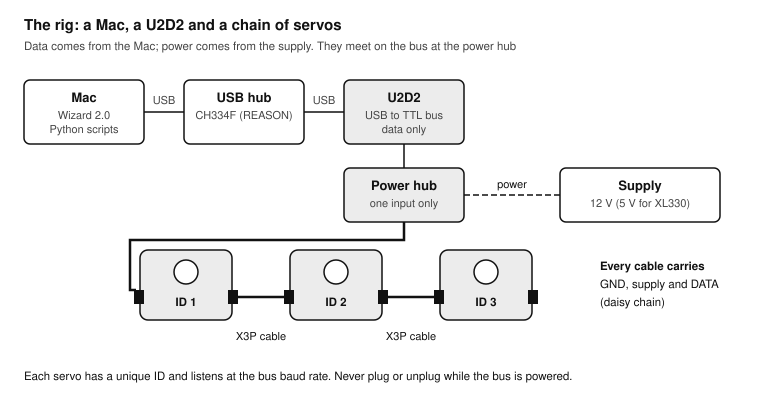
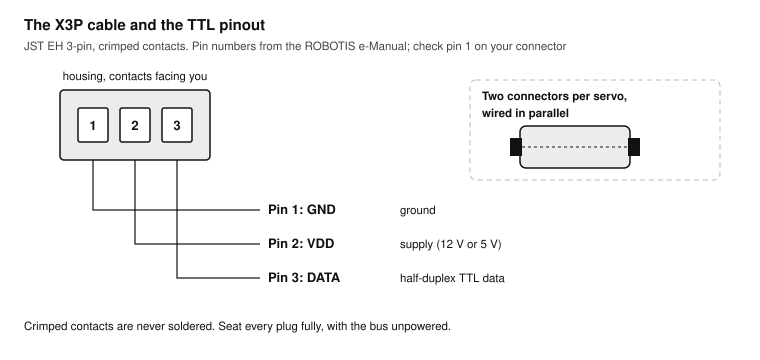
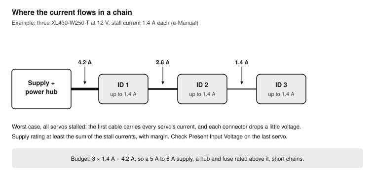
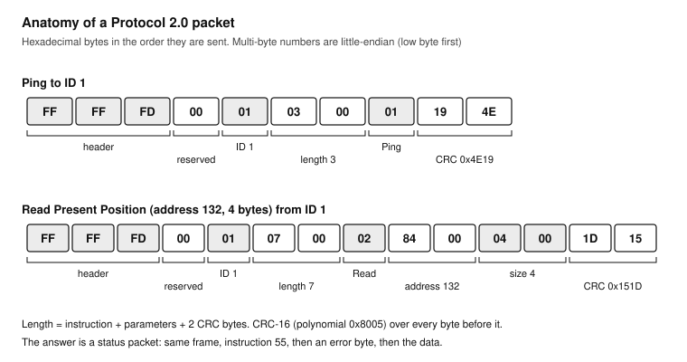
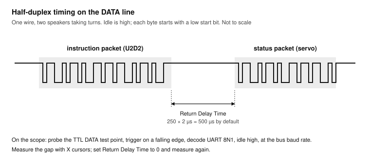
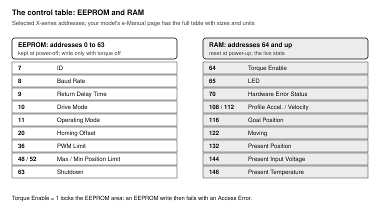
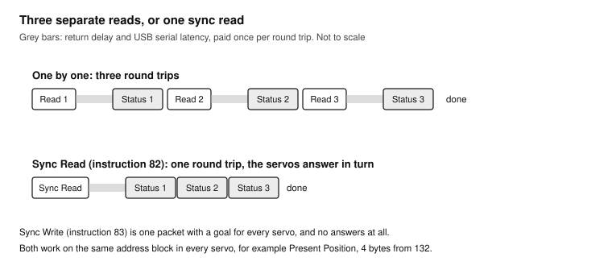
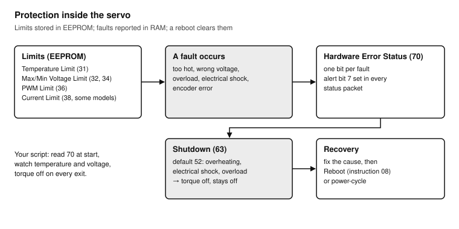
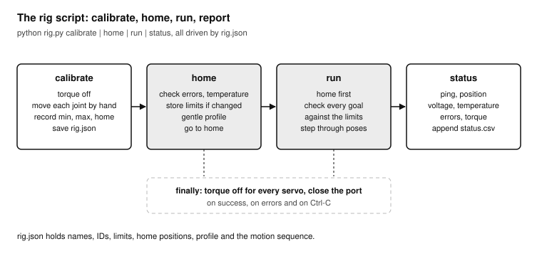

# DYNAMIXEL Hands-On: Smart Servos from the Mac

*A practical course on ROBOTIS DYNAMIXEL X-series servos on a TTL bus, driven from a Mac through a U2D2: wiring and power, DYNAMIXEL Wizard 2.0, Protocol 2.0 by hand, the control table, Python with the DYNAMIXEL SDK, and a calibrated multi-servo tower rig. Last updated 2026-11-07.*

**Shopping list:** see [Everything you need for all lessons](#everything-you-need-for-all-lessons).

**Printable version:** print [`dynamixel-course.pdf`](dynamixel-course.pdf). It has the whole course, high-contrast drawings, cut-out reference cards and a practice log. You can also read [`dynamixel-course.html`](dynamixel-course.html) in a browser. The drawings live in [`diagrams/`](diagrams/) as SVG, with high-contrast print versions in [`diagrams/print/`](diagrams/print/); their sources are in [`diagrams/src/`](diagrams/src/). From the repository root, `node tools/render-diagrams.mjs dynamixel` rebuilds the drawings and then `node tools/build-course.mjs dynamixel` rebuilds both the HTML and the PDF.

## How to use this course

Nine sessions, about 19 hours in total, take you from a box of servos to a rig that calibrates itself, homes, runs a motion sequence and writes a status report. It is written for the servos of a REASON tower: DYNAMIXEL X-series servos with TTL connectors, daisy-chained on X3P cables, powered from a 12 V supply and controlled from a Mac. It works for any X-series TTL servo; where models differ, the text says what to look up.

Every lesson has a goal, the parts you need, numbered exercises and a pass criterion. Do not move on until you pass. Smart servos are strong, quick and expensive: most of the habits taught here exist to stop a wrong number from breaking a bracket, a gearbox or a finger.

**Code.** Every script is complete. They run in one Python virtual environment on the Mac with the official `dynamixel-sdk` package. Type them into the folder `~/dxl` and run them from Terminal.

**Printing.** Everything is line art and text, so it prints cleanly in black and white. The reference cards at the end are meant to lie next to the rig.

| Lesson | Skill | Bench time | Pass criterion |
| --- | --- | --- | --- |
| 0 | Meet the servos, the bus hardware and your model's limits | 1.5 h | Your "check yours" table is filled in from the e-Manual and the label |
| 1 | First contact with DYNAMIXEL Wizard 2.0 | 2 h | Every servo has a unique ID and answers a scan at one baud rate |
| 2 | Power and the bus | 2 h | A power budget on paper, and a measured supply current while moving and stalled |
| 3 | Protocol 2.0 by hand | 2.5 h | A ping and a read built byte by byte in Python, and the same packets decoded on the scope |
| 4 | The control table | 2 h | Limits, operating mode, profile and direction set and verified on one servo |
| 5 | Python with the DYNAMIXEL SDK | 2 h | A script that moves a servo safely and always switches torque off on exit |
| 6 | Many servos at once | 2 h | Sync write and sync read on all servos, with a measured loop rate |
| 7 | Faults and safety | 2 h | A provoked overload detected, reported and cleared by a reboot |
| 8 | Capstone: a calibrated tower rig | 3 h | Calibrate, home, run and report work from one script and one calibration file |

Work in sessions of 60 to 120 minutes. Keep the rig clamped to the bench and your hand off the power switch only when the servos are where you expect them.

### Related courses

- [Hands-On Soldering](../soldering/README.md): the REASON practice track explains which servo leads are crimped and never soldered ([Where each REASON joint is practised](../soldering/README.md#where-each-reason-joint-is-practised)), and the 12 V harness this rig is powered from ([Exercise 6.3](../soldering/README.md#exercise-63-the-12-v-harness-w7-w21)).
- [Oscilloscope Hands-On](../sds804x-hd/README.md): Lesson 3 decodes the servo bus with the UART decoder from [Exercise 8.1](../sds804x-hd/README.md#exercise-81-uart), and Lesson 2 measures the supply current with the two-probe method from [Lesson 6](../sds804x-hd/README.md#lesson-6-power-and-current).
- [ESP32 Hands-On](../esp32/README.md) and [Teensy 4.1 Hands-On](../teensy41/README.md): serial ports, levels and supplies from the microcontroller side. A Teensy can drive a DYNAMIXEL bus too (see Going further in Lesson 8).
- [XIAO Interlock](../xiao-interlock/README.md): the firing interlock and controller that share the tower with these servos.
- [Power and USB](../power-usb/README.md): the 12 V distribution, bucks and USB hubs that feed the rig and the U2D2.

## Smart servos in one page

A hobby servo takes a pulse width and turns to an angle; it reports nothing back. A **smart servo** is a small networked computer with a motor: a DC motor, a gearbox, an absolute position sensor on the output, a microcontroller and a serial port, in one case. You send it messages; it answers with its position, speed, load, temperature and supply voltage, and it refuses commands that break the limits you stored in it.



Data comes from the Mac through the U2D2, power from the supply through the power hub; every X3P cable carries both.

The pieces of a REASON-style rig:

- **The Mac** runs DYNAMIXEL Wizard 2.0 for setup and Python scripts for control.
- **A USB hub** (in REASON, a CH334F hub inside the tower) connects the Mac to the interface.
- **The U2D2** is ROBOTIS's USB-to-DYNAMIXEL interface: a USB serial chip and a driver for the TTL bus (and RS-485 for other models). It carries data only; it does not power the servos.
- **A power board** puts the supply voltage on the bus. The **U2D2 Power Hub Board** plugs onto the U2D2 and takes power from a DC jack, a terminal block or a battery connector; use **only one power input at a time**.
- **The servos** are daisy-chained: each has two identical connectors, and every cable carries ground, supply and data.

Each servo on the bus has an **ID** (0 to 252) and listens at a **baud rate**. Messages follow **Protocol 2.0**: an instruction packet from the Mac, and a status packet back from the addressed servo. Inside each servo, everything it knows and everything you can set lives in its **control table**: a numbered list of values, some stored permanently (EEPROM), some lost at power-off (RAM).

### Check yours: the X-series models differ

The X series shares one protocol and one control-table layout, but voltage, current and features differ. **Fill in this table for your servos before you connect power.** The model name is printed on the label (the suffix `-T` means TTL, `-R` means RS-485; this course is for `-T`).

| Property | XL330 family | XL430-W250-T | XC430 family | XM430 family | Yours |
| --- | --- | --- | --- | --- | --- |
| Supply voltage | 3.7 to 6.0 V, 5.0 V recommended | 12 V class, 11.1 V recommended | 12 V class | 12 V class | |
| Stall current (e-Manual) | 1.47 A at 5.0 V (XL330-M288) | 1.4 A at 12.0 V | 1.4 A at 12 V (XC430-W240) | 2.3 A at 12.0 V (XM430-W350) | |
| Current sensing | yes (Present Current) | no (Present Load, estimated) | check | yes | |
| Operating modes | current, velocity, position, extended, current-based position, PWM | velocity, position, extended, PWM | check | all six | |
| Connector | JST EH 3-pin (X3P) | JST EH 3-pin (X3P) | JST EH 3-pin (X3P) | JST EH 3-pin (X3P) | |

> **Danger:** An XL330 on a 12 V bus is destroyed at once. If your chain mixes 5 V and 12 V models, they need separate buses with separate supplies. Check every label against the supply before the first power-up.

Your model's page on the ROBOTIS e-Manual (emanual.robotis.com, DYNAMIXEL, X series) is the reference for everything in this course: the specifications table, the control table with each address, size, default and unit, and the operating-mode list. Keep it open.

## Safety and good habits

- **Match the supply to the label.** 12 V on a 5 V servo kills it; 5 V on a 12 V servo makes it weak and brown out. Measure the supply with the meter before connecting the bus.
- **Never plug or unplug a servo while the bus is powered.** Hot-plugging can put the supply on the data pin for an instant and damage the servo's interface. Power off, change the chain, power on.
- **Clamp the rig.** A servo that turns to the wrong position at full speed will throw anything not fixed down. Clamp the base, and keep your hands out of the swept range while torque is on.
- **Torque off is the safe state.** Every script in this course switches torque off when it ends, also on errors and on Ctrl-C.
- **Set limits before motion.** Position limits, PWM limit and (where available) current limit live in the servo and protect the mechanism even when your code is wrong.
- **One power input.** On the U2D2 Power Hub Board, connect only one of its power inputs.
- **Crimped leads stay crimped.** The X3P cables use crimped JST EH contacts. Never solder a crimp contact: solder wicks into the strands and the wire snaps where it flexes.
- **The scope ground is mains earth.** When you probe the bus in Lessons 2 and 3, the ground clip goes to the bus GND and nowhere else (see [Safety and good habits](../sds804x-hd/README.md#safety-and-good-habits) in the oscilloscope course).

## Everything you need for all lessons

### Hardware

- [ ] Your DYNAMIXEL X-series TTL servos (`-T` models), at least two (0)
- [ ] ROBOTIS U2D2 with a USB cable that carries data (0)
- [ ] U2D2 Power Hub Board, or another way to put power on the bus (0)
- [ ] Power supply matched to the servos: 12 V at 1.5 × (number of servos × stall current), or 5 V for XL330 models; with a current limit if you have a bench supply (2)
- [ ] X3P cables (JST EH 3-pin), as shipped with the servos (0)
- [ ] A clamp or a heavy base for the rig, and the brackets and horns your build uses (1)
- [ ] A piece of firm foam or rubber as a soft end stop (2, 7)

### Tools and instruments

- [ ] Multimeter with DC volts and continuity (0)
- [ ] Oscilloscope (the SDS804X HD of the [oscilloscope course](../sds804x-hd/README.md)), optional but used in Lessons 2 and 3
- [ ] A 0.1 Ω, 1 % shunt resistor rated 2 W or more, with two short test leads, for the current measurement (2)
- [ ] Small hex and Phillips drivers for horns and brackets (0)

### Software (free)

- [ ] DYNAMIXEL Wizard 2.0 for macOS (1)
- [ ] Python 3.10 or newer, and the `dynamixel-sdk` package in a virtual environment (3)
- [ ] A text editor for the scripts (3)

## Lesson 0: Meet the servos

**Goal:** know your servo model, its limits, the connector and the bus hardware, before any power is applied. **Time:** 1.5 hours. **Pass:** the "check yours" table is complete for your servos, and you can point to GND, VDD and DATA on a connector.

### Exercise 0.1: Identify your servos

1. Read the label on each servo: model (for example XL430-W250-T), serial number and the barcode. Write the models in the practice log.
2. Open each model's e-Manual page. From its specifications table, copy into the "check yours" table: input voltage range and recommended voltage, stall torque and stall current at your supply voltage, and the operating modes.
3. Open the control table on the same page. Find these items and note their address, size and default: ID, Baud Rate, Operating Mode, Torque Enable, Goal Position, Present Position, Hardware Error Status. They should match Card C at the end of this course; if your model differs, use the e-Manual values everywhere.
4. Note whether your model has **Current Limit** and **Present Current** (current sensing) or only **Present Load**. Lessons 2 and 7 use this.

**Test:** the table is filled in; you can say, without looking, which supply voltage your servos need.

### The connector and the cable



Pin 1 GND, pin 2 VDD, pin 3 DATA, the same on both connectors of every servo.

The TTL X-series servos use a 3-pin JST EH connector. Pin 1 is GND, pin 2 is VDD (the supply), pin 3 is DATA. The two connectors on a servo are wired in parallel, which is what makes daisy-chaining work: the cable from the hub feeds the first servo, its second connector feeds the next, and so on.

Data uses one wire for both directions: **half-duplex**. The Mac talks, then stops and listens; the addressed servo answers. Only one device may drive the line at a time, which is why every message is a question followed by an answer.

### Exercise 0.2: Check the cables and the hub

1. With nothing powered, take one X3P cable. Put the meter on continuity and check that pin 1, 2 and 3 at one end connect to pin 1, 2 and 3 at the other, and that no two pins are connected.
2. Look at the U2D2 Power Hub Board. Find its power inputs (DC jack, terminal block, battery connector), its TTL and RS-485 bus connectors, and the TTL data test points. Note which input you will use; the others stay empty.
3. Fit the Power Hub Board to the U2D2 as the e-Manual shows.
4. Measure your supply with the meter: unloaded voltage and polarity at the plug or terminals. It must be inside your servos' range.

**Test:** every cable passes; the supply is in range; you know which single input you will use.

### Exercise 0.3: Mount the first servo

1. Fix one servo to a bracket on the clamped base, horn free to turn. Nothing may be within reach of the horn's sweep.
2. Turn the horn by hand, gently, through its range. Feel for the end stops of your mechanism, if any. With torque off, the servo turns freely (with some gearbox resistance).
3. Mark the horn and the case with a pen line where they align: this mark helps you see "position 2048" later.

**Test:** the servo is fixed, its horn turns freely by hand, and nothing can hit it.

## Lesson 1: First contact with DYNAMIXEL Wizard 2.0

**Goal:** find, identify and configure each servo with ROBOTIS's setup tool. **Time:** 2 hours. **Pass:** every servo has a unique ID, all answer a scan at one baud rate, and you have moved one servo from the Wizard.

### Exercise 1.1: Install the Wizard and find the port

1. Install DYNAMIXEL Wizard 2.0 from ROBOTIS (the e-Manual links the installers; there is also a Mac App Store version, which lists macOS 13 or later). The e-Manual has noted that some builds support x86 only; on an Apple Silicon Mac, use the App Store version or check the current notes.
2. Plug the U2D2 into the Mac (directly, or through your hub). In Terminal:

```sh find_port.sh
ls /dev/cu.*
```

3. The U2D2 appears as `/dev/cu.usbserial-` followed by a serial number. Unplug it and list again: the entry that disappears is the U2D2. Write the name in your log.

**Test:** you know the U2D2's port name. If no `usbserial` entry appears, try another cable: many USB cables carry power only.

### Exercise 1.2: Scan one servo

New servos usually leave the factory with ID 1 at 57,600 baud. Two servos with the same ID on one bus answer at the same time and garble each other, so the first rule is **one new servo on the bus at a time**.

1. With the power off, connect **one** servo to the Power Hub Board's TTL connector. Connect the supply to your chosen power input. Switch on.
2. Open the Wizard. In its scan options, choose Protocol 2.0, your U2D2 port, baud rates 57,600 and 1,000,000, and IDs 0 to 252. Start the scan.
3. The servo appears with its ID and model. Click it: the control table opens.
4. Find Model Number, Firmware Version, ID, Baud Rate, Operating Mode, Present Position, Present Input Voltage and Present Temperature. Compare the voltage with your meter.

**Test:** the servo is found; its Present Input Voltage agrees with your meter within about 0.3 V.

### Exercise 1.3: LED, torque and a first move

1. In the control table, set **LED** (address 65) to 1: the LED on the servo lights. Set it back to 0.
2. Turn the horn by hand and watch **Present Position** (address 132) change. Find the value when your pen marks align; it should be near 2048, the middle of one turn (4096 counts per turn, about 0.088° per count).
3. Set **Torque Enable** (address 64) to 1. The horn now holds its position; you cannot turn it by hand.
4. Set **Goal Position** (address 116) to the present value plus 200. The horn turns about 18°. Set it back.
5. Set Torque Enable to 0. The horn is free again.

> **Warning:** Change Goal Position in small steps the first time, and keep clear of the horn. A large step makes the servo move at full speed.

**Test:** you can switch the LED, hold position with torque, and move by a small step.

### Exercise 1.4: Give every servo a unique ID

The **ID** (address 7) and **Baud Rate** (address 8) live in EEPROM. EEPROM values can only be written while **Torque Enable is 0**: the servo refuses otherwise. This lock is deliberate: you cannot change a servo's identity while it is holding a load.

1. With one servo on the bus and torque off, set its **ID** to the number in your plan (for example 1 for the pan servo, 2 for the tilt servo; write the plan in your log). The Wizard re-scans or shows it under the new ID.
2. Write the ID on a piece of tape on the servo case.
3. Switch off, connect the next new servo **instead of** the first, switch on, scan, set its ID. Repeat for all servos.
4. Switch off, chain all servos, switch on, and scan once more.

**Test:** the scan finds every servo, each with the ID on its tape, and no duplicate.

### Exercise 1.5: Choose the baud rate

57,600 baud is safe and slow. For several servos updated many times a second, 1,000,000 baud is the usual choice. All servos on a bus must use the same baud rate.

| Baud Rate value (address 8) | Speed |
| --- | --- |
| 0 | 9,600 bps |
| 1 | 57,600 bps (factory default) |
| 2 | 115,200 bps |
| 3 | 1 Mbps |
| 4 and up | 2 Mbps and faster, model-dependent: check the e-Manual |

1. With torque off, set Baud Rate to 3 (1 Mbps) on each servo, one at a time. After each change the servo answers only at the new rate; the Wizard finds it there on the next scan.
2. Scan at 1,000,000 baud only.

**Test:** all servos answer at 1 Mbps. Write the bus settings in your log: protocol 2.0, 1 Mbps, IDs.

> **Tip:** If you lose a servo (wrong ID or baud rate written by mistake), scan all baud rates and all IDs with only that servo connected. A servo that does not answer at any rate, or whose firmware update failed, can usually be brought back with the Wizard's **Firmware Recovery**: one servo on the bus, choose the exact model, and power-cycle the servo when the Wizard asks.

## Lesson 2: Power and the bus

**Goal:** size the supply, chain the servos safely, and measure what they really draw. **Time:** 2 hours. **Pass:** a written power budget, and a measured supply current while moving and while stalled against a soft stop.

### The power budget



All servos draw their current through the bus. A servo at rest draws tens of milliamps; a servo accelerating or pushing against something draws up to its **stall current**, about 1.4 A for an XL430 at 12 V. Several servos can stall at once: when a tower is blocked, or at power-up when they all move to their goals.

- **Supply rating:** at least the sum of the stall currents of all servos that can be loaded at once, with margin. For three XL430s at 12 V: 3 × 1.4 A = 4.2 A, so a 5 A or 6 A supply.
- **Cables and connectors:** the first cable in the chain carries the current of every servo after it. Keep chains short, and power each chain from the hub, not through a long string of cables.
- **Voltage drop:** every cable and connector drops a little voltage at high current. Present Input Voltage tells you what each servo actually receives; check the last servo of a chain while all are moving.

### Exercise 2.1: Write the power budget

1. List every servo with its model and its stall current at your supply voltage.
2. Add the stall currents. Compare with your supply's rating. If the supply is smaller, decide: a bigger supply, or software limits (PWM Limit, Current Limit) so they cannot all stall at full force.
3. Check the hub's limit in its e-Manual (the U2D2 Power Hub Board lists its maximum current) and your fuse in the 12 V harness.

**Test:** the budget is in your log, and the supply, hub and fuse all exceed it.

### Exercise 2.2: Present Input Voltage under load

1. Chain all servos, torque on, all at their middle positions.
2. In the Wizard, watch **Present Input Voltage** (address 144, in units of 0.1 V) on the last servo of the chain.
3. Move one servo back and forth with large Goal Position steps (keep clear). Watch the last servo's voltage dip.

**Test:** the lowest voltage stays well inside the servo's range. If it dips by more than about 1 V, shorten the chain, use thicker supply wires, or feed the chain from both ends of the hub.

### Exercise 2.3: Measure the supply current on the scope

This uses the two-probe, high-side method of the oscilloscope course: a 0.1 Ω shunt in the supply's plus line, a probe on each end, and the scope subtracts. Ground stays ground for every probe.

1. Power off. Insert the 0.1 Ω shunt in the plus wire between the supply and the Power Hub Board's power input. Solder or clamp two short test leads to its ends: SUPPLY-side and HUB-side.
2. CH1 on the SUPPLY side, CH2 on the HUB side, both ground clips on the bus GND (the supply's minus at the hub). Both channels at 1 V/div with an offset of −12 V (or −5 V for a 5 V bus), as in [Exercise 6.2](../sds804x-hd/README.md#exercise-62-wi-fi-bursts) of the oscilloscope course.
3. **Math** F1 = C1 − C2. With 0.1 Ω, 1 mV on F1 is 10 mA. With the servos idle, note F1: that is your zero.
4. Torque on, one servo. Trigger on F1 rising above about 50 mV, **Normal** mode, 100 ms/div. Command a large step in the Wizard.
5. Measure the peak and the average current of the move.
6. Fix the soft stop (firm foam or rubber) so the horn meets it within its range. With your hand clear, command a Goal Position a little past the stop. The servo pushes against the foam: the current rises towards the stall current. After two or three seconds, set Torque Enable to 0.

> **Warning:** Stall for seconds, not minutes. A stalled servo heats quickly, and the overload protection (Lesson 7) switches torque off when it decides the load is too much. Use foam, never your hand, as the stop.

**Test:** your log has the idle current, the peak during a move and the stall current, next to the e-Manual's stall current.

## Lesson 3: Protocol 2.0 by hand

**Goal:** understand every byte that crosses the bus by building packets yourself, and see them on the oscilloscope. **Time:** 2.5 hours. **Pass:** a ping and a read built byte by byte in Python, answered correctly; the same packets decoded on the scope with the return delay measured.

### Exercise 3.1: A Python environment for the course

1. Check that Python 3.10 or newer is installed: `python3 --version` in Terminal. If not, install it from python.org or with Homebrew.
2. Make the course folder and a virtual environment, and install the SDK (it brings `pyserial` with it):

```sh setup.sh
mkdir -p ~/dxl && cd ~/dxl
python3 -m venv .venv
source .venv/bin/activate
pip install dynamixel-sdk
python -c "import dynamixel_sdk, serial; print('ok')"
```

3. Every time you open a new Terminal for this course: `cd ~/dxl && source .venv/bin/activate`.

**Test:** the last command prints `ok`.

> **Note:** Quit the DYNAMIXEL Wizard (or disconnect it) before running a script. Only one program can open the U2D2's port at a time.

### The instruction packet



Two instruction packets for ID 1, byte by byte, with their CRCs.

Every Protocol 2.0 packet has the same frame:

| Field | Bytes | Value |
| --- | --- | --- |
| Header | 3 | `FF FF FD` |
| Reserved | 1 | `00` |
| Packet ID | 1 | the servo's ID (0 to 252), or `FE` for broadcast |
| Length | 2 | number of bytes after the length field: instruction + parameters + 2 CRC bytes; low byte first |
| Instruction | 1 | what to do: `01` Ping, `02` Read, `03` Write, `08` Reboot, `82` Sync Read, `83` Sync Write, `55` in a status packet |
| Parameters | 0 or more | for Read: address (2 bytes) and length (2 bytes); for Write: address (2 bytes) and data |
| CRC | 2 | CRC-16 over every byte from the header to the last parameter; low byte first |

All multi-byte numbers are **little-endian**: low byte first. Address 132 (`0x0084`) is sent as `84 00`.

A ping to ID 1 is `FF FF FD 00 01 03 00 01 19 4E`: header, reserved, ID 1, length 3 (instruction plus two CRC bytes), instruction Ping, CRC `0x4E19`.

**Byte stuffing.** If the bytes `FF FF FD` happen to appear inside the instruction and parameters, the sender adds an extra `FD` after them, so a receiver never mistakes data for a new header. The SDK does this for you; it rarely matters for the small packets in this lesson.

### The status packet

The addressed servo answers with a **status packet**: the same frame with instruction `55`, then an **error** byte, then any data. To the ping above, a servo answers with its model number (2 bytes) and firmware version (1 byte).

The error byte has two parts. Bit 7 is the **alert** flag: the servo has a hardware error (Lesson 7) and you should read its Hardware Error Status. Bits 0 to 6 hold an error number for this packet:

| Error number | Meaning |
| --- | --- |
| 0 | none |
| 1 | Result Fail: the instruction could not be processed |
| 2 | Instruction Error: unknown instruction, or Action without Reg Write |
| 3 | CRC Error: the packet was damaged |
| 4 | Data Range Error: the value is outside the allowed range |
| 5 | Data Length Error: too short for the address |
| 6 | Data Limit Error: the value is outside a limit stored in the servo |
| 7 | Access Error: read-only address, EEPROM write with torque on, or a non-existent address |

### Exercise 3.2: A ping, byte by byte

This script builds the packet, computes the CRC, sends it, and parses the answer. It uses `pyserial` directly, without the SDK.

```python raw_ping.py
# Build a Protocol 2.0 ping by hand, send it, and parse the status packet.
# Usage: python raw_ping.py /dev/cu.usbserial-XXXX 1000000 1
import sys
import time
import serial

def crc16(data):
    """CRC-16 used by DYNAMIXEL Protocol 2.0 (polynomial 0x8005, initial value 0)."""
    crc = 0
    for byte in data:
        crc ^= byte << 8
        for _ in range(8):
            crc = ((crc << 1) ^ 0x8005) & 0xFFFF if crc & 0x8000 else (crc << 1) & 0xFFFF
    return crc

def packet(dxl_id, instruction, params=b""):
    length = len(params) + 3                       # instruction + params + CRC
    body = bytes([0xFF, 0xFF, 0xFD, 0x00, dxl_id, length & 0xFF, length >> 8, instruction]) + params
    crc = crc16(body)
    return body + bytes([crc & 0xFF, crc >> 8])

def read_status(port, timeout=0.2):
    """Return (id, error, params) of the first valid status packet, or None."""
    buf = b""
    end = time.monotonic() + timeout
    while time.monotonic() < end:
        buf += port.read(port.in_waiting or 1)
        start = buf.find(b"\xFF\xFF\xFD\x00")
        if start < 0 or len(buf) < start + 7:
            continue
        length = buf[start + 5] | buf[start + 6] << 8
        frame = buf[start:start + 7 + length]
        if len(frame) < 7 + length:
            continue
        if frame[7] != 0x55:                       # an echo of our own instruction: skip it
            buf = buf[start + 7 + length:]
            continue
        crc = crc16(frame[:-2])
        if frame[-2] != crc & 0xFF or frame[-1] != crc >> 8:
            raise ValueError("bad CRC in status packet: " + frame.hex(" "))
        return frame[4], frame[8], frame[9:-2]
    return None

port_name, baud, dxl_id = sys.argv[1], int(sys.argv[2]), int(sys.argv[3])
with serial.Serial(port_name, baud, timeout=0.01) as port:
    ping = packet(dxl_id, 0x01)
    print("sent    ", ping.hex(" ").upper())
    port.reset_input_buffer()
    port.write(ping)
    status = read_status(port)
    if status is None:
        sys.exit("no answer: check ID, baud rate, power and the cable")
    sid, error, params = status
    model = params[0] | params[1] << 8
    print(f"answer from ID {sid}: error 0x{error:02X}, model number {model}, firmware {params[2]}")
```

1. Type the script into `~/dxl/raw_ping.py`. Run it with your port, baud rate and the ID of one servo.
2. Check the printed packet against the anatomy above, byte by byte. For ID 1 it must be `FF FF FD 00 01 03 00 01 19 4E`.
3. Compare the model number with the e-Manual (each model page lists its model number) and the firmware with the Wizard.
4. Try an ID that does not exist: no answer.

**Test:** the ping is answered, the error byte is `0x00`, and the model number matches your servo.

### Exercise 3.3: Read and write by hand

Add these lines to the end of `raw_ping.py` (or a copy called `raw_rw.py`):

```python raw_rw_addition.py
    # Read Present Position: address 132 (84 00), length 4 (04 00)
    port.write(packet(dxl_id, 0x02, bytes([0x84, 0x00, 0x04, 0x00])))
    sid, error, params = read_status(port)
    position = int.from_bytes(params[:4], "little", signed=True)
    print(f"Present Position: {position} (about {position * 360 / 4096:.1f} degrees)")

    # Write LED (address 65 = 41 00) to 1, then read it back
    port.write(packet(dxl_id, 0x03, bytes([0x41, 0x00, 0x01])))
    print("write LED, error", read_status(port)[1])
    time.sleep(1)
    port.write(packet(dxl_id, 0x03, bytes([0x41, 0x00, 0x00])))
    print("LED off, error", read_status(port)[1])

    # Try to write the ID (EEPROM) with torque on: expect an Access Error (7)
    port.write(packet(dxl_id, 0x03, bytes([0x40, 0x00, 0x01])))   # Torque Enable = 1
    read_status(port)
    port.write(packet(dxl_id, 0x03, bytes([0x07, 0x00, dxl_id])))  # ID = same ID
    print("EEPROM write with torque on, error", read_status(port)[1])
    port.write(packet(dxl_id, 0x03, bytes([0x40, 0x00, 0x00])))   # Torque Enable = 0
    read_status(port)
```

1. Run it. The position reads in counts; turn the horn and run again.
2. The LED lights for a second.
3. The EEPROM write with torque on returns error 7 (Access Error), and the ID does not change.

**Test:** you can explain every byte of the Read packet `FF FF FD 00 01 07 00 02 84 00 04 00 1D 15` (for ID 1).

### Exercise 3.4: The Wizard's packet tool

1. Quit the script. Open the Wizard and its packet tool (Tools menu). Choose Protocol 2.0, instruction Ping, ID 1, and send.
2. Compare the instruction and status bytes it shows with your script's.
3. Send a Read of address 146 (Present Temperature), length 1. The answer's data byte is the temperature in °C.

### The return delay and half-duplex timing



The servo waits for its Return Delay Time before it answers on the shared wire.

After the last byte of an instruction, the servo waits for its **Return Delay Time** before answering, so the sender has time to release the line. Return Delay Time (address 9, EEPROM) is in units of 2 µs; the default 250 means 500 µs. With one master that switches direction quickly, as the U2D2 does, it can be set much lower, which speeds up every read.

### Exercise 3.5: Decode the bus on the scope

1. Power on, one servo connected, scripts closed. Probe the TTL DATA test point on the Power Hub Board with CH1 (10×), ground clip on the bus GND.
2. Set CH1 to 2 V/div. Trigger on CH1, falling edge (a start bit), **Normal**, 200 µs/div.
3. Run `raw_ping.py` in a loop from Terminal: `while true; do python raw_ping.py /dev/cu.usbserial-XXXX 1000000 1; done`.
4. Measure the high level of the DATA line with the automatic measurement Top, and write it down: this is the bus's logic level.
5. Set up the UART decoder as in [Exercise 8.1](../sds804x-hd/README.md#exercise-81-uart) of the oscilloscope course: source C1, baud rate 1,000,000 (or your bus rate), 8 data bits, no parity, 1 stop bit, idle high, threshold half the high level.
6. The decoder shows two groups of bytes: the instruction `FF FF FD 00 01 03 00 01 19 4E` and, after a gap, the status packet. Use the list view to read them.
7. Measure the gap from the end of the instruction's last stop bit to the start of the status packet with X cursors. It is about the Return Delay Time (500 µs by default) plus the servo's own processing time.
8. Quit the loop. In the Wizard, set Return Delay Time to 0 (torque off), quit the Wizard, run the loop again and measure the gap once more.

**Test:** both packets decoded on the scope; your log has the gap at the default and at 0. Keep Return Delay Time at 0 if all your servos work reliably with it; Lesson 6 measures how much faster the bus becomes.

## Lesson 4: The control table

**Goal:** understand what lives in the control table and set a servo up properly for your mechanism. **Time:** 2 hours. **Pass:** one servo with position limits, operating mode, profile, direction and homing offset set, and each verified by a test move.

### EEPROM and RAM



The addresses this course uses; Card C repeats them for the bench.

The control table is split in two:

- **EEPROM area** (addresses 0 to 63): settings that survive power-off: identity (ID, Baud Rate), behaviour (Operating Mode, Drive Mode, Return Delay Time, Homing Offset) and protection (limits, Shutdown). Writable **only with Torque Enable at 0**. EEPROM wears out after very many writes, so write settings when they change, not in a loop.
- **RAM area** (addresses 64 and up): the live state, reset at every power-up: Torque Enable, LED, goals, profiles, gains and all Present values.

Values have units. On X-series servos, a position count is about 0.088° (4096 per turn); a velocity unit is 0.229 rpm; voltage is in 0.1 V; temperature in °C. Current and load units differ between models: look them up on your model's page.

### Exercise 4.1: Position limits

The **Min Position Limit** (address 52) and **Max Position Limit** (address 48) stop the servo from being told to go outside its safe range in position mode. A Goal Position outside them is rejected with a Data Limit Error.


1. Torque off. Turn the horn by hand to the safe end of its range in one direction, staying a few degrees short of any mechanical stop. Read Present Position.
2. Repeat for the other end.
3. Write the two values into Min Position Limit and Max Position Limit (the smaller into Min).
4. Torque on. Write a Goal Position just inside each limit: the servo goes there. Write one just outside: the Wizard reports a limit error and the servo stays put.

**Test:** the servo cannot be commanded past either limit.

### Exercise 4.2: Operating modes

**Operating Mode** (address 11, EEPROM) decides what the servo controls. The default is Position Control (3).

| Value | Mode | Goal you write | Typical use |
| --- | --- | --- | --- |
| 0 | Current control | Goal Current | Force or torque control (current-sensing models only) |
| 1 | Velocity control | Goal Velocity | Wheels, continuous rotation |
| 3 | Position control (default) | Goal Position, one turn | Joints, pan and tilt |
| 4 | Extended position control | Goal Position, many turns | Winches, multi-turn joints |
| 5 | Current-based position control | Goal Position with a current limit | Grippers, safe joints (current-sensing models only) |
| 16 | PWM control | Goal PWM | Direct voltage control |

Check which values your model supports in its e-Manual; writing an unsupported mode fails with a range error.

1. Torque off. Set Operating Mode to 1 (velocity). Torque on. Set Goal Velocity (address 104) to 20: the servo turns slowly and continuously. Set it to 0.
2. Torque off. Set Operating Mode back to 3. Torque on and confirm position control works again.

> **Warning:** Do Step 1 with the servo free to rotate. In velocity mode the position limits do not apply. A servo in a mechanism with end stops must never be in velocity or PWM mode.

**Test:** you switched to velocity mode and back, and you know which modes your model supports.

### Exercise 4.3: Smooth moves with a profile

Without a profile, a servo moves to its goal as fast as it can. **Profile Velocity** (address 112) and **Profile Acceleration** (address 108) shape the move: accelerate, cruise, decelerate. A value of 0 means "no limit".

1. Torque on. Set Profile Velocity to 0 and step Goal Position by 1000: a fast, abrupt move.
2. Set Profile Acceleration to 20 and Profile Velocity to 100, and step back: a smooth trapezoid move.
3. Plot Present Velocity in the Wizard's graph during the move and see the ramp up, cruise and ramp down.

**Test:** you can make a move gentle or quick by changing two numbers, and you have chosen values for your mechanism.

### Exercise 4.4: Direction and homing offset

**Drive Mode** (address 10, EEPROM) bit 0 reverses the direction: useful when a servo is mounted mirrored. **Homing Offset** (address 20, EEPROM) shifts the position reading, so Present Position can read 2048 when the mechanism is at its natural centre.

1. Torque off. Turn the mechanism to its natural centre (the pan facing forward, the tilt level). Read Present Position, for example 2190.
2. Set Homing Offset to 2048 − 2190 = −142. Present Position now reads about 2048 at the centre.
3. Set Drive Mode bit 0 (write 1) and turn the horn by hand: the position now counts the other way. Decide which direction you want for each servo in your rig (for example, positive tilt is "up") and set Drive Mode accordingly.
4. Recheck the position limits from Exercise 4.1: they apply to the new readings, so set them again.

**Test:** at the mechanical centre the servo reads 2048, positive moves go the way you defined, and the limits are correct.

## Lesson 5: Python with the DYNAMIXEL SDK

**Goal:** control servos from Python with the official SDK, with error handling and a safe exit. **Time:** 2 hours. **Pass:** a script that reads, moves and reports, survives a pulled cable with a clear message, and always leaves torque off.

### The SDK in five calls

The `dynamixel_sdk` package does the packet work from Lesson 3 for you:

- `PortHandler(port_name)` opens the serial port; `openPort()`, `setBaudRate(baud)`, `closePort()`.
- `PacketHandler(2.0)` builds and parses Protocol 2.0 packets.
- `ping(port, id)` returns `(model_number, comm_result, error)`.
- `read1ByteTxRx`, `read2ByteTxRx`, `read4ByteTxRx(port, id, address)` return `(value, comm_result, error)`; values come back unsigned.
- `write1ByteTxRx`, `write2ByteTxRx`, `write4ByteTxRx(port, id, address, value)` return `(comm_result, error)`.

`comm_result` is `COMM_SUCCESS` when a valid answer arrived; otherwise it says what went wrong on the wire (timeout, bad CRC). `error` is the status packet's error byte. `getTxRxResult()` and `getRxPacketError()` turn both into text.

### Exercise 5.1: A small library for the course

Every later script imports this file. It names the addresses, opens the bus, and checks every result, so no error passes silently.

```python dxl_bus.py
"""Helpers for the DYNAMIXEL course: X series, Protocol 2.0, dynamixel-sdk.
Addresses are those of the X-series control table; check your model's e-Manual page."""
import glob
import sys
from dynamixel_sdk import PortHandler, PacketHandler, COMM_SUCCESS

# EEPROM (write only with torque off)
ID, BAUD_RATE, RETURN_DELAY, DRIVE_MODE, OPERATING_MODE = 7, 8, 9, 10, 11
HOMING_OFFSET = 20                     # 4 bytes, signed
TEMPERATURE_LIMIT = 31                 # 1 byte, degrees C
MAX_VOLTAGE_LIMIT, MIN_VOLTAGE_LIMIT = 32, 34   # 2 bytes, 0.1 V
PWM_LIMIT = 36                         # 2 bytes
MAX_POSITION_LIMIT, MIN_POSITION_LIMIT = 48, 52  # 4 bytes
SHUTDOWN = 63
# RAM
TORQUE_ENABLE, LED, HARDWARE_ERROR = 64, 65, 70
GOAL_VELOCITY = 104                    # 4 bytes, signed
PROFILE_ACCELERATION, PROFILE_VELOCITY = 108, 112
GOAL_POSITION = 116                    # 4 bytes, signed
MOVING = 122
PRESENT_LOAD = 126                     # 2 bytes, signed; Present Current on current-sensing models
PRESENT_VELOCITY, PRESENT_POSITION = 128, 132   # 4 bytes, signed
PRESENT_VOLTAGE, PRESENT_TEMPERATURE = 144, 146 # 2 bytes (0.1 V), 1 byte (degrees C)

ERROR_BITS = {0: "input voltage", 2: "overheating", 3: "motor encoder", 4: "electrical shock", 5: "overload"}


def signed(value, size):
    """Turn an unsigned value read from the servo into a signed one."""
    bits = 8 * size
    return value - (1 << bits) if value >= 1 << (bits - 1) else value


def find_port():
    ports = sorted(glob.glob("/dev/cu.usbserial-*"))
    if not ports:
        sys.exit("No /dev/cu.usbserial-* found: is the U2D2 plugged in, and is it a data cable?")
    return ports[0]


class Bus:
    def __init__(self, port_name=None, baud=1_000_000):
        self.port = PortHandler(port_name or find_port())
        self.packet = PacketHandler(2.0)
        self.alerts = set()
        if not self.port.openPort():
            sys.exit(f"Cannot open {self.port.getPortName()}: is the Wizard still running?")
        if not self.port.setBaudRate(baud):
            sys.exit(f"Cannot set {baud} baud")

    def close(self):
        self.port.closePort()

    def _check(self, what, dxl_id, result, error):
        if result != COMM_SUCCESS:
            raise IOError(f"ID {dxl_id}, {what}: {self.packet.getTxRxResult(result)}")
        if error & 0x7F:
            raise IOError(f"ID {dxl_id}, {what}: {self.packet.getRxPacketError(error)}")
        if error & 0x80 and dxl_id not in self.alerts:    # hardware error: report once, keep going
            self.alerts.add(dxl_id)
            print(f"ALERT: ID {dxl_id} reports a hardware error; read Hardware Error Status (70)")

    def ping(self, dxl_id):
        model, result, error = self.packet.ping(self.port, dxl_id)
        self._check("ping", dxl_id, result, error)
        return model

    def read(self, dxl_id, address, size, is_signed=False):
        fn = {1: self.packet.read1ByteTxRx, 2: self.packet.read2ByteTxRx, 4: self.packet.read4ByteTxRx}[size]
        value, result, error = fn(self.port, dxl_id, address)
        self._check(f"read {address}", dxl_id, result, error)
        return signed(value, size) if is_signed else value

    def write(self, dxl_id, address, size, value):
        fn = {1: self.packet.write1ByteTxRx, 2: self.packet.write2ByteTxRx, 4: self.packet.write4ByteTxRx}[size]
        value &= (1 << (8 * size)) - 1             # negative numbers as two's complement
        result, error = fn(self.port, dxl_id, address, value)
        self._check(f"write {address}", dxl_id, result, error)

    def torque(self, dxl_id, on):
        self.write(dxl_id, TORQUE_ENABLE, 1, 1 if on else 0)

    def reboot(self, dxl_id):
        result, error = self.packet.reboot(self.port, dxl_id)
        self._check("reboot", dxl_id, result, error)

    def hardware_errors(self, dxl_id):
        status = self.read(dxl_id, HARDWARE_ERROR, 1)
        return [name for bit, name in ERROR_BITS.items() if status & (1 << bit)]
```

1. Type the file into `~/dxl/dxl_bus.py`.
2. In Python (`python` in the activated environment), try: `from dxl_bus import *`, `bus = Bus()`, `bus.ping(1)`, `bus.read(1, PRESENT_POSITION, 4, True)`, `bus.close()`.

**Test:** the ping returns your model number and the position matches the Wizard's.

### Exercise 5.2: Scan the bus

```python scan.py
"""List every servo on the bus at the usual baud rates."""
import sys
from dynamixel_sdk import PortHandler, PacketHandler, COMM_SUCCESS
from dxl_bus import find_port

port = PortHandler(sys.argv[1] if len(sys.argv) > 1 else find_port())
packet = PacketHandler(2.0)
if not port.openPort():
    sys.exit("cannot open the port")
try:
    for baud in (1_000_000, 57_600, 115_200, 2_000_000, 9_600):
        port.setBaudRate(baud)
        found, result = packet.broadcastPing(port)
        if result == COMM_SUCCESS and found:
            for dxl_id, (model, firmware) in sorted(found.items()):
                print(f"{baud:>9} baud  ID {dxl_id:3}  model {model:5}  firmware {firmware}")
finally:
    port.closePort()
```

1. Run `python scan.py`. Every servo appears with its baud rate, ID, model number and firmware.

**Test:** the list matches your ID plan from Lesson 1.

### Exercise 5.3: Move safely

```python move.py
"""Move one servo between two positions with a smooth profile, then release it.
Usage: python move.py ID [POSITION_A POSITION_B]"""
import sys
import time
from dxl_bus import *

dxl_id = int(sys.argv[1])
a = int(sys.argv[2]) if len(sys.argv) > 2 else 1800
b = int(sys.argv[3]) if len(sys.argv) > 3 else 2300

bus = Bus()
try:
    low = bus.read(dxl_id, MIN_POSITION_LIMIT, 4, True)
    high = bus.read(dxl_id, MAX_POSITION_LIMIT, 4, True)
    for goal in (a, b):
        if not low <= goal <= high:
            sys.exit(f"{goal} is outside the limits {low} to {high}")
    bus.write(dxl_id, PROFILE_ACCELERATION, 4, 20)
    bus.write(dxl_id, PROFILE_VELOCITY, 4, 100)
    bus.torque(dxl_id, True)
    for goal in (a, b, a):
        bus.write(dxl_id, GOAL_POSITION, 4, goal)
        time.sleep(0.05)
        while bus.read(dxl_id, MOVING, 1):
            time.sleep(0.02)
        pos = bus.read(dxl_id, PRESENT_POSITION, 4, True)
        volts = bus.read(dxl_id, PRESENT_VOLTAGE, 2) / 10
        temp = bus.read(dxl_id, PRESENT_TEMPERATURE, 1)
        print(f"goal {goal:5}  reached {pos:5}  supply {volts:.1f} V  {temp} C")
except KeyboardInterrupt:
    print("stopped by Ctrl-C")
finally:
    try:
        bus.torque(dxl_id, False)            # always leave the servo released
    finally:
        bus.close()
```

1. Run `python move.py 1`. The servo moves smoothly between the two positions and prints where it arrived.
2. Run it again and press Ctrl-C in the middle of a move. The servo stops being driven and is free.
3. Give a goal outside your limits: the script refuses before anything moves.

**Test:** moves are smooth, positions are reached within a few counts, and torque is off after every exit.

### Exercise 5.4: When the cable comes out

1. Run `python move.py 1` and, during a move, **switch off the servo power** (do not unplug the cable while powered).
2. The next read fails with a timeout message naming the ID and the operation: `[TxRxResult] There is no status packet!`. The `finally` block still tries to release torque and closes the port.
3. Switch on again and rerun: it works without restarting anything.

**Test:** a lost servo produces a clear message, never a silent wrong value.

## Lesson 6: Many servos at once

**Goal:** command and read all servos in one bus transaction, and measure how fast the loop runs. **Time:** 2 hours. **Pass:** sync write and sync read on all servos, with the loop rate measured before and after tuning.

### One packet for many servos



Every round trip pays the return delay and the USB latency once; a sync read pays them once for all servos.

Reading three servos one by one costs three instruction packets, three return delays and three status packets, and on a Mac each round trip also waits for the USB serial driver. **Sync Write** (instruction `83`) sends one packet with a goal for every servo; none of them answers. **Sync Read** (instruction `82`) sends one packet naming several servos; they answer one after another. Both work on the same address block in every servo.

### Exercise 6.1: Measure the slow way

```python loop_rate.py
"""Compare reading Present Position one servo at a time with one Sync Read."""
import sys
import time
from dynamixel_sdk import GroupSyncRead, COMM_SUCCESS
from dxl_bus import *

ids = [int(x) for x in sys.argv[1:]] or [1, 2]
bus = Bus()
try:
    n = 200
    t0 = time.perf_counter()
    for _ in range(n):
        for dxl_id in ids:
            bus.read(dxl_id, PRESENT_POSITION, 4, True)
    single = (time.perf_counter() - t0) / n

    group = GroupSyncRead(bus.port, bus.packet, PRESENT_POSITION, 4)
    for dxl_id in ids:
        group.addParam(dxl_id)
    t0 = time.perf_counter()
    for _ in range(n):
        result = group.txRxPacket()
        if result != COMM_SUCCESS:
            raise IOError(bus.packet.getTxRxResult(result))
        for dxl_id in ids:
            if not group.isAvailable(dxl_id, PRESENT_POSITION, 4):
                raise IOError(f"no data from ID {dxl_id}")
            signed(group.getData(dxl_id, PRESENT_POSITION, 4), 4)
    sync = (time.perf_counter() - t0) / n

    print(f"{len(ids)} servos: one by one {single * 1000:.1f} ms per loop ({1 / single:.0f} Hz), "
          f"sync read {sync * 1000:.1f} ms per loop ({1 / sync:.0f} Hz)")
finally:
    bus.close()
```

1. Run `python loop_rate.py 1 2 3` with your IDs, at the baud rate and Return Delay Time you have now. Write both numbers in the log.
2. If Return Delay Time is still 250 on your servos, set it to 0 on all of them (Wizard, torque off) and measure again.
3. If the bus still runs at 57,600 baud, change all servos to 1 Mbps (Exercise 1.5) and measure again.

**Test:** your log has a table of loop rate against method, baud rate and return delay. On a Mac, expect the USB serial driver's latency to dominate a single round trip: the SDK's macOS port handler assumes a 16 ms latency timer. That is the strongest reason to read all servos in one sync read.

### Exercise 6.2: Sync write and sync read together

```python sweep_all.py
"""Move all servos together with one Sync Write per step, and read them with one Sync Read.
Usage: python sweep_all.py ID [ID ...]"""
import math
import sys
import time
from dynamixel_sdk import GroupSyncWrite, GroupSyncRead, COMM_SUCCESS
from dxl_bus import *

ids = [int(x) for x in sys.argv[1:]] or [1, 2]
bus = Bus()
writer = GroupSyncWrite(bus.port, bus.packet, GOAL_POSITION, 4)
reader = GroupSyncRead(bus.port, bus.packet, PRESENT_POSITION, 4)
try:
    centre, limits = {}, {}
    for dxl_id in ids:
        reader.addParam(dxl_id)
        limits[dxl_id] = (bus.read(dxl_id, MIN_POSITION_LIMIT, 4, True), bus.read(dxl_id, MAX_POSITION_LIMIT, 4, True))
        centre[dxl_id] = bus.read(dxl_id, PRESENT_POSITION, 4, True)
        bus.write(dxl_id, PROFILE_VELOCITY, 4, 0)         # the sweep itself is the profile
        bus.torque(dxl_id, True)
    t0 = time.perf_counter()
    while time.perf_counter() - t0 < 10:
        phase = 2 * math.pi * 0.25 * (time.perf_counter() - t0)    # 0.25 Hz sweep
        writer.clearParam()
        for i, dxl_id in enumerate(ids):
            low, high = limits[dxl_id]
            goal = max(low, min(high, centre[dxl_id] + int(300 * math.sin(phase + i))))
            writer.addParam(dxl_id, list(goal.to_bytes(4, "little", signed=True)))
        if writer.txPacket() != COMM_SUCCESS:
            raise IOError("sync write failed")
        if reader.txRxPacket() == COMM_SUCCESS:
            line = "  ".join(f"{i}:{signed(reader.getData(i, PRESENT_POSITION, 4), 4):5}" for i in ids)
            print(line, end="\r")
        time.sleep(0.02)
except KeyboardInterrupt:
    pass
finally:
    for dxl_id in ids:
        try:
            bus.torque(dxl_id, False)
        except IOError as e:
            print(e)
    bus.close()
    print()
```

1. Run it with all your IDs. The servos sweep ±300 counts around where they started, each a little out of phase, for 10 seconds.
2. Watch the printed positions follow the goals.
3. Change the sleep from 0.02 to 0 and see how smooth the motion gets, and how fast the line updates.

> **Warning:** The sweep starts from wherever the servos are and is clipped to their stored limits. Check the limits of every servo (Exercise 4.1) before running it.

**Test:** all servos move together and are released at the end, also after Ctrl-C.

## Lesson 7: Faults and safety

**Goal:** know how a servo protects itself, how to see why it stopped, and how to recover. **Time:** 2 hours. **Pass:** an overload provoked against a soft stop, detected by your script with its cause, and cleared by a reboot.

### Limits, alarms and shutdown



Limits stop bad commands; faults set Hardware Error Status and, if enabled in Shutdown, switch torque off until a reboot.

Each X-series servo protects itself with values stored in its EEPROM:

- **Temperature Limit** (31), **Max/Min Voltage Limit** (32, 34): the safe operating window.
- **PWM Limit** (36): the most voltage the motor may get, as a share of the supply. Lower it to make a servo weaker everywhere.
- **Current Limit** (38, current-sensing models only): the most current the motor may draw.
- **Shutdown** (63): which faults switch torque off. Each bit is one fault; the default (52, binary `0011 0100`) covers overheating, electrical shock and overload.

When a fault occurs, the servo sets a bit in **Hardware Error Status** (70), sets the alert bit (bit 7) in every status packet it sends, and, if that fault is enabled in Shutdown, switches torque off and refuses to switch it on again. Only a **reboot** (instruction `08`, or power-cycling) clears it.

| Bit | Fault in Hardware Error Status |
| --- | --- |
| 0 | Input voltage outside the voltage limits |
| 2 | Overheating: internal temperature above the limit |
| 3 | Motor encoder error |
| 4 | Electrical shock: electrical fault or insufficient power |
| 5 | Overload: a load beyond the servo's capacity for too long |

> **Note:** These bit meanings and the Shutdown default are those of the X-series e-Manual pages; check your model's Hardware Error Status entry, which also lists any model-specific bits.

### Exercise 7.1: Make a servo weaker

1. Torque off. Note PWM Limit (36). Set it to about a third of its value.
2. Torque on and move the servo: it moves more slowly and you can stop it with light pressure on the horn via a stick (never your fingers in the horn's path).
3. On a current-sensing model, also set Current Limit to about a third, and use Operating Mode 5 (current-based position) for a joint that should give way when blocked.
4. Set PWM Limit back, or keep a reduced value if your mechanism never needs full force.

**Test:** you can limit force by configuration, independent of your code.

### Exercise 7.2: Provoke and detect an overload

```python watch.py
"""Push one servo against a soft stop and watch it protect itself. Usage: python watch.py ID GOAL"""
import sys
import time
from dxl_bus import *

dxl_id, goal = int(sys.argv[1]), int(sys.argv[2])
bus = Bus()
try:
    print("errors before:", bus.hardware_errors(dxl_id) or "none")
    bus.torque(dxl_id, True)
    bus.write(dxl_id, GOAL_POSITION, 4, goal)
    t0 = time.perf_counter()
    while time.perf_counter() - t0 < 20:
        load = bus.read(dxl_id, PRESENT_LOAD, 2, True)
        temp = bus.read(dxl_id, PRESENT_TEMPERATURE, 1)
        on = bus.read(dxl_id, TORQUE_ENABLE, 1)
        errors = bus.hardware_errors(dxl_id)
        print(f"{time.perf_counter() - t0:5.1f} s  load {load:5}  {temp} C  torque {'on' if on else 'OFF'}  {errors or ''}")
        if errors:
            break
        time.sleep(0.25)
finally:
    try:
        bus.torque(dxl_id, False)
    except IOError as e:
        print(e)
    bus.close()
```

1. Fix the soft stop so the horn meets it inside its range. Choose a Goal Position a few hundred counts past the stop (but inside the stored limits).
2. Run `python watch.py 1 GOAL`. The servo pushes against the foam; load rises and stays high.
3. Depending on your model, firmware and the foam, the servo reports **overload** after some seconds and switches torque off, or the 20 seconds run out. Either result is useful: write it down.
4. If it reported an error, try to switch torque on in the Wizard: it refuses.

**Test:** your log has the load and temperature curve and whether and when the overload tripped.

### Exercise 7.3: Recover with a reboot

1. With the servo in its error state, run in Python: `from dxl_bus import *`, `bus = Bus()`, `bus.reboot(1)`, then `import time; time.sleep(0.5)`, `bus.hardware_errors(1)`.
2. The error list is empty, the LED blinks briefly at the reboot, and torque can be switched on again. RAM values (goals, profiles, LED) are back to their defaults; EEPROM settings are kept.

**Test:** the servo is back in service without a power cycle.

### Exercise 7.4: Rules for every rig script

Make these rules part of every script from now on; the capstone follows all of them:

1. Read the stored limits and refuse goals outside them before anything moves.
2. Use a profile for every large move.
3. Read Hardware Error Status at start-up and stop if any servo reports a fault.
4. Watch Present Temperature and Present Input Voltage; stop above a temperature you choose (for example 60 °C) or below the supply's minimum.
5. Switch torque off in a `finally` block, for every servo, on every exit.
6. Never write EEPROM in a loop; compare first and write only what changed.

## Lesson 8: Capstone: a calibrated tower rig

**Goal:** one script that calibrates, homes, runs and reports on all servos of a rig, from one calibration file. **Time:** 3 hours. **Pass:** `calibrate`, `home`, `run` and `status` all work on your rig; the calibration file survives a power cycle; the status report shows every servo healthy.



### The calibration file

The calibration file describes the rig. You write it once by hand (names, IDs) and the `calibrate` command fills in the measured positions.

```json rig.json
{
  "baud": 1000000,
  "profile_velocity": 80,
  "profile_acceleration": 20,
  "max_temperature": 60,
  "servos": [
    {"name": "pan",  "id": 1, "home": 2048, "min": 1024, "max": 3072},
    {"name": "tilt", "id": 2, "home": 2048, "min": 1600, "max": 2500}
  ],
  "sequence": [
    {"pan": 2048, "tilt": 2048},
    {"pan": 1500, "tilt": 2300},
    {"pan": 2600, "tilt": 2300},
    {"pan": 2048, "tilt": 1800},
    {"pan": 2048, "tilt": 2048}
  ]
}
```

### The rig script

```python rig.py
"""A calibrated multi-servo rig. Usage: python rig.py calibrate | home | run | status"""
import csv
import json
import sys
import time
from datetime import datetime
from dxl_bus import *

CONFIG = "rig.json"


def load():
    with open(CONFIG) as f:
        return json.load(f)


def check_health(bus, cfg):
    for s in cfg["servos"]:
        bus.ping(s["id"])
        errors = bus.hardware_errors(s["id"])
        if errors:
            sys.exit(f"{s['name']} (ID {s['id']}) reports {errors}: fix the cause, then reboot it")
        temp = bus.read(s["id"], PRESENT_TEMPERATURE, 1)
        if temp > cfg["max_temperature"]:
            sys.exit(f"{s['name']} is at {temp} C: let it cool")


def write_limits(bus, s):
    """Store the calibrated limits in EEPROM, but only if they changed."""
    for address, value in ((MIN_POSITION_LIMIT, s["min"]), (MAX_POSITION_LIMIT, s["max"])):
        if bus.read(s["id"], address, 4, True) != value:
            bus.torque(s["id"], False)
            bus.write(s["id"], address, 4, value)
            print(f"{s['name']}: limit at {address} set to {value}")


def wait_until_still(bus, ids, timeout=5.0):
    t0 = time.perf_counter()
    time.sleep(0.05)
    while any(bus.read(i, MOVING, 1) for i in ids):
        if time.perf_counter() - t0 > timeout:
            raise IOError("move did not finish: blocked joint?")
        time.sleep(0.02)


def calibrate(bus, cfg):
    for s in cfg["servos"]:
        bus.torque(s["id"], False)
    for s in cfg["servos"]:
        for key, prompt in (("min", "one end of its safe range"), ("max", "the other end"), ("home", "its home position")):
            input(f"Move {s['name']} (ID {s['id']}) by hand to {prompt}, then press Enter ")
            s[key] = bus.read(s["id"], PRESENT_POSITION, 4, True)
            print(f"  {key} = {s[key]}")
        s["min"], s["max"] = sorted((s["min"], s["max"]))
        if not s["min"] < s["home"] < s["max"]:
            sys.exit(f"{s['name']}: home must lie between min and max; calibrate again")
    with open(CONFIG, "w") as f:
        json.dump(cfg, f, indent=2)
    print(f"saved {CONFIG}")


def home(bus, cfg):
    check_health(bus, cfg)
    for s in cfg["servos"]:
        write_limits(bus, s)
        bus.write(s["id"], PROFILE_ACCELERATION, 4, cfg["profile_acceleration"])
        bus.write(s["id"], PROFILE_VELOCITY, 4, cfg["profile_velocity"] // 2)   # home gently
        bus.torque(s["id"], True)
        bus.write(s["id"], GOAL_POSITION, 4, s["home"])
    wait_until_still(bus, [s["id"] for s in cfg["servos"]], timeout=10)
    print("homed")


def run(bus, cfg):
    home(bus, cfg)
    by_name = {s["name"]: s for s in cfg["servos"]}
    for s in cfg["servos"]:
        bus.write(s["id"], PROFILE_VELOCITY, 4, cfg["profile_velocity"])
    for step, pose in enumerate(cfg["sequence"]):
        for name, goal in pose.items():
            s = by_name[name]
            if not s["min"] <= goal <= s["max"]:
                raise ValueError(f"step {step}: {name} {goal} is outside {s['min']} to {s['max']}")
            bus.write(s["id"], GOAL_POSITION, 4, goal)
        wait_until_still(bus, [by_name[n]["id"] for n in pose])
        print(f"step {step} done")
    check_health(bus, cfg)


def status(bus, cfg):
    rows = []
    for s in cfg["servos"]:
        i = s["id"]
        rows.append({
            "time": datetime.now().isoformat(timespec="seconds"),
            "name": s["name"], "id": i, "model": bus.ping(i),
            "position": bus.read(i, PRESENT_POSITION, 4, True),
            "home": s["home"],
            "voltage_V": bus.read(i, PRESENT_VOLTAGE, 2) / 10,
            "temperature_C": bus.read(i, PRESENT_TEMPERATURE, 1),
            "torque": bus.read(i, TORQUE_ENABLE, 1),
            "errors": " ".join(bus.hardware_errors(i)) or "none",
        })
    for r in rows:
        print("  ".join(f"{k}={v}" for k, v in r.items() if k != "time"))
    with open("status.csv", "a", newline="") as f:
        out = csv.DictWriter(f, fieldnames=rows[0].keys())
        if f.tell() == 0:
            out.writeheader()
        out.writerows(rows)
    print("appended to status.csv")


if __name__ == "__main__":
    command = sys.argv[1] if len(sys.argv) > 1 else "status"
    cfg = load()
    bus = Bus(baud=cfg["baud"])
    try:
        {"calibrate": calibrate, "home": home, "run": run, "status": status}[command](bus, cfg)
    except KeyboardInterrupt:
        print("stopped by Ctrl-C")
    finally:
        for s in cfg["servos"]:
            try:
                bus.torque(s["id"], False)
            except IOError as e:
                print(e)
        bus.close()
```

### Exercise 8.1: Build and bring up

1. Assemble the rig: the servos in their brackets, the chain cabled with power off, the base clamped.
2. Write `rig.json` with your servo names and IDs; leave the positions as they are.
3. Run `python rig.py status`. Every servo answers; the CSV gets its first lines.

**Test:** all servos report, with sensible voltage and temperature and no errors.

### Exercise 8.2: Calibrate

1. Run `python rig.py calibrate`. With torque off, move each joint by hand to each requested position and press Enter.
2. Open `rig.json`: the measured positions are in it.
3. Edit the `sequence` so every pose lies inside the calibrated limits.

**Test:** `rig.json` holds your rig's real limits and home positions.

### Exercise 8.3: Home and run

1. Run `python rig.py home`. The rig moves gently to home; the limits are stored in each servo (watch the "limit set" lines appear the first time only).
2. Run `python rig.py run`. The rig goes through the sequence and ends at home, then releases.
3. Power-cycle the servos and run `home` again: no limit lines this time, because the stored limits already match.
4. Put a goal outside the limits into the sequence and run: the script refuses before moving.

**Test:** home and run work, also after a power cycle, and bad goals are refused.

### Exercise 8.4: The status report and a long run

1. Run `run` and `status` alternately ten times (a small shell loop is fine).
2. Open `status.csv` in a spreadsheet: temperatures and voltages over the session.
3. Optional, with the oscilloscope: record the supply current with the shunt of Exercise 2.3 during one `run`, and note the peak and the average in the log.

**Test:** ten clean runs, every status line healthy, and temperatures well under your limit.

### Going further

- **A dedicated controller.** A microcontroller can drive the bus instead of the Mac, for example a Teensy with a half-duplex buffer or a ROBOTIS OpenRB-150, using the `Dynamixel2Arduino` library. The protocol and the control table are the same; the timing improves, because there is no USB serial driver in the loop.
- **Bus Watchdog** (address 98 on X-series servos) stops a servo when the controller goes silent for a set time. Read its e-Manual entry carefully before using it: its units and how to clear it are model-specific.
- **Indirect addresses** let you gather scattered values (position, voltage, temperature) into one block for a single sync read. See the e-Manual's Indirect Address section.

## Troubleshooting

| Symptom | Likely cause | Fix |
| --- | --- | --- |
| No `/dev/cu.usbserial-*` | Charge-only USB cable; U2D2 not plugged in; hub without data | Use a data cable; plug directly into the Mac to test |
| Port cannot be opened | The Wizard or another script has it open | Quit the Wizard and other scripts |
| Scan finds nothing | No power on the bus; wrong baud rate; wrong protocol | Measure the bus voltage; scan all baud rates with Protocol 2.0 |
| Scan finds some servos, not all | Duplicate IDs; a bad cable in the chain | Connect servos one at a time and check IDs; swap cables |
| Values flicker, CRC errors | Duplicate IDs answering together; long or damaged cable; baud rate too high for the wiring | Unique IDs; shorter cables; try a lower baud rate |
| Write fails with Access Error | EEPROM write with torque on; read-only address | Torque off first; check the address |
| Write fails with Data Limit Error | Goal outside the stored limits | Check Min/Max Position Limit, or the velocity/PWM limit |
| Servo ignores Goal Position | Torque off; wrong operating mode; shutdown after a fault | Check Torque Enable, Operating Mode and Hardware Error Status |
| Torque will not switch on | A hardware error has shut it down | Read Hardware Error Status, fix the cause, reboot the servo |
| Servo weak or resets under load | Supply too small; voltage drop in the chain; PWM Limit low | Check Present Input Voltage under load; shorten the chain; check the power budget |
| Servo hot | Holding against a load for long; stalls | Lower holding force, add mechanical support, release torque when idle |
| Loop much slower than expected | One round trip per servo; return delay 500 µs; low baud rate | Sync read; Return Delay Time 0; 1 Mbps |
| Servo lost after a firmware update | Interrupted update | Firmware Recovery in the Wizard, one servo on the bus |

## Reference cards and practice log

### Card A: Before you power the bus

- [ ] Every servo's model checked against the supply voltage
- [ ] Supply polarity and voltage measured with the meter
- [ ] Only one power input connected on the hub
- [ ] Chain complete and connectors fully seated, power still off
- [ ] Rig clamped, nothing in the horns' sweep
- [ ] IDs unique; new servos added one at a time
- [ ] Scope ground clip, if used, on the bus GND only

### Card B: Protocol 2.0

| Item | Value |
| --- | --- |
| Frame | `FF FF FD 00` ID LEN_L LEN_H INST params CRC_L CRC_H |
| Length | instruction + params + 2 |
| CRC | CRC-16, polynomial 0x8005, initial value 0, over header to last param |
| Ping ID 1 | `FF FF FD 00 01 03 00 01 19 4E` |
| Instructions | 01 Ping, 02 Read, 03 Write, 08 Reboot, 82 Sync Read, 83 Sync Write |
| Status packet | instruction 55, then error byte, then data |
| Error byte | bit 7 alert (read address 70); 1 Result, 2 Instruction, 3 CRC, 4 Range, 5 Length, 6 Limit, 7 Access |
| Broadcast ID | FE: only Ping, Sync Read and Bulk Read answer |
| Byte order | little-endian: low byte first |

### Card C: Control table (X series, check your model)

| Address | Name | Size | Area |
| --- | --- | --- | --- |
| 7 | ID | 1 | EEPROM |
| 8 | Baud Rate (1 = 57,600, 3 = 1 M) | 1 | EEPROM |
| 9 | Return Delay Time (× 2 µs) | 1 | EEPROM |
| 10 | Drive Mode (bit 0: reverse) | 1 | EEPROM |
| 11 | Operating Mode (3 = position) | 1 | EEPROM |
| 20 | Homing Offset | 4 | EEPROM |
| 36 | PWM Limit | 2 | EEPROM |
| 48, 52 | Max, Min Position Limit | 4 | EEPROM |
| 63 | Shutdown | 1 | EEPROM |
| 64 | Torque Enable | 1 | RAM |
| 65 | LED | 1 | RAM |
| 70 | Hardware Error Status | 1 | RAM |
| 108, 112 | Profile Acceleration, Velocity | 4 | RAM |
| 116 | Goal Position | 4 | RAM |
| 122 | Moving | 1 | RAM |
| 132 | Present Position (4096 per turn) | 4 | RAM |
| 144 | Present Input Voltage (× 0.1 V) | 2 | RAM |
| 146 | Present Temperature (°C) | 1 | RAM |

### Card D: Python SDK

| Want to | Call |
| --- | --- |
| Open the bus | `port = PortHandler(name)`, `port.openPort()`, `port.setBaudRate(1000000)` |
| Protocol | `packet = PacketHandler(2.0)` |
| Ping | `model, res, err = packet.ping(port, id)` |
| Read | `value, res, err = packet.read4ByteTxRx(port, id, addr)` |
| Write | `res, err = packet.write1ByteTxRx(port, id, addr, value)` |
| Check | `res == COMM_SUCCESS`, `packet.getTxRxResult(res)`, `packet.getRxPacketError(err)` |
| Find all | `found, res = packet.broadcastPing(port)` |
| Sync write | `GroupSyncWrite(port, packet, addr, size)`, `addParam(id, bytes)`, `txPacket()`, `clearParam()` |
| Sync read | `GroupSyncRead(port, packet, addr, size)`, `addParam(id)`, `txRxPacket()`, `isAvailable(...)`, `getData(id, addr, size)` |
| Reboot | `res, err = packet.reboot(port, id)` |
| Close | `port.closePort()` |

### Practice log

| Date | Lesson / exercise | Servos and settings | Measured | Worked first time? | Problem and fix |
| --- | --- | --- | --- | --- | --- |
| &nbsp; | | | | | |

## Sources

- ROBOTIS e-Manual, [DYNAMIXEL Protocol 2.0](https://emanual.robotis.com/docs/en/dxl/protocol2/): packet frame, instructions, status packet, error byte, broadcast ID and byte stuffing. The example packets in this course were checked against its examples with the CRC routine of Exercise 3.2.
- ROBOTIS e-Manual, [XL430-W250-T](https://emanual.robotis.com/docs/en/dxl/x/xl430-w250/), [XL330-M288-T](https://emanual.robotis.com/docs/en/dxl/x/xl330-m288/), [XC430-W150](https://emanual.robotis.com/docs/en/dxl/x/xc430-w150/) and [XM430-W350](https://emanual.robotis.com/docs/en/dxl/x/xm430-w350): specifications, stall currents and control tables.
- ROBOTIS e-Manual, [U2D2 Power Hub Board](https://emanual.robotis.com/docs/en/parts/interface/u2d2_power_hub/): pinout (GND, VDD, DATA), input range and the one-power-input rule.
- ROBOTIS e-Manual, [DYNAMIXEL Wizard 2.0](https://emanual.robotis.com/docs/en/software/dynamixel/dynamixel_wizard2): scanning, control table, packet tool and firmware recovery.
- ROBOTIS e-Manual, [Python GroupSyncRead](https://emanual.robotis.com/docs/en/software/dynamixel/dynamixel_sdk/api_reference/python/python_groupsyncread) and the [Python sync read and write tutorial](https://emanual.robotis.com/docs/en/software/dynamixel/dynamixel_sdk/sync_read_write_tutorial/sync_read_write_tutorial_python/): SDK calls used in Lessons 5 and 6.
- DynamixelSDK source, [macOS port handler](https://docs.ros.org/en/api/dynamixel_sdk/html/port__handler__mac_8cpp_source.html): the 16 ms latency timer assumption.
