# ESP32 Hands-On: From Blink to a Wi-Fi Climate Monitor

*A practical course for the ESP32-DevKitC V4 with Arduino IDE 2 on a Mac. Last updated 2026-11-07.*

**Shopping list:** see [Everything you need for all lessons](#everything-you-need-for-all-lessons).

**Printable version:** print [`esp32-course.pdf`](esp32-course.pdf). It has the whole course, high-contrast drawings, cut-out reference cards and two worksheets (actual-size pin-label strips for the breadboard, and a project pin plan). You can also read [`esp32-course.html`](esp32-course.html) in a browser. The drawings live in [`diagrams/`](diagrams/) as SVG, with high-contrast print versions in [`diagrams/print/`](diagrams/print/); their sources are in [`diagrams/src/`](diagrams/src/). From the repository root, `node tools/render-diagrams.mjs esp32` rebuilds the drawings and then `node tools/build-course.mjs esp32` rebuilds both the HTML and the PDF (it needs Google Chrome).

## How to use this course

Eight sessions, about 17 hours in total, take you from plugging the board in for the first time to a climate monitor on your wall that shows temperature, humidity and pressure on a small display, serves a dashboard to your phone and keeps a CSV log you can download. Every lesson has a goal, the parts you need, numbered exercises and a pass criterion. Do not move on until you pass: each lesson uses the circuits and the habits of the one before.

**Printing.** Everything is line art and text, so it prints cleanly in black and white. Print single-sided and keep the pages at the bench. The pinout, the reference cards and the pin-label strips are meant to lie next to the breadboard.

**Code.** Every sketch is complete: type it (or copy it) into a new Arduino sketch and upload it. Typing it is slower and teaches more. The sketches use only the Arduino-ESP32 core 3.x API; code from older tutorials that calls `ledcSetup()` or `ledcAttachPin()` is for core 2.x and will not compile.

**Soldering.** Most DevKitC boards come with headers fitted. If yours does not, solder them first with the breadboard as a jig, as in Exercise 6.4 of the [soldering course](../soldering/README.md).

| Lesson | Skill | Bench time | Pass criterion |
| --- | --- | --- | --- |
| 0 | Meet the board: pins, power, toolchain, first upload | 1.5 h | Blink runs on an external LED; you can name the pins to avoid and why |
| 1 | Digital I/O: LED, button, bounce, interrupts | 2 h | One press toggles the LED exactly once, 20 presses out of 20 |
| 2 | PWM and analog: fading, servo, knob, measuring 12 V | 2 h | Your 12 V reading agrees with the multimeter within 2 % |
| 3 | Driving real loads with a MOSFET | 1.5 h | A 12 V motor or LED strip runs at any speed from the knob; MOSFET stays cool |
| 4 | I2C sensors and an OLED display | 2 h | Live temperature, humidity and pressure on the OLED, plausible against a reference |
| 5 | Wi-Fi: a web page that reads and controls the board | 2 h | Your phone opens `http://esp32.local`, sees live values and toggles the LED |
| 6 | Deep sleep and battery life | 1.5 h | A wake-measure-sleep cycle, measured current, and a battery-life estimate you can defend |
| 7 | Capstone: room climate monitor | 4 h | Runs 24 hours unattended; the CSV download holds a full day of readings |

Work in sessions of 60 to 120 minutes. Debugging a circuit while tired is how wires end up in the 5V row.

## The ESP32 in one page

The ESP32 is a microcontroller from Espressif: a small computer on one chip, with two processor cores at up to 240 MHz, 520 KB of RAM, Wi-Fi and Bluetooth radios, and a long list of peripherals (timers, PWM, analog inputs, I2C, SPI, UART, touch sensing, a real-time clock that keeps running in deep sleep). It is cheap, well supported in Arduino, and it runs on 3.3 V.

You will not use the bare chip. The **ESP32-WROOM-32E module** packs the chip with 4 MB of flash memory, a 40 MHz crystal and a PCB antenna under a metal shield. The **ESP32-DevKitC V4** development board puts that module on a PCB with a USB connector, a USB-to-serial bridge, a 3.3 V regulator, two buttons and two rows of 19 header pins, so you can plug it into a breadboard and program it from your Mac.

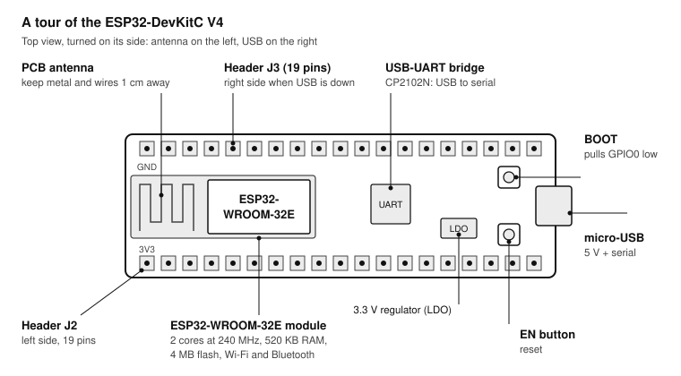

The module on the left is the computer. Everything else on the board exists to power it and to connect it to your Mac; once a project is finished, you could replace the whole board with the module alone.

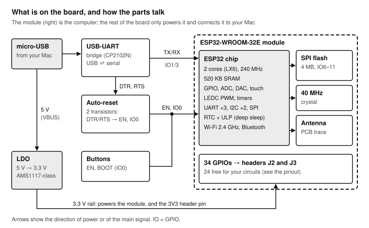

The USB-UART bridge turns USB into the serial signals the chip understands, and two of its control lines toggle EN and GPIO0 so the upload tool can reset the chip into download mode without you pressing anything.

### The defaults used in this course

| Choice | This course uses | Alternatives |
| --- | --- | --- |
| Board | ESP32-DevKitC V4 with ESP32-WROOM-32E (38 pins) | 30-pin "DOIT ESP32 DEVKIT V1" clones; see below |
| IDE | Arduino IDE 2.x on macOS | PlatformIO in VS Code; Espressif ESP-IDF for professional work |
| Core | Espressif Arduino-ESP32 core 3.x | Core 2.x tutorials need changes (PWM and timer APIs differ) |
| Libraries | Adafruit BME280, Adafruit SSD1306, Adafruit GFX | SparkFun BME280, U8g2 for displays |

### If your board is different

**30-pin DOIT ESP32 DEVKIT V1 and its clones** use the same ESP32-WROOM-32 module, so every sketch here runs unchanged as long as you use the GPIO numbers, not pin positions. The differences are physical: 15 pins per side instead of 19, the flash pins (GPIO6 to GPIO11) and GPIO0 are not brought out, the 5 V pin is labelled VIN, there is a blue LED on GPIO2, and the USB bridge is often a CH340 or CP2102. Re-draw the pin-label strips from the silkscreen before wiring.

**ESP32-S2, ESP32-S3, ESP32-C3, ESP32-C6** boards are different chips. Core 3.x supports them and most of the code here works, but the GPIO numbers, ADC channels, strapping pins and boot behaviour differ: the S3 and C3 have USB built into the chip, the C3 and C6 have a single RISC-V core, and none of them has the classic ESP32's GPIO34 to GPIO39 input-only pins. Use the pinout from your board's own user guide and treat every pin number in this course as "look it up".

## Safety, kit and setup

### Safety and good habits

Nothing in this course uses more than 12 V, but small electronics still fail in expensive and sometimes hot ways.

- **3.3 V logic, not 5 V tolerant.** Never connect a GPIO to 5 V or to a 5 V module's output. Nothing above 3.6 V may reach any pin. Use a level shifter or a voltage divider for 5 V signals.
- **One power source at a time.** USB, the 5V pin or the 3V3 pin: never two at once (Espressif's own warning for this board).
- **Common ground.** Every external supply you add shares GND with the board, or nothing works and sometimes something breaks.
- **Power off before rewiring.** Unplug USB before you move a wire. A wire slipping into the 5V row of the breadboard is the classic way to kill a pin.
- **Inductive loads get a flyback diode.** Motors, relays and solenoids produce a voltage spike when switched off.
- **Never mains.** No 230 V or 120 V work in this course. For mains loads, buy a certified smart plug.
- **Lithium cells.** A short-circuited Li-ion or LiPo cell can deliver tens of amps and catch fire. Use protected cells and a proper charger board, never a bare cell on a breadboard.
- **ESD.** Touch a grounded metal object before handling the board in winter, and store it in its bag.

### The board

Buy an **ESP32-DevKitC V4** with an **ESP32-WROOM-32E** module (sold as ESP32-DevKitC-32E). Boards with the older WROOM-32D or WROOM-32 work identically for this course. Avoid boards with a WROVER module for now: they use GPIO16 and GPIO17 for their extra RAM.

Check that your board has headers soldered on, and buy a spare: you will eventually blow a pin, and a second board turns a lost evening into a two-minute swap.

### The breadboard problem

The DevKitC's two header rows are 1 inch (25.4 mm) apart. On a single standard breadboard that covers every hole on one side, leaving you nothing to plug wires into. The fix is two breadboards side by side, the board bridging the joint, so each header row sits in its own breadboard with four free holes beside every pin. All the breadboard drawings in this course use that layout, with the board turned on its side: J3 along the top, J2 along the bottom, USB on the right.

### The USB cable

Many micro-USB cables are charge-only: they have no data wires. If the Mac does not see the board, the cable is the first suspect. Label a cable you have proven to work and keep it with the board. On a Mac with only USB-C ports, use a USB-C to micro-B **data** cable rather than an adapter chain.

### Tools and instruments

- A multimeter with DC volts, DC milliamps and continuity: you will measure every circuit before trusting it.
- A USB power meter (an inline USB tester that shows volts and milliamps) makes Lessons 6 and 7 much easier.
- A 12 V, 1 to 2 A DC adapter and a barrel-jack-to-screw-terminal adapter for Lesson 3. A bench supply with a current limit is better if you have one.

## Everything you need for all lessons

Print this page and tick items off as they arrive. Quantities cover every exercise once with a little spare; the numbers in brackets are the lessons that first use each item. Model names are examples, not endorsements.

### Tools (buy once)

- [ ] ESP32-DevKitC V4 with ESP32-WROOM-32E, headers fitted, plus one spare (0)
- [ ] Micro-USB data cable that fits your Mac, tested and labelled (0)
- [ ] Two full-size (830-point) solderless breadboards (0)
- [ ] Jumper wires: male-to-male 65-piece kit and 20 male-to-female (1, 4)
- [ ] Multimeter with DC mA range and continuity beeper (1)
- [ ] Small flat screwdriver for screw terminals (3)
- [ ] 12 V, 1 to 2 A DC adapter and a female barrel jack to screw terminal adapter (2, 3)
- [ ] USB power meter, USB-A or USB-C to match your cable (6)
- [ ] Optional: bench power supply with a current limit, 0 to 30 V (3, 6)

### Parts

- [ ] 5 mm LEDs, red and green, 10 of each (0, 1)
- [ ] Resistor assortment including 100 Ω, 330 Ω, 4.7 kΩ, 10 kΩ, 22 kΩ and 100 kΩ (0, 1, 2, 3, 4)
- [ ] Tactile push buttons, 6 × 6 mm, 5 pieces (1)
- [ ] 10 kΩ linear potentiometer with breadboard pins (2)
- [ ] Ceramic capacitors 100 nF, 10 pieces; one electrolytic 470 µF, 10 V or more (2)
- [ ] SG90 or MG90S micro servo (2)
- [ ] IRLB8721 N-channel logic-level MOSFET (TO-220), 2 pieces (3)
- [ ] 1N5819 Schottky diodes, 5 pieces (3)
- [ ] A 12 V load: a small 12 V DC motor, or 30 cm of plain (not addressable) 12 V LED strip (3)
- [ ] BME280 breakout for 3.3 V, I2C (check it says BME280, not BMP280: the BMP has no humidity sensor) (4)
- [ ] SSD1306 OLED, 0.96 inch, 128 × 64, I2C, 4 pins (4)
- [ ] Optional: a USB power bank that does not switch off at low current (6, 7)
- [ ] Optional: a small project box and a USB charger, 5 V 1 A, for the finished monitor (7)

### Software (free)

- [ ] Arduino IDE 2.x for macOS (0)
- [ ] Arduino-ESP32 core 3.x, installed from the Boards Manager (0)
- [ ] Libraries: Adafruit BME280 Library, Adafruit SSD1306, Adafruit GFX Library (4)

## Pinout

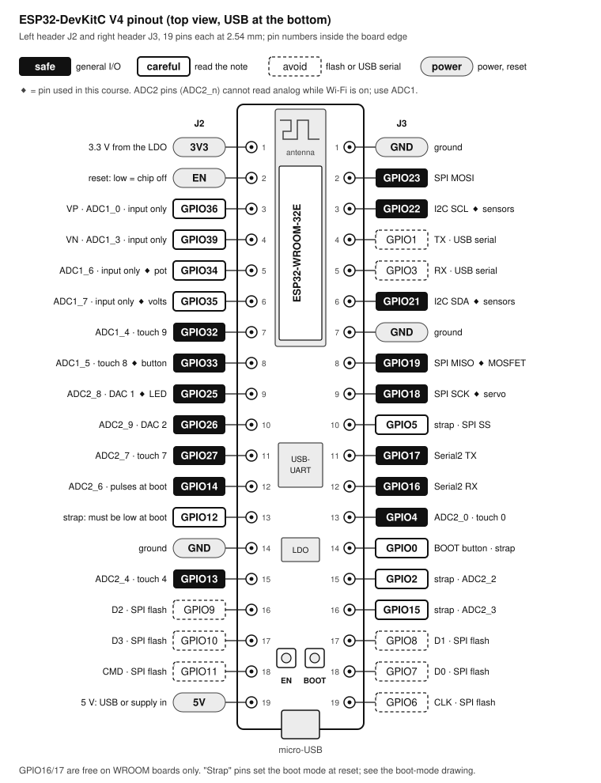

Solid black: safe. Outlined: works with a condition (input only, or a strapping pin). Dashed and hatched: taken by the flash chip or the USB serial port. Pin 1 of both headers is at the antenna end.

## Lesson 0: Meet the board

**Goal:** a working toolchain, a board you understand, and your first program running on it. **Time:** 1.5 hours. **Pass:** Blink runs on an external LED on GPIO25; the Serial Monitor prints the chip details; and you can say, without looking, which pins to avoid and why.

### Pins to avoid, and why

| Pins | What they do | What goes wrong if you use them |
| --- | --- | --- |
| GPIO6 to GPIO11 (CLK, D0 to D3, CMD) | Connect the module to its SPI flash | The chip cannot fetch code: instant crash or boot failure |
| GPIO1 (TX), GPIO3 (RX) | UART0, the USB serial port | Uploads fail and the Serial Monitor shows garbage |
| GPIO12 | Strap: selects the flash voltage at reset | Pulled high at reset, the flash runs at 1.8 V and the board reboots forever |
| GPIO0 | Strap: low at reset means download mode; BOOT button | A circuit pulling it low keeps the board from starting your sketch |
| GPIO2, GPIO5, GPIO15 | Straps with milder effects | GPIO2 high at reset blocks uploads; GPIO5 and GPIO15 rarely matter |
| GPIO34 to GPIO39 | Input only, no pull-ups | `pinMode(34, OUTPUT)` silently does nothing; a button needs an external resistor |
| ADC2 pins (GPIO0, 2, 4, 12 to 15, 25 to 27) | Analog channel group 2 | ADC2 cannot read while Wi-Fi is on: use GPIO32 to GPIO39 (ADC1) for analog |

The pinout on the page before this lesson marks each of these pins; keep it next to the breadboard.

### Exercise 0.1: Install Arduino IDE and the ESP32 core

1. Download Arduino IDE 2.x for macOS (Apple Silicon or Intel, to match your Mac) from arduino.cc and drag it to Applications.
2. Open **Arduino IDE → Settings…** and paste this into **Additional boards manager URLs:** `https://espressif.github.io/arduino-esp32/package_esp32_index.json`
3. Open **Tools → Board → Boards Manager**, search for `esp32`, and install **esp32 by Espressif Systems**, version 3.x. The download is large; let it finish.
4. Select **Tools → Board → esp32 → ESP32 Dev Module**. This board definition matches the DevKitC.
5. Leave the defaults in the Tools menu: Upload Speed 921600, CPU 240 MHz, Flash Size 4MB, Partition Scheme "Default 4MB with spiffs".

### Exercise 0.2: Find the board on your Mac

1. Open Terminal and run `ls /dev/cu.*` with the board unplugged. Note the list.
2. Plug the board in with your data cable. The power LED on the board lights.
3. Run `ls /dev/cu.*` again. A new entry should appear, usually `/dev/cu.usbserial-XXXX` (CP210x or CH340 with Apple's built-in driver), `/dev/cu.SLAB_USBtoUART` (Silicon Labs driver) or `/dev/cu.wchusbserialXXXX` (WCH driver).
4. If nothing new appears: try another cable first, then another port. Check **System Information → USB**: a "CP2102N USB to UART Bridge Controller" (or a CH340/CH9102 device) means the cable is fine and you need the vendor's driver (Silicon Labs CP210x VCP driver, or WCH CH34x driver), installed and allowed in **System Settings → Privacy & Security**.
5. In Arduino IDE choose that port under **Tools → Port**. Always use the `cu.` device, never `tty.`.

> **Note:** Recent macOS versions drive the CP210x and CH340 bridges without extra software. Install a vendor driver only when the port does not appear with a cable you know carries data.

### Power

Three facts to remember:

- **The ESP32 is a 3.3 V chip.** Its pins output 3.3 V, read anything above about 2.5 V as HIGH, and are damaged by 5 V.
- **Wi-Fi is the big consumer.** The chip idles at a few tens of milliamps but transmits in bursts of about 240 mA. A weak USB port or a thin cable makes the voltage dip in those bursts, and the chip resets ("brownout").
- **Plan for 12 mA per pin.** That lights an LED. Anything bigger (motors, relays, LED strips, servos' power) needs a transistor and usually its own supply (Lesson 3).

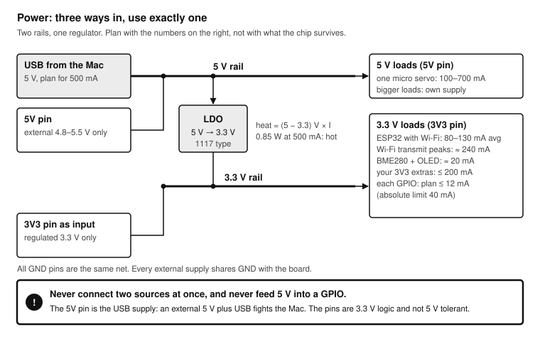

USB delivers 5 V to the 5V pin and to a 1117-type regulator (an AMS1117-3.3 on Espressif's reference schematic) that makes 3.3 V for the module and for the 3V3 pin. The regulator turns the 1.7 V it drops into heat, so the more you draw from 3V3, the hotter it gets.

### Boot modes and the strapping pins

The strapping pins are sampled in the instant EN goes high, and only then; after that they are ordinary GPIOs. The drawing below shows what the chip reads and what each level does.

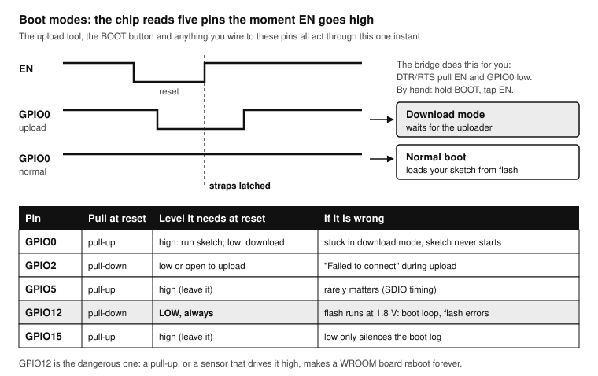

The upload tool, the BOOT button and anything you wire to these pins all act at the moment the chip leaves reset. GPIO12 is the one that bites: a module with a pull-up on that pin turns the board into a boot loop.

### Exercise 0.3: Hello from the chip

Before wiring anything, prove the toolchain works and see what you bought.

```cpp hello_chip.ino
// Prints facts about the chip once a second.
void setup() {
  Serial.begin(115200);
  delay(500);
}

void loop() {
  Serial.println("--- ESP32 says hello ---");
  Serial.printf("Model:     %s rev %d\n", ESP.getChipModel(), ESP.getChipRevision());
  Serial.printf("Cores:     %d at %u MHz\n", ESP.getChipCores(), (unsigned)ESP.getCpuFreqMHz());
  Serial.printf("Flash:     %lu bytes\n", (unsigned long)ESP.getFlashChipSize());
  Serial.printf("Free heap: %lu bytes\n", (unsigned long)ESP.getFreeHeap());
  Serial.printf("MAC (eFuse): %012llX\n", ESP.getEfuseMac());
  Serial.printf("Uptime:    %lu ms\n", millis());
  delay(1000);
}
```

1. Paste the sketch into a new file and click **Upload** (the arrow).
2. Watch the output pane: "Connecting…", then percentages, then "Hard resetting via RTS pin". The bridge reset the board into download mode and back on its own.
3. Open **Tools → Serial Monitor** and set it to **115200 baud**.
4. Read the model, revision, cores and flash size. Write them in the practice log.
5. Press the **EN** button. You will see a burst of boot messages from the chip's ROM before your sketch starts: that is the bootloader, also at 115200.

If the upload stops at "Connecting….…" and fails, hold **BOOT**, start the upload again, and release BOOT when the percentages appear. If you need that every time, see Troubleshooting.

### Exercise 0.4: Blink on GPIO25

The DevKitC has no LED you can program (the one that lights is the power LED), so you wire your own. The resistor value comes from Lesson 1; for now, trust it.

1. Unplug USB. Seat the board across two breadboards as described in Kit and setup.
2. Wire GPIO25 → 330 Ω resistor → LED long leg (anode); LED short leg (cathode, flat side) → GND. The left half of the Lesson 1 breadboard drawing shows exactly this.
3. Plug USB back in and upload the sketch below.
4. Change both delays to 100 and upload again. Then make it blink an SOS.

```cpp blink.ino
const int LED_PIN = 25;   // GPIO number, not the header position

void setup() {
  pinMode(LED_PIN, OUTPUT);
}

void loop() {
  digitalWrite(LED_PIN, HIGH);   // 3.3 V on the pin: LED on
  delay(500);
  digitalWrite(LED_PIN, LOW);    // 0 V: LED off
  delay(500);
}
```

### Exercise 0.5: Measure the rails

1. With USB connected, set the multimeter to DC volts. Black probe on any GND pin.
2. Red probe on 5V: expect 4.7 to 5.1 V (USB minus a small drop).
3. Red probe on 3V3: expect 3.25 to 3.35 V.
4. Red probe on GPIO25 while the LED is on: a little under 3.3 V. While it is off: 0 V.
5. Write the readings in the practice log. When something misbehaves later, these are your "known good" numbers.

## Lesson 1: Digital inputs and outputs

**Goal:** drive an LED safely, read a button reliably, and know when to use an interrupt. **Time:** 2 hours. **Pass:** with the debounced toggle sketch, 20 presses give exactly 20 toggles, and you can show the math for the LED resistor.

A GPIO pin is either an **output**, which the chip drives to 0 V (LOW) or 3.3 V (HIGH), or an **input**, which reports whether the voltage on it is below about 0.8 V (LOW) or above about 2.5 V (HIGH). Between those thresholds the reading is undefined, which is why an input must never float.

### The LED and its resistor

An LED is a diode: once the voltage across it reaches its forward voltage V_f, its current rises steeply with any extra voltage. Connected straight to a pin, it would draw as much as the pin can push, which overheats the pin driver. A series resistor sets the current: it takes whatever voltage the LED does not.

**R = (V_pin − V_f) / I**

For a red LED (V_f ≈ 2.0 V) on a 3.3 V pin and a target of 4 mA: R = (3.3 − 2.0) V / 0.004 A = 325 Ω, so use the next standard value, **330 Ω**. Check it the other way: I = 1.3 V / 330 Ω ≈ 3.9 mA, and the resistor dissipates 1.3 V × 3.9 mA ≈ 5 mW, far below the 250 mW rating of a small resistor. Modern LEDs are bright at 2 to 5 mA; you do not need the 20 mA printed in old datasheets.

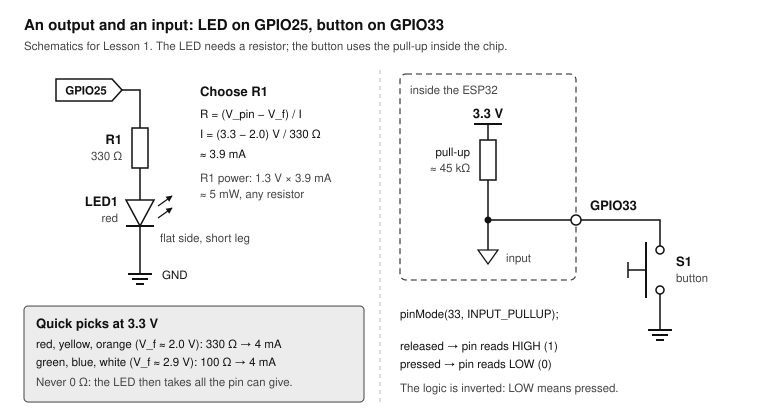

Left: the pin drives current through R1 and the LED to ground. Right: the button connects GPIO33 to ground; with INPUT_PULLUP, a resistor inside the chip holds the pin HIGH while the button is open.

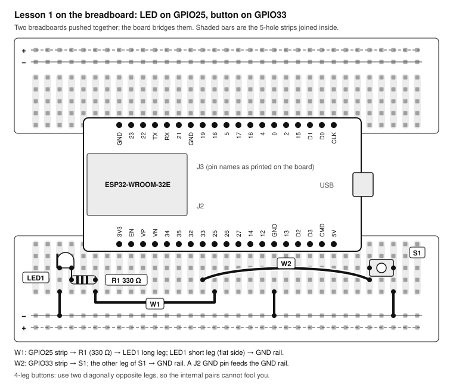

The same two circuits on the breadboard. Each header pin sits in its own five-hole strip, so you connect to a pin by plugging into any free hole of its strip.

### Exercise 1.1: Measure the LED current

1. Wire the LED circuit if it is not already there (GPIO25 → 330 Ω → LED → GND) and upload `blink.ino` with both delays at 5000 ms.
2. Set the multimeter to DC mA. Unplug the resistor leg from the GPIO25 strip, and put the meter in series: red probe in the GPIO25 strip, black probe on the resistor leg.
3. Read the current while the LED is on. Expect 3 to 4 mA. The pin's output sags a little under load, so the number comes out slightly below the calculation.
4. Repeat with a green LED (V_f ≈ 2.9 V) and the same resistor. The current drops to about 1 mA and the LED is dim; replace the resistor with 100 Ω and measure again.
5. Write both results in the practice log next to your calculated values.

### Exercise 1.2: Read a button

The button connects GPIO33 to GND when pressed. `INPUT_PULLUP` switches on a resistor of about 45 kΩ inside the chip from the pin to 3.3 V, so the pin reads HIGH when the button is open and LOW when it is pressed. Remember: **LOW means pressed.**

1. Wire the button from GPIO33 to the GND rail, using two diagonally opposite legs.
2. Upload the sketch and press the button: the LED follows it.
3. Change `INPUT_PULLUP` to `INPUT`, upload, and touch the GPIO33 wire with a finger without pressing. The LED flickers at random: that is a floating input picking up noise. Change it back.

```cpp button_led.ino
const int LED_PIN = 25;
const int BUTTON_PIN = 33;

void setup() {
  pinMode(LED_PIN, OUTPUT);
  pinMode(BUTTON_PIN, INPUT_PULLUP);   // internal pull-up: released = HIGH
}

void loop() {
  bool pressed = (digitalRead(BUTTON_PIN) == LOW);   // LOW means pressed
  digitalWrite(LED_PIN, pressed ? HIGH : LOW);
}
```

### Bounce

A mechanical contact does not close cleanly. The metal parts hit, spring apart and hit again several times over a few milliseconds before they settle, on press and again on release. The chip is fast enough to see every one of those bounces as a separate edge.

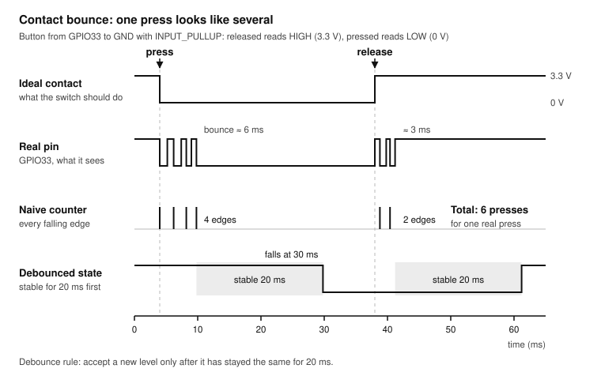

One real press produces a burst of edges. Code that counts falling edges counts too many; the debounced state only changes after the level has stayed put for 20 ms, which no bounce lasts.

### Exercise 1.3: See the bounce

1. Upload the naive counter below and open the Serial Monitor.
2. Press the button 20 times, firmly and at a normal pace. Note the final count.
3. Now replace the button with a bare jumper wire from GPIO33 and tap its end against a GND pin 20 times. Wires bounce far worse than good buttons.
4. Record both counts. Anything above 20 is bounce.

```cpp bounce_counter.ino
const int BUTTON_PIN = 33;
int lastLevel = HIGH;
unsigned long count = 0;

void setup() {
  Serial.begin(115200);
  pinMode(BUTTON_PIN, INPUT_PULLUP);
}

void loop() {
  int level = digitalRead(BUTTON_PIN);
  if (lastLevel == HIGH && level == LOW) {   // a falling edge
    count++;
    Serial.printf("falling edges: %lu\n", count);
  }
  lastLevel = level;
}
```

### Exercise 1.4: Debounce in software

The rule from the drawing, in code: remember when the raw reading last changed, and accept a new level only after it has been stable for `DEBOUNCE_MS`. The sketch never blocks, so `loop()` stays free for other work.

1. Upload the sketch. Each press toggles the LED once and prints the press count.
2. Repeat the 20 presses, then the 20 wire taps. Both counts must now be exactly 20.
3. Set `DEBOUNCE_MS` to 1 and repeat the wire taps. Find the smallest value that still gives 20 out of 20 with your wire, and write it in the log.

```cpp debounce_toggle.ino
const int LED_PIN = 25;
const int BUTTON_PIN = 33;
const unsigned long DEBOUNCE_MS = 20;

int lastReading = HIGH;        // raw level last time round
int stableLevel = HIGH;        // the debounced level
unsigned long lastChange = 0;  // when the raw level last changed
bool ledOn = false;
unsigned long presses = 0;

void setup() {
  Serial.begin(115200);
  pinMode(LED_PIN, OUTPUT);
  pinMode(BUTTON_PIN, INPUT_PULLUP);
}

void loop() {
  int reading = digitalRead(BUTTON_PIN);
  if (reading != lastReading) {          // still bouncing: restart the clock
    lastChange = millis();
    lastReading = reading;
  }
  if (millis() - lastChange >= DEBOUNCE_MS && reading != stableLevel) {
    stableLevel = reading;               // stable long enough: accept it
    if (stableLevel == LOW) {            // a new press
      ledOn = !ledOn;
      digitalWrite(LED_PIN, ledOn ? HIGH : LOW);
      presses++;
      Serial.printf("press %lu, LED %s\n", presses, ledOn ? "on" : "off");
    }
  }
}
```

### Exercise 1.5: Interrupts

Polling works while `loop()` is fast. When `loop()` is busy (talking to Wi-Fi, updating a display), a short press can come and go between two reads. An **interrupt** makes the hardware call a function the instant the pin changes, whatever the main code is doing.

Interrupt handlers (ISRs) follow strict rules:

- Mark the function `IRAM_ATTR` so it lives in internal RAM and can run even while the flash chip is busy (during Wi-Fi or file writes).
- Keep it tiny: update a counter or a flag and return. No `Serial`, no `delay()`, no display or Wi-Fi calls.
- Mark every variable it shares with `loop()` as `volatile`, so the compiler re-reads it every time instead of caching it.

The ISR below only counts edges and notes the time. `loop()` decides, once the edges have stopped for 30 ms, whether that burst was a press (the pin is still LOW) or the release bounce (the pin is HIGH again).

```cpp interrupt_button.ino
const int LED_PIN = 25;
const int BUTTON_PIN = 33;

volatile uint32_t edgeCount = 0;    // written by the ISR, read by loop()
volatile uint32_t lastEdgeMs = 0;

void IRAM_ATTR onButtonFalling() {
  edgeCount++;
  lastEdgeMs = millis();
}

uint32_t handled = 0;
bool ledOn = false;

void setup() {
  Serial.begin(115200);
  pinMode(LED_PIN, OUTPUT);
  pinMode(BUTTON_PIN, INPUT_PULLUP);
  attachInterrupt(digitalPinToInterrupt(BUTTON_PIN), onButtonFalling, FALLING);
}

void loop() {
  uint32_t edges = edgeCount;       // copy once; it may change at any moment
  if (edges != handled && millis() - lastEdgeMs > 30) {   // burst is over
    if (digitalRead(BUTTON_PIN) == LOW) {                 // still held: a press
      ledOn = !ledOn;
      digitalWrite(LED_PIN, ledOn ? HIGH : LOW);
      Serial.printf("press (%lu edges in the burst)\n", (unsigned long)(edges - handled));
    }
    handled = edges;
  }
  delay(200);   // pretend loop() is busy: no press is lost
}
```

1. Upload and press the button: the LED toggles, and the Serial Monitor shows how many edges each press produced.
2. Notice the `delay(200)` at the end of `loop()`. Tap the button as briefly as you can: the press is still caught, because the hardware recorded it.
3. Comment out `attachInterrupt` and replace the logic with the polling code from Exercise 1.4, keeping `delay(200)`. Quick taps are now missed. That is the case for interrupts.

> **Tip:** Reach for an interrupt only when you must not miss a short event or must react within microseconds. For buttons in normal sketches, the non-blocking debounce of Exercise 1.4 is simpler and just as good.

## Lesson 2: PWM and analog

**Goal:** make in-between values: dim an LED, position a servo, read a knob and measure a voltage above 3.3 V. **Time:** 2 hours. **Pass:** your sketch reads your 12 V adapter within 2 % of the multimeter, and you can explain why GPIO35 and not GPIO25 does the measuring.

### PWM: faking an analog output

A digital pin is either 0 V or 3.3 V. **Pulse-width modulation** switches it on and off so fast that an LED (or your eye, or a motor's inertia) only sees the average. The fraction of each period spent HIGH is the **duty cycle**. The ESP32's LEDC peripheral generates PWM in hardware on almost any output pin, so it costs the processor nothing.

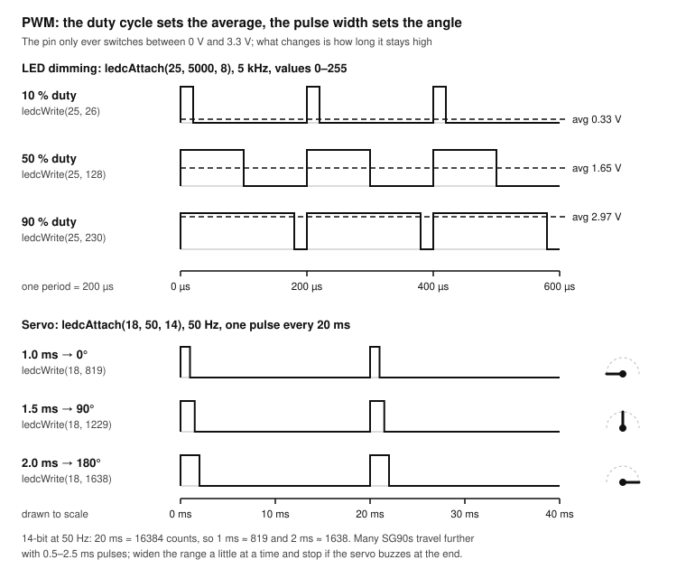

At 5 kHz the LED sees 200 µs periods; 8-bit resolution splits each into 256 steps. A hobby servo ignores the average and reads the width of one pulse every 20 ms instead.

In core 3.x you attach a pin once with `ledcAttach(pin, frequency, resolution_bits)`, then set the duty with `ledcWrite(pin, duty)`, where duty runs from 0 to 2^bits − 1. Higher frequency needs fewer bits: on the classic ESP32 the product of frequency and 2^bits must stay below the 80 MHz LEDC clock. 5 kHz with 8 bits, 20 kHz with 8 bits and 50 Hz with 14 bits are all comfortable.

### Exercise 2.1: Fade an LED

```cpp fade.ino
const int LED_PIN = 25;
const uint32_t PWM_FREQ = 5000;   // Hz: far too fast to see flicker
const uint8_t PWM_BITS = 8;       // duty 0..255

void setup() {
  ledcAttach(LED_PIN, PWM_FREQ, PWM_BITS);
}

void loop() {
  for (int duty = 0; duty <= 255; duty++) {
    ledcWrite(LED_PIN, duty);
    delay(4);
  }
  for (int duty = 255; duty >= 0; duty--) {
    ledcWrite(LED_PIN, duty);
    delay(4);
  }
}
```

1. Upload the sketch with the Lesson 1 LED still on GPIO25. The LED breathes.
2. Notice that the brightness seems to jump up quickly and then barely change at the top. Your eye is logarithmic; PWM is linear.
3. Fix it with a gamma curve: replace `ledcWrite(LED_PIN, duty);` in both loops with `ledcWrite(LED_PIN, (uint32_t)(pow(duty / 255.0, 2.2) * 255 + 0.5));`. The fade now looks even.
4. Measure the pin with the multimeter on DC volts at a few fixed duties (add `delay(5000)` after a `ledcWrite`). A meter averages too: at duty 128 it reads about 1.65 V.

> **Note:** Once a pin is attached to LEDC, use `ledcWrite()` for it, not `digitalWrite()`. Call `ledcDetach(pin)` first if you want it back as a plain output.

### Exercise 2.2: Position a servo

An SG90 micro servo expects a pulse every 20 ms (50 Hz). A 1.0 ms pulse means one end of its travel, 1.5 ms the middle, 2.0 ms the other end. With 14 bits at 50 Hz, one count is 20 ms / 16384 ≈ 1.22 µs, so 1 ms is 819 counts and 2 ms is 1638.

1. Unplug USB. Wire the servo: brown (GND) to the GND rail, red (+) to the 5V pin, orange (signal) to GPIO18. Put the 470 µF capacitor across red and brown near the servo, stripe (minus) to GND.
2. Upload the sketch, open the Serial Monitor and send angles such as `0`, `90`, `180`.
3. Watch the extremes. If the servo buzzes or pushes against its end stop at 0 or 180, narrow the range in `writeAngle()`; if it does not reach the ends, widen it in 50 µs steps (many SG90s accept 600 to 2400 µs).
4. Write the final pulse range in the log; that is your servo's calibration.

```cpp servo.ino
const int SERVO_PIN = 18;
const uint32_t SERVO_FREQ = 50;                    // one pulse every 20 ms
const uint8_t SERVO_BITS = 14;                     // 0..16383 per period
const uint32_t PERIOD_US = 1000000 / SERVO_FREQ;   // 20000 µs

void writeMicroseconds(uint32_t us) {
  ledcWrite(SERVO_PIN, us * (1UL << SERVO_BITS) / PERIOD_US);   // 1000 µs -> 819
}

void writeAngle(int deg) {
  deg = constrain(deg, 0, 180);
  writeMicroseconds(map(deg, 0, 180, 1000, 2000));
}

void setup() {
  Serial.begin(115200);
  ledcAttach(SERVO_PIN, SERVO_FREQ, SERVO_BITS);
  writeAngle(90);
  Serial.println("Type an angle 0..180 and press Enter");
}

void loop() {
  if (Serial.available()) {
    String line = Serial.readStringUntil('\n');
    line.trim();
    if (line.length() > 0) {
      int deg = line.toInt();
      writeAngle(deg);
      Serial.printf("angle %d\n", deg);
    }
  }
}
```

> **Warning:** A servo draws 100 to 250 mA while moving and up to 700 mA when it stalls. One micro servo from the 5V pin is fine with the capacitor; two or a bigger servo need their own 5 V supply, with its GND joined to the board's GND. If the board resets every time the servo moves, that is a brownout: the supply sagged.

### The ADC: reading a voltage

The ESP32 has two analog-to-digital converters with 12 bits each (0 to 4095). Three facts shape how you use them:

- **ADC2 is shared with Wi-Fi.** While Wi-Fi runs, analog reads on ADC2 pins fail. Use ADC1: GPIO32 to GPIO39. This course uses GPIO34 and GPIO35, which are input-only and therefore perfect for it.
- **Attenuation sets the range.** The default 11 dB setting measures roughly 0.15 to 3.1 V. Below 0.15 V it reads 0; near 3.1 V it saturates at 4095.
- **The raw curve is not perfectly straight, and every chip differs a little.** `analogReadMilliVolts()` applies the factory calibration stored in each chip and returns millivolts. Use it whenever you want a voltage rather than a position.

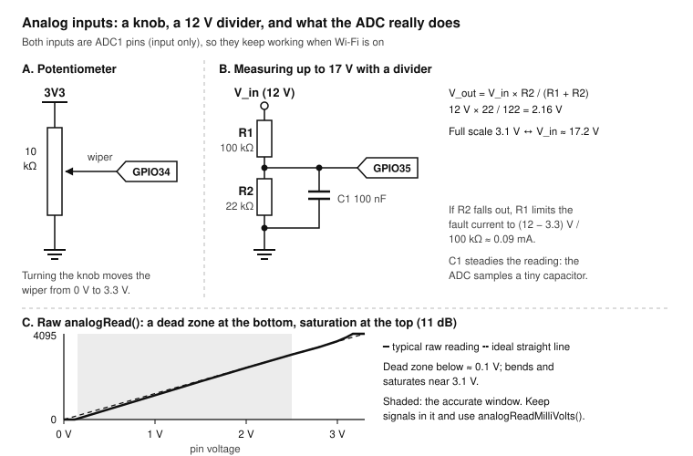

A potentiometer gives 0 to 3.3 V directly. A higher voltage goes through a divider first; R1 also protects the pin if R2 ever comes loose. The shaded band is where the ADC is most trustworthy.

### Exercise 2.3: Read a knob

1. Unplug USB. Wire the potentiometer: one outer leg to the 3V3 pin, the other outer leg to GND, the middle leg (wiper) to GPIO34.
2. Upload the sketch and open **Tools → Serial Plotter**. Turn the knob slowly from end to end.
3. Note where the raw value leaves 0 and where it reaches 4095: neither happens exactly at the ends of travel. That is the dead zone and the saturation from the drawing.
4. Set the knob to five positions and compare the printed mV with the multimeter on the wiper. Write both columns in the log. They should agree within about 30 mV in the middle of the range.

```cpp pot.ino
const int POT_PIN = 34;   // ADC1, input only
const int LED_PIN = 25;

void setup() {
  Serial.begin(115200);
  analogReadResolution(12);                     // 0..4095 (the default)
  analogSetPinAttenuation(POT_PIN, ADC_11db);   // about 0.15..3.1 V (the default)
  ledcAttach(LED_PIN, 5000, 8);
}

void loop() {
  int raw = analogRead(POT_PIN);
  uint32_t mv = analogReadMilliVolts(POT_PIN);
  ledcWrite(LED_PIN, raw >> 4);                 // 12-bit knob -> 8-bit brightness
  Serial.printf("raw:%d,mV:%lu\n", raw, (unsigned long)mv);   // name:value pairs for the Plotter
  delay(50);
}
```

### Exercise 2.4: Measure 12 V with a divider

A divider scales a voltage down by the ratio R2 / (R1 + R2). With R1 = 100 kΩ and R2 = 22 kΩ, 12 V becomes 12 × 22 / 122 = 2.16 V at the pin, safely inside the ADC's range, and the divider draws only 12 V / 122 kΩ ≈ 0.1 mA. The largest input it can measure is 3.1 V × 122 / 22 ≈ 17 V.

> **Warning:** Measure your adapter with the multimeter first. Cheap unregulated "12 V" adapters can read 15 to 17 V with no load. If yours reads more than 16 V, use 150 kΩ for R1 and change the sketch to match. Never connect the adapter to a GPIO without the divider.

1. Measure R1 and R2 with the multimeter and type the real values into the sketch.
2. Build the divider: adapter + → R1 → node → R2 → GND; node → GPIO35; 100 nF from node to GND. Join the adapter's − to the board's GND.
3. Upload and compare the printed voltage with the multimeter on the adapter's terminals.
4. Calibrate: set `CAL` to (meter reading ÷ printed reading), for example 12.21 / 12.05 = 1.013. Upload again. The two now agree within 1 to 2 %.
5. To monitor a single Li-ion cell instead (4.2 V maximum), use 100 kΩ and 100 kΩ: 4.2 V becomes 2.1 V.

```cpp volts.ino
const int SENSE_PIN = 35;     // ADC1, input only
const float R1 = 100000.0;    // top resistor, ohms (use your measured value)
const float R2 = 22000.0;     // bottom resistor, ohms (use your measured value)
const float CAL = 1.000;      // meter reading / printed reading
const int SAMPLES = 64;       // averaging smooths the noise

float readInputVolts() {
  uint32_t sum = 0;
  for (int i = 0; i < SAMPLES; i++) sum += analogReadMilliVolts(SENSE_PIN);
  float pinVolts = sum / (float)SAMPLES / 1000.0;
  return pinVolts * (R1 + R2) / R2 * CAL;
}

void setup() {
  Serial.begin(115200);
}

void loop() {
  Serial.printf("Vin = %.2f V\n", readInputVolts());
  delay(500);
}
```

## Lesson 3: Driving real loads

**Goal:** switch a 12 V load safely from a 3.3 V pin, and control its power with PWM. **Time:** 1.5 hours. **Pass:** the knob sets a 12 V motor's speed (or an LED strip's brightness) smoothly from off to full; the MOSFET stays cool enough to touch; the drain-to-source voltage at full on is under 0.1 V.

A GPIO pin can supply a few milliamps at 3.3 V. A motor, a 12 V LED strip or a solenoid wants hundreds of milliamps at 12 V. A **MOSFET** used as a switch bridges the two: a tiny voltage on its gate lets a large current flow from drain to source.

### The low-side switch

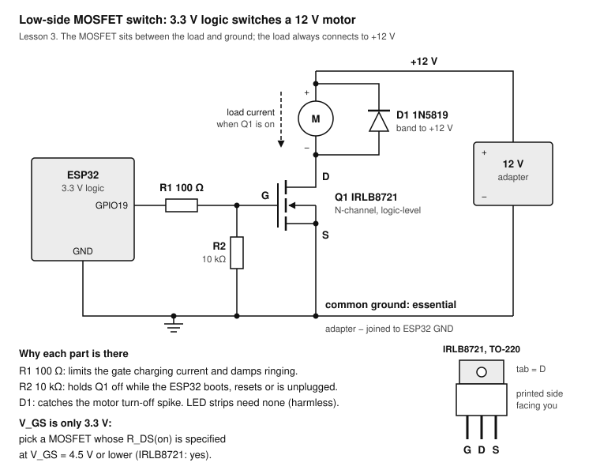

The load connects to +12 V permanently; the MOSFET connects its other end to ground when the gate is driven HIGH. Low-side switching is the simplest way to switch a higher voltage, because the source sits at ground and the gate only needs to rise a few volts above it.

Each part has a job:

- **Q1, a logic-level N-MOSFET.** "Logic-level" means it turns fully on with a low gate voltage. Pick one whose on-resistance R_DS(on) is specified at V_GS = 4.5 V or lower; at 3.3 V you are still near the bottom of that curve. The IRLB8721 (rated 30 V, specified at 4.5 V) works well. The popular IRF540 and IRFZ44N need 10 V and are **not** suitable.
- **R1, 100 Ω gate resistor.** The gate is a small capacitor; R1 limits the current spike when the pin charges it and damps ringing on long wires.
- **R2, 10 kΩ pull-down.** During reset and boot the GPIO floats. R2 holds the gate low so the motor does not twitch on power-up.
- **D1, flyback diode.** A motor's coil keeps its current flowing for an instant when switched off; without a path, that current makes a spike of tens of volts across the MOSFET. D1, band towards +12 V, gives it a path. A 1N5819 Schottky is fast enough for PWM at 20 kHz.
- **Common ground.** The 12 V supply's minus and the ESP32's GND must be joined, or the gate voltage has no reference.

> **Warning:** Never switch mains (230 V or 120 V) loads from this course's circuits, with a MOSFET or with a relay module on a breadboard. Use a certified smart plug for mains.

### Exercise 3.1: Switch a 12 V load on and off

1. Unplug everything. Identify the IRLB8721's pins: printed side facing you, legs down, left to right **G, D, S**; the metal tab is the drain.
2. Build the circuit from the drawing on the breadboard: GPIO19 → 100 Ω → G; 10 kΩ from G to GND; S to GND; D to the motor's minus (or the LED strip's minus); motor plus to +12 V; 1N5819 across the motor, band to +12 V. Join the adapter's minus to the board's GND.
3. Check with the meter on continuity before powering: +12 V must not beep to GND, and D must not beep to S.
4. Upload `blink.ino` with `LED_PIN` set to 19 and both delays at 2000 ms. Plug in USB, then the 12 V adapter. The load turns on and off every 2 seconds.
5. While it is on, measure V_DS (meter between D and S). Note it, and the load current if you can measure it. Power in the MOSFET is V_DS × I; at 1 A and 0.05 V that is 50 mW: no heat sink needed.

### Exercise 3.2: Speed control with PWM

Combine Lessons 2 and 3: the knob on GPIO34 sets the duty cycle on GPIO19. At 20 kHz the PWM is above the range of hearing, so the motor does not whine.

```cpp motor_speed.ino
const int GATE_PIN = 19;
const int POT_PIN = 34;
const uint32_t PWM_FREQ = 20000;   // 20 kHz: silent for motors, flicker-free for LEDs
const uint8_t PWM_BITS = 8;        // duty 0..255

void setup() {
  Serial.begin(115200);
  ledcAttach(GATE_PIN, PWM_FREQ, PWM_BITS);
  ledcWrite(GATE_PIN, 0);
}

void loop() {
  int mv = (int)analogReadMilliVolts(POT_PIN);
  int duty = map(constrain(mv, 150, 3100), 150, 3100, 0, 255);
  ledcWrite(GATE_PIN, duty);
  Serial.printf("knob %4d mV -> duty %3d (%3d %%)\n", mv, duty, duty * 100 / 255);
  delay(50);
}
```

1. Keep the potentiometer from Lesson 2 on GPIO34. Upload the sketch.
2. Turn the knob slowly. A motor starts turning at some duty above zero (it needs enough torque to overcome friction); note that duty.
3. Run at full speed for a minute and touch the MOSFET. Warm is fine; too hot to hold means it is not fully on: check the gate wiring and that it really is a logic-level part.
4. Touch the 1N5819. It should be cool or barely warm.

### Relay modules: the caveats

A relay is a switch moved by an electromagnet. It isolates the load completely and switches AC or DC, which is why relay modules are popular. On an ESP32 they come with traps:

- Most cheap modules are built for 5 V Arduinos. Their input pulls up to 5 V, which back-feeds a 3.3 V pin, and 3.3 V may not switch them reliably. Buy modules marked for 3.3 V triggering, or drive the coil yourself with the MOSFET circuit above (coil in place of the motor, with the diode).
- A relay coil needs 70 to 90 mA at 5 V. Never drive it straight from a GPIO.
- Many modules are "active low": the relay switches on when the input goes LOW, and it may click on during boot while the pins float.
- The screw terminals on a breadboard relay module are not a safe way to switch mains. See the warning above.

## Lesson 4: Sensors and a display on I2C

**Goal:** wire an I2C bus, find devices on it, read a BME280 environmental sensor and show the values on an OLED. **Time:** 2 hours. **Pass:** the OLED shows live temperature, humidity and pressure; the pressure is within 2 hPa of your local weather service's station pressure (or sea-level value corrected for your altitude), and breathing on the sensor makes the humidity jump.

### How I2C works

**I2C** (also written I²C) is a two-wire bus: **SDA** carries data, **SCL** carries the clock. Many devices share the same two wires, and each has a 7-bit address. The ESP32 is the controller: it starts every exchange by sending an address, and only the device with that address answers.

Both lines are **open drain**: devices can only pull a line low, never drive it high. A pull-up resistor to 3.3 V on each line brings it back high. That is why I2C needs pull-ups, and why it is safe to connect many devices: no two can ever fight, one driving high while another drives low.

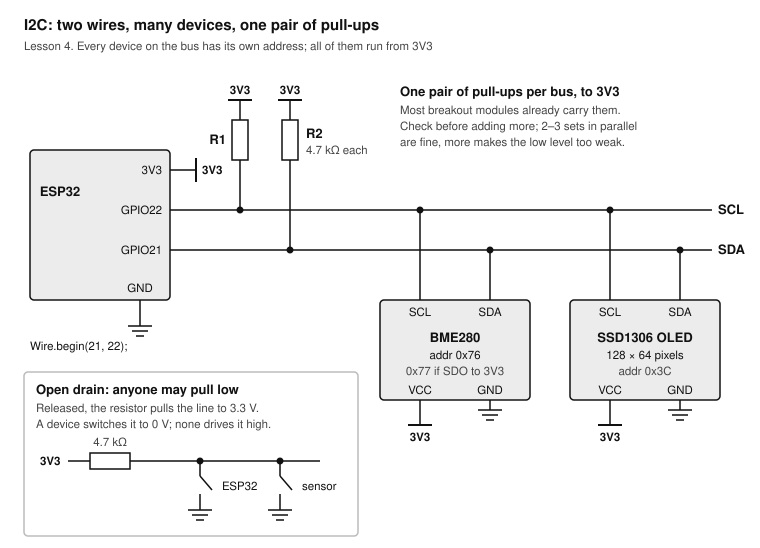

The ESP32's default I2C pins are GPIO21 (SDA) and GPIO22 (SCL). Every device connects to the same two lines, to 3V3 and to GND.

Practical rules:

- **Power the modules from 3V3**, not 5V. Many breakouts accept both, but at 5 V their pull-ups pull SDA and SCL to 5 V, which the ESP32's pins cannot tolerate.
- **Pull-ups:** most breakout modules carry 4.7 kΩ or 10 kΩ pull-ups already. Two or three modules in parallel are fine; if you have more, remove some.
- **Keep the bus short.** Tens of centimetres of wire at the standard 100 kHz are fine. For metres, you need a bus extender.
- **Addresses must differ.** BME280: 0x76 or 0x77 (set by its SDO pin). SSD1306 OLED: 0x3C (some 0x3D).

### Exercise 4.1: Install the libraries

1. Open **Tools → Manage Libraries…**
2. Search for and install **Adafruit BME280 Library**. When asked, click **Install All** so it also installs Adafruit Unified Sensor and Adafruit BusIO.
3. Install **Adafruit SSD1306** and, with it, **Adafruit GFX Library**.

### Exercise 4.2: Scan the bus

Before writing any sensor code, prove the wiring and learn the addresses.

1. Unplug USB. Wire the BME280 and the OLED: VCC (or VIN) to 3V3, GND to GND, SDA to GPIO21, SCL to GPIO22. Read the labels on your modules: the pin order differs between makers.
2. Upload the scanner and open the Serial Monitor.
3. Expect two lines: `0x3C` (OLED) and `0x76` or `0x77` (BME280). Note your BME280's address.
4. Unplug one module's SDA wire: its address disappears. Put it back.

```cpp i2c_scanner.ino
#include <Wire.h>

void setup() {
  Serial.begin(115200);
  Wire.begin(21, 22);   // SDA, SCL
}

void loop() {
  int found = 0;
  Serial.println("Scanning...");
  for (uint8_t addr = 1; addr < 127; addr++) {
    Wire.beginTransmission(addr);
    if (Wire.endTransmission() == 0) {   // 0 = the device acknowledged
      Serial.printf("  device at 0x%02X\n", addr);
      found++;
    }
  }
  Serial.printf("%d device(s) found\n\n", found);
  delay(5000);
}
```

If nothing is found: SDA and SCL swapped (the most common mistake), the module powered from the wrong pin, or a loose jumper. If a module appears at an unexpected address, use that address.

### Exercise 4.3: Read the BME280

The BME280 measures temperature, relative humidity and air pressure. (Its cheaper cousin, the BMP280, looks identical but has no humidity sensor; the library will refuse to start with it.)

```cpp bme280_read.ino
#include <Wire.h>
#include <Adafruit_BME280.h>

Adafruit_BME280 bme;

void setup() {
  Serial.begin(115200);
  Wire.begin(21, 22);
  if (!bme.begin(0x76, &Wire)) {   // use 0x77 if the scanner said so
    Serial.println("BME280 not found: check wiring and address; is it a BMP280?");
    while (true) delay(1000);
  }
}

void loop() {
  float t = bme.readTemperature();         // °C
  float h = bme.readHumidity();            // % relative humidity
  float p = bme.readPressure() / 100.0F;   // Pa -> hPa
  Serial.printf("%.2f °C   %.1f %%RH   %.1f hPa\n", t, h, p);
  delay(2000);
}
```

1. Upload and watch the readings for a minute. Write one set in the log.
2. Breathe gently on the sensor: humidity jumps by 10 % or more, then recovers within a minute.
3. Hold the sensor between two fingers: temperature climbs.
4. Compare pressure with a nearby weather station. Weather services report pressure corrected to sea level; subtract about 12 hPa per 100 m of your altitude to compare.
5. Compare temperature with a thermometer. On a breadboard next to the ESP32 the BME280 often reads 1 to 2 °C high: the module and the regulator warm the air. Lesson 7 deals with that.

### Exercise 4.4: Show it on the OLED

The SSD1306 is a 128 × 64 pixel OLED controller. Adafruit's library draws into a buffer in RAM; nothing appears until you call `display.display()`, which sends the whole buffer over I2C.

1. Upload the sketch below. The OLED shows the three values and updates every 2 seconds.
2. If the screen stays dark but the scanner found 0x3C: check you called `display.display()`, then try address 0x3D.
3. Some OLEDs have a yellow band across the top 16 rows; that is why the title sits alone on the first line.
4. Change the layout: put temperature in size 3, drop the title. Each size step is 6 × 8 pixels times the size.

```cpp oled_climate.ino
#include <Wire.h>
#include <Adafruit_GFX.h>
#include <Adafruit_SSD1306.h>
#include <Adafruit_BME280.h>

Adafruit_SSD1306 display(128, 64, &Wire, -1);   // -1: the module has no reset pin
Adafruit_BME280 bme;

void setup() {
  Serial.begin(115200);
  Wire.begin(21, 22);
  if (!display.begin(SSD1306_SWITCHCAPVCC, 0x3C)) {
    Serial.println("OLED not found");
    while (true) delay(1000);
  }
  if (!bme.begin(0x76)) {
    Serial.println("BME280 not found");
    while (true) delay(1000);
  }
  display.setTextColor(SSD1306_WHITE);
}

void loop() {
  float t = bme.readTemperature();
  float h = bme.readHumidity();
  float p = bme.readPressure() / 100.0F;
  display.clearDisplay();
  display.setTextSize(1);
  display.setCursor(0, 0);
  display.print("Room climate");
  display.setTextSize(2);                       // 12 x 16 pixel characters
  display.setCursor(0, 16);
  display.printf("%.1f C", t);
  display.setCursor(0, 34);
  display.printf("%.0f %%RH", h);
  display.setTextSize(1);
  display.setCursor(0, 54);
  display.printf("%.1f hPa", p);
  display.display();                            // send the buffer to the screen
  delay(2000);
}
```

## Lesson 5: Wi-Fi and a web page

**Goal:** join your Wi-Fi, serve a page that shows the sensor and controls the LED, and survive the router restarting. **Time:** 2 hours. **Pass:** your phone, on the same Wi-Fi, opens `http://esp32.local`, shows live values, toggles the LED; and after you switch the router off for a minute and on again, the page works again without touching the board.

The ESP32 joins your network as a **station** (like a phone does) and gets an IP address from the router. It then runs a small **web server**: a program that waits for browsers to ask for pages and answers them. The Arduino-ESP32 core includes everything you need: `WiFi`, `WebServer` and `ESPmDNS`.

> **Note:** The ESP32 only speaks 2.4 GHz Wi-Fi. A router that combines 2.4 and 5 GHz under one name is fine; a 5 GHz-only network is invisible to it. Networks with a captive login page (hotels, some campuses) do not work.

### Keep your password out of the sketch

Sketches get shared, pasted into forums and pushed to GitHub. Keep the Wi-Fi credentials in a separate file that never leaves your Mac. In Arduino IDE, click the **⋯** button at the right end of the tab bar, choose **New Tab**, and name it `secrets.h`. If the sketch folder is in a git repository, add `secrets.h` to `.gitignore`.

```cpp secrets.h
#pragma once
// Your Wi-Fi network. This file stays on your computer: never share it.
#define WIFI_SSID     "your-network-name"
#define WIFI_PASSWORD "your-wifi-password"
```

### Exercise 5.1: Join the network

1. Create a new sketch `wifi_connect`, add the `secrets.h` tab with your network's name and password, and paste the sketch below into the main tab.
2. Upload and open the Serial Monitor. Within a few seconds it prints the IP address and the signal strength.
3. Write the IP address and RSSI in the log. RSSI is in dBm: −50 is excellent, −70 is fine, below −80 expect dropouts.
4. Walk the board (on a power bank or a long cable) to the far end of the room and watch the RSSI change.

```cpp wifi_connect.ino
#include <WiFi.h>
#include "secrets.h"

void setup() {
  Serial.begin(115200);
  WiFi.mode(WIFI_STA);                     // station: join a network
  WiFi.begin(WIFI_SSID, WIFI_PASSWORD);
  Serial.print("Connecting");
  unsigned long start = millis();
  while (WiFi.status() != WL_CONNECTED && millis() - start < 20000) {
    delay(250);
    Serial.print(".");
  }
  if (WiFi.status() != WL_CONNECTED) {
    Serial.printf("\nNo connection (status %d). Check name, password, 2.4 GHz.\n", WiFi.status());
    return;
  }
  Serial.printf("\nConnected to %s\n", WiFi.SSID().c_str());
  Serial.printf("IP address: %s\n", WiFi.localIP().toString().c_str());
  Serial.printf("MAC:        %s\n", WiFi.macAddress().c_str());
}

void loop() {
  Serial.printf("RSSI %d dBm\n", WiFi.RSSI());
  delay(2000);
}
```

### How a page view works

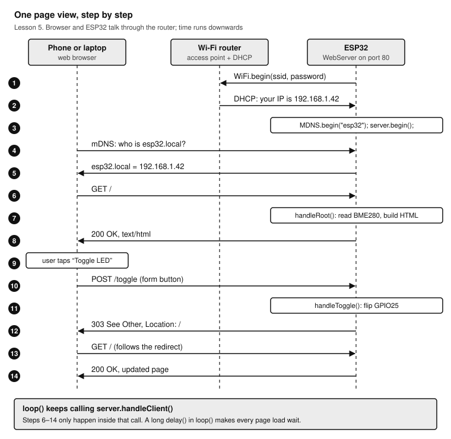

The router hands out the address, mDNS lets your phone find the board by name, and every request is handled inside `server.handleClient()`. The toggle uses POST, not a plain link: browsers may fetch links in advance, and a GET must never change anything.

**mDNS** (multicast DNS, also called Bonjour) lets the board answer to a name ending in `.local` on your network without any router setup. Macs and iPhones resolve `.local` names natively; some Android phones and Windows machines do not, so the IP address always works as a fallback.

### Exercise 5.2: A web page for the sensor and the LED

Keep the BME280 (Lesson 4) and the LED on GPIO25 wired. The page reloads itself every 10 seconds.

```cpp web_server.ino
#include <WiFi.h>
#include <WebServer.h>
#include <ESPmDNS.h>
#include <Wire.h>
#include <Adafruit_BME280.h>
#include "secrets.h"

const int LED_PIN = 25;
WebServer server(80);
Adafruit_BME280 bme;
bool ledOn = false;

void handleRoot() {
  char page[1000];
  snprintf(page, sizeof(page),
    "<!doctype html><html><head><meta charset='utf-8'>"
    "<meta name='viewport' content='width=device-width,initial-scale=1'>"
    "<meta http-equiv='refresh' content='10'><title>ESP32</title>"
    "<style>body{font-family:sans-serif;margin:2em}b{font-size:2em}</style>"
    "</head><body><h1>ESP32 room</h1>"
    "<p><b>%.1f &deg;C</b><br>%.0f %% humidity<br>%.1f hPa</p>"
    "<form action='/toggle' method='post'><p>LED is %s "
    "<button>Toggle</button></p></form>"
    "<p><small>up %lu s, signal %d dBm</small></p></body></html>",
    bme.readTemperature(), bme.readHumidity(), bme.readPressure() / 100.0F,
    ledOn ? "on" : "off", millis() / 1000, WiFi.RSSI());
  server.send(200, "text/html", page);
}

void handleToggle() {
  ledOn = !ledOn;
  digitalWrite(LED_PIN, ledOn ? HIGH : LOW);
  server.sendHeader("Location", "/");
  server.send(303);                      // "see other": browser goes back to /
}

void setup() {
  Serial.begin(115200);
  pinMode(LED_PIN, OUTPUT);
  Wire.begin(21, 22);
  if (!bme.begin(0x76)) Serial.println("BME280 not found");
  WiFi.mode(WIFI_STA);
  WiFi.begin(WIFI_SSID, WIFI_PASSWORD);
  while (WiFi.status() != WL_CONNECTED) { delay(250); Serial.print("."); }
  Serial.printf("\nhttp://%s/\n", WiFi.localIP().toString().c_str());
  if (MDNS.begin("esp32")) MDNS.addService("http", "tcp", 80);   // http://esp32.local
  server.on("/", handleRoot);
  server.on("/toggle", HTTP_POST, handleToggle);
  server.onNotFound([]() { server.send(404, "text/plain", "Not found"); });
  server.begin();
}

void loop() {
  server.handleClient();                 // answer any waiting browser
  static unsigned long lastCheck = 0;
  if (millis() - lastCheck > 10000) {    // every 10 s: still online?
    lastCheck = millis();
    if (WiFi.status() != WL_CONNECTED) {
      Serial.println("Wi-Fi lost, reconnecting");
      WiFi.reconnect();
    }
  }
}
```

1. Add the `secrets.h` tab to this sketch too, upload, and note the address printed in the Serial Monitor.
2. On your Mac open `http://esp32.local`. Then on your phone (on the same Wi-Fi). If the name does not resolve, use the IP address.
3. Tap **Toggle**: the LED on the breadboard changes and the page says so.
4. Add `delay(3000);` at the end of `loop()`, upload, and load the page: every request now waits up to three seconds. Remove it. `loop()` must stay fast in any sketch that serves pages.
5. Reconnect test: switch the router off for a minute, then on. Within a minute of the router being back, the Serial Monitor shows the reconnect and the page loads again.

> **Tip:** The core reconnects on its own in most cases (auto-reconnect is on by default). The 10-second check in `loop()` catches the cases where it gives up, and costs nothing.

### Exercise 5.3: Real time from the internet (optional)

The ESP32 has no battery-backed clock, so after every power-up it does not know the date. Once it is online it can ask a time server (NTP). Time-zone rules are given as a POSIX TZ string; examples: Central Europe `CET-1CEST,M3.5.0,M10.5.0/3`, UK `GMT0BST,M3.5.0/1,M10.5.0`, US Eastern `EST5EDT,M3.2.0,M11.1.0`, US Pacific `PST8PDT,M3.2.0,M11.1.0`.

```cpp ntp_clock.ino
#include <WiFi.h>
#include <time.h>
#include "secrets.h"

const char* TZ_INFO = "CET-1CEST,M3.5.0,M10.5.0/3";   // change to your zone

void setup() {
  Serial.begin(115200);
  WiFi.begin(WIFI_SSID, WIFI_PASSWORD);
  while (WiFi.status() != WL_CONNECTED) delay(250);
  configTzTime(TZ_INFO, "pool.ntp.org");               // starts background sync
}

void loop() {
  struct tm now;
  if (getLocalTime(&now, 100)) {                      // wait at most 100 ms
    char text[32];
    strftime(text, sizeof(text), "%Y-%m-%d %H:%M:%S", &now);
    Serial.println(text);
  } else {
    Serial.println("waiting for NTP...");
  }
  delay(1000);
}
```

## Lesson 6: Deep sleep and battery life

**Goal:** make the board sleep between jobs, wake on a timer or a button, keep data across sleeps, and estimate battery life honestly. **Time:** 1.5 hours. **Pass:** the sketch counts its wakes through deep sleep; you have measured the awake and asleep current of your board; and you can show the arithmetic for how long a 2000 mAh battery would last, on this board and on a bare module.

An ESP32 that only needs to measure something every few minutes can switch almost everything off in between. In **deep sleep** the processor cores, RAM and radios lose power; only the RTC (real-time clock) domain keeps running: a timer, a few RTC pins that can wake the chip, and 8 KB of RTC memory. Waking up is a full reboot: `setup()` runs again from the top.

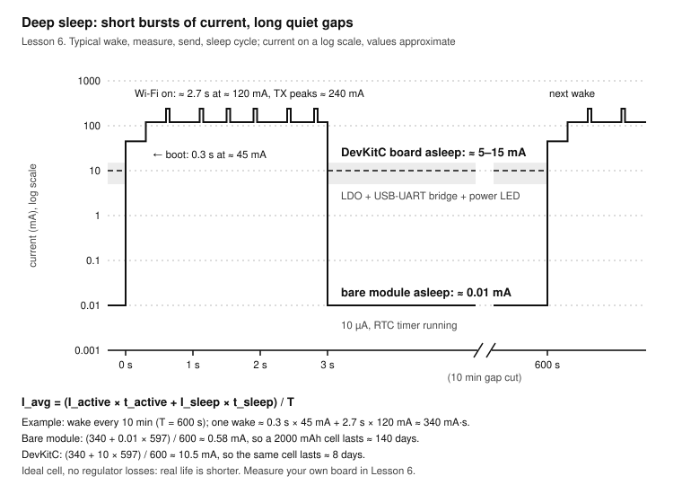

The work happens in short, expensive bursts; the long quiet gaps decide the battery life. The bare module needs about 10 µA asleep, but the DevKitC board around it keeps drawing milliamps.

### Exercise 6.1: Sleep, wake, remember

Variables marked `RTC_DATA_ATTR` live in RTC memory and survive deep sleep (not a power cut). Wake sources: the timer, and **ext0**, which wakes the chip when one RTC-capable pin reaches a level you choose. GPIO33 is RTC-capable.

The internal pull-up you set with `INPUT_PULLUP` belongs to the digital domain, which is off in deep sleep. Add an external 10 kΩ resistor from GPIO33 to 3V3 so the button pin stays HIGH while the chip sleeps.

```cpp deep_sleep.ino
RTC_DATA_ATTR uint32_t bootCount = 0;    // kept in RTC memory through deep sleep
const uint64_t SLEEP_SECONDS = 20;
const gpio_num_t WAKE_PIN = GPIO_NUM_33; // button to GND, 10 kΩ pull-up to 3V3
const int LED_PIN = 25;

void setup() {
  Serial.begin(115200);
  delay(200);
  bootCount++;
  esp_sleep_wakeup_cause_t cause = esp_sleep_get_wakeup_cause();
  const char* why = cause == ESP_SLEEP_WAKEUP_TIMER ? "timer"
                  : cause == ESP_SLEEP_WAKEUP_EXT0  ? "button"
                  : "power-on or reset";
  Serial.printf("Wake #%lu, woken by %s\n", (unsigned long)bootCount, why);

  pinMode(LED_PIN, OUTPUT);              // the "work": one second of LED
  digitalWrite(LED_PIN, HIGH);
  delay(1000);
  digitalWrite(LED_PIN, LOW);

  esp_sleep_enable_timer_wakeup(SLEEP_SECONDS * 1000000ULL);   // in µs
  esp_sleep_enable_ext0_wakeup(WAKE_PIN, 0);                   // wake on LOW
  Serial.println("Sleeping");
  Serial.flush();                        // let the text leave before sleeping
  esp_deep_sleep_start();
}

void loop() {
  // never reached: every wake starts again at setup()
}
```

1. Add the 10 kΩ pull-up from GPIO33 to 3V3 (the button from Lesson 1 stays between GPIO33 and GND).
2. Upload and watch the Serial Monitor: a wake every 20 seconds, with the count going up.
3. Press the button while it sleeps: it wakes at once and reports "button".
4. Press EN, or unplug USB and plug it back in: the count starts again at 1. `RTC_DATA_ATTR` memory is reloaded on every boot except a wake from deep sleep, and EN is a full chip reset.
5. Uploading works even while it sleeps: the upload tool resets the chip through EN.

### Exercise 6.2: Measure the current

1. Put the USB power meter between the Mac (or a USB charger) and the board.
2. Read the current while the LED is on (awake), and while asleep. Write both in the log.
3. Expect roughly 40 to 60 mA awake with the LED and no Wi-Fi, and several milliamps asleep: the LDO, the USB-UART bridge and the power LED stay on. The exact asleep figure depends on your board's revision, which is why you measure it.
4. Optional, with a bench supply and a multimeter: unplug USB, feed 3.3 V into the 3V3 pin with the meter in series on the mA range, and measure again. Bypassing the LDO lowers the sleep current, but it stays far above the module's 10 µA because other parts on the 3.3 V rail still draw.

> **Warning:** When you power the board through the 3V3 or 5V pin, USB must be unplugged. Two sources fight each other.

### Battery-life arithmetic

Average current is the charge used per cycle divided by the cycle time:

**I_avg = (I_awake × t_awake + I_sleep × t_sleep) / (t_awake + t_sleep)**

Example: wake every 10 minutes (600 s), spend 3 s awake with Wi-Fi to send a reading. The wake costs about 0.3 s × 45 mA + 2.7 s × 120 mA ≈ 340 mA·s.

| | Asleep | Average | 2000 mAh cell lasts |
| --- | --- | --- | --- |
| Bare ESP32 module | 0.01 mA | (340 + 0.01 × 597) / 600 ≈ 0.58 mA | 2000 / 0.58 ≈ 3500 h ≈ 140 days |
| DevKitC board | ≈ 10 mA | (340 + 10 × 597) / 600 ≈ 10.5 mA | 2000 / 10.5 ≈ 190 h ≈ 8 days |

Two lessons hide in that table. First, on a dev board the sleep current dominates, so deep sleep buys you only a few days. Second, on a bare module the **wake** dominates: halve the time spent connecting to Wi-Fi and you nearly double the battery life. Real batteries give less than their label (count on 80 %), lose a few percent a month to self-discharge, and any voltage regulator adds its own quiescent current.

For a real battery project, use a board designed for it (its datasheet will quote a deep-sleep current in the tens of microamps), or a bare module with a low-quiescent regulator such as an MCP1700 or HT7333, no USB bridge on the battery rail and no power LED. Disconnect dividers and sensors you are not reading: Lesson 2's 100 kΩ + 100 kΩ battery divider alone draws 21 µA, twice the sleeping chip.

## Lesson 7: Capstone: a room climate monitor

**Goal:** combine everything into a device you leave running: it shows the room's climate on the OLED, serves a dashboard and a JSON API, and logs a reading every five minutes to a CSV file in flash that you download from the browser. **Time:** 4 hours. **Pass:** it runs 24 hours unattended (survive at least one router restart), and the CSV download holds a full day of plausible readings (288 lines).

### What it does

- Reads the BME280 every 5 seconds in **forced mode** (one measurement, then the sensor sleeps), which keeps the sensor from warming itself.
- Shows three pages on the OLED; the button on GPIO33 flips between them: climate, pressure and clock, network status.
- Serves `http://climate.local/` with the live values, a **Toggle LED** button, a **Download CSV** link and a **Clear log** button; `/api` returns JSON for other programs.
- Appends `time,temperature,humidity,pressure` to `/log.csv` in **LittleFS** (a small file system in the flash) every 5 minutes, with real time from NTP. When the file passes 512 KB (about 49 days) it becomes `/log-old.csv` and a new one starts.
- Reconnects to Wi-Fi by itself.

### Wiring

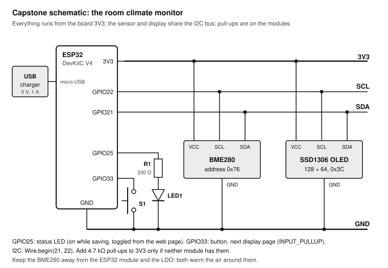

Lessons 1 and 4 combined: the BME280 and OLED on the I2C bus, the status LED on GPIO25 and the page button on GPIO33, all powered from the board's 3V3. A USB charger powers the finished unit.

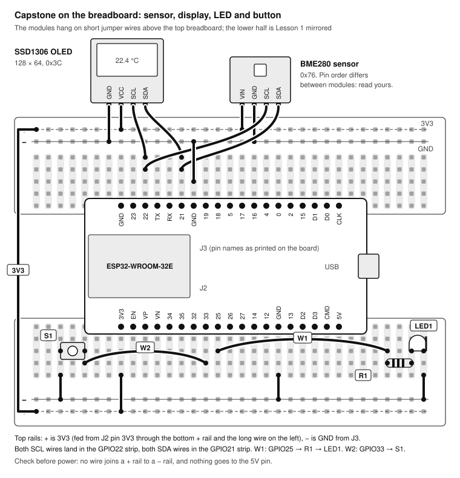

The two modules hang on short jumper wires above the top breadboard, which keeps the sensor a few centimetres away from the warm ESP32 module.

**Parts:** the DevKitC, a BME280 and an SSD1306 OLED (Lesson 4), one LED with 330 Ω, one push button, jumper wires, and a 5 V USB charger.

### The sketch

A sketch can have several tabs; Arduino IDE joins all `.ino` tabs into one program, main tab first and the rest alphabetically. Create a sketch named `climate_monitor`, then add tabs named `display.ino`, `storage.ino`, `web.ino` and `secrets.h` (the same `secrets.h` as Lesson 5). Set your time zone in `TZ_INFO`, and use 0x77 in `bme.begin()` if that is your sensor's address.

```cpp climate_monitor.ino
// Room climate monitor: BME280 + SSD1306 + web dashboard + CSV log in LittleFS.
#include <WiFi.h>
#include <WebServer.h>
#include <ESPmDNS.h>
#include <LittleFS.h>
#include <Wire.h>
#include <Adafruit_GFX.h>
#include <Adafruit_SSD1306.h>
#include <Adafruit_BME280.h>
#include <time.h>
#include "secrets.h"

const int LED_PIN = 25;
const int BUTTON_PIN = 33;
const unsigned long READ_EVERY_MS = 5000;              // sensor and display
const unsigned long LOG_EVERY_MS = 5UL * 60 * 1000;    // one CSV line per 5 min
const char* TZ_INFO = "CET-1CEST,M3.5.0,M10.5.0/3";    // your time zone

Adafruit_BME280 bme;
Adafruit_SSD1306 display(128, 64, &Wire, -1);
WebServer server(80);
float temperature = NAN, humidity = NAN, pressure = NAN;
int page = 0;          // OLED page: 0 climate, 1 pressure and clock, 2 network
bool ledOn = false;    // LED state, toggled from the web page

void readSensor() {
  bme.takeForcedMeasurement();                         // measure once, then sleep
  temperature = bme.readTemperature();
  humidity = bme.readHumidity();
  pressure = bme.readPressure() / 100.0F;
}

void setup() {
  Serial.begin(115200);
  pinMode(LED_PIN, OUTPUT);
  pinMode(BUTTON_PIN, INPUT_PULLUP);
  Wire.begin(21, 22);
  if (!display.begin(SSD1306_SWITCHCAPVCC, 0x3C)) Serial.println("OLED not found");
  if (!bme.begin(0x76)) Serial.println("BME280 not found");
  bme.setSampling(Adafruit_BME280::MODE_FORCED, Adafruit_BME280::SAMPLING_X1,
                  Adafruit_BME280::SAMPLING_X1, Adafruit_BME280::SAMPLING_X1,
                  Adafruit_BME280::FILTER_OFF);
  if (!LittleFS.begin(true)) Serial.println("LittleFS failed");   // true: format on first use
  showMessage("Joining Wi-Fi...");
  WiFi.mode(WIFI_STA);
  WiFi.begin(WIFI_SSID, WIFI_PASSWORD);
  for (int i = 0; i < 80 && WiFi.status() != WL_CONNECTED; i++) delay(250);
  configTzTime(TZ_INFO, "pool.ntp.org");
  MDNS.begin("climate");                               // http://climate.local
  startWebServer();
  readSensor();
  drawPage();
}

void loop() {
  static unsigned long lastRead = 0, lastLog = 0, lastWifiCheck = 0;
  server.handleClient();
  if (pagePressed()) { page = (page + 1) % 3; drawPage(); }
  if (millis() - lastRead >= READ_EVERY_MS) { lastRead = millis(); readSensor(); drawPage(); }
  if (millis() - lastLog >= LOG_EVERY_MS) { lastLog = millis(); appendLog(); }
  if (millis() - lastWifiCheck >= 10000) {
    lastWifiCheck = millis();
    if (WiFi.status() != WL_CONNECTED) WiFi.reconnect();
  }
}
```

```cpp display.ino
// OLED pages and the page button.
void showMessage(const char* text) {
  display.clearDisplay();
  display.setTextColor(SSD1306_WHITE);
  display.setTextSize(1);
  display.setCursor(0, 28);
  display.print(text);
  display.display();
}

void drawPage() {
  display.clearDisplay();
  display.setTextColor(SSD1306_WHITE);
  display.setTextSize(1);
  display.setCursor(0, 0);
  struct tm now;
  if (page == 0) {
    display.print("Room climate");
    display.setTextSize(2);
    display.setCursor(0, 18); display.printf("%.1f C", temperature);
    display.setCursor(0, 40); display.printf("%.0f %%RH", humidity);
  } else if (page == 1) {
    display.print("Pressure and time");
    display.setTextSize(2);
    display.setCursor(0, 18); display.printf("%.0f hPa", pressure);
    display.setCursor(0, 40);
    if (getLocalTime(&now, 10)) display.printf("%02d:%02d", now.tm_hour, now.tm_min);
    else display.print("--:--");
  } else {
    display.print("Network");
    display.setCursor(0, 16); display.print(WiFi.status() == WL_CONNECTED ? "online" : "offline");
    display.setCursor(0, 28); display.print(WiFi.localIP());
    display.setCursor(0, 40); display.printf("signal %d dBm", WiFi.RSSI());
    display.setCursor(0, 52); display.printf("log %u KB", (unsigned)(logBytes() / 1024));
  }
  display.display();
}

bool pagePressed() {                     // debounced, true once per press
  static int stable = HIGH, last = HIGH;
  static unsigned long changed = 0;
  int reading = digitalRead(BUTTON_PIN);
  if (reading != last) { last = reading; changed = millis(); }
  if (millis() - changed >= 20 && reading != stable) {
    stable = reading;
    return stable == LOW;
  }
  return false;
}
```

```cpp storage.ino
// CSV log in LittleFS: one line every LOG_EVERY_MS.
const char* LOG_PATH = "/log.csv";
const char* OLD_PATH = "/log-old.csv";
const size_t LOG_MAX_BYTES = 512 * 1024;   // about 49 days at 5-minute lines

void appendLog() {
  time_t now = time(nullptr);
  if (now < 1700000000 || isnan(temperature)) return;   // no clock or no reading yet
  digitalWrite(LED_PIN, ledOn ? LOW : HIGH);            // brief blink while writing
  File f = LittleFS.open(LOG_PATH, FILE_APPEND);
  if (f) {
    if (f.size() == 0) f.println("time,temperature_C,humidity_pct,pressure_hPa");
    struct tm t;
    localtime_r(&now, &t);
    char stamp[20];
    strftime(stamp, sizeof(stamp), "%Y-%m-%d %H:%M", &t);
    f.printf("%s,%.2f,%.1f,%.1f\n", stamp, temperature, humidity, pressure);
    size_t size = f.size();
    f.close();
    if (size > LOG_MAX_BYTES) {                         // start a fresh file
      LittleFS.remove(OLD_PATH);
      LittleFS.rename(LOG_PATH, OLD_PATH);
    }
  }
  delay(50);
  digitalWrite(LED_PIN, ledOn ? HIGH : LOW);
}

size_t logBytes() {
  File f = LittleFS.open(LOG_PATH, "r");
  if (!f) return 0;
  size_t size = f.size();
  f.close();
  return size;
}
```

```cpp web.ino
// Dashboard, JSON API, CSV download, LED toggle, clear log.
void handleRoot() {
  char html[1400];
  snprintf(html, sizeof(html),
    "<!doctype html><html><head><meta charset='utf-8'>"
    "<meta name='viewport' content='width=device-width,initial-scale=1'>"
    "<meta http-equiv='refresh' content='30'><title>Room climate</title>"
    "<style>body{font-family:sans-serif;margin:2em;max-width:30em}"
    "b{font-size:2.4em}button{font-size:1em;margin:.3em 0}</style></head><body>"
    "<h1>Room climate</h1><p><b>%.1f &deg;C</b><br><b>%.0f %%</b> humidity<br>"
    "%.1f hPa</p><p><a href='/log.csv'>Download CSV</a> (%u KB) &middot; "
    "<a href='/api'>JSON</a></p>"
    "<form action='/toggle' method='post'><button>Toggle LED (%s)</button></form>"
    "<form action='/clear' method='post' onsubmit=\"return confirm('Delete log?')\">"
    "<button>Clear log</button></form><p><small>up %lu min</small></p></body></html>",
    temperature, humidity, pressure, (unsigned)(logBytes() / 1024),
    ledOn ? "on" : "off", millis() / 60000);
  server.send(200, "text/html", html);
}

void handleApi() {
  char json[160];
  snprintf(json, sizeof(json),
    "{\"temperature\":%.2f,\"humidity\":%.1f,\"pressure\":%.1f,\"uptime_s\":%lu}",
    temperature, humidity, pressure, millis() / 1000);
  server.send(200, "application/json", json);
}

void handleLog() {
  File f = LittleFS.open(LOG_PATH, "r");
  if (!f) { server.send(404, "text/plain", "No log yet"); return; }
  server.sendHeader("Content-Disposition", "attachment; filename=climate-log.csv");
  server.streamFile(f, "text/csv");
  f.close();
}

void redirectHome() {
  server.sendHeader("Location", "/");
  server.send(303);
}

void startWebServer() {
  server.on("/", handleRoot);
  server.on("/api", handleApi);
  server.on("/log.csv", handleLog);
  server.on("/toggle", HTTP_POST, []() {
    ledOn = !ledOn;
    digitalWrite(LED_PIN, ledOn ? HIGH : LOW);
    redirectHome();
  });
  server.on("/clear", HTTP_POST, []() { LittleFS.remove(LOG_PATH); redirectHome(); });
  server.onNotFound([]() { server.send(404, "text/plain", "Not found"); });
  server.begin();
  MDNS.addService("http", "tcp", 80);
}
```

### Exercise 7.1: Build and bring it up

1. Wire the circuit from the schematic, on the breadboard as drawn. Check with the meter that 3V3 does not beep to GND.
2. Run the I2C scanner from Lesson 4 once: 0x3C and 0x76 (or 0x77) must appear.
3. Create the sketch with its five tabs. In the Tools menu, keep Partition Scheme "Default 4MB with spiffs": LittleFS uses that data partition.
4. Upload. The OLED says "Joining Wi-Fi...", then shows the climate page.
5. Open `http://climate.local/`. Check the values, toggle the LED, press the button on the breadboard and watch the OLED pages change.
6. To test the log without waiting, temporarily set `LOG_EVERY_MS` to `10000`, upload, wait a minute, and download the CSV. Open it in Numbers or Excel. Then set it back to 5 minutes and upload again.

### Exercise 7.2: The 24-hour test

Use this checklist. Every box must be ticked to pass.

- [ ] Running from a USB charger, not the Mac, in the room it will live in
- [ ] OLED updates every 5 seconds; all three pages work
- [ ] Dashboard loads on the phone by name and by IP address
- [ ] Router switched off for 2 minutes and back on: dashboard works again within 2 minutes, untouched
- [ ] After 24 hours the CSV has about 288 data lines with no gaps longer than 10 minutes
- [ ] Temperature agrees with a reference thermometer within 1 °C (see the tip below)
- [ ] Humidity follows the room: it rises when you shower, cook or open a window in rain
- [ ] Unplug and replug the charger: it comes back by itself and keeps appending to the same file

> **Tip:** If the temperature reads high, the sensor is warming in the air from the ESP32 module and its regulator. Lengthen the sensor's wires to 10 to 15 cm, keep it below and beside the board (warm air rises), and give the enclosure vents at the bottom and top. As a last step, subtract a fixed offset that you measured against a good thermometer.

### Exercise 7.3: Put it in a box

1. Mount the board, the OLED behind a window in the lid, and the sensor in its own ventilated corner, below the board.
2. Replace the breadboard wiring with soldered connections on perfboard or with short dupont leads (see the [soldering course](../soldering/README.md)).
3. Glue down the USB cable with strain relief so a tug on the cable cannot pull the connector.
4. Re-run the 24-hour checklist in the box. Enclosures change the temperature reading; correct the offset again.

### Extensions

- **Home Assistant via MQTT:** install the PubSubClient library, publish the three values to an MQTT broker every minute (for example `home/livingroom/climate`), and add an MQTT sensor in Home Assistant. Use the JSON from `/api` as the payload.
- **A chart on the dashboard:** fetch `/log.csv` with JavaScript in the page and draw the last 24 hours with an inline SVG polyline; no extra library needed.
- **Bluetooth Low Energy:** advertise the temperature with the core's `BLEDevice` library so a phone app can read it without Wi-Fi. BLE and Wi-Fi together usually outgrow the default 1.2 MB app space: choose the "Huge APP (3MB No OTA/1MB SPIFFS)" partition scheme, which still leaves 1 MB for LittleFS.
- **Battery version:** remove the OLED, use forced-mode readings and deep sleep (Lesson 6), log to RTC memory, and upload a batch every hour. On a dev board expect days; on a low-power board, months.
- **Alerts:** blink the LED or send a notification when humidity stays above 65 % for an hour (mould risk) or below 30 % (dry air).

## Troubleshooting

Start with the simplest explanation: cable, port, wiring, power. Most "the ESP32 is broken" moments are one of those.

| Symptom | Likely cause | Fix |
| --- | --- | --- |
| No port appears in Tools → Port | Charge-only cable; bad USB port; missing driver | Try a cable you know carries data; try another port; check System Information → USB; install the CP210x or CH34x driver only if the bridge appears there |
| Upload: "Failed to connect to ESP32: No serial data received" | Auto-reset did not enter download mode; something holds GPIO0 or GPIO2 | Hold BOOT, start the upload, release BOOT at the first percentage; unplug wires from GPIO0, 2, 12, 15 and retry. On early V4 boards, Espressif notes capacitor C15 can disturb boot |
| Upload works only with BOOT held | Bridge timing or a cable with poor signal | Lower Upload Speed to 115200; try another cable; carry on using BOOT |
| "Brownout detector was triggered", resets when Wi-Fi starts or a servo moves | Supply voltage sags under load | Better cable and port or a powered hub; power servos and motors separately; add 470 µF across 5V and GND |
| Endless reboots, "invalid header" or flash errors in the boot log | GPIO12 held high at reset; something on GPIO6 to 11 | Remove anything on GPIO12 or make sure it is low at boot; never use GPIO6 to 11 |
| Sketch never starts, log says "waiting for download" | GPIO0 held low at reset | Disconnect whatever is on GPIO0; do not hold BOOT while resetting |
| Garbage characters in the Serial Monitor | Baud rate mismatch | Set the monitor to 115200 to match `Serial.begin(115200)` |
| Guru Meditation Error, then a reboot | A crash: stack overflow, null pointer, or a non-IRAM ISR calling into flash | Read the first line of the crash; check ISRs are tiny and marked `IRAM_ATTR`; avoid huge local arrays |
| Wi-Fi never connects | Wrong name or password (case matters); 5 GHz-only network; captive portal | Print `WiFi.status()`; test with a phone hotspot set to 2.4 GHz |
| Connects, then drops every few minutes | Weak signal; power dips during transmit | Check RSSI (below −80 dBm is weak); move closer; better power |
| `esp32.local` does not open | The phone or PC does not support mDNS | Use the IP address; on Android, use the IP or an mDNS browser app |
| `analogRead()` returns 0 or fails once Wi-Fi is on | The pin is on ADC2 | Move the signal to GPIO32 to GPIO39 (ADC1) |
| Analog value stuck at 4095 | Input above about 3.1 V, or the pin is floating | Check with the meter; add or fix the divider |
| Input reads random values | Floating input | Use `INPUT_PULLUP` or an external pull-up or pull-down; GPIO34 to 39 need external ones |
| `ledcSetup` was not declared | Code written for core 2.x | Use `ledcAttach(pin, freq, bits)` and `ledcWrite(pin, duty)` |
| I2C device not found | SDA and SCL swapped; wrong address; module on 5V | Run the scanner; swap the wires; power from 3V3 |
| BME280 `begin()` fails but the scanner sees 0x76 | It is a BMP280 (no humidity) | Check the chip marking or buy a real BME280 |
| OLED shows nothing | `display.display()` missing; address 0x3D | Add the call; try 0x3D |

## Reference cards and practice log

Cut these out and keep them at the bench.

### Card A: Which pin for what (DevKitC V4)

| Use | GPIO |
| --- | --- |
| Any digital in or out | 4, 13, 16, 17, 18, 19, 21, 22, 23, 25, 26, 27, 32, 33 (14 also, but it pulses at boot) |
| Analog that works with Wi-Fi (ADC1) | 32, 33, 34, 35, 36 (VP), 39 (VN) |
| Input only, no internal pull-ups | 34, 35, 36, 39 |
| I2C default | SDA 21, SCL 22 |
| SPI default | SCK 18, MISO 19, MOSI 23, SS 5 |
| Serial2 default | RX 16, TX 17 |
| DAC (true analog out) | 25, 26 |
| Touch | T0 4, T1 0, T2 2, T3 15, T4 13, T5 12, T6 14, T7 27, T8 33, T9 32 |
| Wake from deep sleep | RTC pins: 0, 2, 4, 12 to 15, 25 to 27, 32 to 39 |
| Careful: strapping pins | 0, 2, 5, 12, 15 |
| Never | 6 to 11 (flash), 1 and 3 (USB serial) |

### Card B: Power limits

| Quantity | Plan for | Never exceed |
| --- | --- | --- |
| Voltage on any GPIO | 0 to 3.3 V | 3.6 V (pins are not 5 V tolerant) |
| Current per GPIO | 12 mA | 40 mA |
| 5V pin input (USB unplugged) | 5.0 V | 5.5 V |
| 3V3 pin input (USB unplugged) | 3.3 V | 3.6 V |
| Draw from the 3V3 pin for your circuits | 200 mA | what keeps the LDO cool to the touch |
| Total from a USB port | 500 mA | the port's limit |
| ESP32 itself | 80 to 130 mA average with Wi-Fi | 240 mA peaks while transmitting |
| HIGH and LOW input thresholds | above 2.5 V is HIGH, below 0.8 V is LOW | |

### Card C: Arduino-ESP32 core 3.x crib

| Call | Does |
| --- | --- |
| `pinMode(p, INPUT_PULLUP)` | Input with the internal pull-up (not GPIO34 to 39) |
| `digitalWrite(p, HIGH)`, `digitalRead(p)` | Set or read a pin |
| `attachInterrupt(digitalPinToInterrupt(p), isr, FALLING)` | Call `isr` on an edge; mark it `IRAM_ATTR` |
| `ledcAttach(p, freq, bits)` | Start hardware PWM on a pin |
| `ledcWrite(p, duty)` | Duty from 0 to 2^bits − 1 |
| `ledcWriteTone(p, freq)`, `ledcDetach(p)` | A 50 % square wave; release the pin |
| `analogRead(p)`, `analogReadMilliVolts(p)` | Raw 0 to 4095; calibrated millivolts |
| `analogSetPinAttenuation(p, ADC_11db)` | Input range, 11 dB is about 0.15 to 3.1 V |
| `timerBegin(freq)`, `timerAttachInterrupt(t, isr)`, `timerAlarm(t, ticks, true, 0)` | Hardware timer interrupt, for example `timerBegin(1000000)` ticks in µs |
| `Wire.begin(21, 22)` | Start I2C on SDA, SCL |
| `WiFi.begin(ssid, pass)`, `WiFi.status()`, `WiFi.localIP()` | Join Wi-Fi and check |
| `MDNS.begin("name")` | Answer to name.local |
| `server.on("/", fn)`, `server.handleClient()` | Route a URL; serve requests in `loop()` |
| `configTzTime(tz, "pool.ntp.org")`, `getLocalTime(&tm, ms)` | Real time from NTP |
| `LittleFS.begin(true)`, `LittleFS.open(path, FILE_APPEND)` | Files in flash |
| `esp_sleep_enable_timer_wakeup(us)`, `esp_deep_sleep_start()` | Deep sleep with a timer wake |
| `esp_sleep_enable_ext0_wakeup(GPIO_NUM_33, 0)` | Wake when a pin goes LOW |
| `RTC_DATA_ATTR int x;` | A variable that survives deep sleep |

### Card D: Before you plug in USB

- [ ] Nothing connected to the 5V pin unless you mean it
- [ ] No wire from 5 V or 12 V to any GPIO
- [ ] Every external supply's minus joined to GND
- [ ] Nothing on GPIO6 to 11, GPIO1 or GPIO3
- [ ] Nothing pulling GPIO12 high or GPIO0 low
- [ ] Every LED has a resistor; every coil and motor a diode
- [ ] Meter check: 3V3 and 5V do not beep to GND

### Practice log

| Date | Lesson / exercise | What I built | Measured values | Worked first time? | Problem and fix | Next step |
| --- | --- | --- | --- | --- | --- | --- |
| &nbsp; | | | | | | |
| &nbsp; | | | | | | |
| &nbsp; | | | | | | |
| &nbsp; | | | | | | |
| &nbsp; | | | | | | |
| &nbsp; | | | | | | |
| &nbsp; | | | | | | |
| &nbsp; | | | | | | |
| &nbsp; | | | | | | |
| &nbsp; | | | | | | |
