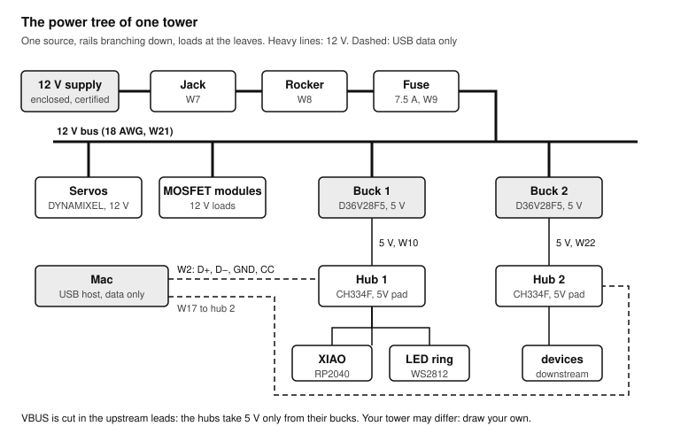
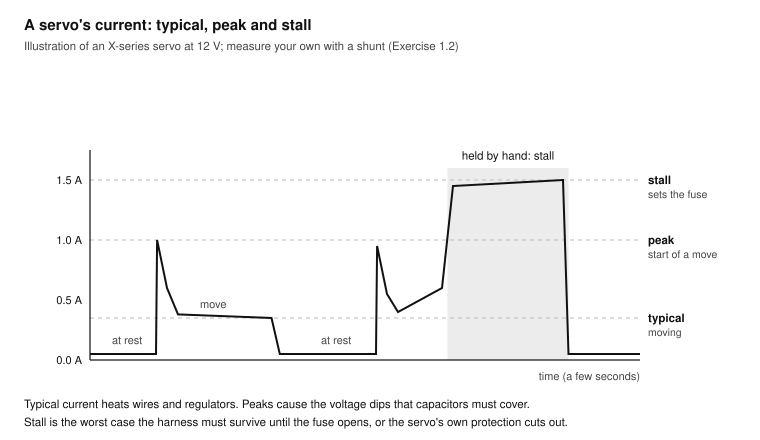
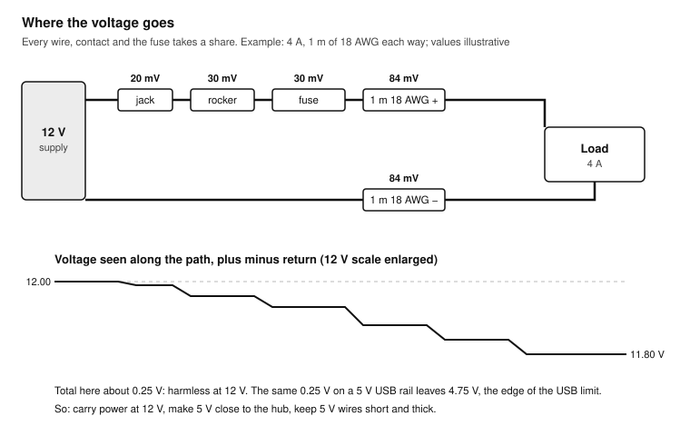
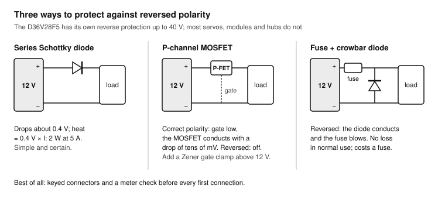
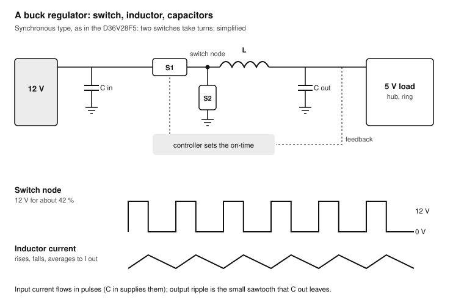
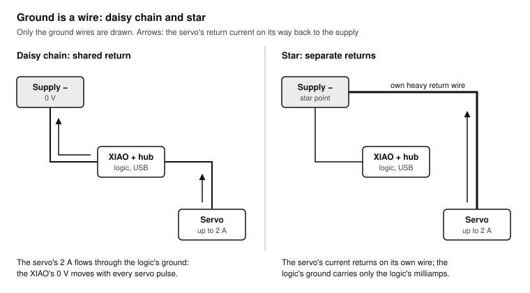
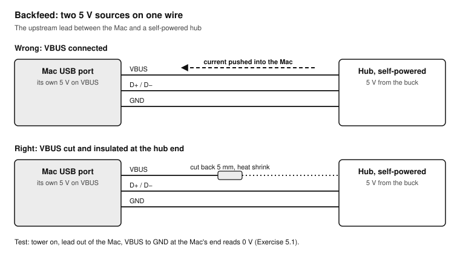
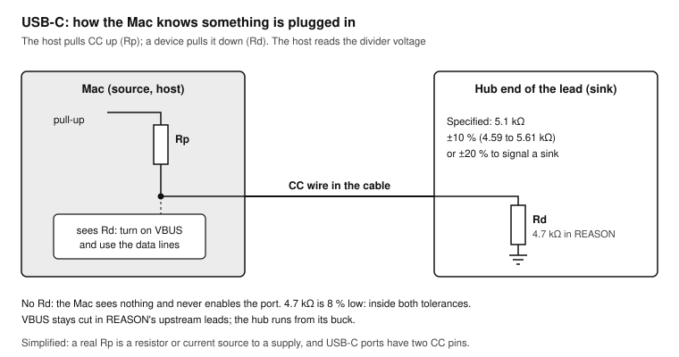
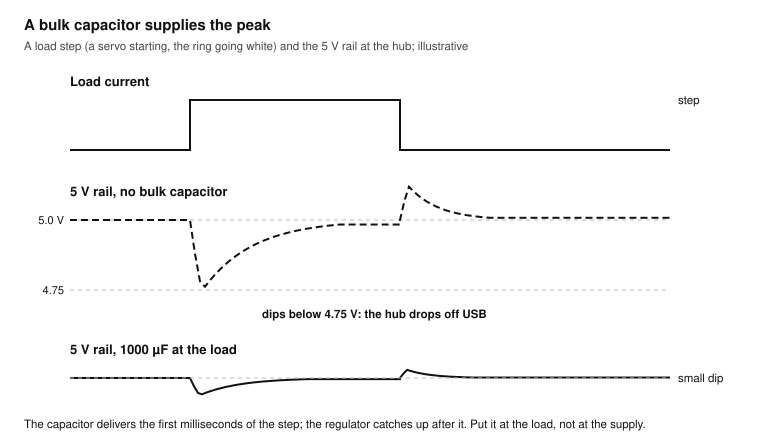
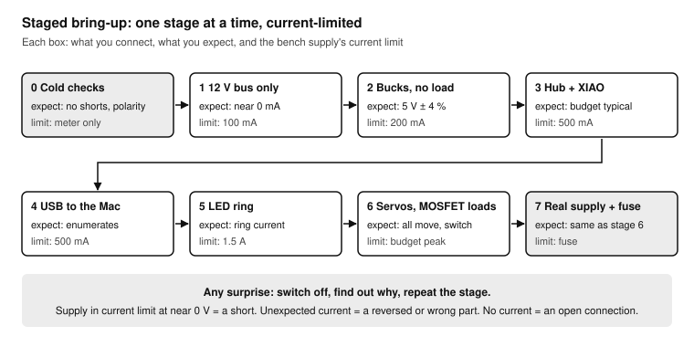

# Power and USB for Multi-Board Builds

*A practical course on powering and connecting a build of several boards from one 12 V supply: power budgets, harnesses and fuses, buck regulators, grounding, USB hubs and cables, noise, and a safe bring-up. Written around REASON's towers and useful for any robot or installation. Last updated 2026-11-07.*

**Shopping list:** see [Everything you need for all lessons](#everything-you-need-for-all-lessons).

**Printable version:** print [`power-usb-course.pdf`](power-usb-course.pdf). It has the whole course, high-contrast drawings, cut-out reference cards, a power-budget worksheet and a rail record sheet. You can also read [`power-usb-course.html`](power-usb-course.html) in a browser. The drawings live in [`diagrams/`](diagrams/) as SVG, with high-contrast print versions in [`diagrams/print/`](diagrams/print/); their sources are in [`diagrams/src/`](diagrams/src/). From the repository root, `node tools/render-diagrams.mjs power-usb` rebuilds the drawings and then `node tools/build-course.mjs power-usb` rebuilds both the HTML and the PDF.

## How to use this course

A single board on a USB cable needs no power design: the Mac supplies 5 V, the board takes what it needs, and the cable carries the data. A build with servos, LED rings, MOSFET loads, regulators, USB hubs and several microcontrollers on one 12 V supply is different. Most of its faults are power faults: a hub that drops off the bus when a servo moves, a board that resets when the LEDs go white, a regulator that runs hot, a cable that works at full speed on Monday and at 12 Mb/s on Tuesday, or a Mac port that gets 5 V pushed back into it.

Nine sessions, about 18 hours in total, take you from a power budget on paper to a measured report on a finished tower. The examples use REASON's parts (a 12 V supply with a fused harness, DYNAMIXEL servos, Pololu D36V28F5 buck regulators feeding CH334F USB hubs, a XIAO RP2040, MOSFET modules and a WS2812 ring), but every method applies to any build of the same kind.

Every lesson has a goal, the parts you need, numbered exercises and a pass criterion. Do not move on until you pass. Write every measurement in the practice log or on the worksheets at the end: a power fault that comes back months later is found in minutes when you know what the rails looked like on the day it worked.

| Lesson | Skill | Bench time | Pass criterion |
| --- | --- | --- | --- |
| 0 | The power tree and the measuring kit | 1.5 h | Your tower's power tree drawn, every rail and load on it |
| 1 | The power budget: typical, peak and stall | 2 h | A filled-in budget with a supply, fuse and regulator choice you can defend |
| 2 | The 12 V supply, harness and fuse | 2.5 h | Voltage drop of your harness measured at full load, within your budget |
| 3 | Buck regulators | 2.5 h | Efficiency, ripple and load-step response of one D36V28F5 measured |
| 4 | Grounding and return currents | 2 h | Ground offset between two points of a tower measured while a servo moves |
| 5 | USB power and data | 2.5 h | Every device enumerates at the right speed; no VBUS backfeed into the Mac |
| 6 | Noise, decoupling and brownouts | 2 h | The 5 V rail stays above 4.75 V during a servo stall and an all-white LED flash |
| 7 | Bring-up: powering a new tower safely | 1.5 h | A tower brought up stage by stage with the checklist, every value recorded |
| 8 | Capstone: a power and USB report for one tower | 2 h | A report that someone else could use to find a fault |

Work in sessions of 60 to 120 minutes. Power work rewards patience: measure first, switch on second.

### Related courses

- [Hands-On Soldering](../soldering/README.md): the joints this course measures. [Exercise 6.1](../soldering/README.md#exercise-61-usb-cable-surgery-do-3) (USB cable surgery), [Exercise 6.2](../soldering/README.md#exercise-62-wires-onto-small-pads-and-an-inline-resistor) (wires onto pads and the inline CC resistor) and [Exercise 6.3](../soldering/README.md#exercise-63-the-12-v-harness-w7-w21) (the 12 V harness) build what Lessons 2 and 5 test.
- [ESP32 Hands-On](../esp32/README.md) and [Teensy 4.1 Hands-On](../teensy41/README.md): brownouts, MOSFET loads and USB boards on a single bench. This course scales them up to a whole build.
- [Oscilloscope Hands-On](../sds804x-hd/README.md): [Lesson 6](../sds804x-hd/README.md#lesson-6-power-and-current) teaches the current shunt, the USB current-sense lead and brownout triggers used here; [Exercise 4.1](../sds804x-hd/README.md#exercise-41-ripple-on-the-3v3-rail) teaches ripple measurement.
- The [oscilloscope buying guide](../oscilloscope/README.md), for safe probing of a build that shares ground with your Mac.
- [DYNAMIXEL Servos](../dynamixel/README.md): the servos that are the biggest and least predictable load on the 12 V bus.
- [The XIAO RP2040 and the Interlock](../xiao-interlock/README.md): the controller and the firing interlock that sit on the rails this course designs.

## Power in one page

Five quantities explain almost everything in this course.

- **Voltage (V)** is what a rail is supposed to hold: 12 V on the bus, 5 V on the hubs, 3.3 V inside the XIAO.
- **Current (A)** is what each load draws. It changes all the time: a servo at rest draws tens of milliamps, moving a few hundred, stalled more than an ampere.
- **Resistance (Ω)** of wires, connectors, fuses and switches turns current into lost voltage: **V = I × R**. A 0.05 Ω path at 4 A loses 0.2 V.
- **Power (W)** is voltage times current, **P = V × I**. It is also the heat in every resistance: **P = I² × R**. That 0.05 Ω path at 4 A heats by 0.8 W.
- **Energy and charge** come in when loads pulse: a capacitor can supply a short peak that a long wire cannot.

A build has a **power tree**: one source at the top, rails branching down, loads at the leaves. Draw it before anything else, because every later decision (fuse, wire size, regulator, capacitor, ground route) belongs to one branch of it.



A typical tower: the 12 V supply feeds the servos and the MOSFET loads directly, and a buck regulator makes 5 V for the USB hub and the LED ring. The Mac provides only data to the hub; its 5 V is cut off in the upstream lead.

### Typical, peak and stall

Three current figures matter for every load:

- **Typical:** what it draws doing its normal job. This sets the heat in wires and regulators and the long-term load on the supply.
- **Peak:** the highest short pulse in normal use: a servo starting to move, a radio transmitting, an LED ring flashing white. This sets the voltage dips and the capacitors you need.
- **Stall or fault:** the most it can draw when something goes wrong: a servo blocked by a hand or a mechanical end stop, a shorted output. This sets the fuse and the wire size, because the harness must survive it until the fuse opens.

## Safety and good habits

The voltages in this course are low, but the currents are not. A 12 V supply that can deliver 10 A will melt a thin wire, burn a finger on a hot regulator and weld a dropped screwdriver across two terminals.

- **Never work on mains.** Use a certified, enclosed 12 V supply. Nothing in this course opens it.
- **Fuse at the source.** Every wire that leaves the supply is protected by a fuse sized for the thinnest wire behind it (Lesson 2).
- **Meter before power.** Check polarity and shorts with the meter before every first connection. REASON's build page writes "polarity: meter first" for a reason.
- **Current-limit new hardware.** A bench supply with a current limit turns a wiring mistake into a beep instead of smoke (Lesson 7).
- **Watch for heat.** Touch regulators, MOSFETs and connectors after a few minutes under load, carefully, with the back of a finger. Too hot to hold means a problem.
- **Mind the scope's ground.** The oscilloscope's probe grounds are mains earth. On a build that is also connected to your Mac, clip probe grounds only to the build's GND (see [Oscilloscope Hands-On, Safety](../sds804x-hd/README.md#safety-and-good-habits)).
- **Never feed 5 V into a Mac port.** A USB lead from a self-powered hub to the Mac must not connect the hub's 5 V to the Mac's VBUS (Lesson 5).

> **Warning:** Large capacitors on the 12 V bus store energy. After switching off, wait a few seconds or check the voltage before you touch or short anything.

## Everything you need for all lessons

### Tools (buy once)

- [ ] Multimeter with DC volts, DC amps (10 A range) and continuity (0 to 8)
- [ ] Adjustable bench power supply with a current limit, 0 to 15 V, at least 3 A (1, 3, 7)
- [ ] Oscilloscope with four probes, ideally the SDS804X HD of the [oscilloscope course](../sds804x-hd/README.md) (3, 4, 6, 8)
- [ ] USB power meter (inline USB-A tester showing volts and milliamps) (1, 5)
- [ ] The USB current-sense lead from [oscilloscope Exercise 6.1](../sds804x-hd/README.md#exercise-61-build-a-usb-current-sense-lead) (1, 5)
- [ ] Soldering kit from the [soldering course](../soldering/README.md) (2, 5)
- [ ] An infrared thermometer, optional (3)

### Parts

- [ ] Shunt resistors: 0.1 Ω and 0.01 Ω, 1 %, 3 W or more (1, 4, 6)
- [ ] Power resistors as dummy loads: 10 Ω 10 W ×2, 5 Ω 10 W ×2 (or 2.5 Ω 25 W) (2, 3, 6)
- [ ] A logic-level MOSFET module or the IRLB8721 circuit of [ESP32 Exercise 3.1](../esp32/README.md#exercise-31-switch-a-12-v-load-on-and-off), to switch a dummy load (3, 6)
- [ ] Electrolytic capacitors: 470 µF 25 V ×2, 1000 µF 16 V ×2; ceramic 10 µF and 100 nF ×4 (3, 6)
- [ ] Spare 18 AWG and 22 AWG wire, red and black, 2 m each (2, 4)
- [ ] Spare blade fuses: 2 A, 5 A, 7.5 A (2)
- [ ] A spare USB cable to cut, and a USB-A breakout pair (5)
- [ ] A spare D36V28F5 regulator, if you have one; otherwise test the one for the tower before fitting it (3)

### From the build

- [ ] The 12 V supply, jack, rocker, fuse holder and harness of [soldering Exercise 6.3](../soldering/README.md#exercise-63-the-12-v-harness-w7-w21) (2)
- [ ] One tower's boards: buck regulator, USB hub, XIAO RP2040, a servo, a MOSFET module, the LED ring (4 to 8)
- [ ] The tower's USB leads, built in [soldering Exercise 6.1](../soldering/README.md#exercise-61-usb-cable-surgery-do-3) (5)

### Software (free)

- macOS System Information and Terminal (`system_profiler`, `ioreg`) for USB checks (5).
- Arduino IDE 2 with the board support you use for the XIAO, for the test sketches (6).

## Lesson 0: The power tree and the measuring kit

**Goal:** know every rail and load of your tower, and have the instruments set up to measure them. **Time:** 1.5 hours. **Pass:** your tower's power tree drawn on paper with every rail, regulator, fuse and load, and your meter and bench supply checked against each other.

### Exercise 0.1: Draw your tower's power tree

1. Take one tower and list every part that takes power: servos, MOSFET modules and their loads, regulators, the hub, the XIAO, the LED ring, anything else.
2. Draw the tree from the top: the 12 V supply, the jack, the rocker, the fuse, the bus, then each branch. Mark each regulator with its input and output voltage.
3. For each USB lead, mark which way data flows and whether VBUS is connected. On REASON's upstream leads it is not.
4. Mark every ground connection: where each board's GND joins the others.
5. Number each wire with REASON's W-numbers where you have them.

**Test:** every part of the tower appears exactly once, and you can trace a path from the supply to each load and back to the supply's minus.

### Exercise 0.2: Check the instruments against each other

A wrong meter makes every later measurement wrong. Check the instruments you will trust.

1. Set the bench supply to 12.00 V with no load. Read it with the meter. Note both values.
2. Connect the 10 Ω power resistor. The supply's display and the meter (on the 10 A range, in series) should both read about 1.2 A. Note both.
3. Read the supply's voltage on the scope (CH1, 10×, DC coupling, 2 V/div) and compare: a scope's DC accuracy is around 1 %, the meter's better.
4. Set the bench supply's current limit to 0.5 A and connect the 10 Ω resistor again. The supply drops into current limit (constant-current mode, usually a lit CC indicator) and its voltage falls to about 5 V. That is the behaviour that protects new hardware in Lesson 7.

**Test:** meter and supply agree within 1 % on voltage and 3 % on current, and you have seen the supply go into current limit.

## Lesson 1: The power budget

**Goal:** know how much current each rail must deliver, typically and at its worst, and choose the supply, fuse and regulators from those numbers. **Time:** 2 hours. **Pass:** the power-budget worksheet filled in for one tower, with typical, peak and stall currents, and a supply, fuse and regulator choice you can defend with them.

### Where the numbers come from

There are three sources of current figures, in order of trust:

1. **Your own measurement** of the actual part, doing the actual job.
2. **The datasheet**, read carefully: typical or maximum, at which voltage, under which load.
3. **A rule of thumb**, only until you can do 1 or 2.

| Load | Typical | Peak | Stall or fault | Where to check |
| --- | --- | --- | --- | --- |
| DYNAMIXEL X-series servo at 12 V | tens of mA at rest, a few hundred mA moving | about 1 A when starting a move under load | about 1.4 A (XL430-W250) to 2.3 A (XM430-W350) | The model's ROBOTIS e-Manual: input voltage and performance table |
| WS2812 LED | about 1 mA dark | about 60 mA at full white | the same | Adafruit's NeoPixel guide; ring current = LEDs × per-LED current |
| XIAO RP2040 | tens of mA | the same | the same | Seeed's wiki; measure with the USB meter |
| USB hub (CH334F board) | tens of mA for the hub itself | plus every downstream device | 500 mA per downstream port in the USB 2.0 rules | The hub board's notes; the devices you plug in |
| MOSFET module with a 12 V load | the load's current | the load's inrush | the load shorted | The load's rating |
| D36V28F5 regulator | input = output power ÷ efficiency ÷ input voltage | | | Pololu's product page |

The servo figures are examples from two common X-series models. Find your exact model (it is printed on the label, for example XL430-W250-T) and use its own table. Some X-series models (the XL330 family, for example) run at 5 V, not 12 V; they belong on a 5 V rail, never on the 12 V bus.



A servo's current is a series of pulses, not a constant. The average sets the heat; the peaks set the dips; the stall sets the fuse.

### From loads to the supply

Each regulator turns its output current into a smaller input current at a higher voltage, plus losses:

**input current = (output voltage × output current) ÷ (efficiency × input voltage)**

A D36V28F5 delivering 2 A at 5 V (10 W), at an efficiency of 90 %, draws 10 ÷ 0.9 ÷ 12 = 0.93 A from the 12 V bus. Pololu publishes the efficiency as graphs on the product page; this course uses 90 % in examples until you measure your own in Lesson 3.

Add the branches up rail by rail, from the leaves to the top:

1. **Typical total** of the 12 V bus: what the supply delivers most of the time. Choose a supply rated at least 1.5 times this.
2. **Peak total**, assuming the peaks that can happen together do happen together (all servos starting at once, the ring flashing white). The supply must deliver this without dropping out, and the capacitors must cover what it cannot.
3. **Stall total**: the fuse must not open during the peak total but must open at a fault well before the thinnest wire behind it overheats.

### Exercise 1.1: Measure the small loads

1. Plug the XIAO into the Mac through the USB power meter. Run its normal sketch. Note the current, idle and busy.
2. Do the same with the hub alone (nothing plugged in), then with each device plugged into it.
3. Power the LED ring from the bench supply at 5.0 V through the meter. Light it dark, at your normal pattern, and at full white for one second. Note the three currents. Full white on a ring of many LEDs can exceed an ampere.

**Test:** three numbers per load in your worksheet: typical, peak and, where it exists, stall.

### Exercise 1.2: Measure a servo's current profile

1. Power one servo from the bench supply at 12.0 V with the current limit at 2.5 A, through a 0.1 Ω shunt in its minus lead (low side, as in [oscilloscope Lesson 6](../sds804x-hd/README.md#lesson-6-power-and-current); the scope's ground clip goes to the supply's minus side of the shunt).
2. CH1 across the shunt: 0.1 Ω turns 100 mA into 10 mV. Set 20 mV/div, 200 ms/div, Roll mode.
3. Command the servo through its normal moves (with the servo course's tools or REASON's software). Note the current at rest, during a move and the peak at the start of a move.
4. Stall test: hold the horn gently while commanding a move. The current rises to its stall value and the servo may shut down on its own overload protection. Hold for no more than two seconds, and keep your fingers clear of anything that can pinch.

**Test:** your worksheet has the servo's rest, moving, peak and stall currents, and they agree with the e-Manual's figures within reason.

### Exercise 1.3: Fill in the budget

1. Use the power-budget worksheet at the end of this course. One row per load, grouped by rail.
2. Compute each regulator's input current from its output.
3. Add up the 12 V bus: typical, peak (with everything that can coincide) and stall.
4. Compare with your supply's rating and REASON's 7.5 A fuse. Write down the margin.

**Test:** you can answer three questions from the worksheet: how much current flows most of the time, how much at the worst normal moment, and what opens the fuse.

## Lesson 2: The 12 V supply, harness and fuse

**Goal:** understand where the voltage goes between the supply and the loads, size wires, connectors and the fuse, and protect against reversed polarity. **Time:** 2.5 hours. **Pass:** the voltage drop of your harness measured at full load, and a fuse, wire and connector choice that you can explain.

### Wire resistance and voltage drop

Every wire is a resistor. For copper at 20 °C, approximately:

| AWG | Cross-section | Resistance per metre | Drop per metre of a pair at 3 A | Typical use in REASON |
| --- | --- | --- | --- | --- |
| 18 | 0.82 mm² | 0.021 Ω | 0.13 V | 12 V harness (W7, W21) |
| 20 | 0.52 mm² | 0.033 Ω | 0.20 V | 12 V branches |
| 22 | 0.33 mm² | 0.053 Ω | 0.32 V | buck to hub 5 V (W10, W22) |
| 24 | 0.20 mm² | 0.084 Ω | 0.50 V | |
| 26 | 0.13 mm² | 0.134 Ω | 0.80 V | LED ring wires (W28) |
| 28 | 0.08 mm² | 0.213 Ω | 1.28 V | conductors inside USB cables |

A "pair" means the plus and the minus wire: current flows out and back, so the loop is twice the length. Stranded wire is a few percent worse than solid; warm wire is worse again (about 0.4 % per °C).



Every wire, contact and the fuse take a small share of the voltage. On the 12 V bus, a few hundred millivolts do not matter. On a 5 V rail they do: USB devices may stop working below 4.75 V, and a thin, long 5 V wire can lose that much on its own.

Two consequences:

- **Put regulators close to their loads.** Carry power at 12 V, where the current is lower and a drop matters less, and make 5 V near the hub. That is why REASON has a buck per hub.
- **Keep 5 V wires short and thick.** 15 cm of 22 AWG pair at 2 A loses 0.03 V; 1 m of 26 AWG pair at 2 A loses 0.54 V.

### Connectors, switches and the fuse

- **Connectors** have a current rating and a contact resistance. A 5.5 × 2.1 mm DC barrel jack is commonly rated between 3 A and 5 A; check yours. If the build's peak current is higher, the jack is the weak point, and it will warm up and its contact will degrade. Use a connector rated above the fuse.
- **Switches** are rated separately for AC and DC. A rocker marked "16 A 250 V AC" may be rated for much less at 12 V DC, because DC arcs do not extinguish themselves at a zero crossing. Read the DC rating, or switch a relay instead of the full current.
- **The fuse protects the wire,** not the load. Choose a fuse that never opens at the normal peak current and opens quickly at a short. Then make sure every wire behind it can carry the fuse's rating continuously. A fuse is not a precise switch: it carries its rated current indefinitely and opens after seconds to minutes at moderate overloads and within milliseconds at a short. The fuse's datasheet has the time-current curve.
- **Inrush:** at switch-on, every capacitor on the bus charges at once. A large inrush makes a spark at the jack and can blow a fast fuse. The D36V28F5's soft-start limits its own inrush; large electrolytics directly on the bus do not.

REASON's 7.5 A fuse with 18 AWG wire is a consistent pair: 18 AWG hook-up wire carries 7.5 A continuously with a modest temperature rise in open air. Branches in thinner wire need their own, smaller fuses.

### Polarity protection

A reversed supply destroys most boards in milliseconds. The D36V28F5 is protected against reverse input up to 40 V, but servos, MOSFET modules, LED rings and hubs generally are not.



- **Series diode:** simple and certain, but a Schottky diode drops about 0.4 V and heats by 0.4 V × current: 2 W at 5 A.
- **P-channel MOSFET:** the same protection with a drop of a few tens of millivolts. With correct polarity, the gate is pulled low and the MOSFET conducts; reversed, it stays off.
- **Fuse and a reverse diode across the bus:** the diode shorts a reversed supply and blows the fuse. Crude but effective, and it costs a fuse each time.
- **Keyed connectors** prevent the mistake in the first place; meter first anyway.

### Exercise 2.1: Measure the harness drop

1. Build or take the harness of [soldering Exercise 6.3](../soldering/README.md#exercise-63-the-12-v-harness-w7-w21). Connect the 12 V supply, and at the far end a dummy load: two 5 Ω 10 W resistors in parallel (2.5 Ω, 4.8 A at 12 V, 58 W: they get hot within seconds, so use short tests).
2. Measure the voltage at the supply's terminals and at the load's terminals at the same moment (two meters, or the scope's CH1 and CH2 with their grounds both on the supply's minus).
3. Switch on for 5 seconds and read both. The difference is the harness drop.
4. Measure the drop across each part separately: the plus wire, the fuse holder, the rocker, the jack, the minus wire. Probe directly at each part's terminals.
5. Compare each with the table above. A contact that drops more than a wire of the same length is a bad joint or a weak part.

**Test:** total drop and each part's share at about 5 A in your log. Nothing feels warm after the 5-second test except the dummy load.

### Exercise 2.2: Fuse check

1. Remove the 7.5 A fuse and measure its resistance with the meter: a few milliohms, often below what a meter can resolve. Note it.
2. Fit a 2 A fuse. Load the harness with the 2.5 Ω dummy load (about 4.8 A). The fuse opens within seconds.
3. Note how long it took. At about 2.4 times its rating, a fuse takes a noticeable time; a short circuit at many times the rating is much quicker.
4. Refit the 7.5 A fuse.

**Test:** you have seen a fuse open on a known overload, and your log has its time.

### Exercise 2.3: Polarity check before every connection

1. With the supply plugged in and the rocker on, measure at each tower's input connector: red probe on the plus terminal, black on the minus. The meter must read +12 V, not −12 V.
2. Repeat with the rocker off: 0 V.
3. Measure from the 12 V bus to the hub's 5 V pad with everything off: no continuity.

**Test:** every tower input reads +12 V with the correct sign, and no 12 V path leads to a 5 V part.

## Lesson 3: Buck regulators

**Goal:** understand how a step-down (buck) regulator works, what it does to the input current and the output voltage, and measure one. **Time:** 2.5 hours. **Pass:** efficiency, output ripple and load-step response of one D36V28F5 measured and recorded.

### How a buck regulator works



A buck regulator switches its input on and off many thousands of times per second through an inductor. While the switch is on, the inductor's current rises and it stores energy; while it is off, the inductor keeps the current flowing through a diode or a second switch and gives the energy to the output. The output capacitor smooths the result. The regulator adjusts the fraction of time the switch is on (the duty cycle) so the output stays at 5 V: roughly 5 ÷ 12, about 42 %, from a 12 V input.

Three things follow:

- **Input current is smaller than output current.** Power in equals power out plus losses. At 90 % efficiency, 2 A at 5 V costs 0.93 A at 12 V. A linear regulator (such as a 7805) would draw the full 2 A from 12 V and burn 14 W as heat.
- **The input current is pulsed.** The regulator draws current from the bus in pulses at its switching frequency. The input capacitor supplies those pulses locally, so the bus wiring does not have to.
- **The output has ripple.** A small sawtooth at the switching frequency rides on the 5 V, plus short spikes at each switching edge.

### The D36V28F5

Pololu's D36V28F5 is a small module around a synchronous buck regulator. From Pololu's product page:

| Property | Value |
| --- | --- |
| Input voltage | 5.3 V to 50 V (the minimum rises with load: the input must stay above 5 V plus the dropout) |
| Output | 5 V, ±4 % |
| Output current | 3.2 A typical maximum continuous, depending on input voltage and cooling |
| Quiescent current | 3 mA maximum with no load; under 1 mA with the enable pin low |
| Protection | reverse input voltage up to 40 V, over-current, over-temperature shutoff, soft-start |
| Power-good output | goes low when the output is more than 20 % above or 10 % below 5 V |
| Efficiency | published as graphs on the product page; read the curve for 12 V input at your load |

Two practical notes. The module has its own input and output capacitors, but a long input lead adds inductance; a 33 µF or larger electrolytic at the module's input, close to it, keeps the input steady when the leads are more than a few centimetres long. Pololu describes this on the product page; follow its recommendation for your lead length. And the power-good pin is a free diagnostic: route it to a spare XIAO input or an LED and the tower can report a sagging 5 V rail itself.

### Exercise 3.1: Measure the efficiency

1. Power one D36V28F5 from the bench supply at 12.0 V. Connect a 10 Ω 10 W resistor to its output (0.5 A at 5 V).
2. Measure input voltage and current, and output voltage and current, with the meter (in series for the current; move it between input and output, or use the bench supply's current display for the input).
3. Efficiency = (V_out × I_out) ÷ (V_in × I_in). Note it.
4. Repeat with 5 Ω (1 A) and with 2.5 Ω (2 A, two 5 Ω in parallel).
5. Compare with Pololu's efficiency curve for 12 V input.

**Test:** three efficiency values in your log, within a few percent of Pololu's curve. At 2 A, touch the module after a minute: warm is normal, too hot to touch is not.

### Exercise 3.2: Output ripple

1. Keep the 1 A load. CH1 on the module's 5 V output with the **ground spring** on the probe, touching the module's GND pad (the long ground lead picks up the switching noise and invents spikes; see [oscilloscope Exercise 5.2](../sds804x-hd/README.md#exercise-52-the-long-ground-lead)).
2. AC coupling, 20 mV/div, 20 MHz bandwidth limit on, 1 µs/div. You see a small sawtooth with spikes.
3. Measure the switching frequency (Frequency measurement on CH1) and the ripple (Pk-Pk), with and without the bandwidth limit.
4. Add a 10 µF ceramic and a 100 nF ceramic at the output pads and measure again.

**Test:** switching frequency and ripple, with and without the extra capacitors, in your log. Ripple well under 50 mV peak to peak is good for USB.

### Exercise 3.3: Load step

1. Switch the dummy load with a MOSFET (module or the circuit of [ESP32 Exercise 3.1](../esp32/README.md#exercise-31-switch-a-12-v-load-on-and-off)): constant 0.5 A (10 Ω) plus a second 10 Ω switched on and off by a slow PWM or blink sketch.
2. CH1 on the output, DC coupling, offset −5 V, 50 mV/div. Trigger on the MOSFET's gate (CH2), rising edge, Normal mode, 50 µs/div.
3. At each step, the output dips briefly and recovers. Measure the dip (Min) and the recovery time.
4. Repeat at the falling edge: the output overshoots briefly.

**Test:** dip, overshoot and recovery time for a 0.5 A step in your log. The 5 V rail must stay above 4.75 V.

## Lesson 4: Grounding and return currents

**Goal:** see that ground is a wire with resistance like any other, and route return currents so that big loads do not disturb small signals. **Time:** 2 hours. **Pass:** the ground offset between two points of a tower measured while a servo moves, and a ground route that keeps it under 50 mV at the logic.

### Ground is not one point

Every current that leaves the supply on a plus wire comes back on a ground wire. That return current causes a voltage drop in the ground wire, exactly like the drop in the plus wire. The "0 V" at one end of a ground wire is not the "0 V" at the other end.



In a **daisy chain**, the servo's return current flows through the ground wire that the XIAO and the hub also use. Each servo pulse lifts their ground by I × R. For 2 A through 0.05 Ω, that is 100 mV, superimposed on every logic signal and on the USB data pair. In a **star**, each heavy load has its own return wire to one ground point near the supply, and the logic's ground carries only the logic's small current.

Rules for a build like REASON:

- **Heavy loads return separately.** Servos and MOSFET loads get their own ground wire back to the star point, sized like their plus wire.
- **Logic and USB share a quiet ground.** The hub, the XIAO and the buck's output ground connect close together.
- **Signals between boards travel with their ground.** A data line from the XIAO to the LED ring needs a ground wire beside it from the same point.
- **One star point per tower,** joined to the supply's minus by one heavy wire.

### The Mac's and the scope's grounds

Your build is not floating. The USB cable's GND connects the tower's ground to the Mac's ground, and through the Mac's power adapter possibly to mains earth. The oscilloscope's probe grounds are mains earth. A second path between the same grounds (a scope probe, a second USB cable, a bench supply with an earthed output) forms a **ground loop**: return current can share the USB cable's thin GND wire or the probe's ground lead.

- Keep heavy return currents off the USB GND: the USB GND should carry only the hub's signal return current.
- When you probe, clip every ground to the tower's star point or to the logic ground, never to a heavy return wire.
- If something resets only while the scope is connected, suspect a ground loop through the scope.

### Exercise 4.1: Measure ground offset

1. Wire one tower's servo and logic grounds in a daisy chain on purpose: supply minus → servo GND → hub and XIAO GND, with 50 cm of 22 AWG between each.
2. CH1 at the XIAO's GND pin, CH2 at the servo's GND pin, both probe grounds at the supply's minus terminal. Math F1 = C1 − C2 is the offset along the chain; CH1 alone is how far the XIAO's ground moves from the supply's.
3. 50 mV/div, 50 ms/div. Move the servo. Measure the peak offset at the XIAO.
4. Rewire as a star: the servo's GND by its own wire to the supply's minus, the logic by another. Measure again.

**Test:** peak offset at the XIAO for daisy chain and star in your log. The star should be several times smaller.

### Exercise 4.2: Find the ground loop

1. With the tower connected to the Mac by USB, measure the voltage between the tower's logic ground and the USB connector shell on the Mac's side with the meter (DC mV) while a servo moves. Note it.
2. Unplug the USB cable and repeat the measurement of Exercise 4.1. If the offset changes, part of the servo's return current was flowing through the USB cable and the Mac.
3. If the USB GND carries heavy current (a measurable voltage along it), the tower's star point is not where the heavy current returns. Move the heavy returns to their own wires.

**Test:** you can say which wires carry the servo's return current, and none of them is the USB cable.

## Lesson 5: USB power and data

**Goal:** understand what each wire of a USB cable does, connect self-powered hubs to the Mac without backfeeding it, and check that every device enumerates at the right speed. **Time:** 2.5 hours. **Pass:** every device in one tower enumerates at its expected speed, VBUS on the Mac's side of each upstream lead reads 0 V from the tower, and a 1 GB copy through the hub verifies.

### USB 2.0 in one page

A USB 2.0 cable has four conductors: **VBUS** (5 V from the host), **GND**, and a twisted data pair, **D+** and **D−**. The data pair is a differential transmission line with about 90 Ω impedance. USB 2.0 has three speeds:

| Speed | Bit rate | Typical devices |
| --- | --- | --- |
| Low speed | 1.5 Mb/s | keyboards, mice |
| Full speed | 12 Mb/s | most microcontrollers, including the XIAO RP2040's built-in USB |
| High speed | 480 Mb/s | hubs, flash drives, cameras, audio interfaces |

When a device is plugged in, it connects a pull-up resistor on D+ (or D− for low speed); the host sees it, resets the device and asks it what it is: **enumeration**. High-speed devices then negotiate up from full speed with a short exchange of tones on the pair (the "chirp"). A bad data pair often still passes full speed and fails high speed: the device works, just slowly, or drops off under load.

A **hub** repeats the upstream port to several downstream ports. The CH334F is a four-port USB 2.0 hub controller. WCH's datasheet lists it with a transaction translator per port (MTT), which matters when several full-speed devices (like several XIAOs) share a high-speed hub: each gets its own translator instead of sharing one.

A **self-powered hub** takes its power from its own supply (here the D36V28F5's 5 V on the hub's 5V pad, W10 and W22), not from the upstream cable. The USB 2.0 rules allow a self-powered hub up to 500 mA per downstream port.

### Backfeed: why VBUS is cut



If the hub's 5 V and the Mac's VBUS were connected through the upstream cable, two power sources would sit on one wire. The slightly higher one pushes current into the other. Into the Mac, that is current flowing backwards into a port designed only to source it; with the Mac off and the tower on, the Mac's port is powered from your build. The USB specification forbids a device from supplying current on its upstream VBUS for this reason.

REASON's upstream leads (W2, W17) cut VBUS back and insulate it at the hub end ([soldering Exercise 6.1](../soldering/README.md#exercise-61-usb-cable-surgery-do-3), step 6). The hub then takes power only from its buck, and the Mac sees no voltage from the tower.

### USB-C: the CC pin and the 4.7 kΩ

A USB-C host does not switch on its port until it sees a device. It detects one through the **CC** (configuration channel) wire: the host pulls CC up through a resistor (Rp), and a device pulls it down through **Rd = 5.1 kΩ**. The host measures the resulting voltage on CC; when it sees an Rd, it turns on VBUS and the data lines are used.



A cut USB-C cable soldered to a hub's pads has no Rd, because the hub board's own USB-C receptacle (with its Rd) is not in the path. Without it the Mac never sees a device and nothing enumerates. REASON's upstream leads add **4.7 kΩ from CC to GND** at the hub end (W2, W17; [soldering Exercise 6.2](../soldering/README.md#exercise-62-wires-onto-small-pads-and-an-inline-resistor)). 4.7 kΩ is about 8 % below 5.1 kΩ. Datasheets and application notes quote the Rd tolerance as ±10 % (needed when the sink also reads the host's current advertisement) or ±20 % (enough to signal a sink); 4.7 kΩ is inside both. The host's current advertisement does not matter here, because VBUS is cut and the hub is self-powered.

> **Note:** On a USB-A to USB-C cable the A end has no CC function at all, and the cable's C plug contains a pull-up. The 4.7 kΩ trick is for leads that come from a USB-C port on the Mac. Check which kind REASON's build page specifies for each lead.

### Exercise 5.1: Check for backfeed

1. Power the tower from 12 V with the upstream lead connected to the hub but **not** to the Mac.
2. Measure on the Mac's end of the lead with the meter: VBUS pin to GND pin (use a USB breakout, or the plug's contacts with fine probes). It must read 0 V, or a few millivolts at most.
3. Repeat for every upstream lead of the tower.

**Test:** 0 V on VBUS at the Mac's end of every upstream lead, with the tower powered.

### Exercise 5.2: Check the CC resistor

1. With the lead unplugged and the tower off, measure from the CC contact to GND at the Mac's end of the lead: about 4.7 kΩ.
2. Plug the lead into the Mac with the tower on. The hub should appear within a second or two.

**Test:** 4.5 kΩ to 5.0 kΩ from CC to GND, and the hub appears.

### Exercise 5.3: Enumeration and speed on macOS

1. With the tower connected and running, open System Information (hold Option and choose Apple menu > System Information), then Hardware > USB. Find the hub and every device below it.
2. For each device, note its **Speed**: "Up to 480 Mb/s" for the hub and high-speed devices, "Up to 12 Mb/s" for the XIAO and other full-speed devices.
3. In Terminal, list the same tree as text:

```sh usb-tree.sh
# The USB device tree with speeds and power (macOS):
system_profiler SPUSBDataType
# On recent macOS versions the data type may be named differently; list them with:
system_profiler -listDataTypes | grep -i usb
# The IOKit view, including each device's current and power state:
ioreg -p IOUSB -l -w 0 | grep -E '"USB Product Name"|"Device Speed"|"USB Address"'
```

4. Save the output to a file named after the tower and the date. It is your reference for later faults.

**Test:** the hub at 480 Mb/s and every device at its expected speed, saved to a file.

### Exercise 5.4: Stress the data path

1. Plug a fast USB flash drive into one of the tower's hub ports. In System Information it must show "Up to 480 Mb/s".
2. Copy a 1 GB file to the drive and back, and compare checksums in Terminal: `shasum -a 256 file` on both copies.
3. Repeat with the servos moving and the LED ring flashing. Power noise reaching the data pair shows up here as a slower copy, a disconnect or a checksum mismatch.

**Test:** both copies identical, with and without the tower's loads running, and no disconnect messages.

## Lesson 6: Noise, decoupling and brownouts

**Goal:** keep every rail steady while the heavy loads pulse, with capacitors, separate rails and short return paths. **Time:** 2 hours. **Pass:** the hub's 5 V rail stays above 4.75 V during a servo stall and an all-white LED flash; no device drops off USB.

### Where the dips come from

A sudden current step ΔI through the resistance R and inductance L of the wiring makes a dip of about **ΔI × R** plus a spike of **L × (ΔI ÷ Δt)** at the edge. A servo starting a move or an LED ring going white is exactly that kind of step. The regulator and the supply cannot react instantly; for the first microseconds to milliseconds, the current comes from the nearest capacitor.



- **Bulk capacitors** (hundreds to thousands of microfarads, electrolytic) at each heavy load supply its peaks locally. A 470 µF to 1000 µF capacitor at a servo's power input, or at the end of the bus where the servos connect, keeps their start-up pulses out of the bus.
- **Local decoupling** (100 nF and 10 µF ceramics) at each IC handles the fast edges; the boards have these already.
- **LED rings:** Adafruit's guidance for NeoPixels is a large capacitor (about 1000 µF) across the ring's power input and a resistor of a few hundred ohms in the data line, near the ring. The ring at full white is a step of up to 60 mA per LED.
- **Separate rails:** a 5 V regulator just for the LED ring keeps its steps away from the hub's 5 V. REASON already separates 12 V loads from the 5 V logic by its bucks.

### Exercise 6.1: Measure the 5 V rail under the worst case

1. Run the tower normally. CH1 on the hub's 5V pad with the ground spring at the hub's GND, DC coupling, offset −5 V, 100 mV/div.
2. Trigger: Edge, CH1, falling, at 4.85 V, **Normal** mode, 500 µs/div (or a Window trigger from 4.85 V to 5.15 V).
3. Make the worst case happen: all servos start a move together, the ring flashes full white, and stall one servo briefly by hand.
4. Measure the deepest dip on each capture. Use History (see [oscilloscope Exercise 6.4](../sds804x-hd/README.md#exercise-64-catch-a-brownout)) to find the worst of many.

**Test:** the deepest dip in your log. Above 4.75 V passes.

### Exercise 6.2: Add the capacitors

1. If the dip was too deep, or close to the limit, add a 1000 µF 16 V electrolytic at the LED ring's power input (minus to GND) and a 470 µF 25 V at the servos' 12 V connection.
2. Repeat Exercise 6.1 and compare.
3. If the 5 V dip follows the servo, not the ring, check the grounds again (Lesson 4): a servo pulse should not reach the 5 V rail through a shared ground wire.

**Test:** dip before and after, and which change made the difference.

### Exercise 6.3: The XIAO's brownout margin

1. Run the XIAO's normal sketch with a debug pin toggling once per loop (a heartbeat), probed on CH2.
2. Repeat the worst case of Exercise 6.1. A reset shows as a gap in the heartbeat, and on the Mac as the XIAO's USB device disappearing and coming back.
3. If the XIAO resets, the 5 V or the 3.3 V inside it sagged: measure its 3V3 pin on CH3 at the same time.

**Test:** no gap in the heartbeat during the worst case.

## Lesson 7: Bring-up: powering a new tower safely

**Goal:** power a new or repaired tower in stages, so that a wiring fault costs a fuse at most, never a board. **Time:** 1.5 hours. **Pass:** one tower brought up with the checklist below, every stage's values recorded on the rail record sheet.



The principle: power one stage at a time, each from a current-limited supply, and measure before going on. A short shows up as the supply going into current limit at near 0 V; a reversed part shows up as an unexpected current; a missing connection shows up as no current.

### Exercise 7.1: Cold checks

1. Nothing powered. Meter on continuity: the 12 V bus to GND must not beep. Each 5 V rail to GND must not beep. The 12 V bus to any 5 V rail must not beep.
2. Resistance from the 12 V bus to GND: some kilohms or more after the capacitors charge from the meter. Near zero is a short.
3. Check every connector's polarity against your power tree.

### Exercise 7.2: Stage by stage

1. **Stage 1, the bus alone.** Disconnect the bucks and all loads. Bench supply at 12 V, current limit 100 mA. Switch on: current near zero, 12 V on the bus at the tower.
2. **Stage 2, the bucks.** Connect the bucks without loads. Current limit 200 mA. Each buck's output must read 5 V ± 4 %, and the total input current a few milliamps per buck.
3. **Stage 3, the 5 V loads.** Connect the hub and the XIAO (USB lead to the Mac unplugged). Current limit 500 mA. Note the 12 V input current and each 5 V rail.
4. **Stage 4, USB.** Plug the upstream lead into the Mac. The hub and the XIAO enumerate (Exercise 5.3).
5. **Stage 5, the LED ring.** Connect it, current limit 1.5 A. Run a dim pattern, then full white briefly. Note the currents.
6. **Stage 6, the servos and MOSFET loads.** Raise the current limit to your budget's peak total. Move each servo through its range; switch each MOSFET load.
7. **Stage 7, the real supply.** Replace the bench supply with the 12 V supply, the harness and the fuse.

At any unexpected reading: switch off, find out why, then repeat the stage.

### Exercise 7.3: Under load, and hot

1. Run the tower for 30 minutes doing its normal job.
2. Measure every rail at the load end with the meter, and touch-check (carefully) every regulator, MOSFET module and connector.
3. Repeat Exercise 6.1's worst case once more, warm.

**Test:** the rail record sheet complete for the tower: every rail's voltage cold and warm, every stage's current, and nothing too hot to touch.

## Lesson 8: Capstone: a power and USB report for one tower

**Goal:** document one tower so well that a future fault can be found by comparison. **Time:** 2 hours. **Pass:** a report someone else could use: power tree, budget, measured rails, worst-case dips, USB tree, and the changes you made.

### Exercise 8.1: Collect the evidence

1. The power tree from Exercise 0.1, updated with every change since.
2. The power-budget worksheet, with measured values replacing estimates.
3. The rail record sheet from Lesson 7.
4. Screenshots: the 5 V rail's worst-case dip, a servo's current profile, the buck's ripple.
5. The `system_profiler` output from Exercise 5.3.

### Exercise 8.2: Write the report

One or two pages, in this order:

1. **Summary:** the tower, the date, and whether every pass criterion of this course is met.
2. **Power tree** with fuse, wire gauges and regulators.
3. **Budget:** typical, peak and stall per rail, with the supply's and the fuse's margins.
4. **Measured rails:** voltage at the load, cold and warm; ripple; worst-case dip.
5. **USB:** the device tree with speeds; backfeed and CC checks.
6. **Changes made** because of what you measured (capacitors added, grounds rerouted, wires shortened).
7. **Known limits:** what would break first if the build grew, and at what current.

### Exercise 8.3: Rehearse a fault

1. Ask someone to make one change while you are away: swap a USB lead for a long, thin one, remove a bulk capacitor, or loosen a ground screw.
2. Find it using only your report and your instruments.

**Test:** you found the change, and the report told you where to look.

## Troubleshooting

| Symptom | Likely cause | Fix |
| --- | --- | --- |
| A USB device disconnects when a servo moves | 5 V dip at the hub; servo return current in the logic or USB ground | Lesson 6 capacitors; Lesson 4 star ground |
| The hub works but only at 12 Mb/s | Poor data pair: untwisted length, wrong pad, broken strands | Redo the lead ([soldering Exercise 6.1](../soldering/README.md#exercise-61-usb-cable-surgery-do-3)); check with Exercise 5.4 |
| Nothing enumerates on a USB-C upstream lead | No Rd on CC, or CC wire not connected | Exercise 5.2: 4.7 kΩ CC to GND |
| The Mac complains about a USB accessory needing power, or a port stops working | Backfeed: tower 5 V on the Mac's VBUS | Exercise 5.1; cut and insulate VBUS on the upstream lead |
| The XIAO resets when the LED ring goes white | 5 V sag; no bulk capacitor at the ring; ring on the hub's 5 V | 1000 µF at the ring; separate 5 V regulator for the ring |
| The fuse blows at switch-on | Inrush into large capacitors; fuse too small or too fast | Check the budget's peak; soft-start; a slower fuse of the same rating |
| The fuse blows when a servo is blocked | Stall currents add up beyond the fuse | Correct behaviour; check the budget's stall total |
| The barrel jack or rocker gets warm | Current above the part's rating, or a worn contact | Lesson 2: measure its drop; use a higher-rated part |
| The buck runs hot | Load near its limit, poor airflow, or an output short | Measure output current; Exercise 3.1 efficiency |
| 5 V rail is low only at the far end | Thin or long 5 V wire | Shorter, thicker 5 V wire; buck closer to the load |
| Something resets only when the scope is connected | Ground loop through the scope's earthed probe ground | Probe grounds on the tower's star point only (Lesson 4) |
| A board died on first power-up | Reversed polarity or 12 V on a 5 V part | Lesson 2 polarity checks; Lesson 7 staged bring-up |

## Reference cards and practice log

### Card A: Before you switch on

- [ ] Power tree up to date for this tower
- [ ] Polarity measured at every input: +12 V with the correct sign
- [ ] No continuity from the 12 V bus to GND or to any 5 V rail
- [ ] Fuse fitted, of the right rating
- [ ] Bench supply current limit set for the stage (new or repaired hardware)
- [ ] Upstream USB leads: VBUS cut and insulated, CC resistor fitted
- [ ] Probe grounds only on the tower's star point or logic ground
- [ ] Hands clear of servo horns and moving parts

### Card B: Numbers and formulas

- **Ohm's law:** V = I × R; **power:** P = V × I = I² × R
- **Pair drop:** V = I × 2 × length × resistance per metre
- **Copper per metre:** 18 AWG 0.021 Ω, 20 AWG 0.033 Ω, 22 AWG 0.053 Ω, 24 AWG 0.084 Ω, 26 AWG 0.134 Ω, 28 AWG 0.213 Ω
- **Buck input current** = V_out × I_out ÷ (efficiency × V_in); 5 V 2 A at 90 % from 12 V: 0.93 A
- **D36V28F5:** 5.3 V to 50 V in, 5 V ± 4 % out, 3.2 A, reverse protection to 40 V, power-good at +20 % / −10 %
- **USB 2.0:** low 1.5 Mb/s, full 12 Mb/s, high 480 Mb/s; data pair about 90 Ω; 500 mA per self-powered hub port; keep 5 V above 4.75 V
- **USB-C:** Rd 5.1 kΩ from CC to GND; 4.7 kΩ is within ±10 %
- **WS2812:** up to about 60 mA per LED at full white
- **Shunt:** 0.1 Ω: 1 mV = 10 mA; 0.01 Ω: 1 mV = 100 mA

### Card C: USB checks

| Check | How | Pass |
| --- | --- | --- |
| Backfeed | Tower on, lead not in the Mac: VBUS to GND at the Mac end | 0 V |
| CC pull-down | Tower off, lead unplugged: CC to GND at the Mac end | 4.5 kΩ to 5.0 kΩ |
| Enumeration | System Information > USB, or `system_profiler SPUSBDataType` | Every device listed |
| Speed | The Speed line of each device | Hub 480 Mb/s; XIAO 12 Mb/s |
| Data integrity | 1 GB copy and `shasum -a 256`, with loads running | Identical checksums |
| Hub 5 V | Scope at the hub's 5V pad, worst case | Above 4.75 V |

### Card D: Bring-up stages

| Stage | Connect | Current limit | Expect |
| --- | --- | --- | --- |
| 1 | 12 V bus only | 100 mA | Near 0 mA |
| 2 | Bucks, no loads | 200 mA | 5 V ± 4 % out, a few mA in |
| 3 | Hub and XIAO | 500 mA | Your budget's typical 5 V load |
| 4 | USB to the Mac | 500 mA | Enumeration at the right speeds |
| 5 | LED ring | 1.5 A | Ring current as measured in Lesson 1 |
| 6 | Servos and MOSFET loads | budget peak | Every servo moves; every load switches |
| 7 | Real supply and fuse | (fuse) | Same rails as stage 6 |

### Practice log

| Date | Tower / lesson | Measurement | Value | Conditions | Notes |
| --- | --- | --- | --- | --- | --- |
| &nbsp; | | | | | |

## Sources

- Pololu, [5V, 3.2A Step-Down Voltage Regulator D36V28F5](https://www.pololu.com/product/3782): input range, output current, quiescent current, protection features, power-good thresholds and efficiency graphs.
- WCH, [CH334/CH335 datasheet](https://www.wch-ic.com/downloads/CH334DS1_PDF.html): the CH334F as a four-port USB 2.0 hub with a transaction translator per port. Check the current version for your package's power pins and features.
- ROBOTIS e-Manual, [XL430-W250](https://emanual.robotis.com/docs/en/dxl/x/xl430-w250/) and [XM430-W350](https://emanual.robotis.com/docs/en/dxl/x/xm430-w350): input voltage and stall figures for two common X-series servos. Use your own model's page.
- Infineon, [USB Type-C termination resistors](https://community.infineon.com/t5/Knowledge-Base-Articles/Termination-Resistors-Required-for-the-USB-Type-C-Connector/ta-p/253544): Rp, Rd and Ra; and the Digi-Key forum thread [Simple way to use USB Type-C to get 5V](https://forum.digikey.com/t/simple-way-to-use-usb-type-c-to-get-5v-at-up-to-3a-15w/7016/11) on the Rd tolerance. The USB Type-C specification from usb.org is the normative source.
- Microchip, [USB layout guide AN15.17](https://web.pa.msu.edu/people/edmunds/Disco_Kraken/Components/USB_Components/usb_microchip_an15.17_layout_guide.pdf): 90 Ω differential impedance and 500 mA per self-powered hub port.
- HyperPhysics, [Common wire gauges](https://hyperphysics.gsu.edu/hbase/Tables/wirega.html): copper resistance per length by AWG.
- Adafruit, NeoPixel Überguide, "Best Practices": current per LED, the bulk capacitor and the data-line resistor.
- REASON's build page: the wire list W1 to W31 and the parts named in this course.
