# Oscilloscope Hands-On: Seeing Signals with the Siglent SDS804X HD

*A practical course on the oscilloscope, from first probe to characterising your own projects, written for the Siglent SDS804X HD and useful with any modern digital scope. Last updated 2026-11-07.*

**Shopping list:** see [Everything you need for all lessons](#everything-you-need-for-all-lessons).

**Printable version:** print [`sds804x-hd-course.pdf`](sds804x-hd-course.pdf). It has the whole course, high-contrast drawings, cut-out reference cards and a practice log. You can also read [`sds804x-hd-course.html`](sds804x-hd-course.html) in a browser. The drawings live in [`diagrams/`](diagrams/) as SVG, with high-contrast print versions in [`diagrams/print/`](diagrams/print/); their sources are in [`diagrams/src/`](diagrams/src/). From the repository root, `node tools/render-diagrams.mjs sds804x-hd` rebuilds the drawings and then `node tools/build-course.mjs sds804x-hd` rebuilds both the HTML and the PDF.

## How to use this course

Ten sessions, about 20 hours in total, take you from unpacking the scope to a measurement report on your own project. The first chapters and Lessons 0 to 2 are about oscilloscopes in general: what they do, how they sample, how triggering works and what the probe does to your circuit. Everything there applies to any digital scope. From Lesson 0 on, every step also names the exact button, knob or menu on the SDS804X HD, so you can follow along at the bench.

The circuits come from the other courses in this repository: the ESP32 board and its breadboard, the MOSFET driver, the I2C sensor, the Teensy and its CAN bus, and the 555 blinker from the soldering course. A short sketch turns the ESP32 into a test-signal generator, so you need no signal generator.

Every lesson has a goal, the parts you need, numbered exercises and a pass criterion. Do not move on until you pass. Write every measurement in the practice log at the end: a measurement you did not write down is a measurement you will repeat.

| Lesson | Skill | Bench time | Pass criterion |
| --- | --- | --- | --- |
| 0 | Meet the scope: setup, probes, compensation, screenshots | 1.5 h | All four probes compensated; a screenshot of the calibration signal on your USB stick |
| 1 | The three systems: vertical, horizontal, trigger | 2 h | A stable PWM trace that you set up by hand, without Auto Setup |
| 2 | Measuring: automatic measurements, cursors, statistics, sampling | 2 h | Frequency and duty cycle within 1 % of the sketch; you can explain an aliased trace |
| 3 | Catching events: Normal and Single, smart triggers, History, Search | 2 h | The rare 5 µs glitch captured with a pulse-width trigger; a bounce train measured |
| 4 | Analog signals: coupling, ripple, noise, filters, FFT | 2 h | 3V3 ripple measured in mV; the harmonics of a square wave identified in the FFT |
| 5 | Edges and probing: bandwidth, rise time, ground leads, loading | 1.5 h | You can explain why the scope shows about 5 ns for an edge that is faster |
| 6 | Power: current shunts, Wi-Fi bursts, brownouts, sleep | 2 h | A wake-cycle current profile and a charge per wake from scope math |
| 7 | Switching: MOSFET gate and drain, flyback, motor current | 1.5 h | Drain spike measured with and without the flyback diode |
| 8 | Serial buses: UART, I2C and CAN decoding | 2 h | An I2C pull-up chosen from a measured rise time; CAN frames decoded |
| 9 | Capstone: characterise a project | 3 h | A one-page measurement report on your climate monitor or desk synth |

Work in sessions of 60 to 120 minutes. The scope needs about 20 minutes to warm up before its specifications apply, so switch it on when you sit down and set up the circuit while it warms.

### Related courses

- [ESP32 Hands-On](../esp32/README.md): the board, breadboard and circuits most lessons measure, and the board that runs the test-signal sketch. Do at least its Lessons 0 to 4 first.
- [Teensy 4.1 Hands-On](../teensy41/README.md): the fast pin edges of Lesson 5, the MQS audio of Lesson 4 and the CAN bus of Lesson 8.
- [Hands-On Soldering](../soldering/README.md): the 555 blinker of Exercise 3.7 and the cable work for the current-sense lead in Lesson 6.
- The [oscilloscope buying guide](../oscilloscope/README.md): why this scope, the alternatives, and a course-by-course list of what a scope shows in the other tutorials.

## What an oscilloscope does

A multimeter answers "how many volts?" with one number, averaged over a fraction of a second. An oscilloscope answers "how many volts, **when**?" It draws voltage on the vertical axis against time on the horizontal axis, from a few nanoseconds per division to many seconds. Everything a meter averages away becomes visible: the square wave behind a PWM "voltage", the bounce behind a button press, the 50 mV dip when Wi-Fi transmits, the 40 V spike when a motor switches off, and the bits of a serial bus.

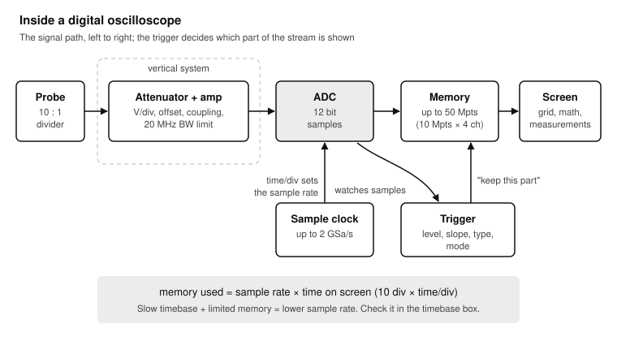

The signal passes through the probe and an attenuator and amplifier (the vertical system), is sampled by an analog-to-digital converter (ADC) into memory, and is drawn on the screen. The trigger watches the samples and decides which moment of the endless signal becomes the centre of the picture.

Four ideas explain almost everything you will do:

1. **Vertical: volts per division.** The screen has 8 vertical divisions. At 1 V/div it shows 8 V from top to bottom; at 10 mV/div, 80 mV. Smaller signals need smaller V/div, and offset (vertical position) moves the trace up and down.
2. **Horizontal: time per division.** The screen has 10 horizontal divisions. At 1 ms/div it shows 10 ms; at 10 ns/div, 100 ns. The timebase sets how much of the signal you see at once.
3. **Sampling: points in time.** A digital scope measures the voltage at regular instants, the sample rate, and stores the samples in memory. Anything that happens between samples is lost, so the sample rate must be high enough for the signal, and the memory long enough for the timebase.
4. **Trigger: a stable picture.** A repeating signal drawn from a random starting point every time would smear across the screen. The trigger starts each picture at the same point of the signal, for example "the voltage rises through 1.65 V", so repeats land on top of each other and stand still.

### Bandwidth and rise time

Every scope and probe is a low-pass filter. Its **bandwidth** is the frequency at which a sine wave is shown 3 dB too small (about 70 % of its real amplitude). Two rules of thumb follow:

- To see the shape of a signal, not just that it exists, the bandwidth should be at least **5 times** its highest frequency. A 70 MHz scope shows clean square waves up to about 10 MHz.
- The fastest edge a scope can show is its own **rise time**, about **0.35 / bandwidth**. For 70 MHz that is 5 ns. An edge that is faster than this is drawn as about 5 ns, whatever it really is. Lesson 5 shows this with the Teensy.

### Sample rate and memory

The scope can only store as many samples as it has memory. The time on screen, the sample rate and the memory are linked:

**memory used = sample rate × time on screen (10 divisions × time/div)**

With 10 million points and 500 million samples per second, the screen can hold 20 ms at full speed. At 200 ms/div (2 s on screen) the same memory allows only 5 million samples per second. The scope lowers the sample rate automatically as you zoom out; it shows the current rate on screen. When the sample rate falls below twice the signal frequency, the trace becomes a lie (aliasing). Lesson 2 makes one on purpose.

## The SDS804X HD in one page

The SDS804X HD is the 4-channel, 70 MHz model of Siglent's SDS800X HD series. The "HD" is its 12-bit ADC: 4096 levels across the screen instead of the 256 of a classic 8-bit scope, so you can zoom in on small signals without the trace breaking into steps.

| Specification | SDS804X HD | What it means for you |
| --- | --- | --- |
| Channels | 4 analog (16 digital with the optional SLA1016 probe) | Watch SDA, SCL, a rail and a debug pin at once |
| Bandwidth | 70 MHz (5 ns typical rise time) | Clean square waves to about 10 MHz; fast edges look like 5 ns |
| Resolution | 12 bit | Millivolt ripple and shunt voltages are measurable |
| Sample rate | 2 GSa/s with one channel, 1 GSa/s with two, 500 MSa/s with four | Switch off unused channels when you need speed |
| Memory | 50 Mpts with one channel, 25 Mpts with two, 10 Mpts with four | Long captures at a high sample rate |
| Waveform update rate | Up to 80,000 waveforms/s (500,000 in Sequence mode) | Rare glitches show up quickly |
| Input | 1 MΩ in parallel with 17 pF; DC, AC or GND coupling; no internal 50 Ω | Use the 10× probe; 50 Ω needs an external terminator |
| Maximum input | 400 V peak (DC + AC) at the BNC | Far above anything in these courses; mains is still forbidden (see Safety) |
| Vertical range | 0.5 mV/div to 10 V/div at the BNC (×10 with a 10× probe) | From microvolt noise to 100 V spikes |
| Timebase | 2 ns/div to 1000 s/div; Roll mode from 50 ms/div | Nanosecond edges to hours-long logs |
| Triggers | Edge, Slope, Pulse width, Window, Runt, Interval, Dropout, Pattern, Video, Qualified, Nth edge, Delay, Setup/Hold, Serial | Lesson 3 |
| Serial decode | I2C, SPI, UART, CAN, LIN, included as standard; 2 decoders at once | Lesson 8 |
| Analysis | 50+ measurements with statistics, 4 math traces (2 Mpts FFT), History (80,000 frames), Search, Navigate, Mask test, Counter | Lessons 2 to 9 |
| Display | 7-inch capacitive multi-touch screen, 1024 × 600 | Drag, pinch and tap as well as knobs |
| Interfaces | 2 × USB host (front and rear), USB device, LAN with a built-in web server, Aux out (trigger out or pass/fail) | Screenshots to a USB stick; control from a browser |
| Probes | One PB470 passive probe per channel | 1× and 10× switch on the probe |
| Power | 100 to 240 V AC mains, 50/60 Hz, earthed through the power cord | The probe ground is earth: read Safety |
| Options | 16-channel logic probe (SLA1016), USB signal generator (SAG1021I, needed for Bode plots), power analysis | None are needed for this course |

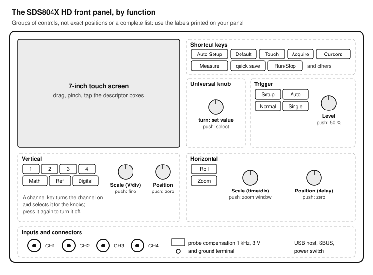

The front panel groups the controls by function. This drawing shows the groups, not the exact positions; compare it with your scope, and use the names printed on your panel. Most controls also exist on the touch screen, and the knobs often do something extra when you push them.

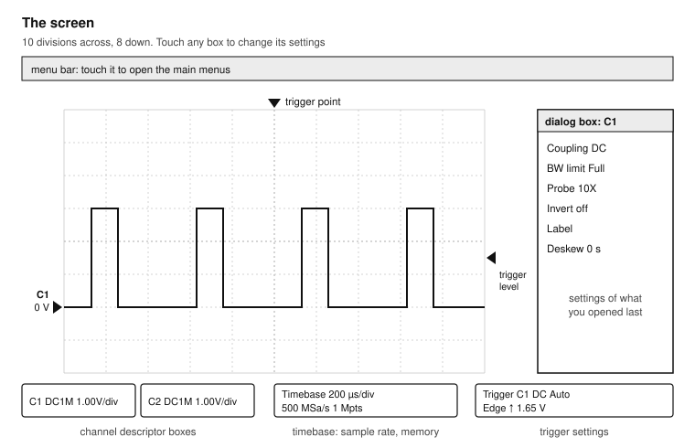

The grid is 10 divisions wide and 8 high. The descriptor boxes along the bottom show each channel's settings, the timebase and the trigger; touch one to open its settings. The dialog box on the right holds the settings of whatever you last opened.

### Button names in this course

Names in **bold** are front-panel keys and knobs as printed on the SDS800X HD. Paths such as Utility > Menu > Maintenance are touch-screen menus, starting from the menu bar at the top of the screen. Siglent changes menus between firmware versions; if a path in this course does not match your scope, look for the same word in the menu bar, or touch the descriptor box of the channel, timebase or trigger you want to change. The User Manual on Siglent's website is the full reference.

## Safety and good habits

An oscilloscope is safer than most bench tools, with one big exception: its ground.

### The probe ground is mains earth

The SDS804X HD runs from mains and is earthed through its power cord. Siglent's Quick Start says it plainly: "The potential of the signal cable ground is equal to the earth ground." The ground clip of every probe, and the outer ring of every BNC socket, is connected straight to the earth pin of the plug.

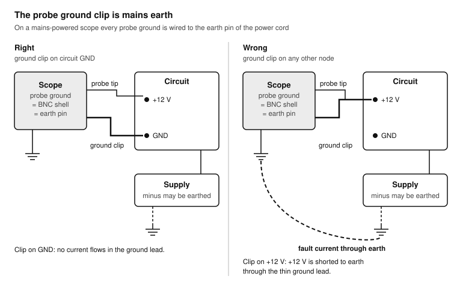

This has three consequences:

- **The ground clip goes to circuit GND, and only to GND.** Clip it to the 12 V rail, or to any point that is not at ground potential, and you have connected that point to earth. If the circuit's supply is earthed too (your Mac on its charger, a bench supply with an earthed output, a USB hub), the current flows through the probe's thin ground lead. At best the circuit resets; at worst the lead or a trace burns.
- **All ground clips are the same node.** Two ground clips on two different points short those points together. To measure a voltage that is not referenced to GND, such as the voltage across a current shunt in the supply line or between CANH and CANL, use two probes with their grounds on GND and let the scope subtract (Math, C1 − C2). Lessons 6 and 8 do this.
- **Never probe mains.** Mains measurements need a rated high-voltage differential probe and training. Nothing in this course or the others in this repository goes near mains.

### Bench rules

- Never remove or defeat the earth pin of the scope's power cord. Without it, the scope's metal parts can float to a dangerous voltage.
- Know the limits: 400 V peak at the BNC input. With a 10× probe, the limit printed on the probe applies. A flyback spike of 50 V is fine; the scope is not the weak point in these courses, your circuit is.
- Connect the ground clip first and remove it last.
- Do not let the probe tip or ground clip slip on a populated board. A shorted pin is the most common way to damage a circuit while measuring it. Use the hook tip or a mini-grabber, and solder a test wire to small pins.
- Discharge yourself before touching the BNC sockets; they lead straight to the input amplifiers.
- Keep the vents free. The scope has a fan for a reason.

> **Warning:** If the scope, its cord or a probe looks damaged, do not use it. A cracked probe insulation or a loose BNC ground is a shock and measurement hazard.

## Everything you need for all lessons

### Tools (buy once)

- [ ] Siglent SDS804X HD with its four PB470 probes, probe accessories and power cord (0)
- [ ] A USB stick formatted as FAT32, for screenshots and saved setups (0)
- [ ] A small non-metallic screwdriver, often supplied with the probes, for probe compensation (0)
- [ ] Your multimeter, to check the scope against something you trust (0, 2)
- [ ] Mini-grabber test hooks (IC hook clips), four or more (3)
- [ ] An optional USB logic analyzer with PulseView, for long digital captures (8)

### Circuits from the other courses

- [ ] ESP32-DevKitC V4 on its breadboard, from the [ESP32 course](../esp32/README.md) (1 to 9)
- [ ] A push button on GPIO33 to GND, as in [ESP32 Exercise 1.2](../esp32/README.md#exercise-12-read-a-button) (3)
- [ ] The MOSFET driver with its 12 V adapter, motor or LED strip and 1N5819, from [ESP32 Exercise 3.2](../esp32/README.md#exercise-32-speed-control-with-pwm) (7)
- [ ] The BME280 sensor and OLED on I2C, from [ESP32 Lesson 4](../esp32/README.md#lesson-4-sensors-and-a-display-on-i2c) (8)
- [ ] Teensy 4.1 on its breadboard, from the [Teensy 4.1 course](../teensy41/README.md) (5, 8)
- [ ] The two SN65HVD230 CAN transceivers from [Teensy Exercise 6.3](../teensy41/README.md#exercise-63-can-bus-with-flexcan_t4) (8)
- [ ] The 555 blinker from the [soldering course](../soldering/README.md), Exercise 2.3 (optional, 3)

### Parts

- [ ] Resistors: 100 Ω ×2, 1 kΩ ×2, 2.2 kΩ ×2, 4.7 kΩ ×2, 10 kΩ ×4 (1 to 8)
- [ ] Current shunts: 1 Ω 1 % ×2 and 0.1 Ω 1 % ×1, 1 W or more (6, 7)
- [ ] Capacitors: 100 nF ×4, 1 µF ×2, 470 µF electrolytic ×1 (4, 6)
- [ ] A USB-A breakout pair (plug and socket on small boards), or a spare USB cable to cut, for the current-sense lead (6)
- [ ] Jumper wires, including one about 50 cm long (5)

### Software (free)

- Arduino IDE 2 with the ESP32 core 3.x and Teensyduino, as set up in the other courses.
- A web browser, for the scope's built-in web server (Lesson 9).

## Lesson 0: Meet the scope

**Goal:** set the scope up, learn the front panel and screen, compensate the probes, and save a screenshot. **Time:** 1.5 hours. **Pass:** all four probes compensated and labelled; a screenshot of the calibration signal on your USB stick.

### Exercise 0.1: Unpack and set up

1. Check the box against the packing list: scope, power cord, four PB470 probes with their accessory bags, a USB cable, the Quick Start and a calibration certificate. Keep the box until you have tested everything.
2. Place the scope where its vents are free, with the screen at eye level. Fold out the feet to tilt it if you look down at it.
3. Plug the power cord into an earthed socket and switch on with the power switch on the front panel. Starting takes about half a minute.
4. If the menus are not in your language: Utility > Menu > System setting > Language.
5. Note the firmware version (in the Utility menu, under the system or help information) in your log. Siglent publishes updates on its website; you do not need to update to follow this course.

### The front panel

Take ten minutes with the drawing of the front panel and your scope side by side.

- **Vertical:** one key per channel (**1** to **4**), plus **Math**, **Ref** and **Digital**. Under them, the **scale** knob (volts per division; push to toggle coarse and fine steps) and the **position** knob (offset; push to set it to zero). Pressing a channel key switches the channel on and makes it the one the knobs control; pressing it again while it is active switches it off.
- **Horizontal:** the **scale** knob (time per division; with Zoom on, push to switch between the main and the zoom window), the **position** knob (trigger delay; push to set it to zero), and the **Roll** and **Zoom** keys.
- **Trigger:** the **Setup** key opens the trigger dialog; **Auto**, **Normal** and **Single** select the trigger mode; the **level** knob moves the trigger level (push to set it to 50 % of the signal).
- **Run control:** **Run/Stop** freezes and restarts the acquisition.
- **Shortcut keys:** **Auto Setup**, **Default**, **Acquire**, **Cursors**, **Measure**, a quick-save key and others. **Touch** enables and disables the touch screen; it is lit when touch is on.
- **Universal knob:** sets whatever parameter is selected on the screen. In the Cursors menu it moves the selected cursor; push it to select the next cursor.

On the screen, you can drag a trace sideways (trigger delay) or up and down (offset), and pinch or spread it horizontally (timebase) or vertically (V/div). It is quick but easy to do by accident; switch **Touch** off when you want the knobs only.

### Exercise 0.2: Default and Auto Setup

**Default** puts every setting back to factory defaults. Use it whenever the scope does something you do not understand: it is the oscilloscope's "turn it off and on again".

1. Press **Default**. Channel 1 is on, at 1 V/div, the timebase at 1 µs/div, the trigger on channel 1 in Auto mode.
2. Take one probe. Check the switch on its body: set it to **10×**.
3. Push the probe onto the **CH1** BNC socket and turn the collar clockwise until it locks.
4. Clip the probe's ground lead to the ground terminal on the front panel (marked with the ground symbol, under the calibration output) and hook the probe tip onto the calibration output above it. This signal is a 1 kHz, 3 V square wave.
5. Press **Auto Setup**. The scope chooses V/div, time/div and trigger for the signal. You see a few cycles of a square wave.
6. Look at the channel descriptor box for C1: coupling, V/div, offset, bandwidth limit and probe factor. The probe factor must say 10X. If it says 1X, the amplitude reads 10 times too small: touch the box and set Probe to 10X.

**Test:** the square wave is 3 V high (from 0 V to 3 V, read against the grid) and repeats every 1 ms.

> **Note:** Auto Setup is a starting point, not a habit. It cannot know what you are looking for, and it fails on slow, rare or noisy signals. From Lesson 1 on, set the scope up by hand.

### The probe and its 10× switch

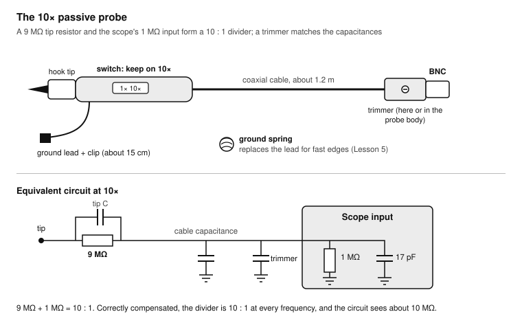

A 10× probe contains a 9 MΩ resistor in its tip. With the scope's 1 MΩ input it forms a 10:1 divider: the scope sees one tenth of the voltage and multiplies the reading back by 10. In exchange you get:

- **Less loading.** Your circuit sees 10 MΩ in parallel with roughly 10 to 15 pF, instead of 1 MΩ and the cable's full capacitance at 1×. A 10 kΩ pull-up does not notice 10 MΩ.
- **Full bandwidth.** At 1× the cable's capacitance limits the bandwidth to a few MHz. At 10× the probe reaches the scope's 70 MHz.
- **Ten times the voltage range.** 10 V/div at the BNC becomes 100 V/div at the tip.

The price is a tenth of the signal, so the scope's own noise is ten times larger in comparison. Use 1× only for tiny, slow signals, such as millivolt ripple below 1 MHz. Otherwise leave every probe on 10× all the time, and make sure the channel's Probe setting matches the switch.

### Exercise 0.3: Compensate every probe

The probe's capacitance must match the scope input's, or square edges come out rounded or with spikes. The small trimmer in the probe body, or in the box at the BNC end, adjusts it.

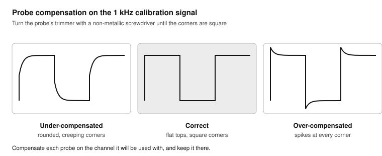

1. With the probe on the calibration output and Auto Setup done, set the timebase to 200 µs/div and V/div so the square wave fills about 6 divisions.
2. Look at the corners of the square wave. A rounded leading edge that creeps up to the flat top is **under-compensated**; a spike at each corner is **over-compensated**.
3. With the non-metallic screwdriver, turn the trimmer slowly until the tops and bottoms are flat and the corners square.
4. Repeat for the other three probes, each on its own channel (CH2, CH3, CH4), with **Auto Setup** on each.
5. Put a coloured ring (supplied with the probes) or a strip of tape on each probe and its BNC socket: probe 1 stays on CH1. The compensation belongs to one probe on one input.

**Test:** all four probes show flat-topped square waves. Write "compensated" and the date in the log.

### Exercise 0.4: Self calibration

The scope was calibrated at the factory at 23 °C. Siglent recommends a self calibration when the room is outside 18 to 28 °C, or when more than a month has passed since the last one.

1. Let the scope warm up for at least 20 minutes.
2. Disconnect all probes and inputs.
3. Run Utility > Menu > Maintenance > Self Calibration and wait until it finishes (a few minutes).
4. Leave **Quick Cal** (in the same menu) switched off, the default. When it is on, the scope recalibrates whenever its ADC warms by 3 °C, and that interrupts the acquisition: bad for long captures.

### Exercise 0.5: Save a screenshot

1. Insert the USB stick into the front USB port.
2. Utility > Save Button sets what the quick-save key does: by default it saves a screenshot. Choose PNG; it is small and sharp.
3. With the calibration signal on screen, press the quick-save key. The scope confirms the file name.
4. Copy the file to your Mac. Make a folder for scope pictures, one subfolder per lesson.

Utility > Save/Recall saves and recalls other things: setups (all settings, to come back to a measurement later), waveform data (CSV for a spreadsheet) and reference waveforms.

**Test:** the PNG opens on your Mac and shows the square wave with its settings.

## Lesson 1: The three systems

**Goal:** set the vertical, horizontal and trigger systems by hand, on a known signal. **Time:** 2 hours. **Pass:** from **Default**, you can display a stable PWM trace with the right V/div, time/div and trigger in under a minute, without Auto Setup.

### The test-signal sketch

This sketch turns the ESP32 into a small signal generator. It outputs four signals at once, and lets you change the PWM from the Serial Monitor. You will use it in most lessons.

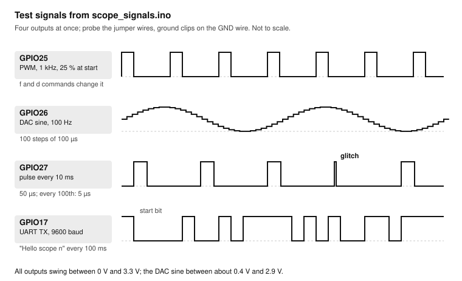

```cpp scope_signals.ino
// ESP32 test-signal generator for the oscilloscope course (Arduino-ESP32 core 3.x).
//   GPIO25  PWM, starts at 1 kHz, 25 % duty
//   GPIO26  100 Hz sine from the 8-bit DAC (100 steps of 100 us)
//   GPIO27  a 50 us pulse every 10 ms; every 100th pulse is only 5 us (the "glitch")
//   GPIO17  UART text at 9600 baud, 8N1, every 100 ms
// Serial Monitor at 115200: type f<Hz> for the PWM frequency or d<percent> for the duty,
// for example f20000 and d50.
#include <math.h>

const int PWM_PIN = 25, DAC_PIN = 26, PULSE_PIN = 27, TX2_PIN = 17, RX2_PIN = 16;
const int PWM_BITS = 10;            // 0..1023 duty steps; allows up to about 78 kHz

uint32_t pwmFreq = 1000;
int pwmDuty = 25;                   // percent
uint8_t sineTable[100];
int sineIndex = 0;
uint32_t lastSine = 0, lastPulse = 0, lastText = 0, pulseCount = 0, textCount = 0;

void applyPwm() {
  ledcChangeFrequency(PWM_PIN, pwmFreq, PWM_BITS);
  ledcWrite(PWM_PIN, (uint32_t)pwmDuty * ((1 << PWM_BITS) - 1) / 100);
  Serial.printf("PWM %lu Hz, %d %% duty\n", pwmFreq, pwmDuty);
}

void setup() {
  Serial.begin(115200);
  Serial2.begin(9600, SERIAL_8N1, RX2_PIN, TX2_PIN);
  pinMode(PULSE_PIN, OUTPUT);
  for (int i = 0; i < 100; i++) sineTable[i] = 128 + 100 * sin(2 * M_PI * i / 100.0);
  ledcAttach(PWM_PIN, pwmFreq, PWM_BITS);
  applyPwm();
}

void loop() {
  uint32_t now = micros();
  if (now - lastSine >= 100) {                 // next sine step every 100 us
    lastSine += 100;
    dacWrite(DAC_PIN, sineTable[sineIndex]);
    sineIndex = (sineIndex + 1) % 100;
  }
  if (now - lastPulse >= 10000) {              // a pulse every 10 ms
    lastPulse += 10000;
    int width = (++pulseCount % 100 == 0) ? 5 : 50;
    digitalWrite(PULSE_PIN, HIGH);
    delayMicroseconds(width);
    digitalWrite(PULSE_PIN, LOW);
  }
  if (now - lastText >= 100000) {              // a line of text every 100 ms
    lastText += 100000;
    Serial2.printf("Hello scope %lu\n", textCount++);
  }
  if (Serial.available()) {
    char cmd = Serial.read();
    long value = Serial.parseInt();
    if (cmd == 'f' && value >= 1 && value <= 40000) { pwmFreq = value; applyPwm(); }
    if (cmd == 'd' && value >= 0 && value <= 100) { pwmDuty = value; applyPwm(); }
  }
}
```

1. Upload the sketch to the ESP32 and open the Serial Monitor at 115200 baud. It prints `PWM 1000 Hz, 25 % duty`.
2. Put a jumper wire into each of the GPIO25, GPIO26, GPIO27 and GPIO17 rows, and one into a GND row. These are your test points: hook probes onto wire ends, not onto the board's pins.

> **Tip:** Leave this setup on a corner of the bench for the whole course. A known signal is the quickest way to check whether the scope or the circuit is at fault.

### The vertical system

Each channel has its own vertical settings: **scale** (V/div), **position** (offset), coupling, bandwidth limit and probe factor. Touch a channel's descriptor box for the quick dialog, and touch it again for all settings.

### Exercise 1.1: Vertical by hand

1. Press **Default**. Probe CH1 (10×) on the GPIO25 wire, ground clip on the GND wire.
2. Set the timebase to 500 µs/div with the horizontal **scale** knob. The trace may roll or flicker: the trigger is not set up yet. That is fine for now.
3. Turn the vertical **scale** knob until the 3.3 V PWM is about 3 to 4 divisions high: 1 V/div.
4. Turn the vertical **position** knob to put the 0 V level (the channel marker at the left edge of the grid) two divisions below the centre. Push the knob: the offset returns to zero.
5. Push the **scale** knob once to switch to fine adjustment, and turn it: the V/div changes in small steps. Push it again to go back to the 1-2-5 steps. Fine steps are useful to fill the screen; 1-2-5 steps are easier to read against the grid.

**Test:** the PWM fills about half the screen, and you can read its high and low levels against the grid: about 3.3 V and 0 V.

### The horizontal system

The horizontal **scale** knob sets the time per division for all channels together. The **position** knob moves the trigger point, which is drawn as a small marker at the top of the grid; push it to put the trigger point back at the centre. Touching the timebase descriptor box opens the timebase dialog, with shortcuts to put the trigger point at the left or right of the screen.

### Exercise 1.2: Horizontal by hand

1. Keep the PWM on CH1. Set 200 µs/div: the screen shows 2 ms, two cycles of 1 kHz.
2. Count the divisions for one period: 5 divisions × 200 µs = 1 ms. Count the high time: 1.25 divisions = 250 µs, so the duty cycle is 25 %.
3. Set 20 µs/div and look at one rising edge. Set 2 ms/div and see 20 cycles.
4. Look at the timebase descriptor box: it shows the sample rate and the number of samples (memory) the scope is using. Change the timebase and watch both change.

### The trigger

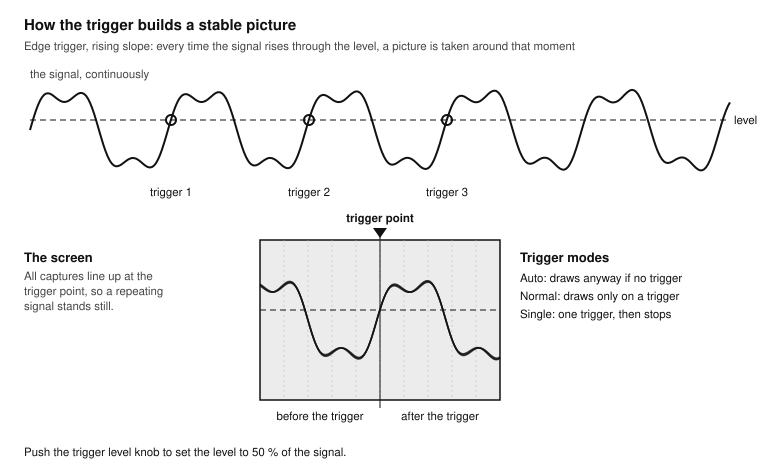

The trigger is a comparator that watches one source, usually a channel. In the simplest type, **Edge**, it fires when the signal crosses the trigger **level** in the chosen direction (**slope**: rising, falling, or alternating). The scope places that moment at the trigger point on screen and shows what happened before it (pre-trigger) and after it.

The **trigger mode** decides what happens when there is no trigger:

- **Auto:** if no trigger comes within a short time, the scope draws anyway. You always see a trace, but it may roll. Use it to find a signal.
- **Normal:** the scope draws only when it triggers, and keeps the last picture otherwise. Use it for signals that come and go.
- **Single:** the scope waits for one trigger, draws it and stops. Use it for one-off events: a button press, a power-up, a reset.

### Exercise 1.3: Trigger by hand

1. Press the trigger **Setup** key. Set Type: Edge, Source: C1, Slope: Rising, Coupling: DC.
2. Turn the trigger **level** knob. A level marker moves on the right edge of the grid, and the level shows in the trigger descriptor box. Below 0 V or above 3.3 V, the trigger never fires: in Auto mode the trace rolls; in Normal mode it freezes.
3. Push the **level** knob: the level jumps to 50 % of the signal, about 1.65 V. The trace stands still.
4. Change the slope to Falling: the picture now starts at a falling edge.
5. Set 500 µs/div and turn the horizontal **position** knob: the trigger point moves left and right. Push it to centre it again.
6. In the Serial Monitor, type `d50`. The trace updates at once.

**Test:** press **Default**, then set up the PWM by hand, with the trigger on the rising edge at 1.65 V, in under a minute.

### Exercise 1.4: Two channels, one trigger

1. Probe CH2 on the GPIO27 pulse wire, ground on GND. Set CH2 to 1 V/div and move its 0 V level to the bottom half of the screen with its **position** knob, so the traces do not overlap.
2. Set 2 ms/div. The pulses on CH2 slide past while CH1 stands still: the trigger is on CH1, and the two signals are not related in time.
3. Change the trigger source to C2. Now CH2 stands still and CH1 slides.
4. Set 20 µs/div: the 50 µs pulse fills two and a half divisions.

The trigger can only make one signal stand still, unless the signals are locked together in time. When you look at related signals (a clock and its data, an input and the code's reaction), trigger on the one that comes first.

### Exercise 1.5: Run/Stop and Zoom

1. Back to CH1 at 1 ms/div. Press **Run/Stop**: the trace freezes and the key changes colour.
2. Turn the horizontal **scale** to 20 µs/div: the stopped trace stretches, because the scope still has all its samples in memory.
3. Press **Run/Stop** again, then **Zoom**. The screen splits: the whole capture on top, a magnified part below. The horizontal **scale** knob sets the zoom, the **position** knob moves the zoomed window; push the **scale** knob to switch which window the knobs control.
4. Press **Zoom** again to leave.

**Test:** you can freeze a trace, zoom into one edge, and get back to a live trace.

## Lesson 2: Measuring

**Goal:** read values accurately with automatic measurements, cursors and statistics, and understand what the sample rate and memory do to a measurement. **Time:** 2 hours. **Pass:** frequency and duty cycle within 1 % of the sketch's settings; you can explain, with numbers, why a trace was aliased.

### Reading the grid, and why not to

Counting divisions is fine for a first look, but it is slow and has an error of a tenth of a division at best. The scope measures for you, from all its samples, not from the screen.

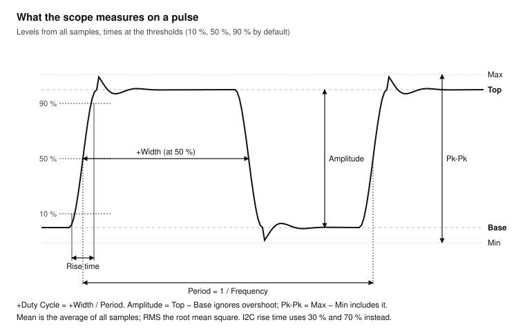

Most measurement names are standard across scopes. A few need care:

- **Top** and **Base** are the most common high and low levels, ignoring overshoot. **Max** and **Min** include every spike. **Amplitude** is Top minus Base; **Pk-Pk** is Max minus Min.
- **Rise time** is measured from 10 % to 90 % of the amplitude, unless you change the thresholds. I2C (Lesson 8) uses 30 % to 70 %.
- **Mean** is the average of all samples on screen, what a meter shows on a steady signal. **RMS** is the root mean square, the "heating" value.
- **Period**, **Frequency**, **+Width**, **-Width** and **+Duty Cycle** are measured at the middle threshold, 50 % by default.

### Exercise 2.1: Automatic measurements

1. Show the PWM on CH1 at 200 µs/div, triggered.
2. Press **Measure**. In Simple mode, the scope shows a set of basic parameters for one source. Choose C1.
3. Switch to Advanced mode, clear the list, and add: Frequency, +Duty Cycle, +Width, Top, Base and Rise time.
4. Switch on Statistics. Each value now shows current, mean, minimum, maximum, standard deviation and count.
5. Compare with the sketch: 1000 Hz and 25 %. Then type `f12345` and `d33` in the Serial Monitor and compare again.
6. Compare Top with your multimeter on the GPIO25 wire with `d100` (a steady 3.3 V).

**Test:** frequency and duty agree with the sketch within 1 %; Top agrees with the multimeter within 2 %. If Top is about 10 times too small, the channel's Probe setting is at 1X.

> **Note:** The ESP32's PWM frequency comes from dividing an 80 MHz clock by whole numbers, so some frequencies come out slightly off. A frequency of 12,345 Hz may measure a few hertz different: that is the ESP32, not the scope. The scope's timebase is accurate to 25 ppm.

### Exercise 2.2: Cursors

Cursors are movable lines for the measurements the automatic list does not cover, and for checking that a measurement measures what you think.

1. Press **Cursors** and switch them on. Choose the horizontal (X) cursors on C1.
2. Turn the **universal knob**: cursor X1 moves. Push the knob: now X2 moves. You can also drag a cursor on the screen.
3. Put X1 on one rising edge and X2 on the next. The readout shows ΔX (the period) and 1/ΔX (the frequency).
4. Switch to vertical (Y) cursors and put Y1 on the top and Y2 on the base of the PWM: ΔY is the amplitude.
5. Show the DAC sine on CH2 (GPIO26), trigger on C2, 2 ms/div. Use X cursors to measure the time between two peaks.

**Test:** your cursor values agree with the automatic Frequency and Amplitude within the width of a cursor step.

### Exercise 2.3: Statistics and jitter

1. Measure the +Width of the GPIO27 pulse on CH2: 50 µs. Turn on statistics and watch the count rise.
2. Wait 10 seconds. The minimum is about 5 µs: once a second, the glitch pulse came through. Statistics catch what your eyes cannot.
3. Measure the Period of the DAC sine on CH2. The standard deviation is not zero: the sketch steps the DAC from `loop()`, and every pulse and line of text delays a step a little. That variation is **jitter**. Lesson 3 hunts it down.

### Sample rate, memory and aliasing

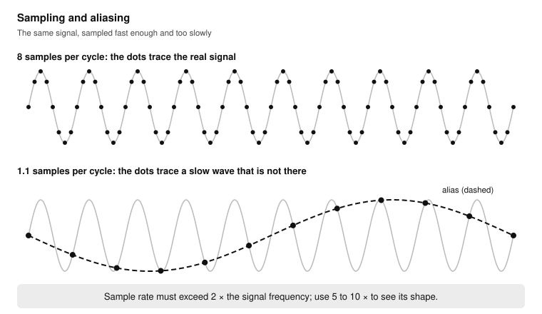

A sampled signal is only correct if there are enough samples per cycle. In theory the sample rate must be more than twice the highest frequency in the signal (the Nyquist rate); in practice, for a recognisable shape, use 5 to 10 times. Below the Nyquist rate the samples still line up, but into a waveform that does not exist: an **alias**.

The SDS804X HD shares its ADCs between channels. With four channels on, the maximum is 500 MSa/s and 10 Mpts per channel; with one channel, 2 GSa/s and 50 Mpts. Switch off the channels you do not need when sample rate or memory is tight, and read the actual sample rate in the timebase descriptor box.

### Exercise 2.4: Make an alias on purpose

1. Show only CH1 with the PWM, `f20000` and `d50`: 20 kHz.
2. Press **Acquire**. Note the settings: memory management Auto, the maximum memory depth, the acquisition mode Normal. Set the maximum memory depth to its smallest value.
3. Turn the timebase slowly towards slower settings and watch the sample rate in the timebase box. At some setting, the sample rate falls below 40 kSa/s, and the 20 kHz square wave turns into a slow, wrong waveform, or a solid band.
4. Write down the timebase and sample rate at which the trace stops being right. Check: is the sample rate below twice the PWM frequency?
5. In **Acquire**, switch the acquisition mode to Peak Detect. Peak Detect keeps the highest and lowest value in each sample interval, so a fast signal shows as a band of the right height instead of an alias. It tells you something is there, not what.
6. Set the memory depth back to its maximum and the mode to Normal.

**Test:** you can explain, with the sample rate you wrote down, why the trace was wrong. From now on, whenever a trace looks surprising, check the sample rate first.

### Exercise 2.5: Long captures with deep memory

1. Keep the 20 kHz PWM on CH1 with full memory. Set 10 ms/div: 100 ms on screen, 2000 cycles.
2. Press **Run/Stop** to freeze. Note the sample rate: still high enough to show every edge.
3. Press **Zoom** and zoom into one cycle in the middle of the capture. Every edge is there.

Deep memory is the reason to prefer a long capture over a short one: you capture the whole event once, then zoom in on the detail afterwards.

## Lesson 3: Catching events

**Goal:** capture events that happen once or rarely, using trigger modes, smart triggers, History and Search. **Time:** 2 hours. **Pass:** the rare 5 µs glitch on GPIO27 captured on purpose with a pulse-width trigger; the bounce of your button measured and written in the log.

### Exercise 3.1: Single shot: see the bounce

The ESP32 course counted bounces in software. Here you see them.

1. Wire the button from GPIO33 to GND, as in [ESP32 Exercise 1.2](../esp32/README.md#exercise-12-read-a-button), and upload any sketch that sets `pinMode(33, INPUT_PULLUP)` (the bounce counter from [ESP32 Exercise 1.3](../esp32/README.md#exercise-13-see-the-bounce) is fine). Probe CH1 on GPIO33.
2. Set CH1 to 1 V/div, the timebase to 200 µs/div, and the trigger to Edge, C1, Falling, level about 1.6 V.
3. Move the trigger point to the left part of the screen (horizontal **position**, or the shortcut in the timebase dialog), so you see mostly what happens after the trigger.
4. Press **Single**. The scope waits. Press the button: one picture, then the scope stops.
5. Count the bounces and measure from the first fall to the last rise with X cursors. Repeat 10 times, with presses of different force, and write the longest bounce in your log.
6. Repeat with the trigger slope on Rising and catch the release. Releases often bounce differently.
7. Replace the button with a bare wire tapped against GND. Compare.

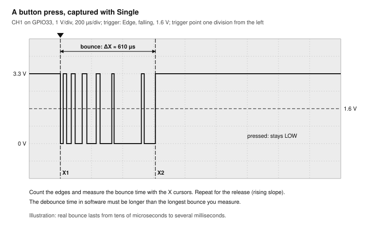

**Test:** your log has the longest bounce for press and release. Is the ESP32 course's 20 ms debounce time long enough for your button?

### Exercise 3.2: Normal mode and holdoff

1. Keep the button setup, and switch the trigger mode to **Normal**. The scope shows each new press and keeps it on screen until the next.
2. With 200 µs/div and the trigger point at the left, each bounce edge could itself trigger a new picture. Open the trigger dialog and set Holdoff to 50 ms. Now, after a trigger, the scope ignores everything for 50 ms: one press, one picture.

Holdoff is the cure for a picture that keeps jumping on a burst of edges.

### Exercise 3.3: Pulse-width trigger: find the glitch

Once a second, the test sketch makes a 5 µs pulse instead of a 50 µs one. At 2 ms/div it is invisible; with an edge trigger you would wait for luck.

1. Probe CH2 on GPIO27. Set 1 V/div, 10 µs/div.
2. Open the trigger dialog: Type: Pulse width, Source: C2, Polarity: +width (positive pulse), Limit: less than (<), Time: 20 µs. Mode: **Normal**.
3. The scope now triggers only on positive pulses shorter than 20 µs. About once a second the picture updates, always showing a 5 µs pulse.
4. Measure the width with the automatic +Width measurement.

**Test:** the scope shows only the glitch, never a normal pulse. That is how you find a rare fault: describe what makes it different, and trigger on that.

### Other triggers, briefly

The SDS804X HD has many trigger types. You have used Edge and Pulse width; the others answer other questions:

| Trigger | Fires when | Example in these courses |
| --- | --- | --- |
| Slope | An edge is faster or slower than a time limit | A slow I2C rising edge (Lesson 8) |
| Window | The signal leaves a voltage window | The 3V3 rail dips below 3.1 V or rises above 3.5 V |
| Runt | A pulse crosses one threshold but not the other | A half-height pulse from a weak driver or a bus conflict |
| Interval | The time between edges is outside a limit | A PWM period that is too long |
| Dropout | A signal stops changing for longer than a time | The UART line goes quiet; a loop stalls |
| Pattern | Several channels match a high/low pattern | Chip select low and clock high |
| Nth edge | The Nth edge after an idle time | The 9th clock of an I2C byte |
| Delay | Edge B follows edge A by a time outside a limit | Interrupt latency exceeds 10 µs |
| Serial | A bus frame matches an address or data | I2C to address 0x76 (Lesson 8) |

### Exercise 3.4: Interrupt latency

How long does the ESP32 take to react to a pin change in an interrupt? Measure from the button edge to the moment the code reacts.

```cpp isr_latency.ino
// GPIO27 copies the button on GPIO33 from inside an interrupt handler.
const int BUTTON_PIN = 33;
const int ECHO_PIN = 27;

void IRAM_ATTR onChange() {
  digitalWrite(ECHO_PIN, digitalRead(BUTTON_PIN));
}

void setup() {
  pinMode(BUTTON_PIN, INPUT_PULLUP);
  pinMode(ECHO_PIN, OUTPUT);
  attachInterrupt(digitalPinToInterrupt(BUTTON_PIN), onChange, CHANGE);
}

void loop() { }
```

1. Upload the sketch. CH1 on GPIO33 (the button), CH2 on GPIO27 (the echo). Both at 1 V/div, placed one above the other.
2. Trigger: Edge, C1, Falling, **Single**. Timebase 2 µs/div, trigger point at the left.
3. Press the button. CH2 follows CH1 after a short delay.
4. Measure the delay with X cursors, or add a channel-delay measurement in **Measure** between C1 and C2.
5. Repeat 20 times in **Normal** mode with statistics on, and note the minimum, mean and maximum.

**Test:** your log has the interrupt latency, typically a few microseconds, and its spread. Some bounce edges are missed by the echo: they were shorter than the latency.

### History: the scope's flight recorder

The SDS804X HD records every triggered acquisition into History, up to 80,000 frames, whenever it runs. After you stop the scope, you can play the frames back one by one and measure each.

### Exercise 3.5: Go back in time

1. Set up the bounce capture of Exercise 3.1 in **Normal** mode, without holdoff.
2. Press the button 10 times, then press **Run/Stop**.
3. Open History (the History key, or from the menu bar). Step back through the frames with the universal knob. Each press and each bounce that triggered is a frame, with a time stamp.
4. Find the frame with the longest bounce, and measure it.

### Search and Navigate

Search marks every event in a capture that matches a condition (Edge, Slope, Pulse, Interval or Runt), and Navigate jumps from one mark to the next. Use them on long captures, where the event is a needle in 10 million samples.

### Exercise 3.6: Search a long capture

1. CH2 on GPIO27, trigger on C2 rising edge, 200 ms/div (2 s on screen). Press **Single**.
2. Open Search (from the Search key or the menu bar), Source: C2, Type: Pulse, positive width less than 20 µs.
3. The scope marks the glitches in the capture: about two in 2 seconds. Use Navigate to jump to each, and zoom in.

### Exercise 3.7 (optional): The 555 blinker

1. Power the 555 blinker from the soldering course. CH1 on its output (pin 3), CH2 on the timing capacitor (pins 2 and 6).
2. Measure the frequency and duty cycle, and compare with f = 1.44 / ((R1 + 2 × R2) × C) using the parts you fitted.
3. Watch the capacitor voltage ramp between one third and two thirds of the supply: that is how the 555 keeps time.

## Lesson 4: Analog signals

**Goal:** measure small signals on top of large ones, filter, average, and look at signals in the frequency domain. **Time:** 2 hours. **Pass:** the ripple on the ESP32's 3V3 rail measured in millivolts; the harmonics of the PWM square wave identified in the FFT.

### Coupling, offset and the bandwidth limit

Three settings in the channel menu decide what part of a signal you see:

- **DC coupling** shows the signal as it is, including its average level. Use it by default.
- **AC coupling** puts a capacitor in front of the input: the average level is removed (anything below about 2 Hz on this scope), so a small ripple on a large DC level can be magnified. It distorts slow signals and shifts square waves; do not measure levels with it.
- **Offset** is the other way to see a small ripple on a DC level: keep DC coupling and move the trace down by the DC level with the **position** knob. Unlike AC coupling it keeps the true level and slow changes.
- **Bandwidth limit 20 MHz** removes everything above 20 MHz: much of the noise, none of a power rail's real ripple. Use it for rails and slow analog signals.

### Exercise 4.1: Ripple on the 3V3 rail

1. ESP32 on USB, running the test-signal sketch. CH1 on the 3V3 pin, ground clip on the nearest GND pin, with the shortest ground lead you have.
2. DC coupling, 1 V/div: a flat line at 3.3 V.
3. Switch to AC coupling and turn down to 10 mV/div. Now you see the ripple and noise.
4. Switch on the 20 MHz bandwidth limit. How much of the "ripple" disappears? That part was high-frequency noise picked up by the probe and ground lead.
5. Measure Pk-Pk and RMS. Write them in the log.
6. Now try the offset method: DC coupling, 10 mV/div, and set the offset to −3.3 V (touch the channel box, then the offset value, and type it on the keypad). The trace is the same, and the reading stays a true voltage.

**Test:** your log has the ripple in mV peak to peak, with and without the bandwidth limit.

### Exercise 4.2: Filter a PWM into a DC level

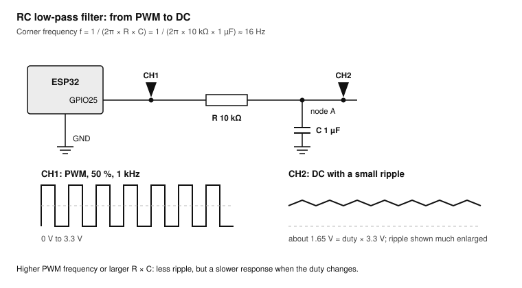

1. PWM at `f1000` and `d50`. Build an RC low-pass filter on the breadboard: GPIO25 → 10 kΩ → node A → 1 µF → GND. The corner frequency is 1 / (2π × 10 kΩ × 1 µF) ≈ 16 Hz.
2. CH1 on GPIO25, CH2 on node A, both at 1 V/div, same 0 V level.
3. CH2 is a DC level of about 1.65 V with a small triangular ripple. Switch CH2 to 20 mV/div with the offset method and measure the ripple.
4. Change the duty cycle: `d25`, `d75`. The DC level follows: duty × 3.3 V.
5. Change the frequency to `f10000`. The ripple shrinks by ten. More frequency, or a bigger RC, gives less ripple and a slower response.

### Averaging and ERES

Random noise changes from one acquisition to the next; a repeating signal does not. Two math functions use this. **Average** averages many acquisitions: the noise falls, the signal stays, but it only works on a stable, triggered signal. **ERES** (enhanced resolution) smooths neighbouring samples in one acquisition: it works on single shots, at the cost of bandwidth.

### Exercise 4.3: Clean up a noisy trace

1. Look at the filtered ripple of Exercise 4.2 at 5 mV/div. It is fuzzy with noise.
2. Press **Math**, create F1 with the operator Average on C2, 16 averages. F1 is a clean triangle.
3. Change F1 to ERES on C2 and compare.

### The frequency domain: FFT

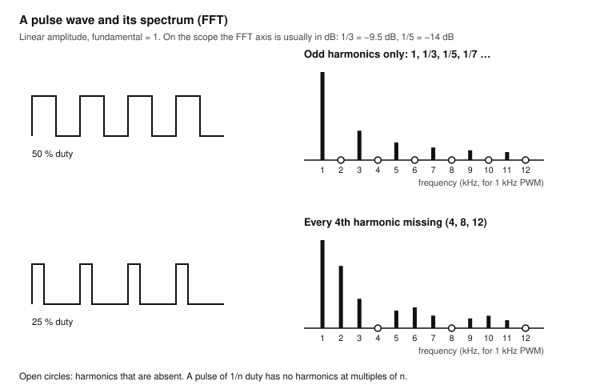

Every repeating signal is a sum of sine waves: its fundamental frequency and harmonics at whole multiples of it. The FFT (Fast Fourier Transform) computes those sine waves from the captured samples and draws amplitude against frequency. A square wave of 50 % duty has only odd harmonics (3, 5, 7 times the fundamental), each smaller in proportion (1/3, 1/5, 1/7).

On the SDS804X HD, FFT is a math operator. Its settings are the number of points (up to 2 Mpts), the window (Rectangle, Blackman, Hanning, Hamming, Flattop), the display (Split shows time and frequency together), the mode (Normal, Max hold, Average), and tools for peaks and markers. The vertical unit is usually dBV: 0 dBV is 1 V rms, and every −20 dB is ten times less.

### Exercise 4.4: Harmonics of a square wave

1. PWM at `f1000` and `d50` on CH1. Press **Math**, create F1, operator FFT, source C1.
2. Set the timebase to 10 ms/div (10 cycles is the minimum; more cycles give finer frequency steps). Choose the Hanning window and the Split display.
3. In the FFT settings, set the horizontal range (centre and span, or start and stop) to show 0 to 20 kHz. Peaks appear at 1, 3, 5, 7 kHz... The even harmonics are missing.
4. Turn on the peak table. Compare the levels: the 3rd harmonic should be about 9.5 dB below the fundamental (1/3), the 5th about 14 dB below (1/5).
5. Change to `d25`. Now the even harmonics appear, except every 4th (4, 8, 12 kHz). A pulse of 1/n duty has no harmonics at multiples of n.

**Test:** your log lists the first five peaks at 50 % duty, and which ones vanished at 25 %.

### Exercise 4.5: The DAC sine is not a sine

1. CH2 on the GPIO26 sine. FFT on C2, 0 to 30 kHz.
2. The tallest peak is at 100 Hz. Further peaks sit around 10 kHz and 20 kHz: the DAC holds each value for 100 µs, a staircase with a 10 kHz step rate.
3. Add the RC filter (10 kΩ and 100 nF: corner at 160 Hz) and look at the FFT after it: the steps are damped, the sine stays.

### Exercise 4.6 (optional): Teensy MQS audio

1. Run the first sound sketch from [Teensy Exercise 5.1](../teensy41/README.md#exercise-51-first-sound). Probe the MQS output pin you used in that exercise.
2. In the time domain you see a fast switching signal, not a sine: MQS makes audio by switching a pin at high speed, like a PWM.
3. FFT: the audio tone appears at the low end, and a large carrier far above the audio band. A 1 kΩ and 100 nF filter (1.6 kHz) is not hi-fi, but shows the tone appear in the time domain.

## Lesson 5: Edges and probing

**Goal:** understand what the scope and the probe do to fast signals and to the circuit. **Time:** 1.5 hours. **Pass:** you can explain why the scope shows about 5 ns for an edge that is faster, and you can show the difference a ground spring makes.

### What you measure is never just the signal

A measured rise time includes the signal's own rise time and the scope's and probe's. For roughly Gaussian responses they add as a root sum of squares:

**measured rise time ≈ √(signal² + scope²)**

With the SDS804X HD's 5 ns, a 1 ns edge reads about 5.1 ns, a 5 ns edge reads 7 ns, and a 20 ns edge reads 20.6 ns. Only edges much slower than the scope's own rise time are measured correctly.

### Exercise 5.1: How fast is a Teensy pin?

1. Upload `toggle_speed.ino` from [Teensy Exercise 1.6](../teensy41/README.md#exercise-16-how-fast-is-a-pin). Pin 11 now toggles as fast as the loop allows.
2. Switch off all channels except CH1 (2 GSa/s). Probe pin 11 with the **ground spring** on the probe tip and the spring touching the nearest GND pin: no long ground lead.
3. Set 1 V/div, 10 ns/div, trigger on the rising edge at 1.65 V.
4. Measure Frequency and Rise time. Compare the frequency with the `digitalWriteFast()` result from the Teensy course.
5. The rise time reads about 5 ns: that is the scope. The pin is faster.
6. Set the CPU speed to 150 MHz in Arduino IDE (Tools > CPU Speed) and repeat. The frequency drops in proportion; the rise time does not: edge speed is set by the pin's driver, not the CPU.

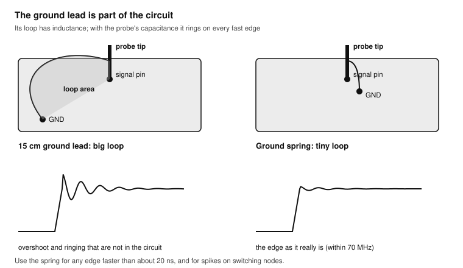

### Exercise 5.2: The long ground lead

1. Keep the fast square wave on pin 11 with the ground spring. Take a screenshot.
2. Replace the spring with the probe's normal ground lead, clipped to GND. Take a screenshot.
3. Now clip a 50 cm wire into the ground path and look again.
4. Compare the three screenshots. With longer ground leads, the edges ring and overshoot. The circuit did not change: the ground lead's inductance and the probe's capacitance form a resonant circuit that rings on every fast edge.

**Test:** your log has the overshoot (Max minus Top) for the spring, the standard lead and the 50 cm wire. For any edge faster than about 20 ns, use the spring.

### Exercise 5.3: The probe loads the circuit

1. Run the test-signal sketch: GPIO27 gives a 50 µs pulse every 10 ms.
2. Add a 100 kΩ resistor in series: GPIO27 → 100 kΩ → node B, with nothing else connected to node B. Probe node B with CH1 at 10×.
3. Measure the rise time at node B. The probe's capacitance (about 10 to 15 pF at 10×) and the 100 kΩ form an RC filter: 100 kΩ × 15 pF = 1.5 µs time constant, a rise time of about 3 µs.
4. Switch the probe to 1× (and the channel's Probe setting to 1X). The rise time becomes several times longer: at 1× the cable's capacitance loads the node.

The lesson: high-impedance nodes (pull-ups, dividers, sensors) are changed by the probe. Use 10×, and when the node is very high impedance, remember the probe is part of the circuit.

### Exercise 5.4: Deskew

Two probes and two channels can have slightly different delays. For timing between channels at nanosecond level, line them up.

1. Probe the same Teensy pin 11 with CH1 and CH2, both with ground springs.
2. Measure the delay between C1 and C2 rising edges. It should be under a nanosecond.
3. If it is not, set the channel's Deskew value in the CH2 menu to cancel it.

## Lesson 6: Power and current

**Goal:** measure current with a shunt, find brownouts, and profile a wake cycle. **Time:** 2 hours. **Pass:** a captured current profile of a Wi-Fi wake cycle, and the charge per wake computed by the scope.

### Measuring current with a shunt

A scope only measures voltage. To see current, put a small known resistor, a **shunt**, in the current path and measure the voltage across it: I = V / R. A 1 Ω shunt gives 1 mV per mA.

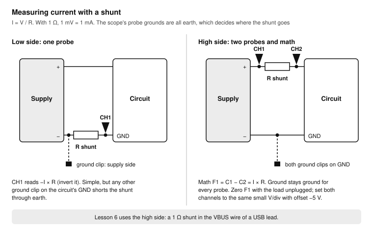

There are two places for it:

- **Low side**, between the circuit's GND and the supply's minus. One probe measures it, but the circuit's GND is now a little above the supply's ground. Every probe ground clip must go to the supply side of the shunt, or it shorts the shunt through earth. Easy with one probe, a trap with several.
- **High side**, in the supply's plus line. Ground stays ground for every probe, but the shunt sits at 5 V. Measure both ends with two probes and let the scope subtract: F1 = C1 − C2. This is the safe default on an earthed scope.

Two errors limit the high-side method. First, the two channels must have equal gain: a 0.5 % mismatch on 5 V is 25 mV, which a 1 Ω shunt turns into a false 25 mA. Measure C1 − C2 with no load and subtract it, or note it as your zero. Second, resolution: put both channels at the same small V/div with an offset of −5 V, so the 12-bit ADC spends its levels on the part that changes.

### Exercise 6.1: Build a USB current-sense lead

1. Take a USB-A plug breakout and a USB-A socket breakout, or cut a USB extension cable as in [soldering Exercise 6.1](../soldering/README.md#exercise-61-usb-cable-surgery-do-3).
2. Connect GND, D+ and D− straight through. Connect VBUS through a 1 Ω, 1 % shunt.
3. Solder a short test wire to each end of the shunt (call them VBUS-in and VBUS-out) and one to GND.
4. Check with the meter: GND, D+ and D− beep through; VBUS reads 1 Ω end to end.

With 240 mA of Wi-Fi current the shunt drops 0.24 V, so the board sees 4.76 V instead of 5 V: still fine for its regulator.

### Exercise 6.2: Wi-Fi bursts

```cpp wifi_burst.ino
// Wake, join Wi-Fi, stay connected for 2 s, then deep sleep for 5 s.
// GPIO27 is HIGH while the board is awake: a marker for the scope.
// Fit 10 kOhm from GPIO27 to GND so the marker reads LOW during deep sleep.
#include <WiFi.h>
#include "secrets.h"            // WIFI_SSID and WIFI_PASSWORD, as in the ESP32 course

const int MARK_PIN = 27;

void setup() {
  pinMode(MARK_PIN, OUTPUT);
  digitalWrite(MARK_PIN, HIGH);
  WiFi.begin(WIFI_SSID, WIFI_PASSWORD);
  uint32_t start = millis();
  while (WiFi.status() != WL_CONNECTED && millis() - start < 10000) delay(10);
  delay(2000);                                   // stay connected: the radio keeps working
  WiFi.disconnect(true);
  digitalWrite(MARK_PIN, LOW);
  esp_sleep_enable_timer_wakeup(5ULL * 1000000ULL);
  esp_deep_sleep_start();
}

void loop() { }
```

1. Add a `secrets.h` tab with your network, as in [ESP32 Lesson 5](../esp32/README.md#lesson-5-wi-fi-and-a-web-page), and upload. Then power the ESP32 through the current-sense lead.
2. CH1 on VBUS-in, CH2 on VBUS-out, ground clips on the lead's GND wire. Both at 50 mV/div with an offset of −5 V (type it on the keypad). CH3 on the GPIO27 marker at 2 V/div.
3. Press **Math**: F1 = C1 − C2. With 1 Ω, 1 mV on F1 is 1 mA. Set F1's scale so the trace fills the screen.
4. Unplug the ESP32 from the lead's socket: F1 should read zero. Note what it reads; that is your offset error.
5. Plug the ESP32 back in. Trigger on CH3, rising edge (the board wakes), **Normal** mode. Timebase 500 ms/div: the whole awake time fits.
6. You see the wake cycle in F1: the boot, the radio calibration, spikes of a few hundred mA during Wi-Fi transmission, a lower level while connected, then the drop into deep sleep.
7. Zoom into one burst. Measure its peak and width.

**Test:** your log has the peak burst current and the awake current between bursts. Typical ESP32-WROOM values are about 240 mA in transmit bursts, but boards and settings differ.

### Exercise 6.3: Charge per wake

The battery-life arithmetic in the ESP32 course needs the average current. The scope can integrate.

1. With the wake cycle of Exercise 6.2 captured and stopped, add a measurement on F1: Area@DC, gated to the awake time. Use the measurement gate, and put the gate cursors on the rising and falling edge of the marker on CH3.
2. The area is in V·s. Divide by the shunt's resistance (1 Ω): that is the charge in ampere-seconds (coulombs). Convert to milliampere-hours: mAh = A·s ÷ 3.6.
3. Compute the average current over a full 7 s cycle: (charge awake + sleep current × 5 s) ÷ 7 s. The DevKitC's sleep current is several milliamps because of its USB bridge and regulator; measure it on F1 at a slow timebase, or use the value from [ESP32 Exercise 6.2](../esp32/README.md#exercise-62-measure-the-current).
4. Estimate the battery life of a 2000 mAh battery.

**Test:** your charge per wake and your battery-life estimate, with the arithmetic, are in the log.

### Exercise 6.4: Catch a brownout

1. Run the Wi-Fi sketch from [ESP32 Exercise 5.1](../esp32/README.md#exercise-51-join-the-network) (it stays connected), powered through a long, thin USB cable or a weak USB port.
2. CH1 on the board's 3V3 pin, DC coupling, 100 mV/div, offset −3.3 V. Trigger: Edge, C1, Falling, level 3.15 V, **Normal** mode, 200 µs/div.
3. Every capture is a dip below 3.15 V. Measure the deepest one. If the board resets, it went below about 2.4 to 2.7 V, the brownout detector's range.
4. Add a 470 µF electrolytic from 5V to GND on the breadboard (minus to GND), and repeat. The dips get shallower.
5. Swap to a short, good USB cable and repeat.

**Test:** the deepest dip with the bad cable, with the capacitor and with the good cable, in the log.

### Exercise 6.5: Roll mode for slow signals

1. Keep the 3V3 probe. Set 1 s/div and press **Roll**. The trace scrolls from right to left like a chart recorder, without waiting for a trigger.
2. Watch the rail during the full Wi-Fi connect. Press **Run/Stop** to freeze when something interesting has passed.

Roll mode works from 50 ms/div and slower. Use it for slow events you cannot trigger on: a battery discharging, a temperature-driven drift.

## Lesson 7: Switching loads

**Goal:** see what happens when a MOSFET switches an inductive load, and why each part of the driver is there. **Time:** 1.5 hours. **Pass:** the drain spike measured with and without the flyback diode; the gate edge with and without the gate resistor.

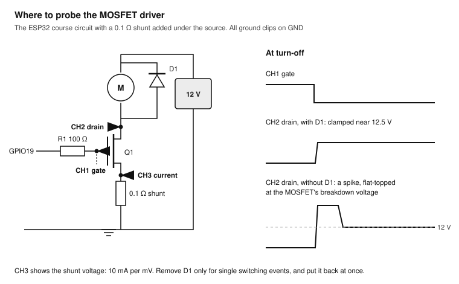

Build the MOSFET driver from [ESP32 Exercise 3.1](../esp32/README.md#exercise-31-switch-a-12-v-load-on-and-off) with the motor (or a 12 V relay coil), and add a 0.1 Ω shunt between the MOSFET's source and GND. Ground clips go to the GND of the circuit, which is also the 12 V adapter's minus.

> **Warning:** Use the 12 V adapter from the ESP32 course, never a higher voltage, and only a small motor (under 0.5 A). Without the flyback diode, the spike can exceed the MOSFET's 30 V rating; the IRLB8721 survives a few such events by avalanche, not thousands. Do the diode-less test with single switching events only, and put the diode back straight away.

### Exercise 7.1: Gate, drain and current

1. Upload `blink.ino` from the ESP32 course with `LED_PIN` 19 and 2000 ms delays. The motor turns on and off every 2 s.
2. CH1 on the gate (G), CH2 on the drain (D), CH3 on the source side of the shunt (S). Set CH1 to 1 V/div, CH2 to 5 V/div, CH3 to 20 mV/div.
3. Trigger on CH1, falling edge (turn-off), **Normal**, 2 µs/div, trigger point at the left.
4. When the gate falls, the drain rises from near 0 V to 12 V plus a little: the diode clamps the coil's voltage to one diode drop above 12 V. CH3 shows the motor current dropping to zero in the MOSFET; it now flows through the diode.
5. Measure the drain's Max. Expect about 12.5 V.

### Exercise 7.2: Without the flyback diode

1. Power off. Remove the 1N5819. Power on.
2. Set CH2 to 10 V/div, trigger on CH1 falling edge, **Single**. One capture, then power off and put the diode back.
3. The drain jumps far above 12 V and flattens at a level near the MOSFET's breakdown voltage: the MOSFET is absorbing the coil's energy in avalanche. That flat top is the sound of a part being stressed.
4. Write the peak voltage in the log next to the 12.5 V of Exercise 7.1.

### Exercise 7.3: PWM and the gate resistor

1. Load the knob speed-control sketch from [ESP32 Exercise 3.2](../esp32/README.md#exercise-32-speed-control-with-pwm) (20 kHz PWM). Set the knob to about half.
2. CH1 on the gate, 1 V/div, 100 ns/div, trigger on the rising edge. Measure the gate's rise time with the 100 Ω gate resistor.
3. Replace the 100 Ω with a wire link, and measure again. The edge is faster, and may ring.
4. Replace it with 1 kΩ. The edge is much slower: the MOSFET spends longer half-on, and heats.
5. Put the 100 Ω back. Look at the drain at 10 µs/div and the current on CH3: at 20 kHz the motor's inductance smooths the current into a ripple around its average.

**Test:** your log has gate rise times for 0 Ω, 100 Ω and 1 kΩ, and the drain peak with and without the diode.

## Lesson 8: Serial buses

**Goal:** decode UART, I2C and CAN; trigger on bus events; judge a bus's signal quality. **Time:** 2 hours. **Pass:** an I2C pull-up value chosen from a measured rise time; CAN frames decoded and the bit time measured.

### How decoding works

The scope samples the bus lines as analog signals, decides at a threshold whether each sample is 0 or 1, and interprets the bits according to the protocol settings you give it. The result is drawn under the traces and listed in a table. The SDS804X HD decodes I2C, SPI, UART, CAN and LIN, two buses at a time, all included.

Wrong decoding is almost always a wrong setting (baud rate, threshold, which channel is which), not a broken bus. Look at the analog trace first: if the signal looks bad, no decoder will fix it.

### Exercise 8.1: UART

1. Run the test-signal sketch. CH1 on the GPIO17 wire (TX2), 2 V/div.
2. Trigger on C1, falling edge (the start bit), 2 ms/div, **Normal**.
3. Measure the width of one bit with X cursors: about 104 µs, which is 1 / 9600 s.
4. Open the decode setup (from the menu bar; in current firmware under Analysis > Decode). Bus 1, protocol UART. Set the RX or TX source to C1, 9600 baud, 8 data bits, no parity, 1 stop bit, idle level high. Set the threshold to about 1.6 V.
5. The decoded text appears under the trace. Switch on the list view: each line of text as rows of characters.
6. Set the trigger type to Serial, protocol UART, condition Data, value 0x48 ("H"). Now the scope triggers at the start of each "Hello".
7. Set the decoder to 19200 baud. The characters turn to garbage: this is what a baud mismatch looks like. Set it back.

**Test:** decoded `Hello scope` lines with their counter; the trace triggers on the "H".

### Exercise 8.2: I2C decode

1. Build the BME280 circuit from [ESP32 Exercise 4.3](../esp32/README.md#exercise-43-read-the-bme280) and run its sketch.
2. CH1 on SCL (GPIO22), CH2 on SDA (GPIO21), both 1 V/div.
3. Decode: Bus 1, protocol I2C, SCL source C1, SDA source C2, 7-bit address, thresholds about 1.6 V.
4. Trigger: Serial, I2C, condition Start. 200 µs/div, **Normal**.
5. The decode shows the address (0x76 or 0x77 for the BME280), the read or write bit, the ACK, and the data bytes. Open the list view.
6. Run the I2C scanner from [ESP32 Exercise 4.2](../esp32/README.md#exercise-42-scan-the-bus). Use the I2C trigger condition No Ack: the scope shows every address that nobody answered.

### Exercise 8.3: I2C rise time and pull-ups

I2C lines are pulled up by resistors and pulled down by the chips. The rise time depends on the pull-up resistance and the bus capacitance. Fast-mode (400 kHz) allows a rise time of at most 300 ns, Standard-mode (100 kHz) 1000 ns, both measured from 30 % to 70 % of the supply.

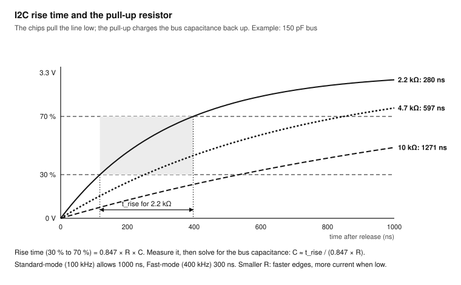

1. CH2 on SDA, 500 mV/div, 200 ns/div. Trigger on C2, rising edge.
2. In **Measure**, open the measurement configuration and set custom thresholds: upper 70 %, middle 50 %, lower 30 %. Add Rise time on C2 and switch on statistics.
3. Note the rise time with the modules' own pull-ups.
4. Add a 4.7 kΩ from SDA to 3.3 V and measure again. Then replace it with 2.2 kΩ.
5. Compute the bus capacitance from one measurement: C ≈ t_rise / (0.847 × R), where R is the total pull-up (all resistors in parallel, including those on the modules).
6. Pick the largest pull-up that keeps the rise time under 300 ns for 400 kHz, with some margin.

**Test:** your log has three rise times, the bus capacitance and your chosen pull-up.

### Exercise 8.4: CAN

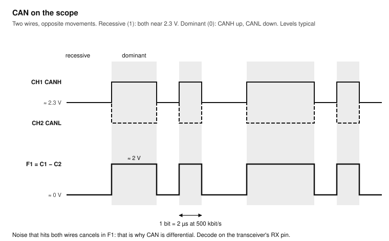

1. Set up the Teensy CAN loopback from [Teensy Exercise 6.3](../teensy41/README.md#exercise-63-can-bus-with-flexcan_t4) (500 kbit/s, a frame every 500 ms).
2. CH1 on CANH, CH2 on CANL, both 1 V/div, ground clips on the transceivers' GND. CH3 on CAN1's CRX pin (the logic-level receive pin of the transceiver).
3. Trigger on CH3, falling edge (start of frame), 20 µs/div, **Normal**.
4. Recessive bits: CANH and CANL both about 2.3 V. Dominant bits: CANH higher, CANL lower, about 2 V apart.
5. Math: F1 = C1 − C2. The difference is clean even when both lines carry noise: that is why CAN is differential.
6. Measure one bit: 2 µs at 500 kbit/s.
7. Decode: Bus 1, CAN, source C3, 500 kbit/s. The decode shows ID 0x123, the length and the two data bytes. Turn the knob and watch the second byte change.
8. Power off and remove one terminator. Look at the edges of F1 again: slower and with reflections. Put it back.

**Test:** decoded frames with ID 0x123; your log has the bit time and the voltage levels.

## Lesson 9: Capstone: characterise a project

**Goal:** apply everything to a finished project and write a measurement report. **Time:** 3 hours. **Pass:** a one-page report with screenshots that someone else could repeat.

Choose the ESP32 room climate monitor ([ESP32 Lesson 7](../esp32/README.md#lesson-7-capstone-a-room-climate-monitor)) or the Teensy desk synth ([Teensy Lesson 7](../teensy41/README.md#lesson-7-capstone-the-teensy-desk-synth)). Measure it as a test engineer would, and record each result with its screenshot.

### Exercise 9.1: Plan the measurements

Make a table before you touch a probe: what to measure, where, with which settings, and what you expect. For the climate monitor, for example:

| Measurement | Probe point | Settings | Expected |
| --- | --- | --- | --- |
| 3V3 ripple, idle and during Wi-Fi | 3V3 pin | AC, 20 mV/div, BW limit | Under 50 mV peak to peak |
| Current per measurement cycle | USB current-sense lead | C1 − C2, 500 ms/div | Peaks of a few hundred mA |
| I2C traffic and rise time | SDA, SCL | Decode, thresholds 30/70 % | Address 0x76 or 0x77, rise under 300 ns |
| Measurement cycle time | Debug pin | Single, 1 s/div | As programmed |
| Brownout margin | 3V3 pin | Window trigger 3.1 to 3.5 V | No trigger in 10 minutes |

For the desk synth: the audio output's waveform and FFT, the time from a key press to sound (a debug pin and the audio output), the MIDI or USB timing, and the supply during loud notes.

### Exercise 9.2: Measure and save

1. For each row, set up the scope, measure, and take a screenshot.
2. Save the setup of each measurement to the USB stick (Utility > Save/Recall, Setup): a measurement you can recall is a measurement you can repeat after a change.
3. Save one clean waveform as a reference (**Ref**, REFA) and recall it next to the live trace after you change something.

### Exercise 9.3: Watch it for a long time

1. Choose the measurement most likely to go wrong (the brownout margin, or a dropout trigger on a debug pin that toggles every cycle).
2. Set the trigger, **Normal** mode, and leave it for an hour or overnight. Check History afterwards: an empty History means no event happened.
3. Optional: Mask test. Create a mask from a good waveform (Auto create mask) and run the test: the scope counts passes and failures, up to 80,000 per second, and the Aux output on the back gives a pass/fail signal.

### Exercise 9.4: Control the scope from your Mac

1. Connect the scope's LAN port to your network. Find its IP address in the Utility menu (I/O or LAN settings).
2. Type the address into a browser on your Mac. The scope's web server shows the screen and the controls.
3. Take your final screenshots from the browser.

### Exercise 9.5: Write the report

One page per project: what you measured, the settings, the results against expectation, the screenshots, and what you would change in the project because of what you saw.

**Test:** give the report to someone else (or to yourself a week later). Can they repeat every measurement from it?

## Troubleshooting

| Symptom | Likely cause | Fix |
| --- | --- | --- |
| No trace at all | Channel off; trace off screen; Run/Stop stopped; Normal mode with no trigger | Press the channel key; push the position knob; press Run/Stop; switch to Auto; or press Default and start over |
| A flat line at 0 V | Coupling set to GND; probe not connected; tip not on the signal | Check coupling DC; check the BNC lock and the hook |
| Amplitude 10 times too small or large | Probe switch and channel Probe setting disagree | Set both to 10× |
| Trace rolls or smears | No stable trigger: wrong source, level outside the signal, wrong slope | Trigger source = the signal's channel; push the level knob for 50 % |
| Trace jumps between two positions | Edges of different shape both trigger | Change the slope, or use holdoff or a smarter trigger |
| Square wave has rounded or spiky corners | Probe not compensated | Exercise 0.3 |
| Edges ring that should not | Long ground lead | Use the ground spring (Exercise 5.2) |
| Slow, wrong waveform at slow timebases | Aliasing: the sample rate is too low | Check the sample rate; raise the memory depth; switch off unused channels; use Peak Detect to check |
| Noisy trace on a quiet signal | 1× probe; long ground lead; full bandwidth | 10× probe, short ground, 20 MHz bandwidth limit, Average or ERES |
| Hum at 50 or 60 Hz on everything | Ground loop or a floating circuit | Clip the ground to the circuit's GND; check that the circuit's supply is connected |
| Circuit resets when you clip the ground | Ground clip on a point that is not GND, shorting it to earth | Remove it; find the real GND |
| Decode shows garbage | Wrong baud rate, threshold or channel assignment | Check the analog trace, then the settings |
| Measurement shows "****" or no value | Not enough cycles or edges on screen, or the signal is clipped off screen | Show at least two cycles; adjust V/div so the whole signal fits |
| Acquisition pauses now and then | Quick Cal is recalibrating | Utility > Menu > Maintenance > Quick Cal off |
| Touch does nothing | Touch disabled | Press **Touch** |
| Settings are a mess | Many changes stacked up | **Default**, then set up the measurement again, or recall a saved setup |

## Reference cards and practice log

### Card A: Before you probe

- [ ] Scope warmed up for 20 minutes
- [ ] Probe switch on 10× and channel Probe setting 10X
- [ ] Probe compensated on this channel
- [ ] Ground clip on circuit GND, and on nothing else
- [ ] No mains anywhere near the probes
- [ ] Ground spring fitted for fast edges, spikes and switching nodes
- [ ] Trigger: source = the signal that comes first; Auto to find, Normal or Single to catch
- [ ] Sample rate in the timebase box at least 5 × the highest frequency of interest
- [ ] Coupling: DC for levels, AC or offset for ripple

### Card B: SDS804X HD controls

| Want to | Do |
| --- | --- |
| Start over | **Default** |
| Quick first look | **Auto Setup** |
| V/div, coarse or fine | Vertical **scale** knob; push to toggle |
| Offset to zero | Push vertical **position** |
| Trigger point to the centre | Push horizontal **position** |
| Trigger level to 50 % | Push trigger **level** |
| Catch one event | **Single** |
| Show only triggered pictures | **Normal** |
| Freeze, then restart | **Run/Stop** |
| Look closer at a stopped trace | **Zoom**; push horizontal **scale** to switch windows |
| Slow chart-recorder view | **Roll** (50 ms/div and slower) |
| Move a cursor | **Cursors**, then the **universal knob**; push it for the next cursor |
| Measurements and statistics | **Measure**, Advanced mode, Statistics on |
| FFT, C1 − C2, average | **Math** |
| Screenshot to USB | Quick-save key (set in Utility > Save Button) |
| Self calibration | Utility > Menu > Maintenance > Self Calibration |
| Lock the touch screen | **Touch** |

### Card C: Numbers and formulas

- **Scope rise time** ≈ 0.35 / bandwidth: 5 ns at 70 MHz
- **Measured rise time** ≈ √(signal² + scope²)
- **Bandwidth needed** ≥ 5 × the highest signal frequency
- **Sample rate needed** > 2 × the highest frequency (Nyquist); 5 to 10 × for shape
- **Memory used** = sample rate × 10 divisions × time/div
- **SDS804X HD:** 2 GSa/s and 50 Mpts with one channel; 1 GSa/s and 25 Mpts with two; 500 MSa/s and 10 Mpts with four
- **Shunt:** I = V / R; 1 Ω: 1 mV = 1 mA; 0.1 Ω: 1 mV = 10 mA
- **Charge:** Area (V·s) / R = A·s; mAh = A·s / 3.6
- **RC low-pass corner:** f = 1 / (2π × R × C)
- **I2C rise time:** 30 % to 70 %; Standard-mode ≤ 1000 ns, Fast-mode ≤ 300 ns; C ≈ t_rise / (0.847 × R)
- **UART bit time** = 1 / baud: 104 µs at 9600
- **CAN bit time** = 1 / bit rate: 2 µs at 500 kbit/s
- **dB:** −6 dB = half, −20 dB = a tenth; 0 dBV = 1 V rms
- **Square wave harmonics:** odd only at 50 % duty, amplitudes 1, 1/3, 1/5, 1/7

### Card D: Trigger recipes

| To catch | Trigger | Mode |
| --- | --- | --- |
| A steady repeating signal | Edge, level 50 % | Auto |
| A button press or a power-up | Edge on the input | Single |
| A burst of edges, once per burst | Edge with holdoff longer than the burst | Normal |
| A pulse that is too short | Pulse width, less than the normal width | Normal |
| A supply dip | Edge falling below the minimum, or Window | Normal |
| A signal that stops | Dropout, longer than the normal gap | Normal |
| A half-height pulse | Runt | Normal |
| A late reaction | Delay, from input edge to output edge | Normal |
| A specific bus message | Serial: address, ID or data | Normal |
| Something slow, no trigger possible | Roll mode | (none) |

### Practice log

| Date | Lesson / exercise | Signal and probe point | Settings | Result | Notes |
| --- | --- | --- | --- | --- | --- |
| &nbsp; | | | | | |

## Sources

- Siglent, [SDS800X HD Series Quick Start](https://www.siglenteu.com/wp-content/uploads/dlm_uploads/2024/12/SDS800X-HD_QuickStart_EN01B.pdf) (EN01B): controls, menus, probe compensation, calibration and safety statements used in this course.
- Siglent, [SDS800X HD Data Sheet](https://www.siglenteu.com/wp-content/uploads/dlm_uploads/2024/07/SDS800X-HD_Datasheet_EN01D.pdf) (EN01D): specifications, trigger types, decoders, math and measurement lists.
- Siglent, [SDS800X HD User Manual](https://www.batronix.com/files/Siglent/Oszilloskope/SDS800X-HD/4-Manuals/SDS800X_HD_UserManual_EN01A.pdf): the full reference for every menu.
- Analog Devices, [I²C Cabling](https://www.analog.com/en/resources/technical-articles/i2c-cabling.html): rise-time limits and the pull-up formula.
- The [oscilloscope buying guide](../oscilloscope/README.md) in this repository, for the background and the other sources.
