# Hands-On Soldering: A Practical Course

*With a practice track for the REASON build. Last updated 2026-11-07.*

**Shopping list:** see [Everything you need for all lessons](#everything-you-need-for-all-lessons).

**Printable version:** print [`soldering-course.pdf`](soldering-course.pdf). It has the whole course, high-contrast drawings, cut-out bench cards and fill-in worksheets (50-joint score sheet, layout grid, actual-size ruler). You can also print [`soldering-course.html`](soldering-course.html) from a browser. The drawings live in [`diagrams/`](diagrams/) as SVG, with high-contrast print versions in [`diagrams/print/`](diagrams/print/); their sources are in [`diagrams/src/`](diagrams/src/) (`node tools/render-diagrams.mjs soldering` rebuilds them). From the repository root, `node tools/build-course.mjs soldering` rebuilds both the HTML and the PDF (it needs Google Chrome).

## How to use this course

Seven bench sessions, about 18 hours in total, take you from never having held an iron to drag-soldering a fine-pitch IC, building a working circuit, and rehearsing every kind of joint the REASON towers need (Lesson 6). Each lesson has a goal, the parts you need, numbered exercises and a pass criterion. Do not move on until you pass.

**Printing.** Everything is line art and text, so it prints cleanly in black and white. Print single-sided and keep the pages at the bench; the checkboxes and the practice log at the end are meant to be filled in by pen.

**Units.** Temperatures are given in °C with °F in brackets. Wire sizes are given in AWG with mm² where it matters.

| Lesson | Skill | Bench time | Pass criterion |
| --- | --- | --- | --- |
| 0 | Setup, temperature, tinning, tip care | 30 min | Tip stays bright silver after 10 wipe-and-retin cycles |
| 1 | Wires: tinning, splices, connectors | 1.5 h | 10 splices that pass inspection and a firm pull |
| 2 | Through-hole on perfboard + 555 blinker | 3 h | 45 of 50 drill joints pass; blinker works first time |
| 3 | Desoldering and rework | 1.5 h | 10 parts removed, no lifted pads, holes clear |
| 4 | Surface mount: chips and SOIC | 3 h | 20 chip parts + 2 SOICs, zero bridges (meter-verified) |
| 5 | Capstone kit build | 2–4 h | Kit works on first power-up |
| 6 | REASON track: USB onto pads, 12 V harness, headers, interlock board, fine wire | 5–6 h | Every 6.x test passes; the interlock works at 12 V with a current limit |

Work in sessions of 60–90 minutes. Fine motor control degrades with fatigue faster than you notice, and a tired hand is where lifted pads come from.

### Related courses

- [ESP32 Hands-On](../esp32/README.md) and [Teensy 4.1 Hands-On](../teensy41/README.md) start where Lesson 2 ends. Both expect you to solder headers onto a module ([Exercise 6.4](#exercise-64-straight-headers-on-modules)) and to move a finished breadboard circuit onto perfboard.
- [Oscilloscope Hands-On](../sds804x-hd/README.md) measures the [555 blinker](#exercise-23-build-a-555-led-blinker) from Lesson 2, and its current-sense lead uses the cable skills of [Exercise 6.1](#exercise-61-usb-cable-surgery-do-3).
- The [oscilloscope buying guide](../oscilloscope/README.md) explains what a scope adds at the soldering bench: finding intermittent joints and checking a first power-up.

## The engineering of a solder joint

Soldering is a metallurgical bond, not glue: molten tin reacts with clean copper and forms an intermetallic layer (mostly Cu₆Sn₅) a few microns thick. That reaction only happens when **both** metal surfaces are above the solder's melting point and free of oxide. Almost every beginner failure traces back to violating one of those two conditions.

### Four principles that explain every technique in this course

1. **Heat the work, not the solder.** The pad and the lead must reach melting temperature themselves. Solder melted on the tip and dribbled onto a cold joint sits on top as a ball and never bonds.
2. **Heat moves through contact area, not tip temperature.** A dry tip touching a round lead at a single point transfers very little heat. A small bead of molten solder on the tip fills the gap and multiplies heat transfer several times over. This "thermal bridge" is the single most important trick you will learn. It is also why a chisel tip beats a needle tip for almost everything.
3. **Flux has a short life.** Flux chemically strips oxide and shields the surface while hot. It activates at roughly 150 °C (300 °F) and burns off within a few seconds at soldering temperature. Once it is gone, the solder turns sluggish, dull and spiky. The cure is fresh flux, not more heat.
4. **Thermal mass sets the dwell time.** A small resistor lead heats in about one second. A ground plane, a thick wire or a large connector pin sinks heat away and may need a bigger tip, a higher setting, or a few seconds of pre-heat. Learn to read how fast solder flows; it tells you how much heat the joint is absorbing.

### What wetting looks like

Wetted solder spreads like water on clean glass: a low contact angle and a smooth, concave fillet that feathers out onto the pad. Non-wetted solder beads up like water on a waxed car: a high contact angle and a ball that sits on the surface. You can judge a joint by its profile alone (see the drawing in Inspection and troubleshooting).

### Choosing an alloy

| Alloy | Melting behaviour | Recommended tip temp | Notes |
| --- | --- | --- | --- |
| Sn63Pb37 (eutectic leaded) | Melts and freezes at exactly 183 °C | 315–345 °C (600–650 °F) | Easiest to learn with: no pasty range, shiny joints. Contains lead. |
| Sn60Pb40 (leaded) | 183–190 °C pasty range | 320–350 °C (610–660 °F) | Slightly less forgiving than 63/37; joints can be disturbed while pasty. |
| SAC305 (Sn96.5Ag3Cu0.5, lead-free) | 217–220 °C | 340–370 °C (645–700 °F) | RoHS standard. Joints look duller and grainier by nature. Wets more slowly. |
| Sn99.3Cu0.7 (lead-free) | 227 °C | 350–380 °C (660–715 °F) | Cheap, hardest to work with. Avoid for learning. |

**Recommendation:** learn on Sn63Pb37 if you can keep lead hygiene strict (Safety section). If the bench is in a space young children use, start directly on SAC305 instead; you will need a slightly hotter tip and more flux, but the technique is identical.

**Wire diameter:** 0.8 mm (0.031") rosin-core for through-hole and wires; 0.5 mm (0.020") for surface mount.

## Safety

The real hazards are burns, flux fumes and lead on your hands, in that order. Lead does not vaporise at soldering temperatures; the visible smoke is burning flux (rosin), which is a respiratory sensitiser that can cause occupational asthma with repeated exposure.

**Heat and fire**

- The tip runs at 300–400 °C (570–750 °F). The iron lives in its stand whenever it is not in your hand, even for two seconds.
- Never catch a falling iron. Step back and let it drop.
- Work on a silicone mat. Keep isopropyl alcohol, paper and cable insulation away from the stand.
- Burn first aid: cool running water for 20 minutes. Do not use ice or butter.
- Switch the station off (or confirm auto-sleep) when you leave the bench.

**Fumes**

- Use a fume extractor with an activated-carbon filter, positioned 10–15 cm from the joint, or at minimum a fan pulling smoke away from your face and an open window.
- Do not lean directly over the joint; the plume rises straight up.

**Lead and flux residue**

- No food, drinks or phones on the bench. Wash hands with soap and cold water after every session, before eating or touching your face.
- Wipe the bench with a damp disposable cloth; do not sweep or blow solder dross around.
- Collect clipped leads, used braid and dross in a sealed jar; dispose of it as e-waste or hazardous waste, not household trash.
- Keep solder, flux and the bench out of reach of children.

**Eyes**

- Wear safety glasses. Flux spits, and clipped leads fly at speed: cover the lead with a finger when clipping and point it down into the bench.

**Electrical**

- Never solder on a powered circuit. Unplug, remove batteries, and discharge large capacitors first.
- Stay away from mains-voltage equipment until you have the skills and knowledge for it; nothing in this course needs more than the 12 V of the REASON towers.

### Bench rules (tape this to the wall)

- [ ] Glasses on
- [ ] Extractor running
- [ ] Iron in stand when not in hand
- [ ] No food or drink at the bench
- [ ] Wash hands when done
- [ ] Iron off before walking away

## Kit and workstation

Buy a temperature-controlled iron with a chisel tip, good flux and good solder; those three decide 80% of your results. Cheap uncontrolled "pencil" irons and conical needle tips are the most common reasons beginners conclude they are bad at soldering. Model names below are examples, not endorsements; prices change, so compare current listings.

### Core tools

| Item | Spec to look for | Why it matters | Examples |
| --- | --- | --- | --- |
| Soldering iron | Temperature-controlled, 60 W or more, fast recovery, auto-sleep | Holds temperature when the joint pulls heat | Pinecil V2 (USB-C PD), Hakko FX-888DX, cartridge stations using T12, C245 or C210 tips |
| Tips | Chisel 2.0–2.4 mm; bevel or hoof 1.6–3 mm for SMD drag | Flat face = big contact area | Hakko T18-D24, T12-D24 / BC2, Pinecil short chisel |
| Tip cleaner | Brass wool in a cup | Cleans without thermally shocking the tip | Any brass-wool cleaner |
| Tip tinner | Tin/flux paste in a tin | Revives oxidised (black) tips | Hakko FS-100, Thermaltronics TMT-TC-2 |
| Solder, through-hole | 0.8 mm (0.031") rosin or no-clean core; Sn63Pb37 or SAC305 | Thin enough to feed precisely | Kester 44, MG Chemicals, Chip Quik |
| Solder, SMD | 0.5 mm (0.020") | Small, controllable volume | Same brands, thinner gauge |
| Flux | No-clean gel in a syringe + flux pen | Fresh flux fixes most bad joints | Amtech NC-559, Chip Quik SMD291, MG 8341 |
| Desoldering braid | 2.0 mm, flux-impregnated | Removes solder from pads | Chemtronics Soder-Wick, Goot Wick |
| Solder sucker | Metal body, silicone nozzle | Clears through-holes | Engineer SS-02, Hakko DS01P |
| Flush cutters | Small, flush-ground | Clean lead trimming | Hakko CHP-170, Knipex 78 61 125 |
| Tweezers | ESD-safe, fine straight + curved | Holding SMD parts | Vetus or Hakko 7-SA / 15-SA |
| Wire strippers | Adjustable or self-adjusting, 30–10 AWG | Nicked strands break later | Knipex 12 62 180, Klein 11061 |
| Holder | PCB vise or helping hands with weighted base | You need both hands free | Stickvise, Omnifixo, PanaVise Jr. |
| Magnification | 10× loupe now; stereo microscope later for SMD | You cannot judge what you cannot see | Any 10× loupe; a phone macro shot works too |
| Multimeter | Continuity beeper, DC volts, resistance | Verifying joints and circuits | Any decent DMM |
| Cleaning | 99% isopropyl alcohol + ESD-safe brush | Removing flux residue | — |

### Safety gear

- Safety glasses (wrap-around)
- Fume extractor with carbon filter
- Silicone work mat, at least 30 × 45 cm

### Practice consumables

- 2–3 single-sided perfboards, about 7 × 9 cm, with individual copper pads
- Resistor assortment (1/4 W), a bag of 5 mm LEDs, a few 10 µF electrolytic capacitors
- NE555 timer + DIP-8 socket, 9 V battery and battery clip
- Male header strips (2.54 mm pitch)
- 22 AWG (0.33 mm²) stranded and solid wire in two colours; assorted heat-shrink tubing
- One solder-cup connector (XLR, DB9 or similar)
- An SMD practice board with 1206, 0805 and 0603 pads plus SOIC and TSSOP footprints, sold with matching parts
- A capstone kit (see Lesson 5)

### Later, not now

Hot-air rework station, PCB preheater, stereo microscope, solder paste and stencils. You will know when you need them.

### Extras for the REASON track (Lesson 6)

Most of these are already on REASON's shopping list; buy one spare of each so you rehearse on parts you can afford to ruin.

- Two sacrificial USB cables (USB-A to micro-B or USB-C), a USB-A female breakout, and a USB flash drive for testing
- A spare Omron G5LE-1-E DC12 relay, 1N4007 diodes, and 4.7 kΩ, 10 kΩ and 22 kΩ resistors (REASON's resistor kit covers these)
- Two pushbuttons or toggle switches to stand in for the E-stop and the ARM key
- A DIP-14 socket and a spare 74AHCT125
- Silicone wire in 18, 22 and 26 AWG, and heat shrink from 1.5 to 6 mm
- A hot-glue gun for strain relief
- A bench power supply with a current limit (0–30 V, 3 A or more); REASON's bench step B3 needs one too, to meter the valve's coil current
- A spare WS2812 ring or a short strip (optional)

## Everything you need for all lessons

Print this page and tick items off as they arrive. Quantities cover every exercise once with a little spare; the numbers in brackets are the lessons that first use each item. If you are building REASON, many Lesson 6 items are already on its shopping list: buy one extra of each so you rehearse on spares.

### Tools (buy once)

- [ ] Temperature-controlled soldering iron or station, 60 W or more, with stand (0)
- [ ] Chisel tips 2.0–2.4 mm, plus a bevel or hoof tip 1.6–3 mm for drag soldering (0, 4)
- [ ] Brass-wool tip cleaner and a tin of tip tinner (0)
- [ ] Safety glasses, fume extractor with carbon filter, silicone mat 30 × 45 cm or larger (0)
- [ ] Sealed jar for clippings, used braid and dross (0)
- [ ] Flush cutters and needle-nose pliers (1, 2)
- [ ] Wire strippers for 30–10 AWG (1, 6)
- [ ] PCB vise or helping hands (1)
- [ ] Heat gun, or use the side of the iron's barrel (1)
- [ ] Multimeter with continuity beeper (2)
- [ ] 10× loupe; a stereo microscope later (2, 4)
- [ ] Solder sucker (3)
- [ ] ESD-safe tweezers, fine straight and curved, and an ESD-safe brush (4)
- [ ] Bench power supply with a current limit, 0–30 V and 3 A or more (5, 6)
- [ ] Hot-glue gun and a solderless breadboard (6)

### Consumables

- [ ] Solder wire 0.8 mm, Sn63Pb37 or SAC305, 100–250 g (0)
- [ ] Solder wire 0.5 mm, same alloy, about 50 g (4)
- [ ] No-clean gel flux in a syringe, and a flux pen (0)
- [ ] Desoldering braid 2.0 mm, two rolls (3)
- [ ] 99 % isopropyl alcohol and lint-free wipes (4)
- [ ] Heat-shrink assortment, 1.5–6 mm (1)
- [ ] 22 AWG stranded wire in two colours, about 5 m each, and 2 m of 22 AWG solid or tinned bus wire (1, 2)
- [ ] Silicone wire: 18 AWG red and black, 2 m each; 26 AWG in three colours, 2 m each (6)
- [ ] Three perfboards with single copper pads, about 7 × 9 cm (1, 2, 6)

### Parts by lesson

**Lesson 0**

- [ ] 20 cm of 0.8 mm bare copper wire
- [ ] A thick 12 AWG wire offcut, a copper coin or a scrap of copper-clad board

**Lesson 1**

- [ ] One solder-cup connector (XLR, DB9 or similar)

**Lesson 2**

- [ ] 25 resistors of any value, for the 50-joint drill
- [ ] One 10-pin male header strip, 2.54 mm pitch
- [ ] 555 blinker: NE555, DIP-8 socket, 1 kΩ, 68 kΩ and 470 Ω resistors, 10 µF electrolytic, 10 nF ceramic, a 5 mm LED, a 9 V battery and clip

**Lesson 3**

- [ ] Nothing new: you rework the Lesson 2 drill board
- [ ] Optional: a short piece of stainless-steel wire for clearing holes

**Lesson 4**

- [ ] SMD practice kit: at least 20 parts each in 1206, 0805 and 0603, plus SOIC and TSSOP chips with their footprints

**Lesson 5**

- [ ] A capstone kit: plated-through PCB, 30–80 joints, no mains-voltage parts
- [ ] A 100 Ω resistor, if you have no bench supply

**Lesson 6 (REASON track)**

- [ ] 6.1: two sacrificial USB cables (USB-A to micro-B or USB-C), a USB-A female breakout and a USB flash drive
- [ ] 6.2: a scrap PCB and one 4.7 kΩ resistor
- [ ] 6.3: panel DC jack 5.5 × 2.5 mm, SPST rocker switch, inline mini blade-fuse holder with a 7.5 A fuse, and a 12 V supply with a 5.5 × 2.5 mm plug (REASON's GST90A12 works)
- [ ] 6.4: header strips and a spare module to practise on (a XIAO RP2040, a Pololu D36V28F5 or a MOSFET module)
- [ ] 6.5: Omron G5LE-1-E DC12 relay, 1N4007, two 22 kΩ and four 10 kΩ resistors, one normally-closed pushbutton (E-stop stand-in), one toggle switch (key stand-in), an LED with a 1 kΩ resistor, a DIP-14 socket and a 74AHCT125
- [ ] 6.6: a spare WS2812 ring or short strip, any Arduino-compatible board, a 330 Ω resistor, a spare MOSFET module, and a small 12 V load such as a 12 V indicator lamp or a spare valve

## Lesson 0: Setup, tinning and the core technique

**Goal:** a bright, wetted tip and a feel for how heat moves. **Time:** 30 minutes. **Pass:** the tip stays bright silver through 10 wipe-and-retin cycles, and you can explain why the copper block took longer than the wire.

### Bench layout

Right-handers: iron stand to the right, solder spool and flux to the left, holder centred, extractor behind the work and slightly to the side. Rest both forearms on the bench; precision comes from anchored wrists, not from hovering hands. Hold the iron like a pen, behind the grip, never on the metal.

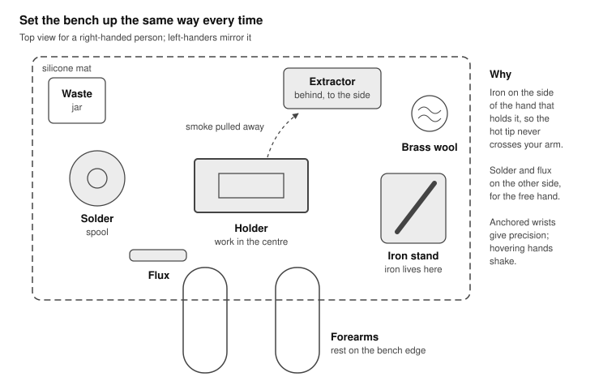

Everything has a fixed place, so your hands find the iron, solder and flux without you looking away from the joint.

### Exercise 0.1: Tin a new tip

1. Set the temperature for your alloy (Sn63Pb37: 330 °C / 625 °F; SAC305: 360 °C / 680 °F).
2. As the tip passes about 200 °C, start feeding solder onto the working face so it is coated the moment it reaches temperature. A new tip that heats up bare starts oxidising immediately.
3. Coat the whole working end until it is uniformly silver.
4. Wipe lightly in the brass wool, then immediately re-tin.
5. Repeat wipe-and-retin 10 times. The surface should stay mirror-bright.

### Tip care rules

- **Park it wet.** Before every return to the stand, leave a small blob of solder on the tip. It protects the plating.
- Clean the tip immediately before each joint, not after.
- If the tip turns black and solder balls off it, roll it in tip tinner, then re-tin. Never file or sand a plated tip; that removes the iron plating and destroys it.
- Do not press hard. Pressure does not add heat; contact area and a solder bridge do.
- Turn the temperature down or let the station sleep during pauses. Heat is what wears tips out.

### Exercise 0.2: Feel the thermal bridge

1. Clean the tip so it is just barely tinned.
2. Touch a 0.8 mm bare copper wire with the tip and press solder against the wire (not the tip). Count seconds until it flows.
3. Now add a tiny bead of solder to the tip first, touch the wire with the bead, and repeat.
4. Record both times in the practice log. The bead should cut the time by half or more.

### Exercise 0.3: Feel thermal mass

1. Tin the end of a thin wire: note the time to flow.
2. Try to tin a copper coin, a thick 12 AWG (3.3 mm²) wire or a scrap of copper-clad board.
3. Notice the solder balling up while the copper is still too cold. Keep the tip in contact with a solder bridge until it suddenly flows out flat. That moment is wetting.

### The core technique (memorise this)

Every through-hole and wire joint follows the same five steps, about 2–4 seconds in total.

1. **Clean and load.** Wipe the tip in brass wool; add a tiny bead of solder.
2. **Heat both.** Place the tip so it touches the pad and the lead at the same time, the bead bridging them. Hold 1 second.
3. **Feed into the joint.** Touch the solder wire to the pad/lead on the side opposite the tip, not onto the tip. Feed until a concave fillet forms, about 1–2 seconds.
4. **Solder off, then iron off.** Withdraw the solder first. Half a second later, lift the iron up and away along the lead.
5. **Do not move.** Keep the joint still for 2–3 seconds while it freezes. Any movement while it solidifies gives a disturbed, grainy joint.

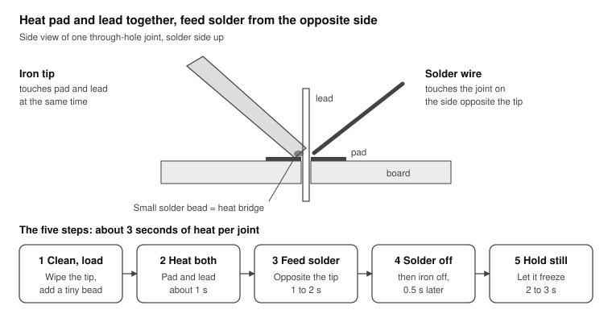

The flat of the tip rests where pad and lead meet; the solder goes in from the far side so it melts on the hot joint, not on the iron.

Say it out loud while you learn: "clean, heat, feed, solder off, iron off, still."

## Lesson 1: Wires

**Goal:** clean tinned ends, strong splices and solder-cup connections. **Time:** 1.5 hours. **Pass:** 10 inline splices that survive a firm pull, show no stray strands, have insulation intact within 1 mm of the joint, and are fully covered by heat shrink.

Wires are forgiving to learn on: big targets, visible wetting, and mistakes cost a few centimetres of wire.

### Exercise 1.1: Strip and tin stranded wire (do 10)

1. Strip 5 mm of insulation. Check that no strands were nicked or cut; if any were, cut off and strip again.
2. Twist the strands tightly in the original lay direction.
3. Clamp the wire horizontally in the holder. Dab flux on the strands.
4. Hold the loaded tip under the strands; feed solder from above. Solder should wick into the bundle and flow toward the insulation.
5. Stop when the strands are saturated. **Pass look:** the outline of individual strands is still visible under a thin silver skin; no blob at the tip; solder stops 0.5–1 mm short of the insulation (wicking under the insulation makes the wire stiff and it will break there).

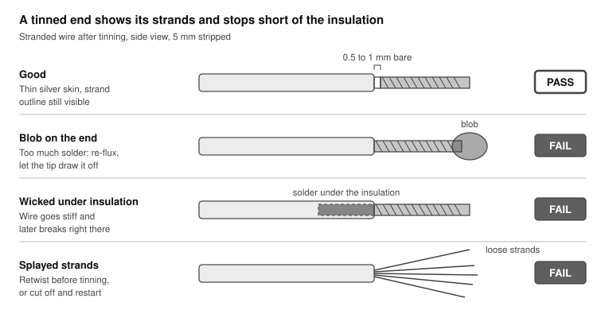

Only the top end passes. Each of the other three is a reason to cut the end off and tin it again.

### Exercise 1.2: Inline splice (do 10)

1. **Slide the heat shrink on first**, well away from the joint. (Everyone forgets this once.)
2. Strip and tin both wires (1.1), with 8–10 mm stripped.
3. Lay the two tinned ends side by side, overlapping fully, clamped so they touch along their length. For more mechanical strength, use a linesman's splice: cross the bare ends at the middle and wrap each around the other wire 3–4 turns.
4. Heat the joint from below with a loaded tip; add a little solder until the two ends fuse into one smooth piece.
5. Let it cool fully. Inspect: smooth, shiny (or uniformly satin on lead-free), no spikes, no sharp strands.
6. Slide the heat shrink over and shrink it with a heat gun or the side of the iron barrel (not the tip).
7. Pull firmly. Nothing should move.

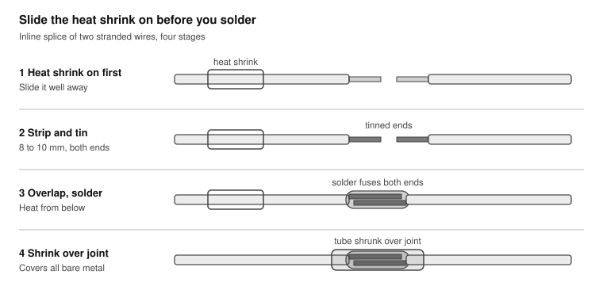

The tube waits on one wire, away from the heat, until the joint is cold; then it slides over and is shrunk.

### Exercise 1.3: Wire to a solder cup (do 3 pins)

Solder cups are found in XLR, DB-series and many power connectors.

1. Clamp the connector with the cup openings facing up.
2. Fill each cup about two-thirds full: heat the cup from the side and feed solder into it.
3. Tin the wire (1.1) and trim it to the depth of the cup.
4. Heat the cup until its solder is molten, slide the tinned wire straight in, remove the iron, and hold the wire perfectly still for 3 seconds.
5. **Pass look:** solder fills the cup with a concave meniscus to the wire; insulation sits 0.5–1 mm above the cup rim; no solder on the outside of the cup.

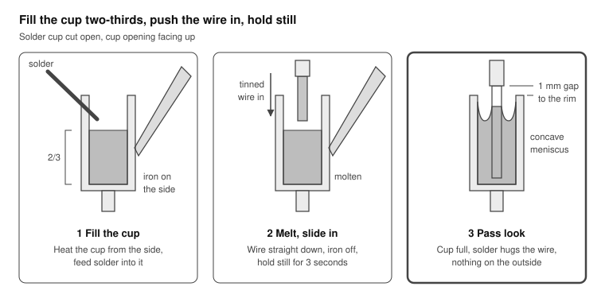

The iron heats the cup from the outside; the solder inside stays molten while the wire goes in, then freezes around it.

### Exercise 1.4: Wire to a through-hole pad (do 5)

1. Tin the wire, push it through a perfboard hole from the component side, and bend it 45° on the copper side to hold it.
2. Solder as per the core technique, then clip the excess just above the fillet.

### Common faults

| Fault | What you see | Fix |
| --- | --- | --- |
| Melted insulation | Insulation shrinks back or blisters | Shorter dwell; strip a little more; use PTFE or silicone wire for heavy work |
| Stiff, wicked wire | Solder visible under the insulation | Use less solder; heat-sink the wire with a clip near the insulation |
| Blob on the end | Rounded ball, strands hidden | Re-flux, reheat, and let the tip draw off the excess |
| Splayed strands | Single strands sticking out | Retwist before tinning; cut off and restart |

## Lesson 2: Through-hole on perfboard

**Goal:** consistent, inspectable through-hole joints, then a working circuit. **Time:** 3 hours. **Pass:** at least 45 of 50 drill joints pass inspection, and the 555 blinker flashes at about 1 Hz on first power-up.

### Exercise 2.1: The 50-joint drill

1. Bend 25 resistors' leads 90° at least 1.5 mm from the body (use pliers as a former; never bend at the body seal).
2. Insert them in a neat grid on the perfboard, body flat against the board.
3. Flip the board. Splay each lead 30–45° outward so the part cannot fall out. Do not bend flat; a flat-bent lead is hard to remove later.
4. Solder all 50 joints using the core technique. Count the seconds; target 2–4 s per joint.
5. Clip each lead just above the top of the fillet, cutter's flat side toward the board, finger over the lead.
6. Inspect every joint with the loupe against the Inspection section. Mark each pass or fail on a printout of the grid and record the score in the practice log.

**Pass look:** a smooth, concave "volcano" that covers the whole pad and climbs the lead; lead outline visible; shiny (63/37) or uniformly satin (lead-free); no spikes.

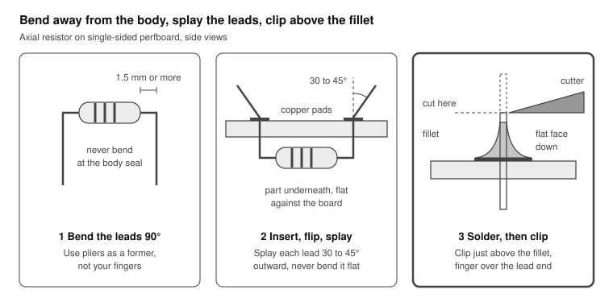

Splayed leads hold the part while you solder but still straighten easily for desoldering in Lesson 3.

### Exercise 2.2: Harder joints

1. Solder a 10-pin header strip. Tack one end pin, check the strip is square and flat, reflow that pin to correct it, then tack the other end before doing the middle.
2. Make a 5 cm bus: lay a tinned bare wire across 10 pads and solder it to each pad. Notice how the wire carries heat away from neighbouring joints.
3. Join three adjacent pads into one net with a deliberate solder bridge. This teaches the difference between a controlled bridge and an accidental one.

### Exercise 2.3: Build a 555 LED blinker

A classic astable oscillator: the 555 charges and discharges a capacitor through two resistors and toggles its output, flashing an LED at roughly 1 Hz.

**f ≈ 1.44 / ((R1 + 2·R2) · C1) = 1.44 / ((1 kΩ + 136 kΩ) × 10 µF) ≈ 1.05 Hz**

**Parts:** NE555 + DIP-8 socket, R1 = 1 kΩ, R2 = 68 kΩ, R3 = 470 Ω (LED current limit), C1 = 10 µF electrolytic, C2 = 10 nF ceramic (optional, stabilises pin 5), one 5 mm LED, 9 V battery clip.

**555 pinout** (notch at top, pin 1 at top-left, counting anticlockwise viewed from above): 1 GND, 2 TRIG, 3 OUT, 4 RESET, 5 CTRL, 6 THRES, 7 DISCH, 8 VCC.

| Net | Connects |
| --- | --- |
| +9 V | Battery red, pin 8, pin 4, R1 end A |
| DISCH | R1 end B, pin 7, R2 end A |
| TIMING | R2 end B, pin 6, pin 2, C1 + (long leg) |
| OUT | Pin 3, R3 end A |
| LED | R3 end B, LED anode (long leg) |
| GND | Battery black, pin 1, C1 − (stripe side), LED cathode (flat side), C2 end B |
| CTRL | Pin 5, C2 end A |

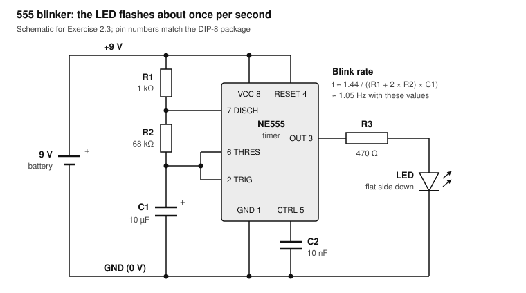

Dots mark joined wires. C1 charges through R1 and R2 and discharges through R2 into pin 7; pin 3 drives the LED through R3 each half-cycle.

**Build order and checks**

1. Draw the layout on paper first, on a grid matching the board. Keep it compact.
2. Solder the socket, never the chip. Tack two opposite corner pins, check it sits flat, then do the rest.
3. Fit lowest parts first: resistors, then C2, then the LED and C1, then the battery clip wires.
4. Route connections on the copper side with bent-over leads or tinned bus wire; insulated wire for any jumper that crosses another net.
5. Check polarity twice: C1 stripe to GND, LED flat/short leg to GND.
6. **Before power:** with the meter on continuity, confirm there is NO beep between +9 V and GND. Then check each net in the table beeps end to end.
7. Insert the 555 with the notch matching your drawing; connect the battery.

**If it does not blink:** LED reversed (most common); C1 reversed; pin 4 not tied to +9 V; a solder bridge between adjacent socket pins; a cold joint on the socket. Measure pin 8 to pin 1: you should read about 9 V.

> **Tip:** With a scope, check your blinker against the 555 formula and watch its timing capacitor charge: [Exercise 3.7](../sds804x-hd/README.md#exercise-37-optional-the-555-blinker) of the oscilloscope course.

## Lesson 3: Desoldering and rework

**Goal:** remove parts and fix bad joints without damaging the board. **Time:** 1.5 hours. **Pass:** remove 10 resistors and the header strip from your Lesson 2 drill board with no lifted pads and every hole clear.

Desoldering is harder than soldering, and it is where boards get damaged. Pads are thin copper foil glued to fibreglass; heat softens the glue and force tears the pad off. **Rule:** no more than about 5 seconds of heat per attempt, then let the area cool for 10–20 seconds before the next.

### The counter-intuitive trick: add solder to remove solder

Old or factory joints often hold too little solder, or lead-free solder with a higher melting point. Adding fresh leaded solder plus flux first makes the joint melt faster and fully, so the braid or pump can take it all in one go.

### Exercise 3.1: Desoldering braid

1. Add flux to the joint and to the last centimetre of braid.
2. Lay the braid flat on the joint. Press the flat of a loaded tip on top of the braid.
3. Wait until you see solder wick into the braid (it turns silver), 1–3 seconds.
4. Lift braid and iron away **together**. If you lift the iron first, the braid solders itself to the pad and rips it off when pulled.
5. Cut off the used, silver section of braid. Repeat on a fresh section if needed.

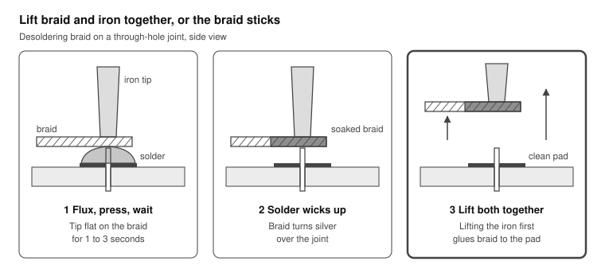

The iron heats the joint through the braid; capillary action pulls molten solder up into the copper weave. Cut off the soaked section before the next joint.

### Exercise 3.2: Solder sucker

1. Cock the plunger.
2. Melt the joint completely; add fresh solder if it is reluctant.
3. Move the nozzle over the joint, touching the iron tip, and trigger it in one motion.
4. If the lead still sticks to the barrel wall, reflow with fresh solder and suck again, or wiggle the lead gently with tweezers while the joint is molten.
5. Empty the sucker regularly into the waste jar.

### Exercise 3.3: Remove parts

1. **Two-lead parts:** straighten the splayed leads first (heat and nudge with tweezers). Clear each joint with the sucker, then the part drops out. Alternative: heat one joint and rock the part out a little, then the other, alternating.
2. **Header strip:** clear every pin with the sucker, then check each pin wiggles freely before pulling. If one stubborn pin remains, reflow it with fresh solder and try again.
3. **When the board matters more than the part:** cut the part's leads on the component side, then remove each lead individually. A new resistor is cheaper than a repaired pad.
4. **Clear the holes:** reflow each hole and suck, or push a heated piece of stainless-steel wire through it (solder will not stick to stainless).

### Exercise 3.4: Rework bad joints

Go back to the joints you failed in Exercise 2.1:

- Dull or grainy (cold): add flux, reheat until it flows, remove the iron cleanly.
- Too much solder: touch a clean, unloaded tip to the joint; the tip carries off excess. Or use braid.
- Bridge between pads: flux, then drag a clean tip from between the pads outward.

**If you lift a pad:** stop. Scrape the trace back to clean copper, then solder a short wire from the component lead to the next point on that net. This is a normal repair; note it and move on.

## Lesson 4: Surface mount

**Goal:** place and solder chip components down to 0603 and gull-wing ICs down to 0.65 mm pitch. **Time:** 3 hours. **Pass:** 20 × 0805 parts with good fillets on both ends, and 2 SOICs with zero bridges, verified by a continuity check between every pair of adjacent pins.

SMD is easier than it looks once you accept two facts: flux does the work, and magnification is not optional. Switch to 0.5 mm solder, keep the gel flux syringe within reach, and use fine tweezers.

**Size reference (imperial codes):** 1206 = 3.2 × 1.6 mm, 0805 = 2.0 × 1.25 mm, 0603 = 1.6 × 0.8 mm. Practise in that order.

### Exercise 4.1: Two-terminal chip parts (1206 → 0805 → 0603)

1. Put a small amount of solder on **one** pad only.
2. Grip the part with tweezers. Reflow that pad with the iron and slide the part in flat against the board, end cap into the molten solder. Remove the iron; hold the tweezers still for 2 seconds.
3. Check alignment under magnification. If it is crooked or lifted, reflow and nudge it now.
4. Solder the second end: touch the tip to pad and end cap together, feed a little solder.
5. Add flux to the first end and briefly reflow it, so it gets a proper fillet rather than just a tack.
6. **Pass look:** a concave fillet climbing at least a quarter of the way up each end cap; part flat and centred; no solder balls nearby.

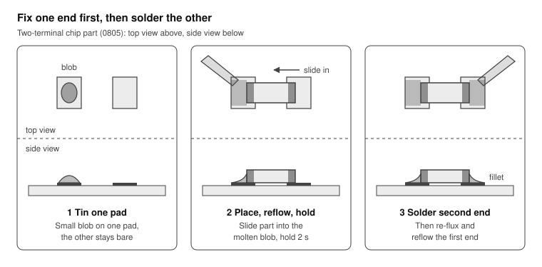

The pre-tinned pad lets you hold the part with one hand and the iron with the other; a finished end shows a concave fillet climbing the end cap. The same tack-first logic applies to SOICs: tack one corner pin, check alignment, then tack the opposite corner.

### Exercise 4.2: SOIC (1.27 mm pitch)

1. Tin one corner pad only.
2. Place the chip with tweezers, pin 1 matching the footprint marker. Reflow the corner pad to tack that pin.
3. Check under magnification that **every** pin sits centred on its pad on both sides. Reflow the tack and adjust until it does.
4. Tack the diagonally opposite corner pin.
5. Solder each remaining pin individually: tip on the pad tip and pin foot, a touch of solder.
6. Flux the whole row, then pass the clean tip once along it to even out the fillets.

### Exercise 4.3: Drag soldering (TSSOP, 0.65 mm pitch)

This is how fine-pitch ICs are really soldered: a controlled wave of solder flows along the pins, and surface tension, helped by flux, keeps each pin separate.

1. Tack two opposite corners as in 4.2. Alignment must be perfect before you continue.
2. Flood the pin row with gel flux. Be generous.
3. Load a hoof or bevel tip with a moderate bead of solder.
4. Starting at one end, drag the tip slowly along the pin row, slightly angled, touching the pin feet at the pad tips. About 1 mm per second.
5. Bridges are normal at first. Remove them by adding flux and dragging a **clean** tip off the end of the row, or by laying braid over the row.
6. Check under magnification, then with the meter between each adjacent pin pair.

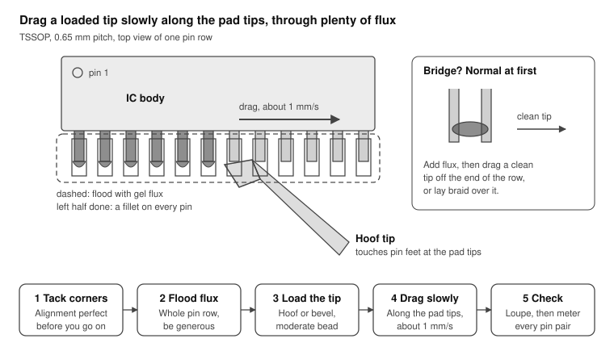

The flux lets surface tension pull the solder onto each pin and away from the gaps between them; when the flux is spent, bridges appear.

### Exercise 4.4: Clean up

Scrub flux residue off with 99% isopropyl alcohol and an ESD-safe brush, then blot dry with a lint-free wipe. No-clean flux is technically safe to leave, but residue hides defects during inspection and attracts dust.

### Optional: first steps with hot air

When you add a hot-air station, practise removing an SOIC: flux the pins, set about 320–350 °C (610–660 °F) at low airflow, circle the nozzle evenly over the whole chip 1–2 cm above it, and lift the chip with tweezers when all pins are molten. Shield nearby plastic parts with aluminium tape.

## Lesson 5: Capstone kit build

**Goal:** build a real product on a real PCB, start to finish. **Time:** 2–4 hours. **Pass:** it works on first power-up, or you find and fix the fault yourself with the meter.

### Choosing a kit

Pick a kit with a plated-through PCB, 30–80 through-hole joints and a few SMD parts if possible. Good categories: a small headphone amplifier, a guitar effects pedal, a fuzz or synth module, a clock, or an LED matrix badge. Kits from Adafruit, SparkFun, Elenco and the many pedal and synth kit makers all qualify. Avoid kits that include mains-voltage parts.

### Build procedure

1. **Inventory.** Lay out all parts and tick them off against the bill of materials. Measure every resistor with the meter rather than reading colour bands.
2. **Read the whole manual first.** Note polarised parts: diodes, electrolytics, LEDs, ICs, connectors.
3. **Lowest profile first:** SMD parts, then resistors and diodes, IC sockets, small ceramic caps, transistors, then electrolytics, headers, connectors, pots and jacks. Tall parts first make the board rock when flipped.
4. **Solder in batches.** Insert 5–10 parts, flip, solder, clip, inspect. Do not populate the whole board and then solder.
5. **Tack before committing** on anything that must be square: sockets, headers, jacks, pots. One pin, check alignment, then the rest.
6. **Inspect the whole board** with the loupe and a strong light at a low angle. Look specifically for bridges and unsoldered pins.
7. **Clean** the flux residue.

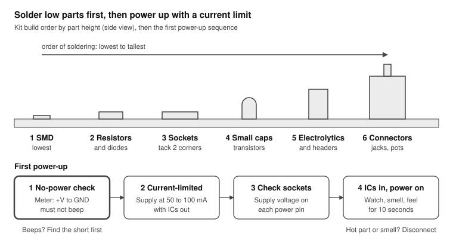

Low parts first keep the board flat on the bench when you flip it; the current limit turns a hidden short into a warning instead of smoke.

### First power-up

1. Without power: meter on continuity or resistance between supply and ground. A dead short (near 0 Ω) means stop and find it.
2. If you have a bench supply, set the voltage to spec and the current limit low (for example 50–100 mA). If not, put a 100 Ω resistor in series with the battery for the first test.
3. Power on with ICs out of their sockets, check supply voltage at each socket's power pin, power off, insert ICs, power on again.
4. Watch, listen and smell for 10 seconds. Hot parts or a burning smell: disconnect immediately.

### Where to go next

- **Standards:** IPC-A-610 defines what an acceptable assembled joint looks like and is the industry reference for inspection; IPC J-STD-001 defines the soldering process; IPC/WHMA-A-620 covers cables and wire harnesses.
- **Tools:** a stereo microscope (transforms SMD work), a hot-air station, then solder paste with a stencil and a hot plate or reflow oven for whole SMD boards.
- **Skills:** QFN and other bottom-terminated packages with hot air, then designing and ordering your own PCBs.

## Lesson 6: The REASON practice track

**Goal:** rehearse every kind of joint the REASON towers need, on spare parts, before touching the real hubs, servos and fire controller. **Time:** 5–6 hours over two or three sessions. **Pass:** every exercise below passes its own test, and the rehearsal interlock board works on the bench at 12 V with a current limit.

REASON's build page lists every wire as W1–W31. They come down to six kinds of joint. The real boards are cheap but slow to reorder, and a lifted pad on a hub costs you a tower, so rehearse each kind here first.

### Where each REASON joint is practised

| Joint type | REASON wires and parts | Rehearsal | Builds on |
| --- | --- | --- | --- |
| Cut USB 2.0 lead onto board pads | W2, W3, W4, W5, W17, W19, W30 | 6.1 USB cable surgery | Lessons 1, 4 |
| Wire onto a small pad; inline resistor | W10, W22 (buck to hub 5V pad); W2, W17 (4.7 kΩ on CC) | 6.2 Pads and inline parts | Lessons 1, 4 |
| 12 V power: jack, rocker, fuse, bus | W7, W8, W9, W21, W24 | 6.3 The 12 V harness | Lesson 1 |
| Header pins on modules | XIAO RP2040, Pololu D36V28F5, MOSFET modules | 6.4 Straight headers | Lesson 2 |
| Perfboard circuit: relay, flyback diode, dividers, level shifter | W23, W24, W26, W31, W28 | 6.5 The interlock board | Lessons 2, 3 |
| Fine wire to light boards, low-side loads | W28 (NeoPixel ring), W25 (module outputs) | 6.6 Fine wire and strain relief | Lessons 1, 4 |

The JST EH connectors on the DYNAMIXEL leads (W13, W14, W29) are crimped, not soldered. Use the X3P cables as shipped where you can, and never solder a crimp contact: solder wicks into the strands and makes the wire snap where it flexes.

### Exercise 6.1: USB cable surgery (do 3)

REASON cuts USB leads short and solders them straight to the CH334F hubs' pads. USB 2.0 high speed runs at 480 Mb/s on a twisted pair with about 90 Ω differential impedance; it tolerates a short untwisted stub, not a sloppy one.

1. Cut a sacrificial cable. Strip 25 mm of the outer jacket, fold the braid and foil back, and find four conductors and usually a bare drain wire.
2. The usual colours are red VBUS, black GND, green D+, white D−. **Check each one with the meter against the connector's pinout before you trust the colours.**
3. Strip 2 mm of each inner conductor (about 28 AWG) with the stripper's finest hole. Check for cut strands; at this size you can lose half of them without noticing.
4. Keep D+ and D− twisted together right up to the pads: **under 10 mm untwisted, and both the same length.**
5. Tin pads and conductors, then join each with a quick tack joint (Exercise 6.2). Drain and GND share the GND pad.
6. For REASON's upstream leads (W2, W17), cut VBUS back by 5 mm and seal it in heat shrink: the Mac's VBUS must never meet the buck's 5 V.
7. **Test:** splice a cable into a USB-A female breakout, plug a flash drive into it and the cable into the Mac. In System Information → USB it must show **Up to 480 Mb/s**. Copy a 1 GB file across and compare checksums. A drive that drops to 12 Mb/s, or disconnects, means a data-pair joint is poor.

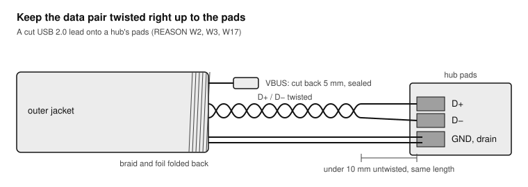

The braid and the drain are the cable's shield; folding them back cleanly and landing the drain on GND keeps the pair's noise immunity.

> **Tip:** The same skills build the USB current-sense lead in [Exercise 6.1](../sds804x-hd/README.md#exercise-61-build-a-usb-current-sense-lead) of the oscilloscope course: a 1 Ω resistor spliced into the 5 V wire, for measuring a board's current on a scope.

### Exercise 6.2: Wires onto small pads, and an inline resistor

1. On a scrap board (the SMD practice board or a dead PCB), tin five pads and five 22 AWG wire ends.
2. Lay each tinned wire flat on its pad, touch the iron to the top of the wire, and let both melt together: 1–2 s, no extra solder. This tack joint is how buck 1 and buck 2 feed the hubs' 5V pads (W10, W22).
3. Anchor each wire within 10–15 mm of its pad with a dab of hot glue or a zip tie. A pad is thin copper glued to the board; the wire must never pull on it.
4. **Inline resistor (CC → 4.7 kΩ → GND):** slide heat shrink onto the wire, trim the resistor's leads to 6 mm, lap-splice one lead to the CC wire and the other to the GND wire (as in Exercise 1.2), then shrink the tube over the whole resistor.
5. **Test:** a firm tug on each wire, then 4.7 kΩ end to end through the inline resistor.

### Exercise 6.3: The 12 V harness (W7, W21)

1. Lay out the panel DC jack, the rocker switch, the inline fuse holder (fuse out), and 18 AWG red and black wire.
2. Slide heat shrink onto each wire **before** soldering, long enough to cover each lug.
3. Hook each wire through its lug's hole and close it gently with pliers so it holds mechanically, then solder. 18 AWG on a big lug needs the 2.4 mm chisel or larger at 350–380 °C (leaded) to flow in 3–4 s.
4. Splice the fuse holder's leads into the red wire (Exercise 1.2).
5. Shrink every tube over its lug; nothing bare may remain on the 12 V side.
6. **Test:** meter on continuity: jack centre pin to the red end beeps, sleeve to the black end beeps, red to black is silent. Then fit the 7.5 A fuse, plug in the supply and read +12 V on red with the rocker on, 0 V with it off. REASON writes "polarity: meter first" on W7 and W21 for a reason.

### Exercise 6.4: Straight headers on modules

Headers go on the XIAO RP2040, the Pololu D36V28F5 bucks and the MOSFET modules, unless you wire them directly.

1. Push the header strips into a breadboard and lay the module on top: the breadboard is the jig that keeps the pins square.
2. Solder one pin at each end, check the module sits flat, then do the rest.
3. Keep each joint under 3 s; the modules' own parts sit close to the pins.
4. **Test:** no bridges between neighbouring pins (meter), and the module lifts out of the breadboard square.

### Exercise 6.5: The interlock board (rehearsal for W23, W24, W26, W31)

This is the REASON track's capstone: the same circuit tower 2 relies on so that no software can fire with the key off. Build it on perfboard with spare parts and prove it at 12 V before it ever meets the XIAO.

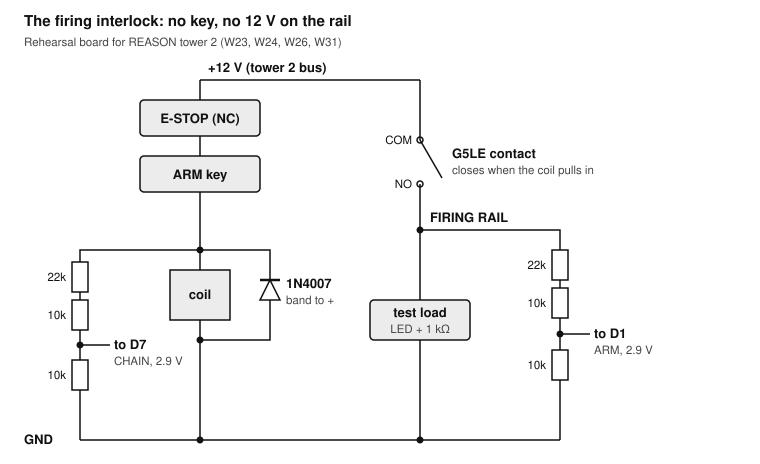

The key and E-stop carry only the coil's ≈ 35 mA; the relay's contact carries the rail. Each divider turns 12 V into a safe logic level for the XIAO.

**Parts:** a G5LE-1-E DC12 relay, a 1N4007, two 22 kΩ and four 10 kΩ resistors, two switches standing in for the E-stop (normally closed) and the key, an LED with a 1 kΩ resistor as the rail's test load, and wires or a terminal block for 12 V in.

1. Place the relay first; its pins are thick and its body sinks heat, so expect 3–4 s per pin with a chisel tip. Check the pins against the datasheet's bottom view.
2. Fit the 1N4007 directly across the coil pins, **band (cathode) to the side the key feeds.** Reversed, it shorts the coil's feed the moment you arm.
3. Wire the chain: 12 V → E-stop stand-in (NC) → key stand-in → coil → GND.
4. Wire the contact: 12 V → COM, NO → the rail → test load → GND.
5. Build both dividers, each 22 kΩ + 10 kΩ in series on top and 10 kΩ to GND: one from the rail (ARM, to D1), one from the coil's feed (CHAIN, to D7).
6. **Test with a current-limited supply** at 12 V and 100 mA:
   - Key off: relay silent, rail 0 V, both divider outputs 0 V.
   - Key on, E-stop released: relay clicks, rail 12 V, both outputs about 2.86 V (12 × 10 / 42), safely under the RP2040's 3.3 V.
   - Press the E-stop: relay drops out, rail back to 0 V.
   - Current with the relay pulled in: about 35 mA plus the test load.
7. Only when all four pass, wire in the real E-stop, key and XIAO.

**The level shifter (W28)** goes on the same board in a DIP-14 socket: pin 14 to 5 V, pin 7 to GND, pin 1 (1OE) to GND to enable channel 1, XIAO D10 into pin 2 (1A), pin 3 (1Y) out to the ring's data in, and the unused inputs (pins 5, 9 and 12) to GND. Check TI's datasheet pinout against your part before soldering the socket.

### Exercise 6.6: Fine wire and strain relief

1. Solder three 26 AWG wires (5 V, GND, data) to a spare WS2812 ring's or strip's pads: tin pads, tin wires, tack, 1 s each.
2. Twist the three loosely together and anchor them with hot glue beside the pads straight away; the board is light and the pads are small.
3. Route the bundle through a 6 mm hole in scrap, like the deck's Ø6 hole, without pulling on the joints.
4. Wire a spare MOSFET module to a 12 V load with 22 AWG, as in W25: module V+ to the rail, OUT− to the load's minus, the load's plus to the rail.
5. **Test:** the ring lights from a known-good controller (any Arduino running the NeoPixel example, data through 330 Ω), and every joint survives ten wiggles through the hole.

### Before you touch the real towers

- [ ] 6.1 Flash drive enumerates at 480 Mb/s through a spliced cable
- [ ] 6.2 Inline 4.7 kΩ reads correctly; pads survive the tug test
- [ ] 6.3 Harness polarity checked by meter; every 12 V lug covered
- [ ] 6.4 Headers square, no bridges
- [ ] 6.5 Interlock passes all four bench tests at 12 V with a current limit
- [ ] 6.6 Ring lights; joints survive the wiggle test
- [ ] Then REASON's bench steps B1–B3 with the real parts

## Inspection and troubleshooting

Judge every joint by its profile first: a good joint is a smooth, concave fillet that feathers onto the pad and climbs the lead. Shape tells you more than shine, especially with lead-free solder.

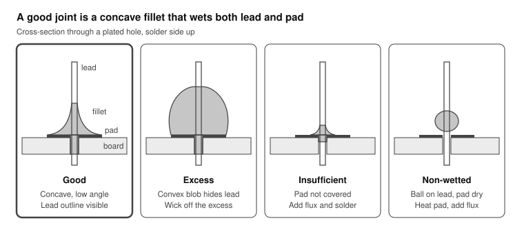

The good joint's solder flows out to the pad edge with a low angle on both sides; each fault shows either too much solder, too little, or solder that never bonded to one of the two surfaces.

### How to inspect

1. Use a 10× loupe and a bright light at a low angle; rotate the board so you see every joint from several sides.
2. Check both sides of a plated-through board: solder should fill the hole and show a small fillet on the component side too.
3. On fine-pitch parts, confirm with the meter: no continuity between adjacent pins that should be separate.
4. Lead-free (SAC) joints are naturally satin and slightly grainy. Do not mistake that for a cold joint; judge the shape instead.

### Defect table

| Defect | What it looks like | Cause | Fix |
| --- | --- | --- | --- |
| Cold joint | Dull, lumpy, grainy; may show a ring crack around the lead | Not enough heat; never fully wetted | Add flux, reheat until it flows smoothly |
| Disturbed joint | Frosty, crinkled surface | Lead moved while freezing | Add flux, reflow, hold still for 3 s |
| Non-wetted | Ball on the lead or pad, high contact angle | Oxide or dirt; one surface not hot enough | Clean, flux, heat both surfaces together |
| Excess solder | Convex blob, lead outline hidden | Fed too much solder | Clean tip draws off excess; or braid |
| Insufficient | Pad partly bare, hole not filled | Too little solder, or removed too soon | Add flux and a little solder |
| Bridge | Solder joins neighbouring pads or pins | Excess solder, burnt-off flux, dirty tip | Flux, drag a clean tip away; or braid |
| Spike or icicle | Sharp point where the iron left | Flux exhausted; iron withdrawn slowly | Flux, reflow, withdraw in one quick motion |
| Burnt flux | Brown or black charred residue | Too hot or too long | Lower temperature, shorter dwell; clean with IPA |
| Lifted pad | Pad raised or torn from board | Heat plus force, often during desoldering | Stop; repair with a wire jumper |
| Pinhole or blowhole | Small crater in the fillet | Gas from moisture or contamination | Reflow with flux; clean or dry the board |
| Tombstone (SMD) | Chip part standing on one end | One pad heated before the other | Reflow the low end and press the part flat |
| Solder balls | Tiny spheres near the joint | Spattering flux, excess solder | Remove with tweezers or brush; they cause shorts |

## Reference cards and practice log

Cut these out or keep this page at the bench.

### Card A: Temperature starting points

| Job | Sn63Pb37 | SAC305 lead-free |
| --- | --- | --- |
| SMD chip parts, SOIC | 300–330 °C (570–625 °F) | 330–360 °C (625–680 °F) |
| Through-hole, wires | 330 °C (625 °F) | 360 °C (680 °F) |
| Large pins, ground planes, 16 AWG+ | 350–380 °C (660–715 °F) + bigger tip | 380–400 °C (715–750 °F) + bigger tip |

If a joint needs more than 5 seconds, use a bigger tip before raising the temperature.

### Card B: The core technique

1. Clean the tip, load a small bead.
2. Heat pad and lead together, 1 s.
3. Feed solder opposite the tip, 1–2 s.
4. Solder off, then iron off.
5. Hold still 2–3 s.

### Card C: Pre-session checklist

- [ ] Glasses on, extractor on
- [ ] Tip tinned and bright
- [ ] Correct solder diameter loaded
- [ ] Flux within reach
- [ ] Brass wool clean
- [ ] Waste jar open

### Card D: Joint inspection checklist

- [ ] Concave fillet, low contact angle
- [ ] Pad fully covered
- [ ] Lead outline visible
- [ ] Shiny (63/37) or uniformly satin (lead-free)
- [ ] No spikes, cracks or pinholes
- [ ] No bridges to neighbours
- [ ] Lead clipped above the fillet
- [ ] No burnt flux or lifted pad

### Practice log

| Date | Lesson / exercise | Joints done | Passed | Avg. seconds per joint | Main fault | Next focus |
| --- | --- | --- | --- | --- | --- | --- |
| &nbsp; | | | | | | |
| &nbsp; | | | | | | |
| &nbsp; | | | | | | |
| &nbsp; | | | | | | |
| &nbsp; | | | | | | |
| &nbsp; | | | | | | |
| &nbsp; | | | | | | |
| &nbsp; | | | | | | |
| &nbsp; | | | | | | |
| &nbsp; | | | | | | |
