# Teensy 4.1 Hands-On: A Practical Course

*From the first blink to a USB MIDI desk synth, on real parts. Last updated 2026-11-07.*

**Shopping list:** see [Everything you need for all lessons](#everything-you-need-for-all-lessons).

**Printable version:** print [`teensy41-course.pdf`](teensy41-course.pdf). It has the whole course, high-contrast drawings, cut-out reference cards and fill-in worksheets (actual-size pin-label strips for the breadboard, a pin planner and the practice log). You can also read [`teensy41-course.html`](teensy41-course.html) in a browser. The drawings live in [`diagrams/`](diagrams/) as SVG, with high-contrast print versions in [`diagrams/print/`](diagrams/print/); their sources are in [`diagrams/src/`](diagrams/src/). From the repository root, `node tools/render-diagrams.mjs teensy41` rebuilds the drawings and `node tools/build-course.mjs teensy41` rebuilds the HTML and the PDF (it needs Google Chrome).

## How to use this course

Eight sessions, about 20 hours in total, take you from an unsoldered board to a finished instrument: a desk synth with eight keys, four knobs and a screen that plays its own sound and also shows up on your Mac as a USB MIDI controller. Every lesson has a goal, the parts you need, numbered exercises and a pass criterion. Do not move on until you pass.

**Who it is for.** You can solder (if not, do Lessons 0–2 of the [soldering course](../soldering/README.md) first) but you have never programmed a microcontroller. Every sketch here is complete: type it in or copy it, upload it, then change one thing at a time and watch what happens. That last step is where the learning is.

**Defaults used throughout.** If yours differ, the text tells you what changes.

| Item | Default in this course |
| --- | --- |
| Board | Teensy 4.1 (NXP i.MX RT1062, ARM Cortex-M7 at 600 MHz, 8 MB flash, 1 MB RAM, microSD socket, Ethernet PHY, USB host pads, RTC with VBAT, two PSRAM footprints) |
| Computer | A Mac with macOS; Windows and Linux work the same apart from the port names |
| Software | Arduino IDE 2.x with Teensyduino installed through the Boards Manager |
| Logic level | 3.3 V everywhere. No pin is 5 V tolerant |
| Cable | USB-A or USB-C to micro-B, a **data** cable (many phone-charging cables have no data wires) |

**Printing.** Everything is line art and text, so it prints cleanly in black and white. The pin-label strips at the end are actual size: print at 100 % and check the scale bar. The checkboxes and the practice log are meant to be filled in by pen.

| Lesson | Skill | Bench time | Pass criterion |
| --- | --- | --- | --- |
| 0 | Meet the board: power, 3.3 V rules, first upload, USB serial | 2 h | Blink runs from your own edit; Serial prints the CPU temperature |
| 1 | Digital I/O and timing: LEDs, buttons, debouncing, timers, interrupts | 2.5 h | One press = exactly one count, 50 presses in a row |
| 2 | Analog in, PWM out, switching 12 V with a MOSFET | 3 h | Battery reading within 2 % of your meter; strip dims smoothly from a knob |
| 3 | USB device types: MIDI controller and macro keyboard | 2.5 h | Four keys and four knobs drive a synth in a DAW, no stuck notes, no jitter |
| 4 | Storage and time: SD data logger with RTC timestamps | 2 h | One hour of 1-second CSV lines, opened in a spreadsheet, no gaps |
| 5 | Sound: Audio library, MQS output, a MIDI-played synth | 2 h | The synth plays clean notes from the Mac with no clicks or crackle |
| 6 | Talking to other things: serial, I2C, CAN, USB host, Ethernet | 3 h | Each short exercise passes its own test |
| 7 | Capstone: the Teensy desk synth | 3–4 h | Every line of the capstone test checklist ticked |

Work in sessions of 60–90 minutes and stop with something working. When a sketch misbehaves, the Troubleshooting chapter near the end is ordered by symptom.

## Three rules that save boards

A Teensy 4.1 is robust against software mistakes: whatever you upload, the Program button always gets you back. It is fragile against electrical mistakes, and nearly every dead Teensy dies one of these three ways.

1. **Nothing above 3.3 V on any pin.** Not 5 V from an Arduino sensor, not 5 V from a USB rail, not 12 V through a careless jumper. Analog pins included.
2. **No more than 4 mA from any pin, and no more than 250 mA from the 3.3V pins in total.** A pin lights an LED through a resistor or drives a transistor's gate. It never powers a motor, a relay coil or a strip of LEDs.
3. **Never short VIN or 3.3V to GND, and never feed VIN while USB is plugged in** unless you have cut the VIN–VUSB link (Lesson 0). Check with the meter before the first power-up of every new circuit.

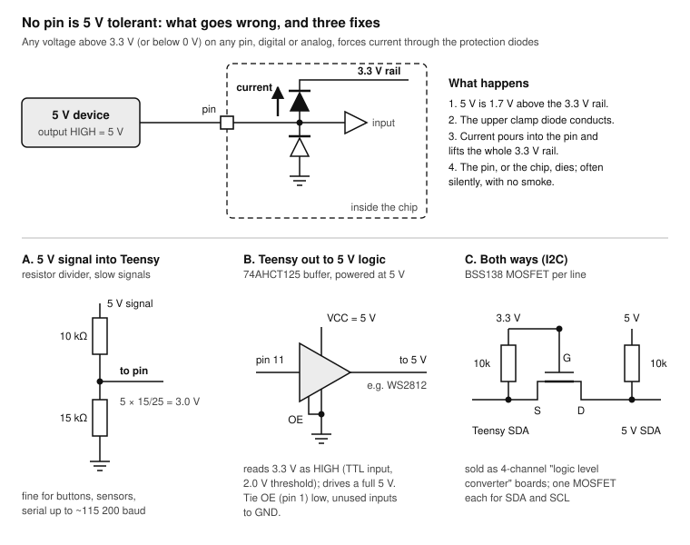

Above 3.3 V, the pin's protection diode conducts into the 3.3 V rail; the pin, or the whole chip, dies, often without any smell. Use a divider for slow 5 V inputs (A), a 74AHCT125 powered at 5 V for outputs that must reach 5 V logic (B), and a BSS138 level-converter board for I2C (C).

**Bench rules.** Unplug USB before you change wiring. Wire GND first. Power up new circuits with the meter's continuity beeper already checked between 3.3V and GND (no beep) and between VIN and GND (no beep). Keep 12 V supplies switched off until the logic side works. Nothing in this course touches mains voltage.

## Everything you need for all lessons

Print this page and tick items off as they arrive. Quantities cover every exercise once with a little spare; the numbers in brackets are the lessons that first use each item. Model names are examples, not endorsements; check that every breakout you buy runs at 3.3 V.

### Tools (buy once)

- [ ] Soldering iron, solder and flux from the [soldering course](../soldering/README.md) kit (0)
- [ ] Multimeter with continuity beeper, DC volts and, if possible, a frequency range (0)
- [ ] Two full-size solderless breadboards (830 holes) (0, 7)
- [ ] Jumper wire kit: male-male, plus some male-female (1)
- [ ] Flush cutters and wire strippers (1)
- [ ] A Mac with Arduino IDE 2.x and a free USB port; a powered USB hub is handy (0)

### Boards and modules

- [ ] Teensy 4.1 (the version with Ethernet if you want Exercise 6.5), plus two 24-pin 0.1" male header strips (0)
- [ ] USB-A or USB-C to micro-B **data** cable, 1 m (0)
- [ ] microSD card, 4–32 GB, any brand-name card (4)
- [ ] CR2032 coin cell and a holder with flying leads (4)
- [ ] SSD1306 OLED, 128 × 64, I2C, 3.3 V-capable (6, 7)
- [ ] BME280 breakout, 3.3 V (Adafruit, SparkFun or a generic purple board) (6)
- [ ] Two SN65HVD230 CAN transceiver breakouts (Waveshare SN65HVD230 CAN Board or similar) (6)
- [ ] USB Host Cable for Teensy 4.1 (PJRC) and a 5-pin 0.1" header; a USB MIDI keyboard or a USB computer keyboard to test with (6)
- [ ] Optional: Ethernet Kit for Teensy 4.1 (PJRC MagJack kit) and a network cable (6)
- [ ] Optional: Audio Adaptor Board for Teensy 4.x, Rev D (SGTL5000) (5)

### Components

- [ ] 5 mm LEDs, red and green, 10 of each (1)
- [ ] Resistors, 1/4 W: 470 Ω × 10, 100 Ω × 5, 2.2 kΩ × 5, 4.7 kΩ × 5, 10 kΩ × 10, 15 kΩ × 5, 47 kΩ × 5 (1, 2, 5)
- [ ] 6 × 6 mm tactile pushbuttons × 12 (1, 3, 7)
- [ ] 10 kΩ linear potentiometers (B10K) × 4, with knobs (2, 3, 7)
- [ ] Capacitors: 100 nF ceramic × 10, 4.7 nF film or C0G × 4, 10 µF electrolytic × 4 (2, 5)
- [ ] IRLB8721 N-MOSFET (TO-220) × 2 and 1N5819 Schottky diodes × 4 (2)
- [ ] 3.5 mm stereo jack breakout, or a cut audio cable (5)
- [ ] A few 0.1" female and male header strips, and two perfboards about 7 × 9 cm (6, 7)
- [ ] Optional for reference: 74AHCT125 and a 4-channel BSS138 level-converter board (0)

### 12 V and audio (Lesson 2 and 5)

- [ ] 12 V DC power supply, 2 A or more, with a screw-terminal DC jack adapter (2)
- [ ] 50 cm of 12 V LED strip (single colour, non-addressable) (2)
- [ ] A small 12 V DC motor (computer fan motors work too) (2)
- [ ] Powered computer speakers with a 3.5 mm line input, or a small amplifier module such as a PAM8302 with a 4–8 Ω speaker (5)

### Software (free)

- [ ] Arduino IDE 2.x from arduino.cc (0)
- [ ] Teensyduino through the Boards Manager (0)
- [ ] Libraries from the Library Manager: Adafruit SSD1306, Adafruit GFX Library, Adafruit BME280 Library (6, 7)
- [ ] On the Mac: GarageBand (preinstalled) as a synth, MIDI Monitor by Snoize, MidiKeys to play notes into the Teensy; for the capstone, a DAW that can send MIDI out, such as Reaper or Ableton Live Lite (3, 5, 7)

## Lesson 0: Meet the board

**Goal:** know what is on the board, where power goes, how to upload, and how to talk to the Teensy over USB. **Time:** 2 hours. **Pass:** Blink runs at a rate you chose, the Serial Monitor prints the CPU temperature once a second, and you can point to VIN, 3.3V, GND, VBAT and the Program button without looking at the drawing.

### What you are holding

The Teensy 4.1 is a 61 × 18 mm board built around NXP's i.MX RT1062, an ARM Cortex-M7 running at 600 MHz: hundreds of times faster than a classic Arduino Uno, with a floating-point unit, 1 MB of RAM and 8 MB of flash for your program. Around it sit a microSD socket, an Ethernet PHY (it only needs a jack), pads for a second USB port that works as a host, a real-time clock and two footprints for extra PSRAM chips.


Everything goes through the processor. The parts with dashed outlines need something you add: a PSRAM chip, the MagJack kit for Ethernet, a host cable for USB host, a coin cell for the clock.

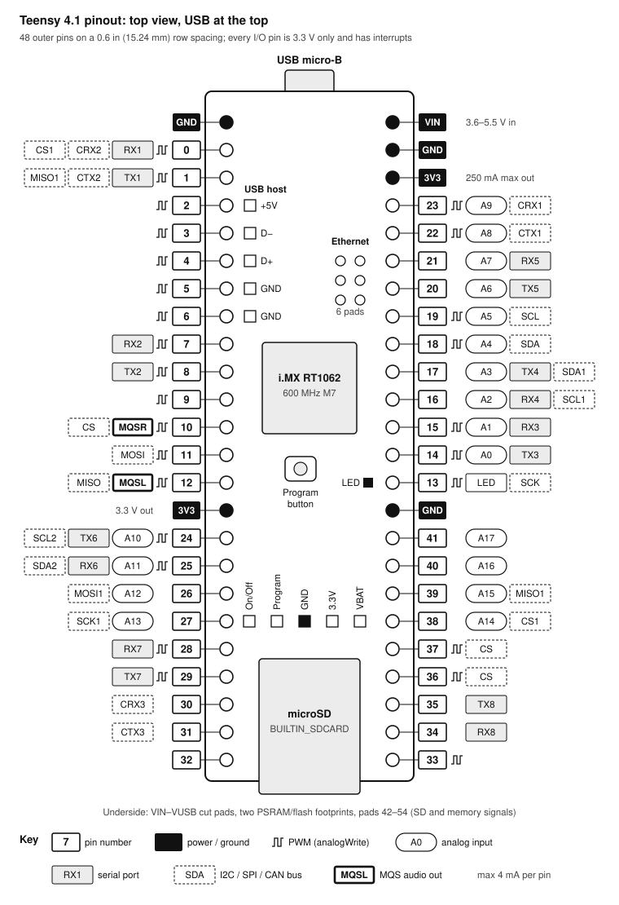

Each pin has a number (what you write in code) and several possible jobs. Solid boxes are power; outlined pills are analog inputs; the square-wave glyph means PWM. The inner pads (USB host, Ethernet, On/Off, Program, GND, 3.3V, VBAT) are drawn where they sit on the board; check the order of the five pads beside the SD socket against the silkscreen or PJRC's printed card before you solder to them. The same information is on Card A and, at actual size, on the pin-label strips at the end.

### Power, in one picture


USB brings 5 V to VUSB. A trace on the underside joins VUSB to VIN, and VIN feeds a regulator that makes 3.3 V for the processor and for the 3.3V pins. The coin cell on VBAT only runs the clock.

The facts you need, all from PJRC's Teensy 4.1 page:

- **VIN** accepts 3.6–5.5 V. With USB plugged in, VIN *is* the USB 5 V.
- **3.3V pins** can supply about 250 mA to your circuits, on top of what the board itself draws (around 100 mA at 600 MHz).
- **VIN–VUSB link.** To run from an external 5 V supply while USB is also plugged in (for example to keep a project powered while you debug it), cut the thin trace between the two pads on the underside marked for it, using a sharp knife, then check with the meter that VIN and VUSB no longer beep. After that the board runs from VIN only, and USB still works for data. Never feed VIN with the link intact and USB plugged in: you would back-feed your Mac's USB port.
- **VBAT** takes a 3 V coin cell (CR2032). It keeps the real-time clock running while the power is off.
- **On/Off** pad: a button to GND. Held for 4 seconds it switches the 3.3 V off; pressed for half a second it switches it on again.
- **Program** button: it does not reset the board; it puts it into upload mode. Pressing it is always safe.

### Exercise 0.1: Solder the headers

Your Teensy may have come without headers. Solder two 24-pin strips to the outer rows; leave the inner pads bare for now.

1. Push the two header strips into a breadboard, 0.6" apart (rows d and h on most boards; see the breadboard drawing in Lesson 1), long pins down.
2. Lay the Teensy on top, components up. The breadboard is the jig that keeps the pins square.
3. Solder one corner pin on each strip, check the board sits flat, then solder the rest. Keep each joint under 3 seconds; the processor sits close to the pins.
4. Inspect with a loupe: 48 smooth fillets, no bridges. Check adjacent pins with the meter's beeper, especially around GND and 3.3V.

**Test:** no beep between 3.3V and GND, none between VIN and GND, and the board lifts out of the breadboard straight.

> **Tip:** If you are new to soldering, Exercise 6.4 of the [soldering course](../soldering/README.md) is exactly this job on a cheaper module.

### Exercise 0.2: Install Arduino IDE 2 and Teensyduino

1. Download Arduino IDE 2.x from arduino.cc, drag it to Applications and open it once. macOS will ask for permission to access the Documents folder: allow it, because Arduino keeps boards and libraries there.
2. Open **Arduino IDE ▸ Settings**. In **Additional boards manager URLs**, paste `https://www.pjrc.com/teensy/package_teensy_index.json` and click OK.
3. Click the Boards Manager icon on the left, search for `teensy`, and install **Teensy** (by Paul Stoffregen). It is a large download.
4. Plug the Teensy in with your data cable. A new Teensy runs a blink program out of the box: the orange LED flashes.
5. Choose **Tools ▸ Board ▸ Teensy ▸ Teensy 4.1**, then **Tools ▸ Port**: pick the entry under "Teensy ports" (or a `/dev/cu.usbmodem…` port). Leave **Tools ▸ USB Type** at **Serial** and **Tools ▸ CPU Speed** at **600 MHz**.

**Test:** **Tools ▸ Get Board Info** (or the port list) shows a Teensy. No driver is needed on macOS.

> **Note:** If no port appears, try another cable first. A charge-only cable powers the board (the LED blinks) but carries no data. That is the most common first-day problem.

### Exercise 0.3: First upload

```cpp blink.ino
// Blink the orange LED on pin 13.
const int ledPin = 13;

void setup() {
  pinMode(ledPin, OUTPUT);
}

void loop() {
  digitalWrite(ledPin, HIGH);
  delay(500);
  digitalWrite(ledPin, LOW);
  delay(500);
}
```

1. Paste the sketch into a new window and click **Upload** (the arrow).
2. The IDE compiles, then the small Teensy Loader window appears and programs the board. The first upload may ask you to press the Program button; press it once.
3. Change both delays to 100, upload again, and watch the rate change.

**Test:** the LED blinks at the rate you set. You have the whole loop working: edit, compile, upload, run.

`setup()` runs once after power-up; `loop()` then runs forever. `pinMode()` makes a pin an output; `digitalWrite()` sets it to 3.3 V (`HIGH`) or 0 V (`LOW`); `delay()` waits a number of milliseconds and does nothing else meanwhile, which Lesson 1 fixes.

### Exercise 0.4: Talk over USB

```cpp hello_serial.ino
// Print a greeting and the CPU temperature once a second.
void setup() {
  Serial.begin(9600);                      // the number is ignored on USB
  while (!Serial && millis() < 4000) { }   // wait up to 4 s for the monitor
  if (CrashReport) Serial.print(CrashReport);
  Serial.println("Hello from Teensy 4.1");
  Serial.printf("CPU clock: %lu MHz\n", F_CPU_ACTUAL / 1000000);
}

void loop() {
  Serial.printf("%lu ms since start, CPU at %.1f C\n", millis(), tempmonGetTemp());
  delay(1000);
}
```

1. Upload, then open **Tools ▸ Serial Monitor**.
2. Read the lines. Touch the processor (the big square chip) and watch the temperature rise a degree or two.
3. Set **Tools ▸ CPU Speed** to 150 MHz, upload, and compare the temperature after a minute.

**Test:** one line per second, a sensible temperature (typically 35–55 °C at 600 MHz), and the clock line matching the CPU Speed menu.

On the Teensy, `Serial` is native USB, so it always runs at full USB speed and the baud rate is ignored. The `while (!Serial …)` line waits for the Serial Monitor so you do not miss the first lines. `CrashReport` prints the reason for the last crash, if there was one; keep that line in every sketch while you develop.

### Exercise 0.5: Measure the power rails

1. With the Teensy plugged in, set the meter to DC volts.
2. Measure VIN to GND (about 5 V from USB), 3.3V to GND (3.3 V within 2 %), and VBAT to GND (near 0 V without a coin cell).
3. Note the numbers in the practice log. When something misbehaves later, these are your reference values.

**Test:** both rails within range. If 3.3V reads low, unplug and look for a short before going on.

## Lesson 1: Digital I/O and timing

**Goal:** drive LEDs, read buttons reliably, and do several things at once without `delay()`. **Time:** 2.5 hours. **Pass:** the debounced counter in Exercise 1.3 counts exactly 50 for 50 presses, while an LED keeps blinking undisturbed.

**Parts:** breadboard, a red LED, a 470 Ω resistor, a tactile pushbutton, jumper wires.

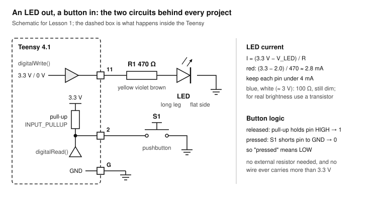

An output pin drives the LED through a resistor that sets the current. The button pulls an input pin to GND; the Teensy's internal pull-up holds it high the rest of the time, so a press reads `LOW`.

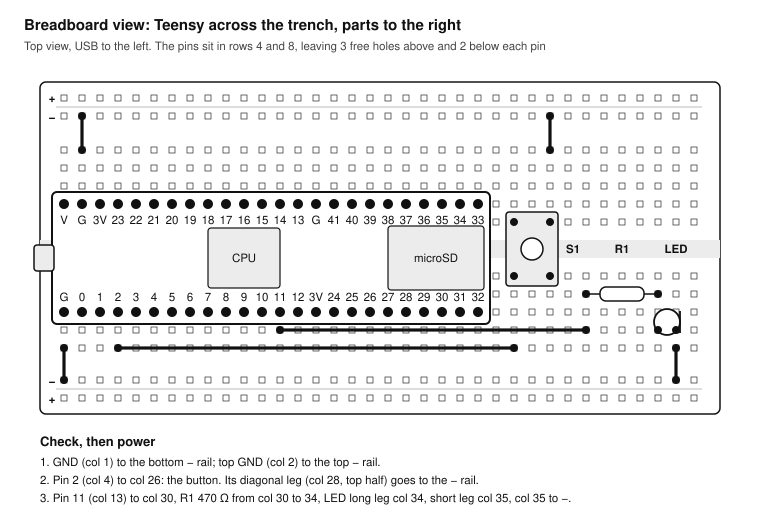

The Teensy straddles the centre trench; each pin owns one numbered column, with three free holes above and two below. Jumpers take the signals to the free part of the board.

### Exercise 1.1: An LED of your own

**Resistor maths.** A red LED drops about 2.0 V. The pin gives 3.3 V, so the resistor sees 1.3 V. At 470 Ω that is 1.3 / 470 ≈ 2.8 mA: bright enough, and safely under the 4 mA per pin.

1. Wire pin 11 → 470 Ω → LED long leg (anode); LED short leg (flat side) → GND, as in the drawings.
2. Change `ledPin` in the Blink sketch to 11 and upload.
3. Swap the LED around on purpose. Nothing breaks; it just stays dark. Turn it back.

**Test:** the external LED blinks. Measure across the resistor with the meter while the LED is on: about 1.3 V.

### Exercise 1.2: Read a button, and meet bounce

```cpp button_raw.ino
// Count presses the naive way: every HIGH to LOW change is a "press".
const int buttonPin = 2;
int lastState = HIGH;
unsigned long presses = 0;

void setup() {
  pinMode(buttonPin, INPUT_PULLUP);
  Serial.begin(9600);
}

void loop() {
  int state = digitalRead(buttonPin);
  if (lastState == HIGH && state == LOW) {
    presses++;
    Serial.printf("presses: %lu\n", presses);
  }
  lastState = state;
}
```

1. Wire the button between pin 2 and GND, upload, open the Serial Monitor.
2. Press 20 times, slowly and deliberately. Write down the count.

**Test:** the count is almost certainly more than 20. That is contact bounce: the metal contacts hit, spring apart and hit again several times within a few milliseconds, and the Teensy is fast enough to see every one.

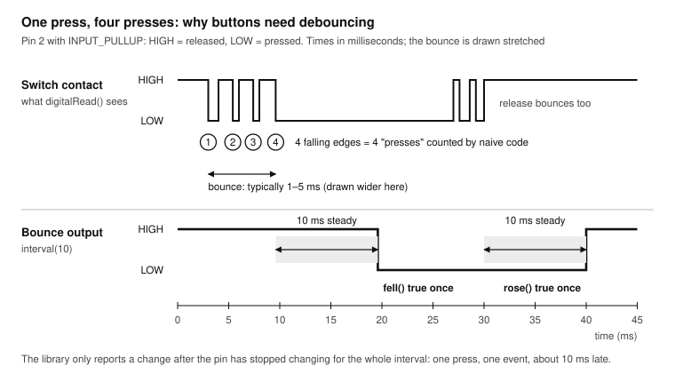

The raw contact flickers for a few milliseconds on press and on release. The Bounce library waits until the pin has been steady for the whole interval before it reports a single, clean change.

### Exercise 1.3: Debounce with the Bounce2 library

Teensyduino ships the Bounce2 library. Its `Bounce` class watches one pin; `update()` must be called often, and `fell()` / `rose()` are true for exactly one call after a debounced change.

```cpp button_bounce.ino
// One press = one count. The LED on pin 11 toggles on every press.
#include <Bounce2.h>

const int buttonPin = 2, ledPin = 11;
Bounce button;
bool ledOn = false;
unsigned long presses = 0;

void setup() {
  button.attach(buttonPin, INPUT_PULLUP);  // also sets the pin mode
  button.interval(10);                     // milliseconds of steadiness
  pinMode(ledPin, OUTPUT);
  Serial.begin(9600);
}

void loop() {
  button.update();
  if (button.fell()) {                     // HIGH to LOW = pressed
    presses++;
    ledOn = !ledOn;
    digitalWrite(ledPin, ledOn);
    Serial.printf("presses: %lu\n", presses);
  }
}
```

1. Upload and press 50 times, counting yourself.
2. Try `interval(1)` and see bounce creep back in; then try `interval(50)` and notice that very fast double-taps start to merge.

**Test:** 50 presses give exactly 50. Settle on 5–10 ms for tactile buttons.

> **Note:** You will also see `#include <Bounce.h>` with `fallingEdge()` and `risingEdge()` in older Teensy examples. That is the original Bounce library, also included; the calls in this course use Bounce2, which is maintained.

### Exercise 1.4: Several things at once with elapsedMillis

`delay()` freezes the whole program. The Teensy-specific `elapsedMillis` type is a variable that counts up by itself; you check it and subtract the period, and the loop stays free for other work.

```cpp two_rates.ino
// Two LEDs at two rates, and a button that stays responsive.
#include <Bounce2.h>

elapsedMillis fastTimer, slowTimer;
bool fastOn = false, slowOn = false;
Bounce button;

void setup() {
  pinMode(13, OUTPUT);
  pinMode(11, OUTPUT);
  button.attach(2, INPUT_PULLUP);
  button.interval(10);
  Serial.begin(9600);
}

void loop() {
  if (fastTimer >= 100) {        // every 100 ms
    fastTimer -= 100;            // subtract, so no drift builds up
    fastOn = !fastOn;
    digitalWrite(13, fastOn);
  }
  if (slowTimer >= 700) {        // every 700 ms
    slowTimer -= 700;
    slowOn = !slowOn;
    digitalWrite(11, slowOn);
  }
  button.update();
  if (button.fell()) Serial.println("pressed, and nothing stuttered");
}
```

**Test:** both LEDs keep their own rhythm while you hammer the button, and every press is reported at once. `elapsedMicros` works the same way in microseconds.

### Exercise 1.5: IntervalTimer and interrupts

Sometimes timing must not depend on the loop at all. `IntervalTimer` calls a function from a hardware timer at a fixed rate (the Teensy 4.1 has four of them), and `attachInterrupt()` calls a function the instant a pin changes. Both functions run *inside* an interrupt: keep them tiny, mark shared variables `volatile`, and never print from them.

```cpp timer_interrupt.ino
// A hardware timer blinks pin 13; a pin interrupt counts falling edges on pin 2.
IntervalTimer blinkTimer;
volatile bool ledState = false;
volatile uint32_t edgeCount = 0;

void blinkISR() {
  ledState = !ledState;
  digitalWriteFast(13, ledState);
}

void buttonISR() {
  edgeCount++;
}

void setup() {
  pinMode(13, OUTPUT);
  pinMode(2, INPUT_PULLUP);
  blinkTimer.begin(blinkISR, 250000);              // every 250 000 µs
  attachInterrupt(digitalPinToInterrupt(2), buttonISR, FALLING);
  Serial.begin(9600);
}

void loop() {
  noInterrupts();
  uint32_t n = edgeCount;                          // copy safely
  interrupts();
  Serial.printf("edges seen by the interrupt: %lu\n", n);
  delay(1000);                                     // the LED blinks on regardless
}
```

1. Upload. The LED blinks at 2 Hz even though `loop()` spends all its time in `delay()`.
2. Press the button 10 times. The interrupt counts every bounce: expect more than 10. Interrupts are for fast, clean signals (encoders, sensors), not for raw buttons.

**Test:** steady blink during `delay()`, and you can explain why the edge count is higher than the press count.

### Exercise 1.6: How fast is a pin?

The processor counts its own clock cycles in `ARM_DWT_CYCCNT`. That lets you time code without an oscilloscope.

```cpp toggle_speed.ino
// Compare digitalWrite() and digitalWriteFast() on pin 11.
const int pin = 11;

void setup() {
  pinMode(pin, OUTPUT);
  Serial.begin(9600);
  while (!Serial && millis() < 4000) { }

  uint32_t t0 = ARM_DWT_CYCCNT;
  for (int i = 0; i < 1000; i++) { digitalWrite(pin, HIGH); digitalWrite(pin, LOW); }
  uint32_t slow = ARM_DWT_CYCCNT - t0;

  t0 = ARM_DWT_CYCCNT;
  for (int i = 0; i < 1000; i++) { digitalWriteFast(pin, HIGH); digitalWriteFast(pin, LOW); }
  uint32_t fast = ARM_DWT_CYCCNT - t0;

  Serial.printf("digitalWrite:     %.1f ns per pulse\n", slow * 1e9 / F_CPU_ACTUAL / 1000);
  Serial.printf("digitalWriteFast: %.1f ns per pulse\n", fast * 1e9 / F_CPU_ACTUAL / 1000);
}

void loop() {
  while (true) {                      // a square wave as fast as the loop allows
    digitalWriteFast(pin, HIGH);
    digitalWriteFast(pin, LOW);
  }
}
```

1. Upload and read the two numbers. `digitalWriteFast()` with a constant pin number compiles to a single register write.
2. With the LED removed, put the meter on pin 11: DC volts reads roughly half of 3.3 V, the average of a square wave far too fast for the meter to follow.
3. Change the CPU Speed menu to 150 MHz and run it again.

**Test:** `digitalWriteFast()` is several times faster, and both scale with the CPU speed. Record the numbers in the log.

## Lesson 2: Analog in, PWM out, and switching real loads

**Goal:** read voltages, scale bigger ones safely, make "in-between" outputs with PWM, and switch 12 V loads with a MOSFET. **Time:** 3 hours. **Pass:** the battery voltmeter agrees with your multimeter within 2 %, and a knob dims a 12 V LED strip smoothly from off to full with no flicker or whine.

**Parts:** a 10 kΩ pot, 47 kΩ, 10 kΩ and 100 Ω resistors, a 100 nF capacitor, an IRLB8721 MOSFET, a 1N5819 diode, the 12 V supply, LED strip and motor.

### Exercise 2.1: Read a knob

The ADC turns 0–3.3 V into a number: 0–1023 by default (10 bits), about 3.2 mV per step. The range is fixed; `analogReference()` does nothing on a Teensy 4.

```cpp knob.ino
// Print a pot on A0 as a raw number and in volts. Try Tools > Serial Plotter.
void setup() {
  Serial.begin(9600);
}

void loop() {
  int raw = analogRead(A0);
  float volts = raw * 3.3 / 1023.0;
  Serial.printf("raw:%d volts:%.3f\n", raw, volts);
  delay(20);
}
```

1. Wire the pot: outer legs to 3.3V and GND, wiper to pin 14 (A0). See part A of the drawing below.
2. Upload, open **Tools ▸ Serial Plotter** and turn the knob end to end.

**Test:** 0 at one end, 1023 (or 1022) at the other, a smooth line in between.


The pot divides 3.3 V. For anything higher, a divider scales the voltage down first; its top resistor also limits the current if the input is ever overvoltage.

### Exercise 2.2: Noise and averaging

Leave the knob still and look at the plotter: the last digit wanders. Some of that is real noise on the wire, some is the ADC itself.

```cpp averaging.ino
// Compare one reading, hardware averaging and a software low-pass filter.
float smooth = 0;

void setup() {
  Serial.begin(9600);
  analogReadResolution(12);          // 0-4095; about 10 bits are truly quiet
}

void loop() {
  analogReadAveraging(1);
  int single = analogRead(A0);
  analogReadAveraging(16);           // the ADC averages 16 samples itself
  int averaged = analogRead(A0);
  smooth += 0.1 * (averaged - smooth);
  Serial.printf("single:%d avg16:%d smooth:%.1f\n", single, averaged, smooth);
  delay(10);
}
```

1. Watch the three traces with the knob still, then turn it quickly.
2. Change the 0.1 to 0.02 and to 0.5. Smaller is quieter but slower to follow.

**Test:** you can explain the trade-off you see: smoothing removes jitter and adds lag. You will use exactly this filter for the MIDI knobs in Lesson 3.

### Exercise 2.3: A battery voltmeter

Build part B of the drawing on the breadboard: +12 V → 47 kΩ → A1 (pin 15) → 10 kΩ → GND, with 100 nF from A1 to GND. Join the battery's (or supply's) minus to the Teensy's GND. The divider ratio is (47 + 10) / 10 = 5.7, so 12.6 V becomes 2.21 V, and anything up to 18.8 V stays inside the ADC's range.

```cpp battery_meter.ino
// Measure up to about 18 V on A1 through a 47k / 10k divider.
const float RATIO = (47.0 + 10.0) / 10.0;
const float CAL = 1.000;   // set this after comparing with your meter

void setup() {
  Serial.begin(9600);
  analogReadResolution(12);
  analogReadAveraging(32);
}

void loop() {
  int raw = analogRead(A1);
  float volts = raw * 3.3 / 4095.0 * RATIO * CAL;
  Serial.printf("raw %4d   battery %.2f V\n", raw, volts);
  delay(500);
}
```

1. Before connecting the Teensy, measure the divider's midpoint with the meter while 12 V is applied: it must be under 3.3 V.
2. Connect A1, upload and compare the reading with the meter on the 12 V terminals.
3. Set `CAL` to meter reading ÷ sketch reading (resistor tolerance is the usual error) and upload again.

**Test:** within 2 % of the meter over the whole range your supply can do.

> **Warning:** Check the divider's output with the meter *before* it touches a pin. A swapped pair of resistors puts 10 V on A1.

### Exercise 2.4: Fade an LED with PWM

`analogWrite()` does not make an analog voltage. It switches the pin fully on and off thousands of times a second, and the fraction of time it is on (the duty cycle) sets the average. An LED or a motor responds to the average.

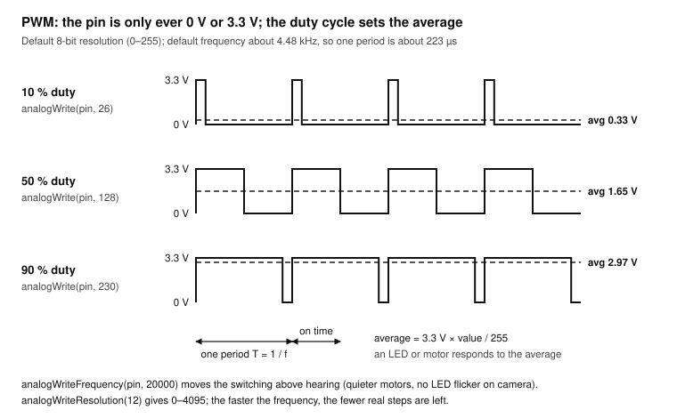

The default is 8-bit (0–255) at about 4.48 kHz on most pins. `analogWriteFrequency()` changes the frequency for a pin and any pins sharing its timer; `analogWriteResolution()` changes the number range for all pins.

```cpp fade.ino
// Breathe the LED on pin 11.
const int ledPin = 11;

void setup() {
  pinMode(ledPin, OUTPUT);
}

void loop() {
  for (int v = 0; v <= 255; v++) { analogWrite(ledPin, v); delay(4); }
  for (int v = 255; v >= 0; v--) { analogWrite(ledPin, v); delay(4); }
}
```

1. Upload. Notice that the LED seems to change little in the upper half: your eye is logarithmic.
2. Replace `analogWrite(ledPin, v)` with `analogWrite(ledPin, v * v / 255)` in both lines. The fade now looks even.

**Test:** a smooth, even breathing LED. Only pins with the PWM glyph on the pinout can do this.

### Exercise 2.5: Switch 12 V with a MOSFET

A pin gives 4 mA at 3.3 V; a metre of LED strip wants an amp or more at 12 V. A logic-level N-channel MOSFET bridges the gap: the pin only charges its gate, and the load current flows from the 12 V supply through the load and the MOSFET to ground.

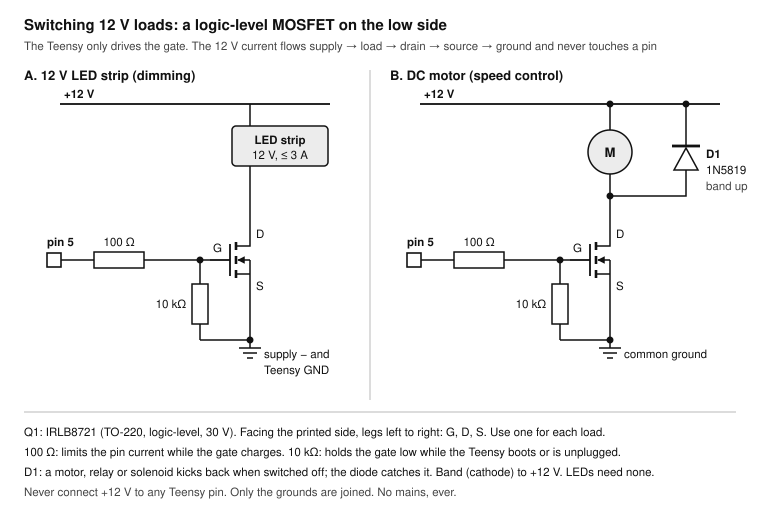

The load sits between +12 V and the drain; the source goes to ground. The 100 Ω resistor limits the pin current while the gate charges, the 10 kΩ keeps the MOSFET off while the Teensy boots, and the diode across the motor absorbs the voltage spike when the current stops.

```cpp strip_dimmer.ino
// A knob on A0 dims a 12 V LED strip through a MOSFET on pin 5.
const int gatePin = 5;

void setup() {
  analogWriteFrequency(gatePin, 20000);   // 20 kHz: no audible whine, no flicker
  analogWriteResolution(10);              // 0-1023, same range as analogRead
}

void loop() {
  int knob = analogRead(A0);
  int duty = (long)knob * knob / 1023;    // even-looking brightness steps
  analogWrite(gatePin, duty);
  delay(5);
}
```

1. Build part A with the 12 V supply **switched off**. Q1's legs, facing the printed side, are G, D, S from left to right.
2. Check with the meter: no continuity between +12 V and any Teensy pin; Teensy GND and supply minus are joined.
3. Upload with only USB connected, then switch on the 12 V supply and turn the knob.
4. Replace the strip with the motor and add D1 across it, band towards +12 V. Run it from slow to full.
5. Touch Q1 after a minute at full power. With the strip used here it should stay barely warm.

**Test:** smooth dimming from off to full with no flicker; the motor runs smoothly from slow to full without the Teensy resetting. If the Teensy resets when the motor starts, see "brownouts" in Troubleshooting.

> **Warning:** Keep 12 V on its own side of the breadboard and away from the Teensy's pins. Only the grounds are joined. Do not adapt this circuit to mains voltage.

## Lesson 3: USB device types, the Teensy superpower

**Goal:** make the Teensy appear to the Mac as a MIDI instrument and as a keyboard, with nothing but a menu choice and a few library calls. **Time:** 2.5 hours. **Pass:** four keys and four knobs play and shape a software instrument in GarageBand (or any DAW) with no stuck notes and no knob jitter, and the macro pad's four keys do what their labels say.

**Parts:** four buttons and four 10 kΩ pots on the breadboard (wired as below).

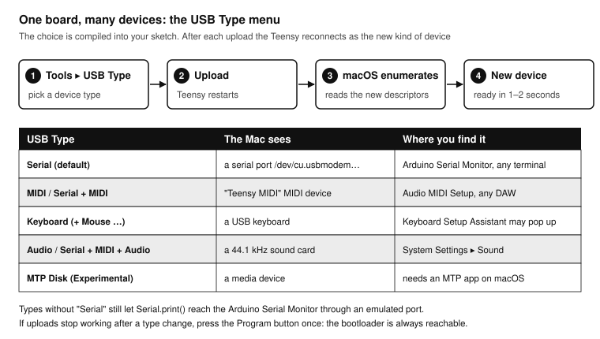

The USB Type you choose is compiled into the sketch. After the upload the Teensy disconnects and comes back as the new kind of device; the Mac needs no driver for any of them.

### Exercise 3.1: Wire the controller

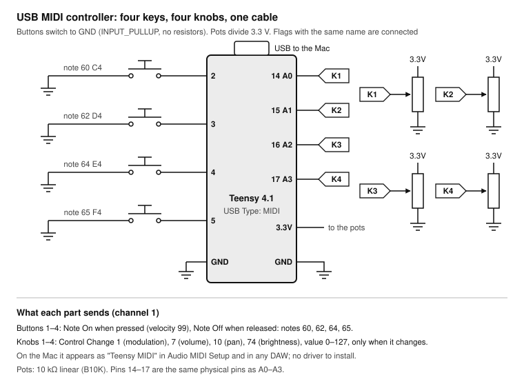

Buttons on pins 2–5 switch to GND, so they need no resistors. Pots divide 3.3 V into A0–A3 (pins 14–17). Flags with the same name are connected.

1. Wire the four buttons and four pots. Keep the pot wires short and away from the USB cable.
2. Before uploading the MIDI sketch, run the knob sketch from Exercise 2.1 on A1, A2 and A3 in turn, and the Bounce sketch on pins 3, 4 and 5. Find wiring faults now, not inside a DAW.

**Test:** every pot reads 0 to 1023, every button counts cleanly.

### Exercise 3.2: The USB MIDI controller

Set **Tools ▸ USB Type ▸ Serial + MIDI** before uploading. (Plain **MIDI** works too, but you lose the normal serial port.)

```cpp midi_controller.ino
// Four keys send notes, four knobs send Control Change messages.
// Tools > USB Type: "Serial + MIDI"
#include <Bounce2.h>

const int channel = 1;
const int buttonPins[4] = {2, 3, 4, 5};
const int notes[4] = {60, 62, 64, 65};      // C4 D4 E4 F4
const int potPins[4] = {A0, A1, A2, A3};
const int ccNumbers[4] = {1, 7, 10, 74};    // mod wheel, volume, pan, brightness
Bounce buttons[4];
float smooth[4];
int lastRaw[4] = {-100, -100, -100, -100};
int lastCC[4] = {-1, -1, -1, -1};
elapsedMillis potTimer;

void setup() {
  for (int i = 0; i < 4; i++) {
    buttons[i].attach(buttonPins[i], INPUT_PULLUP);
    buttons[i].interval(5);
    smooth[i] = analogRead(potPins[i]);
  }
}

void loop() {
  for (int i = 0; i < 4; i++) {
    buttons[i].update();
    if (buttons[i].fell()) usbMIDI.sendNoteOn(notes[i], 99, channel);
    if (buttons[i].rose()) usbMIDI.sendNoteOff(notes[i], 0, channel);
  }
  if (potTimer >= 5) {                       // read the knobs 200 times a second
    potTimer = 0;
    for (int i = 0; i < 4; i++) {
      smooth[i] += 0.2 * (analogRead(potPins[i]) - smooth[i]);
      int raw = (int)smooth[i];
      if (abs(raw - lastRaw[i]) >= 8) {      // hysteresis: ignore small wobble
        lastRaw[i] = raw;
        int cc = raw >> 3;                   // 0-1023 to 0-127
        if (cc != lastCC[i]) {
          lastCC[i] = cc;
          usbMIDI.sendControlChange(ccNumbers[i], cc, channel);
        }
      }
    }
  }
  while (usbMIDI.read()) { }                 // read and ignore incoming MIDI
}
```

1. Upload. Open **Audio MIDI Setup** (in Applications ▸ Utilities), choose **Window ▸ Show MIDI Studio**: a "Teensy MIDI" device is there.
2. Open MIDI Monitor and press each key and turn each knob. Check each key sends one Note On and one Note Off, and each knob sends values only while it moves.
3. Open GarageBand, create a Software Instrument track and play the four keys. Turn knob 2 (CC 7, volume) and knob 1 (CC 1, modulation).

**Test:** no stuck notes after 100 fast presses; a knob left alone sends nothing for a whole minute in MIDI Monitor; every knob reaches both 0 and 127.

Three details make a controller feel professional, and the sketch has all three: **smoothing** (the low-pass filter from Exercise 2.2), **hysteresis** (a value only counts as new when it moves by a full MIDI step), and **change detection** (send nothing when nothing changed). The sketch also reads and discards incoming MIDI, as PJRC recommends for transmit-only controllers, so the Mac's messages never pile up.

> **Tip:** To rename the device from "Teensy MIDI", add a `name.c` file to the sketch as shown in File ▸ Examples ▸ Teensy ▸ USB_MIDI ▸ MIDI_name. Each Teensy can have its own name.

### Exercise 3.3: A macro pad

Set **Tools ▸ USB Type ▸ Keyboard** and **Tools ▸ Keyboard Layout** to your Mac's layout (for example US English or German). The first time, macOS opens the Keyboard Setup Assistant: close it, or let it identify the "keyboard" by pressing the keys it asks for on your real keyboard.

```cpp macro_pad.ino
// Four buttons: copy, paste, type a phrase, play/pause.
// Tools > USB Type: "Keyboard"
#include <Bounce2.h>

Bounce keys[4];
const int keyPins[4] = {2, 3, 4, 5};

void tap(int modifier, int key) {
  if (modifier) Keyboard.press(modifier);
  Keyboard.press(key);
  delay(10);
  Keyboard.releaseAll();
}

void setup() {
  for (int i = 0; i < 4; i++) {
    keys[i].attach(keyPins[i], INPUT_PULLUP);
    keys[i].interval(10);
  }
}

void loop() {
  for (int i = 0; i < 4; i++) keys[i].update();
  if (keys[0].fell()) tap(MODIFIERKEY_GUI, KEY_C);         // Command-C
  if (keys[1].fell()) tap(MODIFIERKEY_GUI, KEY_V);         // Command-V
  if (keys[2].fell()) Keyboard.print("Sent from a Teensy 4.1\n");
  if (keys[3].fell()) tap(0, KEY_MEDIA_PLAY_PAUSE);        // music play/pause
}
```

1. Open TextEdit, upload, and try each key.
2. Change the phrase, or make key 3 open Spotlight: `tap(MODIFIERKEY_GUI, KEY_SPACE)`.

**Test:** each key does exactly one thing per press.

> **Warning:** A keyboard sketch types into whatever window has focus. Only ever send keys in response to a button press, never in a timed loop: a runaway sketch can type into your Terminal. If it happens, unplug the Teensy, press the Program button while plugging it back in, and upload a harmless sketch.

## Lesson 4: Storage and time

**Goal:** keep data and know when it was taken: a data logger that writes timestamped CSV lines to the built-in microSD card and stops cleanly. **Time:** 2 hours. **Pass:** one hour of logging produces a file with 3600 lines (± 1), correct timestamps, no gaps, and it opens in Numbers or Excel.

**Parts:** a microSD card (formatted FAT32 or exFAT), a CR2032 coin cell and holder, the pot on A0, the battery divider on A1 from Lesson 2, the button on pin 2.

### Exercise 4.1: Read the card

The Teensy 4.1's socket is wired to the processor's fast 4-bit SD interface. The standard `SD` library reaches it with `SD.begin(BUILTIN_SDCARD)`; no SPI wiring, no chip-select pin.

```cpp sd_list.ino
// List the files on the built-in microSD card.
#include <SD.h>

void setup() {
  Serial.begin(9600);
  while (!Serial && millis() < 4000) { }
  if (!SD.begin(BUILTIN_SDCARD)) {
    Serial.println("No card, or the card is not readable");
    return;
  }
  File root = SD.open("/");
  while (true) {
    File entry = root.openNextFile();
    if (!entry) break;
    Serial.printf("%-24s %10lu bytes\n", entry.name(), (unsigned long)entry.size());
    entry.close();
  }
  Serial.printf("Card size: %lu MB\n", (unsigned long)(SD.totalSize() / 1048576));
}

void loop() { }
```

**Test:** the listing matches what Finder shows on the same card.

### Exercise 4.2: Set and keep the time

The Teensy 4.1 has a real-time clock with its crystal on board. Without a coin cell it forgets the time when power goes; with a CR2032 on VBAT it keeps running for years. The `TimeLib` library (included) turns the clock's seconds into dates.

1. Solder the coin-cell holder's red lead to VBAT and black lead to GND (the inner pads beside the SD socket), with the cell **out**. Check polarity with the meter, then insert the cell. Expect about 3 V on VBAT.
2. Upload the sketch below.

```cpp rtc_clock.ino
// Show the RTC time; set it by sending T followed by a Unix time.
#include <TimeLib.h>

time_t getTeensy3Time() { return Teensy3Clock.get(); }

void setup() {
  Serial.begin(9600);
  setSyncProvider(getTeensy3Time);       // TimeLib asks the RTC every 5 minutes
  if (timeStatus() != timeSet) Serial.println("RTC not set");
}

void loop() {
  if (Serial.available() && Serial.read() == 'T') {
    time_t t = Serial.parseInt();
    if (t > 1700000000) {                // a plausible date after 2023
      Teensy3Clock.set(t);
      setTime(t);
    }
  }
  Serial.printf("%04d-%02d-%02d %02d:%02d:%02d\n",
                year(), month(), day(), hour(), minute(), second());
  delay(1000);
}
```

3. Uploading usually sets the clock to roughly your computer's time already. To set it exactly to your local time, run this in Terminal and type `T` followed by the number into the Serial Monitor's input line:

```text Terminal
TZ=UTC date -j -f "%Y-%m-%d %H:%M:%S" "$(date '+%Y-%m-%d %H:%M:%S')" +%s
```

4. Unplug USB for a minute, plug it back in and check the time.

**Test:** after the power break the clock is still right to within a second or two.

### Exercise 4.3: The data logger

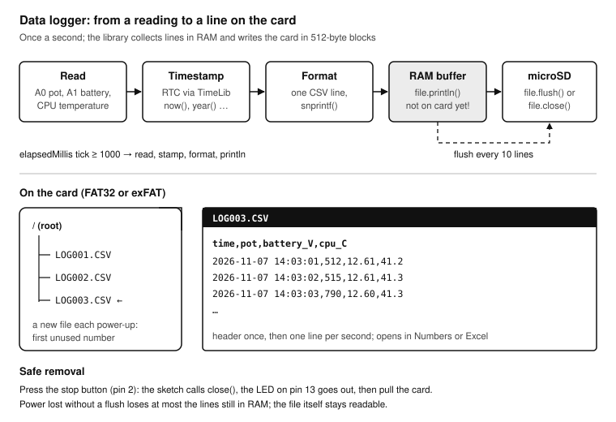

Once a second the sketch reads, stamps and formats a line, and hands it to the library, which collects lines in RAM and writes the card in 512-byte blocks. `flush()` forces the write; `close()` flushes and finishes the file.

```cpp sd_logger.ino
// One CSV line per second to a new LOGnnn.CSV; button on pin 2 closes the file.
#include <SD.h>
#include <TimeLib.h>
#include <Bounce2.h>

const int stopPin = 2, ledPin = 13;
File logFile;
Bounce stopButton;
elapsedMillis tick;
int linesSinceFlush = 0;
bool logging = false;

time_t getTeensy3Time() { return Teensy3Clock.get(); }

void setup() {
  Serial.begin(9600);
  pinMode(ledPin, OUTPUT);
  stopButton.attach(stopPin, INPUT_PULLUP);
  stopButton.interval(10);
  setSyncProvider(getTeensy3Time);
  analogReadResolution(12);
  analogReadAveraging(16);
  if (!SD.begin(BUILTIN_SDCARD)) { Serial.println("SD card missing"); return; }
  char name[16];
  for (int n = 1; n < 1000; n++) {                 // first unused file name
    snprintf(name, sizeof(name), "LOG%03d.CSV", n);
    if (!SD.exists(name)) break;
  }
  logFile = SD.open(name, FILE_WRITE);
  if (!logFile) { Serial.println("Cannot create the file"); return; }
  logFile.println("time,pot,battery_V,cpu_C");
  logging = true;
  digitalWrite(ledPin, HIGH);                      // LED on = file open
  Serial.printf("Logging to %s\n", name);
}

void loop() {
  stopButton.update();
  if (logging && stopButton.fell()) {
    logFile.close();
    logging = false;
    digitalWrite(ledPin, LOW);
    Serial.println("File closed: safe to remove the card");
  }
  if (!logging || tick < 1000) return;
  tick -= 1000;
  time_t t = now();
  int pot = analogRead(A0);
  float battery = analogRead(A1) * 3.3 / 4095.0 * 5.7;
  char line[64];
  snprintf(line, sizeof(line), "%04d-%02d-%02d %02d:%02d:%02d,%d,%.2f,%.1f",
           year(t), month(t), day(t), hour(t), minute(t), second(t),
           pot, battery, tempmonGetTemp());
  logFile.println(line);
  Serial.println(line);
  if (++linesSinceFlush >= 10) { logFile.flush(); linesSinceFlush = 0; }
}
```

1. Upload, watch the lines in the Serial Monitor, turn the knob now and then.
2. After an hour, press the stop button, wait for the LED to go out, then remove the card and open the file on the Mac.
3. Make a chart of the pot column. Then run it again and pull the USB cable without pressing stop: open that file too and see what you lost.

**Test:** 3600 lines (± 1), timestamps one second apart, no gaps. The unplugged run loses at most the last ten lines.

`FILE_WRITE` on the Teensy opens a file for appending, so restarting the same name adds to the end rather than overwriting. Flushing every line is safest but wears the card and costs time; every 10 lines is a reasonable middle.

### Exercise 4.4: LittleFS in program flash

No card? The Teensy can keep a small file system in its own 8 MB flash, using the included LittleFS library. It is ideal for settings and short logs.

```cpp littlefs_boots.ino
// Count boots in a file kept in program flash.
#include <LittleFS.h>

LittleFS_Program flash;

void setup() {
  Serial.begin(9600);
  while (!Serial && millis() < 4000) { }
  if (!flash.begin(1024 * 1024)) { Serial.println("LittleFS failed"); return; }
  File f = flash.open("boots.txt", FILE_WRITE);
  f.printf("boot at %lu ms\n", millis());
  f.close();
  f = flash.open("boots.txt", FILE_READ);
  while (f.available()) Serial.write(f.read());
  f.close();
  Serial.printf("used %lu of %lu bytes\n",
                (unsigned long)flash.usedSize(), (unsigned long)flash.totalSize());
}

void loop() { }
```

**Test:** each reset adds a line. The data survives power cycles; it usually survives uploading a new sketch too, but do not rely on that for anything precious.

## Lesson 5: Sound

**Goal:** make sound with the Teensy Audio library and no extra board, then build a synth you play from the Mac. **Time:** 2 hours. **Pass:** the synth plays clean notes from MidiKeys or a DAW, with no clicks at note start or end and no crackle, and a knob (CC 74) sweeps the filter.

**Parts:** two 2.2 kΩ resistors, two 4.7 nF capacitors, two 10 µF electrolytics, a 3.5 mm jack, powered speakers (or a small amplifier and speaker).

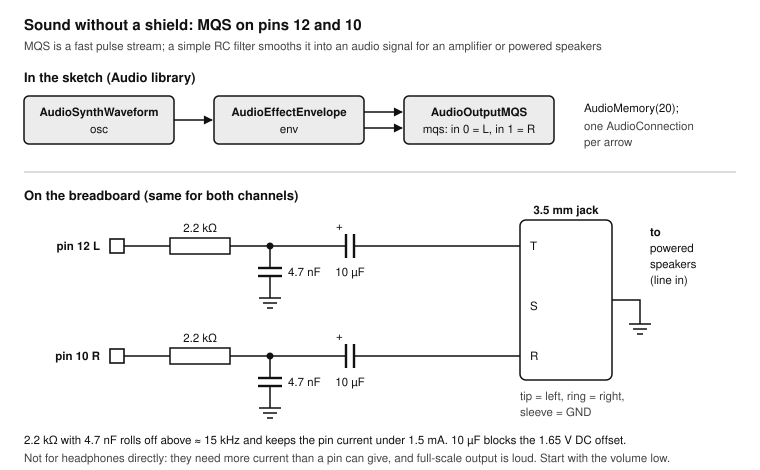

MQS ("medium quality sound") is a Teensy 4 feature that turns pins 12 (left) and 10 (right) into a fast pulse stream. The RC filter removes the high-frequency pulses, and the 10 µF capacitor blocks the DC offset before the line input.

The Audio library works like a patch bay. You create objects (oscillators, envelopes, filters, mixers, outputs), connect them with `AudioConnection` lines, reserve memory with `AudioMemory()`, and the library computes 44.1 kHz audio in the background while your `loop()` does other work. PJRC's **Audio System Design Tool** (pjrc.com/teensy/gui) lets you draw the graph in a browser and exports the code, and each object's help text is in the panel on the right.

### Exercise 5.1: First sound

1. Build both filter channels on the breadboard. Jack tip to the left channel, ring to the right, sleeve to GND.
2. Set the speakers' volume low before connecting them.

```cpp mqs_beep.ino
// Alternate 440 Hz and 660 Hz sine tones on MQS (pins 12 and 10).
#include <Audio.h>

AudioSynthWaveform osc;
AudioOutputMQS     mqs;
AudioConnection    c1(osc, 0, mqs, 0);   // left
AudioConnection    c2(osc, 0, mqs, 1);   // right

void setup() {
  AudioMemory(10);
  osc.begin(0.3, 440, WAVEFORM_SINE);    // amplitude 0-1, Hz, waveform
}

void loop() {
  osc.frequency(440);
  delay(500);
  osc.frequency(660);
  delay(500);
}
```

**Test:** a clean two-tone beep from both speakers. Change `WAVEFORM_SINE` to `WAVEFORM_SQUARE` and `WAVEFORM_SAWTOOTH` and listen to the difference.

> **Warning:** Do not connect headphones straight to the pins or the filter. A pin can give only a few milliamps and full-scale output is loud. Use powered speakers or an amplifier, and start with the volume low.

### Exercise 5.2: A synth you play over USB MIDI

Set **Tools ▸ USB Type ▸ Serial + MIDI**. The sketch registers functions that `usbMIDI.read()` calls whenever a message arrives.

```cpp usb_synth.ino
// Monophonic synth: USB MIDI notes in, MQS audio out. CC 74 = cutoff, CC 71 = resonance.
#include <Audio.h>

AudioSynthWaveform       osc;
AudioEffectEnvelope      env;
AudioFilterStateVariable filter;
AudioOutputMQS           mqs;
AudioConnection c1(osc, env);
AudioConnection c2(env, 0, filter, 0);
AudioConnection c3(filter, 0, mqs, 0);   // output 0 of the filter = low-pass
AudioConnection c4(filter, 0, mqs, 1);
int currentNote = -1;

void noteOn(byte channel, byte note, byte velocity) {
  osc.frequency(440.0f * powf(2.0f, (note - 69) / 12.0f));
  osc.amplitude(0.2f + 0.5f * velocity / 127.0f);
  currentNote = note;
  env.noteOn();
}

void noteOff(byte channel, byte note, byte velocity) {
  if (note == currentNote) env.noteOff();
}

void controlChange(byte channel, byte control, byte value) {
  if (control == 74) filter.frequency(80.0f * powf(2.0f, value / 18.0f));
  if (control == 71) filter.resonance(0.7f + value * 4.3f / 127.0f);
}

void setup() {
  AudioMemory(20);
  osc.begin(0.5, 220, WAVEFORM_BANDLIMIT_SAWTOOTH);
  env.attack(5);
  env.decay(80);
  env.sustain(0.6);
  env.release(300);
  filter.frequency(2000);
  filter.resonance(1.2);
  usbMIDI.setHandleNoteOn(noteOn);
  usbMIDI.setHandleNoteOff(noteOff);
  usbMIDI.setHandleControlChange(controlChange);
}

void loop() {
  usbMIDI.read();
}
```

1. Upload. In MidiKeys (or your DAW's MIDI output), choose "Teensy MIDI" as the destination and play.
2. Send CC 74 from MidiKeys' controls or a DAW knob and sweep the filter. Then CC 71.
3. Change `release(300)` to `release(1500)` and play staccato.
4. Add `Serial.printf("CPU %.1f%%, blocks %d\n", AudioProcessorUsageMax(), AudioMemoryUsageMax());` to `loop()` behind an `elapsedMillis` of one second, and check the synth uses only a few percent of the CPU.

**Test:** every note starts and ends without a click, no crackle while playing fast, the filter sweeps smoothly.

The envelope shapes each note's volume (attack, decay, sustain, release), which is what removes clicks. `WAVEFORM_BANDLIMIT_SAWTOOTH` avoids the harsh aliasing that a plain sawtooth produces on high notes. The Teensy treats a Note On with velocity 0 as a Note Off, which is what many keyboards send.

### Going further: the Audio Shield

PJRC's **Audio Adaptor Board Rev D** for Teensy 4.x carries an SGTL5000 codec: real line in and out, a microphone input and a headphone amplifier with volume control. It uses `AudioOutputI2S` and `AudioControlSGTL5000` instead of `AudioOutputMQS`, and occupies pins 7, 8, 20, 21 and 23 for I2S audio and 18 and 19 for control (its own SD socket uses 10–13). Everything else in this lesson stays the same; swap the output object and add `sgtl5000_1.enable(); sgtl5000_1.volume(0.5);` to `setup()`.

## Lesson 6: Talking to other things

**Goal:** connect the Teensy to other chips and devices over the five most useful links. **Time:** 3 hours (Ethernet optional). **Pass:** each exercise below passes its own test.


I2C shares two wires among many chips, each with its own address; most breakouts already carry the pull-up resistors. Serial ports are point to point: one device's TX always goes to the other's RX, and the grounds are joined.

### Exercise 6.1: Hardware serial ports

The Teensy 4.1 has eight hardware serial ports, `Serial1` to `Serial8`, separate from the USB `Serial`. Pins are on Card A; Serial1 is RX 0 / TX 1, Serial2 is RX 7 / TX 8.

```cpp serial_loopback.ino
// Serial1 and Serial2 talk to each other through two jumpers.
void setup() {
  Serial.begin(9600);
  Serial1.begin(115200);
  Serial2.begin(115200);
}

void loop() {
  Serial1.println("ping from Serial1");
  delay(50);
  while (Serial2.available()) Serial.write(Serial2.read());
  Serial2.println("pong from Serial2");
  delay(50);
  while (Serial1.available()) Serial.write(Serial1.read());
  delay(900);
}
```

1. Jumper pin 1 (TX1) to pin 7 (RX2), and pin 8 (TX2) to pin 0 (RX1).
2. Upload and open the Serial Monitor. Then pull one jumper and see which message stops.

**Test:** "ping" and "pong" alternate every second. Real serial devices (a GPS module, a DIN MIDI port, another microcontroller) connect the same way, at 3.3 V levels.

### Exercise 6.2: An I2C sensor and an OLED

Libraries: install **Adafruit SSD1306**, **Adafruit GFX Library** and **Adafruit BME280 Library** from the Library Manager (accept their dependencies). The bus is `Wire` on pins 18 (SDA) and 19 (SCL); `Wire1` and `Wire2` are on 17/16 and 25/24.

1. Wire the BME280 and the OLED to 3.3V, GND, SDA and SCL as in the drawing. Read the pin names on your boards: OLED pin orders vary.
2. Run this scanner first. It must find 0x3C (the OLED) and 0x76 or 0x77 (the BME280).

```cpp i2c_scan.ino
// List every I2C address that answers on Wire (pins 18 and 19).
#include <Wire.h>

void setup() {
  Serial.begin(9600);
  while (!Serial && millis() < 4000) { }
  Wire.begin();
  for (byte address = 1; address < 127; address++) {
    Wire.beginTransmission(address);
    if (Wire.endTransmission() == 0) Serial.printf("found a device at 0x%02X\n", address);
  }
  Serial.println("scan done");
}

void loop() { }
```

3. Then upload the weather display, with the BME280 address the scanner found.

```cpp weather_oled.ino
// BME280 temperature, humidity and pressure on a 128 x 64 OLED.
#include <Wire.h>
#include <Adafruit_GFX.h>
#include <Adafruit_SSD1306.h>
#include <Adafruit_BME280.h>

Adafruit_SSD1306 display(128, 64, &Wire, -1);   // -1: no reset pin
Adafruit_BME280 bme;

void setup() {
  Serial.begin(9600);
  if (!display.begin(SSD1306_SWITCHCAPVCC, 0x3C)) Serial.println("OLED not found");
  if (!bme.begin(0x76)) Serial.println("BME280 not found at 0x76: try 0x77");
  display.setTextColor(SSD1306_WHITE);
}

void loop() {
  float t = bme.readTemperature();
  float h = bme.readHumidity();
  float p = bme.readPressure() / 100.0;          // Pa to hPa
  display.clearDisplay();
  display.setTextSize(2);
  display.setCursor(0, 0);
  display.printf("%.1f C", t);
  display.setTextSize(1);
  display.setCursor(0, 28);
  display.printf("%.0f %% humidity", h);
  display.setCursor(0, 44);
  display.printf("%.1f hPa", p);
  display.display();
  delay(1000);
}
```

**Test:** the readings update every second; breathing on the sensor raises the humidity within seconds.

### Exercise 6.3: CAN bus with FlexCAN_T4

CAN is the robust two-wire bus of cars, machines and robots. The Teensy 4.1 has three CAN controllers (CAN1 on 22/23, CAN2 on 1/0, CAN3 on 31/30), but a CAN bus also needs a **transceiver** chip per node. Here one Teensy talks to itself: CAN1 and CAN2 each get an SN65HVD230 (a 3.3 V transceiver), and the two transceivers share a short bus.

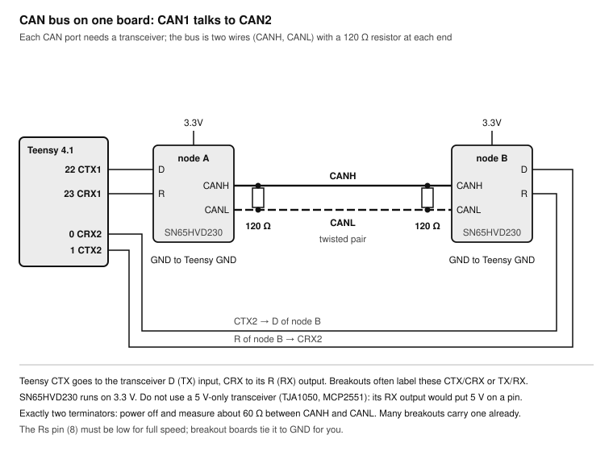

The bus is CANH and CANL, ideally a twisted pair, with exactly one 120 Ω terminator at each end. Each transceiver turns the Teensy's TX/RX logic into the bus's differential signal.

```cpp can_loopback.ino
// CAN1 sends a frame every 500 ms; CAN2 receives and prints it. 500 kbit/s.
#include <FlexCAN_T4.h>

FlexCAN_T4<CAN1, RX_SIZE_256, TX_SIZE_16> can1;
FlexCAN_T4<CAN2, RX_SIZE_256, TX_SIZE_16> can2;
elapsedMillis sendTimer;
uint8_t counter = 0;

void setup() {
  Serial.begin(9600);
  can1.begin();
  can1.setBaudRate(500000);
  can2.begin();
  can2.setBaudRate(500000);
}

void loop() {
  if (sendTimer >= 500) {
    sendTimer = 0;
    CAN_message_t msg;
    msg.id = 0x123;
    msg.len = 2;
    msg.buf[0] = counter++;
    msg.buf[1] = analogRead(A0) >> 2;          // the knob, 0-255
    can1.write(msg);
  }
  CAN_message_t rx;
  if (can2.read(rx)) {
    Serial.printf("CAN2 got id 0x%03lX, %d bytes: %d %d\n", rx.id, rx.len, rx.buf[0], rx.buf[1]);
  }
}
```

1. Power off. Measure between CANH and CANL: about 60 Ω means two terminators (most SN65HVD230 boards carry one each). 120 Ω means one is missing; 40 Ω means one too many.
2. Wire both transceivers to 3.3V and GND, Teensy CTX to the transceiver's TX/D, CRX to its RX/R.
3. Upload and turn the knob.

**Test:** a frame every half second, the counter increasing and the second byte following the knob. Pull CANL: the frames stop; plug it back: they resume without a reset.

### Exercise 6.4: USB host: plug a keyboard into the Teensy

The Teensy 4.1's second USB port is a **host**: it powers and reads USB devices, just like a computer. It needs the five pads near the USB connector (+5V, D−, D+, GND, GND) and a host cable. Solder a 5-pin header to those pads and plug in PJRC's USB host cable, matching its GND marking to the GND pads.

```cpp usb_host_midi.ino
// Print notes from a USB MIDI keyboard plugged into the Teensy's host port.
#include <USBHost_t36.h>

USBHost myusb;
USBHub hub1(myusb);
MIDIDevice midi1(myusb);

void onNoteOn(byte channel, byte note, byte velocity) {
  Serial.printf("note on  ch %d  note %d  velocity %d\n", channel, note, velocity);
}

void onNoteOff(byte channel, byte note, byte velocity) {
  Serial.printf("note off ch %d  note %d\n", channel, note);
}

void setup() {
  Serial.begin(9600);
  myusb.begin();
  midi1.setHandleNoteOn(onNoteOn);
  midi1.setHandleNoteOff(onNoteOff);
}

void loop() {
  myusb.Task();
  midi1.read();
}
```

**Test:** keys on the USB MIDI keyboard print in the Serial Monitor. For a computer keyboard, open File ▸ Examples ▸ USBHost_t36 ▸ Mouse (it handles keyboards too). Extension: call the synth's `noteOn()` from Exercise 5.2 here, and the Teensy becomes a stand-alone instrument.

> **Note:** The host port's 5 V comes from VIN through a current-limited switch. Small devices are fine; power hungry ones (hard drives, big keyboards with lights) need a powered hub.

### Exercise 6.5 (optional): Ethernet

If your board has the Ethernet chip, solder PJRC's MagJack kit to the six Ethernet pads (follow the kit's orientation photo) and plug in a network cable to your router. The QNEthernet library (included with recent Teensyduino; otherwise install it from the Library Manager) gives the board an IP address by DHCP.

```cpp ethernet_status.ino
// A tiny web page showing the knob and the CPU temperature.
#include <QNEthernet.h>
using namespace qindesign::network;

EthernetServer server{80};

void setup() {
  Serial.begin(9600);
  while (!Serial && millis() < 4000) { }
  Ethernet.begin();                                   // DHCP
  if (!Ethernet.waitForLocalIP(15000)) { Serial.println("No IP address"); return; }
  IPAddress ip = Ethernet.localIP();
  Serial.printf("Open http://%u.%u.%u.%u/\n", ip[0], ip[1], ip[2], ip[3]);
  server.begin();
}

void loop() {
  EthernetClient client = server.available();
  if (!client) return;
  delay(5);
  while (client.available()) client.read();           // skip the request
  client.printf("HTTP/1.1 200 OK\r\nContent-Type: text/plain\r\nConnection: close\r\n\r\n");
  client.printf("A0 = %d\r\nCPU = %.1f C\r\n", analogRead(A0), tempmonGetTemp());
  client.close();
}
```

**Test:** the address opens in Safari on the same network, and reloading shows the knob's new value.

## Lesson 7: Capstone, the Teensy desk synth

**Goal:** build a finished instrument from everything so far: eight keys, four knobs and an OLED, playing four-voice sound on MQS and acting as a USB MIDI controller at the same time. **Time:** 3–4 hours. **Pass:** every box in the capstone test checklist is ticked.

**What it does.** Each key plays a note on the built-in synth and sends the same note to the Mac. Each knob shapes the sound (filter cutoff, resonance, release time, volume) and sends a Control Change, so a DAW can record your knob moves. Notes and controls sent *from* the Mac also play the synth. The OLED shows the last note and the four knob positions.

**Parts:** everything from Lessons 3 and 5, four more buttons, the OLED, two perfboards for the key strip and audio board, header strips and hook-up wire.

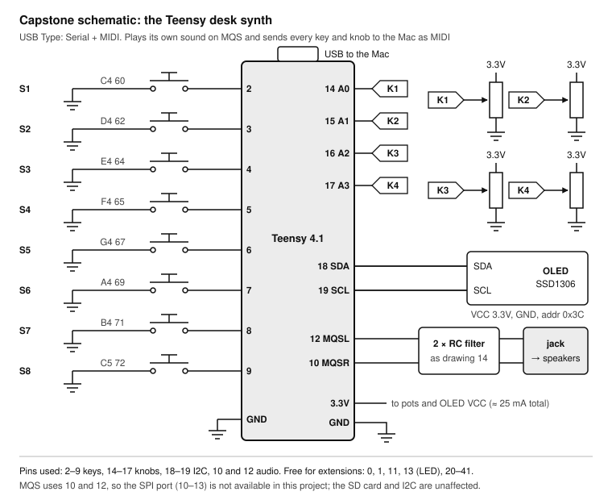

Keys on pins 2–9 switch to GND; knobs on A0–A3; the OLED on I2C (18, 19); audio on MQS (12, 10) through the filter from Lesson 5. Pins 0, 1, 11, 13 and 20–41 stay free for extensions.

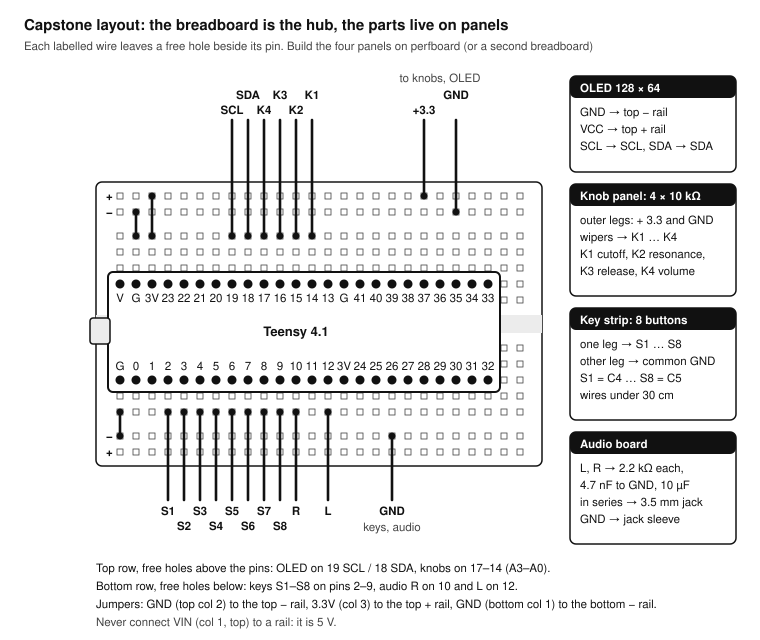

Only the Teensy sits on the breadboard. Each labelled wire leaves a free hole next to its pin and goes to a small panel. Building the key strip and audio board on perfboard turns a breadboard experiment into something you can keep on the desk.

### Build order

1. **Audio board.** Solder the two RC filters and the jack on perfboard (drawing 14), with three flying leads: L, R, GND. Test it with the beep sketch from Exercise 5.1.
2. **Key strip.** Solder eight buttons in a row on perfboard with a common GND bus and nine flying leads (S1–S8, GND). Test each key with the Bounce sketch, moving the pin number.
3. **Knob panel.** Four pots with a shared 3.3 V and GND, four wiper leads. Test each with the knob sketch.
4. **OLED.** Four wires: GND, VCC (3.3 V), SCL, SDA. Run the I2C scanner: 0x3C.
5. **Wire everything to the breadboard** as in the layout drawing. Before plugging in USB: no beep between 3.3V and GND.
6. Set **Tools ▸ USB Type ▸ Serial + MIDI**, **CPU Speed 600 MHz**, and upload the sketch.

### The sketch

```cpp desk_synth.ino
// Teensy desk synth: 8 keys, 4 knobs, OLED, 4-voice MQS audio, USB MIDI in and out.
// Tools > USB Type: "Serial + MIDI"
#include <Audio.h>
#include <Wire.h>
#include <Bounce2.h>
#include <Adafruit_GFX.h>
#include <Adafruit_SSD1306.h>

const int VOICES = 4;
AudioSynthWaveform       osc[VOICES];
AudioEffectEnvelope      env[VOICES];
AudioMixer4              mix;
AudioFilterStateVariable filter;
AudioAmplifier           volume;
AudioOutputMQS           mqs;
AudioConnection c0(osc[0], env[0]), c1(osc[1], env[1]), c2(osc[2], env[2]), c3(osc[3], env[3]);
AudioConnection c4(env[0], 0, mix, 0), c5(env[1], 0, mix, 1);
AudioConnection c6(env[2], 0, mix, 2), c7(env[3], 0, mix, 3);
AudioConnection c8(mix, 0, filter, 0), c9(filter, 0, volume, 0);
AudioConnection c10(volume, 0, mqs, 0), c11(volume, 0, mqs, 1);

Adafruit_SSD1306 display(128, 64, &Wire, -1);
const int keyPins[8]  = {2, 3, 4, 5, 6, 7, 8, 9};
const int keyNotes[8] = {60, 62, 64, 65, 67, 69, 71, 72};   // C4 to C5
const int knobPins[4] = {A0, A1, A2, A3};
const int knobCC[4]   = {74, 71, 72, 7};    // cutoff, resonance, release, volume
const char *knobName[4] = {"cut", "res", "rel", "vol"};
Bounce keys[8];
int voiceNote[VOICES] = {-1, -1, -1, -1};
int nextVoice = 0;
int knobRaw[4] = {-100, -100, -100, -100};
int knobValue[4] = {64, 20, 40, 100};
char noteText[8] = "--";
bool screenDirty = true;
elapsedMillis knobTimer, screenTimer;

void startNote(int note, int velocity) {
  int v = nextVoice;                                   // steal round-robin if all busy
  for (int i = 0; i < VOICES; i++) if (voiceNote[i] < 0) { v = i; break; }
  nextVoice = (v + 1) % VOICES;
  voiceNote[v] = note;
  osc[v].frequency(440.0f * powf(2.0f, (note - 69) / 12.0f));
  osc[v].amplitude(0.3f + 0.5f * velocity / 127.0f);
  env[v].noteOn();
  const char *names[12] = {"C", "C#", "D", "D#", "E", "F", "F#", "G", "G#", "A", "A#", "B"};
  snprintf(noteText, sizeof(noteText), "%s%d", names[note % 12], note / 12 - 1);
  screenDirty = true;
}

void stopNote(int note) {
  for (int i = 0; i < VOICES; i++) {
    if (voiceNote[i] == note) { env[i].noteOff(); voiceNote[i] = -1; }
  }
}

void applyKnob(int k, int value) {                     // value 0-127
  knobValue[k] = value;
  if (k == 0) filter.frequency(80.0f * powf(2.0f, value / 18.0f));     // 80 Hz to 10 kHz
  if (k == 1) filter.resonance(0.7f + value * 4.3f / 127.0f);          // 0.7 to 5.0
  if (k == 2) for (int i = 0; i < VOICES; i++) env[i].release(20 + value * 15);
  if (k == 3) volume.gain(value / 127.0f);
  screenDirty = true;
}

void onNoteOn(byte channel, byte note, byte velocity) { startNote(note, velocity); }
void onNoteOff(byte channel, byte note, byte velocity) { stopNote(note); }
void onControlChange(byte channel, byte control, byte value) {
  for (int k = 0; k < 4; k++) if (control == knobCC[k]) applyKnob(k, value);
}

void drawScreen() {
  display.clearDisplay();
  display.setTextSize(1);
  display.setCursor(0, 0);
  display.print("Teensy desk synth");
  display.setTextSize(2);
  display.setCursor(0, 14);
  display.print(noteText);
  display.setTextSize(1);
  for (int k = 0; k < 4; k++) {
    int x = k * 32;
    display.setCursor(x, 38);
    display.print(knobName[k]);
    display.drawRect(x, 50, 28, 10, SSD1306_WHITE);
    display.fillRect(x, 50, knobValue[k] * 28 / 127, 10, SSD1306_WHITE);
  }
  display.display();
}

void setup() {
  AudioMemory(30);
  for (int i = 0; i < VOICES; i++) {
    osc[i].begin(0.0, 220, WAVEFORM_BANDLIMIT_SAWTOOTH);
    env[i].attack(5);
    env[i].decay(80);
    env[i].sustain(0.7);
    mix.gain(i, 0.3);                                  // 4 voices cannot clip
  }
  for (int k = 0; k < 4; k++) applyKnob(k, knobValue[k]);
  for (int i = 0; i < 8; i++) {
    keys[i].attach(keyPins[i], INPUT_PULLUP);
    keys[i].interval(5);
  }
  usbMIDI.setHandleNoteOn(onNoteOn);
  usbMIDI.setHandleNoteOff(onNoteOff);
  usbMIDI.setHandleControlChange(onControlChange);
  if (!display.begin(SSD1306_SWITCHCAPVCC, 0x3C)) Serial.println("OLED not found");
  display.setTextColor(SSD1306_WHITE);
}

void loop() {
  for (int i = 0; i < 8; i++) {
    keys[i].update();
    if (keys[i].fell()) { startNote(keyNotes[i], 100); usbMIDI.sendNoteOn(keyNotes[i], 100, 1); }
    if (keys[i].rose()) { stopNote(keyNotes[i]); usbMIDI.sendNoteOff(keyNotes[i], 0, 1); }
  }
  if (knobTimer >= 5) {
    knobTimer = 0;
    for (int k = 0; k < 4; k++) {
      int raw = analogRead(knobPins[k]);
      if (abs(raw - knobRaw[k]) < 8) continue;         // hysteresis
      knobRaw[k] = raw;
      int value = raw >> 3;
      if (value == knobValue[k]) continue;
      applyKnob(k, value);
      usbMIDI.sendControlChange(knobCC[k], value, 1);
    }
  }
  usbMIDI.read();
  if (screenDirty && screenTimer >= 100) {             // at most 10 redraws a second
    screenTimer = 0;
    screenDirty = false;
    drawScreen();
  }
}
```

### How it works

- **Audio graph.** Four oscillator-plus-envelope voices feed a four-input mixer, then one resonant filter, then a volume stage, then MQS. Each mixer input is set to 0.3, so four voices at full amplitude stay below clipping.
- **Voice allocation.** `startNote()` takes a free voice, or steals the next one in turn when all four are busy; `stopNote()` releases every voice playing that note.
- **One knob function.** `applyKnob()` is called from the physical knobs and from incoming Control Change messages, so the Mac and the panel always agree.
- **Screen.** Drawing the OLED takes tens of milliseconds over I2C, so it only happens when something changed and at most ten times a second. The audio keeps running meanwhile because the library works from interrupts.

### Capstone test checklist

- [ ] At power-on the OLED shows the title and four knob bars
- [ ] Each of the eight keys plays its note (C4 to C5) and the OLED shows its name
- [ ] Four keys held together all sound; a fifth steals a voice without a crash
- [ ] Cutoff, resonance, release and volume knobs each do what they say, end to end
- [ ] MIDI Monitor shows one Note On and one Note Off per key press, and CCs only while a knob moves
- [ ] A DAW with MIDI output (Logic, Ableton Live Lite or Reaper; GarageBand cannot send MIDI out) records a key performance and, played back to "Teensy MIDI", the synth replays it
- [ ] A CC 74 automation from the DAW moves the cutoff bar on the OLED
- [ ] No clicks, no crackle, after 10 minutes of playing
- [ ] Unplug and replug USB: it comes back without pressing anything

### Extensions

- **Presets in flash.** Save the four knob values to `EEPROM` (the Teensy emulates 4 KB of it) on a long press of key 8, and load them in `setup()`.
- **Second oscillator.** Add a detuned saw per voice through a second mixer for a fatter sound.
- **Arpeggiator.** Use an `IntervalTimer` or `elapsedMillis` to step through held keys at a tempo set by a knob.
- **Stand-alone.** Add the USB host code from Exercise 6.4 so a MIDI keyboard plugged into the Teensy plays it, and power the whole thing from a USB power bank.
- **Better audio.** Swap MQS for the Audio Shield Rev D and `AudioOutputI2S`; the rest of the sketch is unchanged.
- **Logging.** Write every note with an RTC timestamp to the SD card, using Lesson 4's logger.

## Troubleshooting

Work from the top of each list: the first causes are the common ones.

### The Mac does not see the Teensy

1. **Charge-only cable.** The LED blinks but no port appears. Try a cable you know carries data.
2. **Hub or adapter.** Plug straight into the Mac.
3. **USB Type with no serial port.** After uploading a MIDI or Keyboard sketch, there is no `/dev/cu.usbmodem…` port; that is normal. The Teensy still appears under "Teensy ports" in the Port menu.
4. **Crashed sketch.** A sketch that crashes very early can stop USB from starting. Press the Program button: the bootloader always answers, and the next upload replaces the sketch.

### The upload hangs or fails

1. Press the **Program** button once while the IDE says it is waiting. This fixes nearly every stuck upload.
2. Close any other program holding the serial port (a second Serial Monitor, a terminal, CoolTerm).
3. Check **Tools ▸ Board** is Teensy 4.1 (not 4.0) and the port is the Teensy.
4. Last resort, the **15-second restore**: hold the Program button for about 15 seconds (the LED flashes briefly when the time is right), then release. The board erases itself and runs the factory blink. Upload again afterwards.

### Wrong USB Type

- A MIDI sketch does nothing in the DAW: **Tools ▸ USB Type** was not set to MIDI or Serial + MIDI when you uploaded. `usbMIDI` calls compile only when a MIDI type is selected, so a compile error mentioning `usbMIDI` means the same thing.
- `Serial.print` output missing: plain MIDI and Keyboard types use an emulated serial port; select it in the Port menu, or choose a "Serial + …" type.

### It crashes or resets

- Keep `if (CrashReport) Serial.print(CrashReport);` at the top of `setup()`. After a crash and automatic restart it prints the reason and the code address.
- Typical causes: writing past the end of an array, using a pointer that was never set, very deep recursion, or a large local array inside a function (make it `static` or global).
- An `IntervalTimer` or interrupt function that takes too long starves everything else: keep them short.

### Brownouts: the board resets when something switches on

- A motor, solenoid or LED strip shares ground wiring with the Teensy and its start-up current makes the ground "bounce". Run separate thick ground wires from the load and from the Teensy to the supply's minus terminal (star ground).
- Missing flyback diode on a motor or relay: the voltage spike resets or damages the board. Add the 1N5819.
- Too much on the 3.3V pins: more than about 250 mA pulls the rail down. Power big loads from their own supply.

### A pin stopped working

- Test it alone: Blink on that pin with only an LED and resistor attached. Then `INPUT_PULLUP` and `digitalRead()` with nothing connected: it must read 1.
- A pin that once saw 5 V or more may be dead while the rest of the chip works. Move to another pin and find the cause before you reconnect anything.
- If the whole board runs warm with nothing connected, or 3.3V reads low, the chip may be damaged. Disconnect everything and measure again.

### Analog readings are noisy or wrong

- Use the 3.3V pin, not VIN, for pots and sensors.
- Average (Exercise 2.2), and add 100 nF from the analog pin to GND for high-resistance sources.
- Long wires near the USB cable or a PWM-driven load pick up noise: shorten and separate them.

### No sound or bad sound

- Check `AudioMemory()` is called, and that every object you hear is connected all the way to `AudioOutputMQS`.
- Crackle: `AudioMemoryUsageMax()` reaching the number you reserved; reserve more.
- Clicks at note start or end: envelope attack or release too short; use at least 2–5 ms.
- Silence on one channel: check the jack's tip and ring wiring, and that both `mqs` inputs are connected.
- MQS needs pins 10 and 12, so it cannot be used together with the SPI port.

## Reference cards and practice log

Cut these out or keep this page at the bench.

### Card A: Pin cheat sheet (Teensy 4.1 outer pins)

| Function | Pins |
| --- | --- |
| Analog inputs | A0–A9 = 14–23 · A10–A13 = 24–27 · A14–A17 = 38–41 |
| PWM (outer pins) | 0–15, 18, 19, 22–25, 28, 29, 33, 36, 37 |
| Serial1 … Serial4 | RX/TX: 0/1, 7/8, 15/14, 16/17 |
| Serial5 … Serial8 | RX/TX: 21/20, 25/24, 28/29, 34/35 |
| I2C | Wire SDA/SCL 18/19 · Wire1 17/16 · Wire2 25/24 |
| SPI | MOSI 11, MISO 12, SCK 13, CS 10 · SPI1 MOSI1 26, MISO1 1 (or 39), SCK1 27, CS1 0 (or 38) |
| CAN | CAN1 TX/RX 22/23 · CAN2 1/0 · CAN3 31/30 |
| MQS audio | left 12, right 10 |
| Audio shield (I2S) | 7, 8, 20, 21, 23 plus I2C 18, 19 |
| LED | 13 (also SPI SCK) |
| Power | VIN 3.6–5.5 V in · 3.3V out, 250 mA spare · GND ×3 |
| Inner pads | VBAT, 3.3V, GND, Program, On/Off · USB host +5V D− D+ GND GND · Ethernet ×6 |

### Card B: Electrical limits

| Quantity | Limit |
| --- | --- |
| Voltage on any pin | 0 to 3.3 V. Not 5 V tolerant, analog pins included |
| Current per pin | 4 mA recommended |
| 3.3V pins, total for your circuits | about 250 mA |
| VIN | 3.6–5.5 V; joined to USB 5 V unless the VIN–VUSB link is cut |
| VBAT | 3 V coin cell (CR2032) |
| ADC range | 0–3.3 V, 10-bit default, 12-bit available (about 10 bits quiet) |
| LED on a pin | red: 470 Ω ≈ 2.8 mA |
| Dividers for higher voltage | 47 kΩ / 10 kΩ: up to 18.8 V full scale |

### Card C: Timing and API crib

| You want | Write |
| --- | --- |
| Wait, blocking | `delay(ms)`, `delayMicroseconds(us)` |
| Do something every N ms | `elapsedMillis t; if (t >= N) { t -= N; … }` |
| Exact periodic call | `IntervalTimer it; it.begin(func, microseconds);` |
| React to a pin edge | `attachInterrupt(digitalPinToInterrupt(p), func, FALLING);` |
| Fast pin write | `digitalWriteFast(pin, HIGH)` with a constant pin |
| Debounced button | `Bounce b; b.attach(p, INPUT_PULLUP); b.interval(10); b.update(); b.fell()` |
| Analog setup | `analogReadResolution(12); analogReadAveraging(16);` |
| PWM setup | `analogWriteFrequency(pin, hz); analogWriteResolution(bits);` |
| USB MIDI out | `usbMIDI.sendNoteOn(note, vel, ch); usbMIDI.sendControlChange(cc, val, ch);` |
| USB MIDI in | `usbMIDI.setHandleNoteOn(fn); … usbMIDI.read();` in `loop()` |
| SD card | `SD.begin(BUILTIN_SDCARD); File f = SD.open(name, FILE_WRITE);` |
| Clock | `setSyncProvider(getTeensy3Time);` then `now()`, `year()`, `hour()` |
| Crash reason | `if (CrashReport) Serial.print(CrashReport);` |
| CPU temperature, clock | `tempmonGetTemp()`, `F_CPU_ACTUAL` |

### Card D: Before every power-up

- [ ] USB unplugged while wiring
- [ ] No beep between 3.3V and GND, or between VIN and GND
- [ ] Nothing above 3.3 V can reach any pin
- [ ] 12 V side switched off until the logic side works
- [ ] Every motor or relay has its flyback diode
- [ ] Right USB Type and port selected
- [ ] Stuck? Press Program once

### Practice log

| Date | Lesson / exercise | What I built or measured | Worked? | Problem found | Fix / next step |
| --- | --- | --- | --- | --- | --- |
| &nbsp; | | | | | |
| &nbsp; | | | | | |
| &nbsp; | | | | | |
| &nbsp; | | | | | |
| &nbsp; | | | | | |
| &nbsp; | | | | | |
| &nbsp; | | | | | |
| &nbsp; | | | | | |
