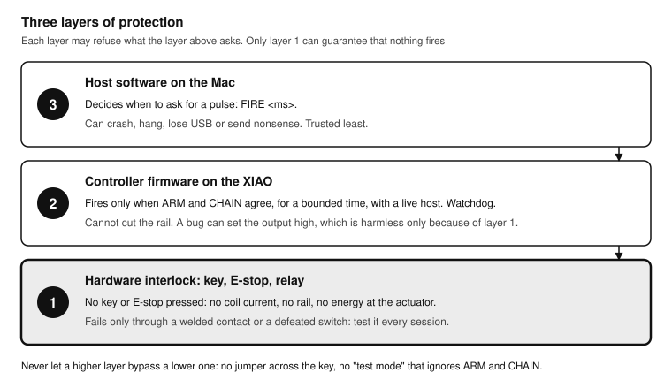
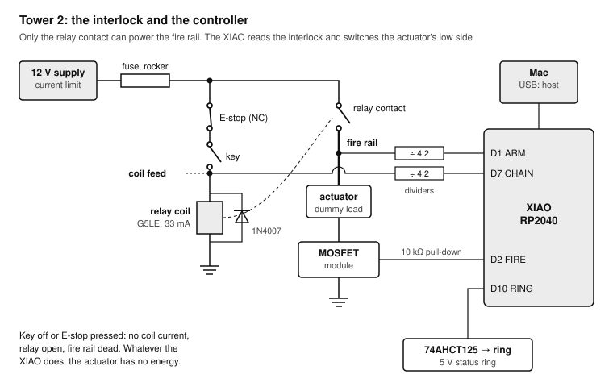
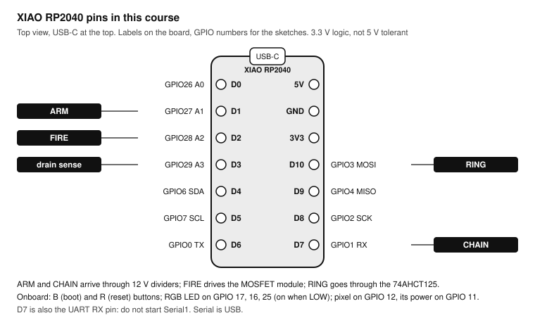
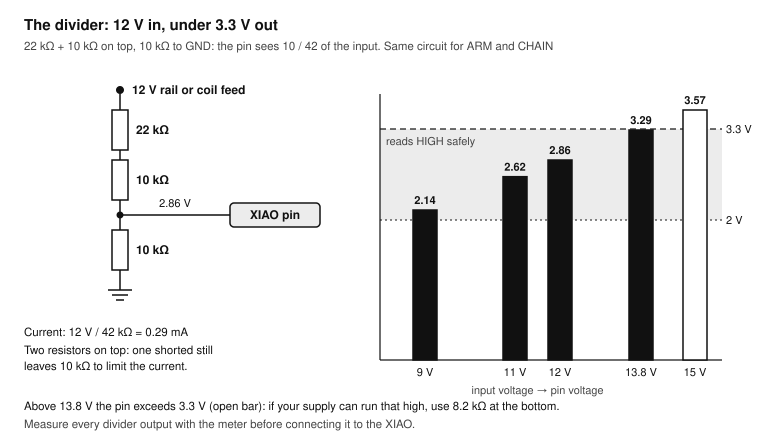
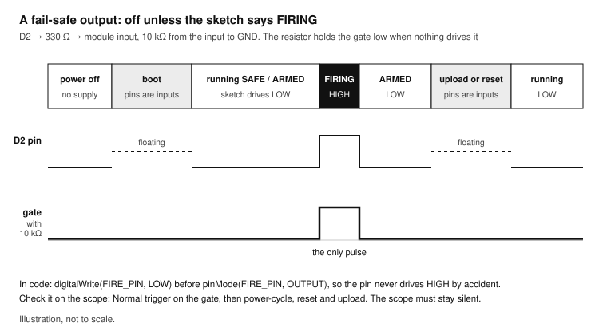
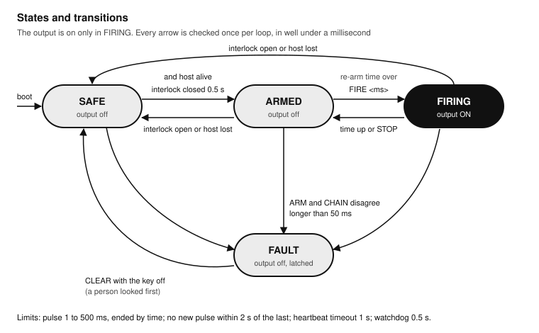
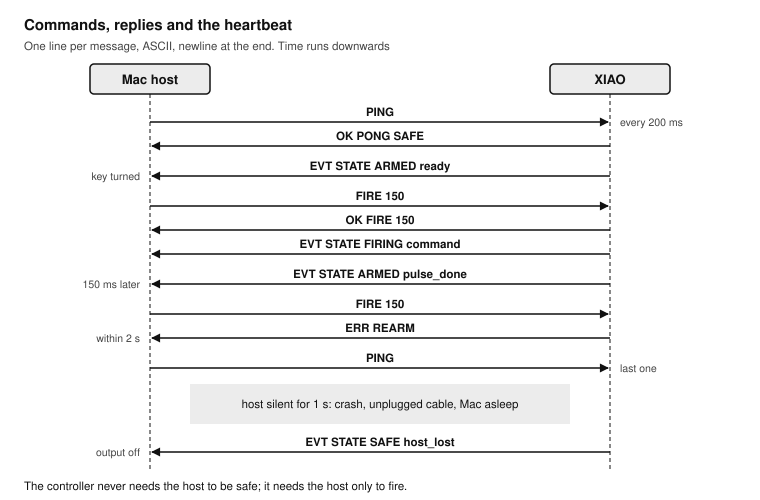
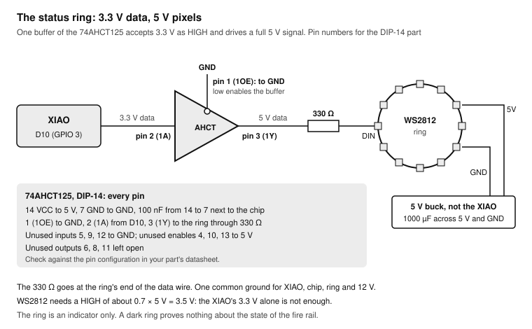
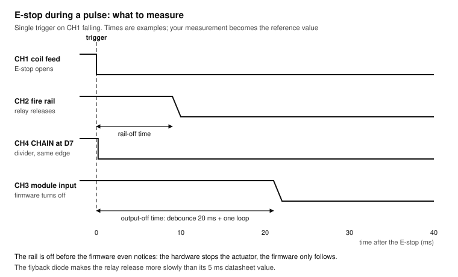

# Safe Actuator Control: Interlocks and a Fire Controller on the XIAO RP2040

*A practical course on controlling a 12 V actuator safely: a hardware interlock first, fail-safe firmware second, written around REASON's tower 2 and a Seeed XIAO RP2040. Last updated 2026-11-07.*

**Shopping list:** see [Everything you need for all lessons](#everything-you-need-for-all-lessons).

**Printable version:** print [`xiao-interlock-course.pdf`](xiao-interlock-course.pdf). It has the whole course, high-contrast drawings, cut-out reference cards, a test record and a practice log. You can also read [`xiao-interlock-course.html`](xiao-interlock-course.html) in a browser. The drawings live in [`diagrams/`](diagrams/) as SVG, with high-contrast print versions in [`diagrams/print/`](diagrams/print/); their sources are in [`diagrams/src/`](diagrams/src/). From the repository root, `node tools/render-diagrams.mjs xiao-interlock` rebuilds the drawings and then `node tools/build-course.mjs xiao-interlock` rebuilds both the HTML and the PDF.

## How to use this course

Nine sessions, about 19 hours in total, take you from a bare XIAO RP2040 to a tested controller for REASON's tower 2: it reads the key-and-E-stop interlock, drives the 12 V fire output through a MOSFET module, talks to the Mac over USB, shows its state on a WS2812 ring, and resets itself if it ever hangs. Every lesson has a goal, the parts you need, numbered exercises and a pass criterion. Do not move on until you pass.

The course rests on one rule, and every lesson comes back to it:

**The hardware interlock is the safety system. The firmware is a second layer that can only refuse.** With the key off or the E-stop pressed, the relay is open and the fire rail is dead, whatever the XIAO, the Mac or a bug does. The firmware's job is to never fire when it should not, to keep every pulse short, and to fall back to safe when anything is wrong. It must never be the only thing between a command and the actuator.

**The actuator.** This course calls the 12 V device on the fire rail "the actuator" (a solenoid or similar) and uses a dummy load for almost every exercise. The real actuator is connected once, in the capstone, after the whole test record has passed.

**Code.** Every sketch is complete. Pins are written as RP2040 GPIO numbers, with the XIAO label in a comment, so the sketches compile whatever pin names your board package defines.

| Lesson | Skill | Bench time | Pass criterion |
| --- | --- | --- | --- |
| 0 | Meet the XIAO RP2040: toolchain, pins, 3.3 V rules | 1.5 h | The onboard RGB LED changes colour on command from the Serial Monitor |
| 1 | Reading the interlock: ARM and CHAIN | 2 h | The XIAO reports key, E-stop and rail correctly in all four combinations, and flags the impossible ones |
| 2 | A fail-safe output | 2 h | The fire output stays off through power-up, reset and a firmware upload, checked on the scope |
| 3 | The state machine | 2.5 h | SAFE, ARMED, FIRING and FAULT behave as the transition table says, pulse length bounded |
| 4 | Talking to the Mac | 2.5 h | The Python host fires a pulse; stopping the heartbeat drops the controller to SAFE within 1 s |
| 5 | The watchdog | 1.5 h | A deliberate hang reboots the XIAO within 0.5 s with the output off, and the boot reason is reported |
| 6 | The status ring | 1.5 h | The ring shows every state, with clean data through the 74AHCT125 |
| 7 | Testing like you mean it | 2.5 h | Every row of the test matrix passes, with scope timings recorded |
| 8 | Capstone: the tower 2 controller | 3 h | The signed test record is complete and the real actuator fires only when it should |

Work in sessions of 60 to 120 minutes, and never alone with 12 V and a moving actuator when you are tired.

### Related courses

- [Hands-On Soldering](../soldering/README.md): [Exercise 6.5, the interlock board](../soldering/README.md#exercise-65-the-interlock-board-rehearsal-for-w23-w24-w26-w31), is the circuit this course reads and tests. Build and pass it first.
- [ESP32 Hands-On](../esp32/README.md) and [Teensy 4.1 Hands-On](../teensy41/README.md): digital inputs, debouncing, PWM and the [low-side MOSFET switch](../esp32/README.md#the-low-side-switch) are taught there in more depth.
- [Oscilloscope Hands-On](../sds804x-hd/README.md): Lessons 2 and 7 here measure the output and the interlock timing with the SDS804X HD.
- [DYNAMIXEL servos](../dynamixel/README.md) and [Power and USB](../power-usb/README.md): the other parts of the REASON towers, written alongside this course.

## Safety design

Before any code: what protects you, what does not, and why the order matters.



REASON's tower 2 has three layers:

1. **The hardware interlock.** 12 V reaches the relay coil only through the normally closed E-stop and the key. Only the energised relay connects the fire rail. The actuator's plus side sits on the fire rail, so with the key off there is no energy to fire with. Nothing in software can change this.
2. **The controller firmware.** It fires only when both interlock inputs agree, only for a bounded time, only with a live host, and never again within the re-arm time. It latches a fault when the inputs disagree, and the watchdog resets it if it hangs.
3. **The host software on the Mac.** It decides when to ask for a pulse. It is the least trustworthy layer: it can crash, lose the USB link or send nonsense. The firmware treats it accordingly.



### What the interlock guarantees, and what it does not

| Part | Guarantees | Does not guarantee |
| --- | --- | --- |
| E-stop (normally closed) | Pressing it opens the coil circuit and drops the relay | Anything if its contact welds closed; test it at the start of every session |
| Key switch | No rail without the key | Anything if someone leaves the key in |
| Relay | The rail is disconnected while the coil is off | A welded contact keeps the rail live with the key off. The firmware detects this (ARM without CHAIN) but cannot cut the power: only the rocker switch or the supply can |
| Flyback diode | The coil's switch-off spike is clamped | Fast release: the diode slows the relay's release a little (Lesson 7 measures it) |
| Fuse | A short on the rail cannot burn the wiring | Protection of the MOSFET or the actuator |
| MOSFET module | The actuator is off while its gate is low | Anything if the MOSFET fails short: the actuator then fires as soon as the rail goes live. The optional drain sense in Lesson 3 detects it |

### Bench rules

- **Never defeat the interlock to test something.** No jumper across the key, no clip across the E-stop, no "temporary" wire from 12 V to the rail. If a test needs the rail live, turn the key.
- **Use a dummy load** until the capstone: a 12 V bulb, or a 47 Ω, 5 W resistor (about 0.26 A at 12 V). Keep the real actuator disconnected.
- **Use a current-limited supply** for every 12 V test: start at 0.5 A and raise it only as far as the dummy load needs.
- **Press the E-stop first** whenever something surprises you. Then think.
- **One ground.** The 12 V minus, the XIAO's GND and the ring's GND must be joined, or the dividers and the MOSFET module have no reference.
- **No 12 V on a GPIO.** The XIAO's pins are 3.3 V only and not 5 V tolerant. Every 12 V signal goes through a divider, and every divider is measured before it is connected.

### Single points of failure

A single point of failure is one part whose failure alone makes the system unsafe. Walk through them before you build, and again before the capstone:

- A welded relay contact: the rail stays live. The firmware latches FAULT and refuses to fire; you must switch off at the rocker.
- A shorted MOSFET: the actuator fires when the rail goes live, that is, when the key turns. The firmware cannot prevent this. The drain-sense exercise detects it while the key is off, before it matters; and the first arming of every session is done with the actuator in a safe state.
- A shorted top resistor in a divider: more than 3.3 V on a GPIO. With the 22 kΩ + 10 kΩ top, a short of one resistor still limits the current to under a milliampere, which the pin's protection diodes usually survive, but it is outside the RP2040's ratings. Measure every divider output before connecting it.
- A firmware bug that sets the output high: harmless with the key off, because the rail is dead. This is the point of the interlock.

## The XIAO RP2040 in one page

The Seeed Studio XIAO RP2040 is a thumb-sized board with Raspberry Pi's RP2040 chip: two Arm Cortex-M0+ cores at up to 133 MHz, 264 KB of RAM and 2 MB of flash, a USB-C connector, an RGB LED and a single WS2812 pixel on the board, and 11 usable pins on two edges.



| XIAO label | GPIO | Other functions | Use in this course |
| --- | --- | --- | --- |
| D0 | 26 | A0 | spare |
| D1 | 27 | A1 | **ARM**: fire rail present, through a divider |
| D2 | 28 | A2 | **FIRE**: gate of the MOSFET module |
| D3 | 29 | A3 | optional drain sense (Lesson 3) |
| D4, D5 | 6, 7 | I2C SDA, SCL | spare |
| D6 | 0 | UART TX | spare |
| D7 | 1 | UART RX | **CHAIN**: coil feed present, through a divider |
| D8, D9 | 2, 4 | SPI SCK, MISO | spare |
| D10 | 3 | SPI MOSI | **RING**: WS2812 data, through the 74AHCT125 |
| onboard | 11, 12 | NeoPixel power, NeoPixel data | Lesson 0 |
| onboard | 17, 16, 25 | red, green, blue LED (on when LOW) | Lesson 0 |

ARM on D1, CHAIN on D7 and the ring on D10 follow REASON's wiring. The fire output on D2 and the drain sense on D3 are this course's choice; if REASON's build page assigns other pins, change the constants at the top of each sketch.

**Electrical limits.** The pins run at 3.3 V and are **not** 5 V tolerant. A pin reads HIGH above about 2 V and LOW below about 0.8 V. Keep the current per pin to a few milliamps: the pins in this course drive a gate input and a level shifter, nothing more. The board is powered from USB-C (or 5 V on its 5V pin, never both without a diode); its 3V3 pin can supply a small sensor, not the ring.

## Everything you need for all lessons

Print this page and tick items off as they arrive. The numbers in brackets are the lessons that first use each item.

### Tools (buy once)

- [ ] Seeed Studio XIAO RP2040, headers soldered as in [soldering Exercise 6.4](../soldering/README.md#exercise-64-straight-headers-on-modules), plus one spare (0)
- [ ] USB-C data cable for the Mac (0)
- [ ] Breadboard and jumper wires (0)
- [ ] Multimeter (1)
- [ ] Bench power supply, 12 V, with an adjustable current limit (1)
- [ ] Oscilloscope; the course uses the Siglent SDS804X HD (2, 7)
- [ ] Two switches to stand in for the key and the E-stop, if the interlock board from soldering Exercise 6.5 is not to hand (1)

### Parts

- [ ] The rehearsal interlock board from [soldering Exercise 6.5](../soldering/README.md#exercise-65-the-interlock-board-rehearsal-for-w23-w24-w26-w31): G5LE relay with 1N4007, key and E-stop stand-ins, both dividers (1)
- [ ] Resistors: 22 kΩ ×2, 10 kΩ ×6, 330 Ω ×2, 1 kΩ ×2 (1, 2, 3, 6)
- [ ] One MOSFET module of the kind REASON uses for W25, logic-level (fully on at 3.3 V gate drive) (2)
- [ ] Dummy load: a 12 V, 5 W bulb, or a 47 Ω, 5 W wirewound resistor (2)
- [ ] 1N5819 or 1N4007 diode, as a flyback diode if your dummy load is a coil (2)
- [ ] 74AHCT125 in DIP-14 with a socket (6)
- [ ] WS2812 ring (the REASON ring or a spare), and a 5 V supply for it: the REASON 5 V buck or a 5 V, 2 A adapter (6)
- [ ] Electrolytic capacitor 1000 µF, 6.3 V or more (6)
- [ ] The real actuator, for the capstone only (8)

### Software (free)

- Arduino IDE 2 with Earle Philhower's RP2040 core (Lesson 0).
- The Adafruit NeoPixel library (Lessons 0 and 6).
- Python 3 on the Mac with the `pyserial` package (Lesson 4).

## Lesson 0: Meet the XIAO RP2040

**Goal:** a working toolchain and a board you can talk to. **Time:** 1.5 hours. **Pass:** the onboard RGB LED changes colour on command from the Serial Monitor, and you can name the four pins this course uses and what each is connected to.

### Exercise 0.1: Install the RP2040 core

There are two Arduino cores for the RP2040. This course uses Earle Philhower's `arduino-pico`, which supports the XIAO RP2040, the hardware watchdog and the Adafruit NeoPixel library.

1. In Arduino IDE, open **Arduino IDE → Settings…** and add this line to **Additional boards manager URLs:** `https://github.com/earlephilhower/arduino-pico/releases/download/global/package_rp2040_index.json`
2. Open **Tools → Board → Boards Manager**, search for `pico`, and install the core by **Earle F. Philhower, III**. Do not install the "Arduino Mbed OS RP2040" core for this course.
3. Select **Tools → Board** and find **Seeed XIAO RP2040** in the core's list of boards. The menu's group name changes between versions; search the list for "XIAO".
4. Install the **Adafruit NeoPixel** library through **Tools → Manage Libraries…**.

### Exercise 0.2: First upload

1. Plug the XIAO into the Mac with the USB-C cable. A new port appears under **Tools → Port**, named `/dev/cu.usbmodem…`.
2. If no port appears (a brand-new board, or one that crashed), hold the **B** (boot) button, plug in the cable, and release the button. The XIAO appears as a drive called **RPI-RP2**; the first upload works from there and later ones use the port.
3. Upload the sketch below and open the Serial Monitor at 115200 baud. Type `r`, `g`, `b` or `0` and press Enter.

```cpp xiao_hello.ino
// Onboard NeoPixel and RGB LED on the XIAO RP2040 (arduino-pico core).
#include <Adafruit_NeoPixel.h>

const int NEO_POWER = 11;   // GPIO11 powers the onboard pixel
const int NEO_DATA  = 12;   // GPIO12 is its data line
const int LED_R = 17, LED_G = 16, LED_B = 25;  // separate RGB LED, on when LOW

Adafruit_NeoPixel pixel(1, NEO_DATA, NEO_GRB + NEO_KHZ800);

void setup() {
  Serial.begin(115200);
  pinMode(NEO_POWER, OUTPUT);
  digitalWrite(NEO_POWER, HIGH);
  pixel.begin();
  pixel.setBrightness(40);
  for (int pin : {LED_R, LED_G, LED_B}) { pinMode(pin, OUTPUT); digitalWrite(pin, HIGH); }  // all off
}

void loop() {
  if (!Serial.available()) return;
  char c = Serial.read();
  uint32_t colour = c == 'r' ? pixel.Color(255, 0, 0) : c == 'g' ? pixel.Color(0, 255, 0)
                  : c == 'b' ? pixel.Color(0, 0, 255) : 0;
  if (c == '\n' || c == '\r') return;
  pixel.setPixelColor(0, colour);
  pixel.show();
  digitalWrite(LED_B, c == 'b' ? LOW : HIGH);   // the blue LED follows 'b'
  Serial.printf("pixel %c, uptime %lu ms\n", c, millis());
}
```

**Test:** each letter changes the pixel's colour, `0` turns it off, and the Serial Monitor confirms every key.

> **Note:** On this core, `Serial` is the USB connection and the baud rate is ignored. `Serial1` is the hardware UART on D6 and D7; this course uses D7 as an input, so do not start `Serial1`.

### Exercise 0.3: The pins you will use

1. Print the XIAO pin drawing. Mark D1 (ARM), D2 (FIRE), D3 (drain sense), D7 (CHAIN) and D10 (RING) in colour.
2. With the XIAO on the breadboard and USB connected, measure 3V3 and 5V against GND with the meter. Write both in the log.
3. Write down the answer to: what is the highest voltage you may ever put on D1? (3.3 V; Lesson 1 keeps it under 3 V.)

## Lesson 1: Reading the interlock

**Goal:** read the interlock's two signals reliably and recognise the combinations that should never happen. **Time:** 2 hours. **Pass:** the XIAO reports all four switch combinations correctly, and flags a simulated welded contact and a simulated missing rail.

### Two signals, two questions

The interlock board gives the XIAO two answers through two dividers:

- **CHAIN** (D7) asks: is the coil fed? It is HIGH when the E-stop is released and the key is on.
- **ARM** (D1) asks: is the fire rail live? It is HIGH when the relay's contact has closed.

In normal operation they move together, with the relay's few milliseconds between them. Any lasting disagreement means something is broken.

| CHAIN | ARM | Meaning | Controller |
| --- | --- | --- | --- |
| LOW | LOW | Key off or E-stop pressed: safe | SAFE |
| HIGH | HIGH | Key on, E-stop released, relay in: armed | may arm |
| HIGH | LOW | Coil fed but no rail: relay not pulling in, blown fuse, broken wire or divider | FAULT |
| LOW | HIGH | Rail live without coil feed: welded relay contact or a wiring error | FAULT, and switch off at the rocker |

### The divider, with numbers



Each divider is 22 kΩ and 10 kΩ in series on top and 10 kΩ to GND, so the pin sees 10 / 42 of the input:

- At 12.0 V: 12 × 10 / 42 = **2.86 V**, a clear HIGH (above about 2 V) with 0.44 V of margin to 3.3 V.
- At 13.8 V (a lead-acid battery on charge): 3.29 V, at the limit. If your 12 V supply can run above 13.5 V, change the bottom resistor to 8.2 kΩ.
- At 9 V (a sagging supply): 2.14 V, still HIGH but only just. The firmware does not trust levels near the threshold; Lesson 3 adds the rail voltage to the status report.
- The divider draws 12 V / 42 kΩ = 0.29 mA: negligible for the supply, and small enough that a fault in the top resistor cannot push much current into the pin.

ARM is on D1, which is also the analog input A1, so the firmware can read the rail voltage itself: rail = ADC voltage × 42 / 10.

### Exercise 1.1: Measure before you connect

1. Power the interlock board from the bench supply at 12.0 V, current limit 0.2 A. Leave the XIAO disconnected.
2. With the meter, measure both divider outputs in all four combinations of key and E-stop. Write the eight readings in the log.
3. **Test:** every reading is either below 0.3 V or between 2.7 and 3.0 V. Anything above 3.0 V: stop and check the resistors.
4. Join the interlock board's GND to the XIAO's GND. Then connect the ARM output to D1 and the CHAIN output to D7.

### Exercise 1.2: Read, debounce, check

Key switches and E-stops bounce, and the relay contact bounces when it closes. The sketch below accepts a new level only after it has been stable for 20 ms, and reports how long the two signals disagreed.

```cpp interlock_inputs.ino
// Reads ARM (D1) and CHAIN (D7) from the interlock dividers, debounces them,
// prints every change, and flags disagreement that lasts longer than the relay needs.
const int ARM_PIN   = 27;   // D1, also A1
const int CHAIN_PIN = 1;    // D7
const uint32_t DEBOUNCE_MS = 20;
const uint32_t RELAY_MS    = 50;   // G5LE: 10 ms operate, 5 ms release at most, plus bounce

struct Input { int pin; bool stable; bool last; uint32_t since; };
Input arm = {ARM_PIN, false, false, 0}, chain = {CHAIN_PIN, false, false, 0};
uint32_t disagreeSince = 0;
bool reported = false;

bool update(Input &in, uint32_t now) {        // returns true when the stable level changes
  bool raw = digitalRead(in.pin);
  if (raw != in.last) { in.last = raw; in.since = now; return false; }
  if (raw != in.stable && now - in.since >= DEBOUNCE_MS) { in.stable = raw; return true; }
  return false;
}

float railVolts() {
  return analogRead(ARM_PIN) * 3.3f / 4095.0f * 42.0f / 10.0f;
}

void setup() {
  Serial.begin(115200);
  pinMode(ARM_PIN, INPUT);       // the divider defines the level; no internal pull
  pinMode(CHAIN_PIN, INPUT);
  analogReadResolution(12);
}

void loop() {
  uint32_t now = millis();
  bool changed = update(arm, now) | update(chain, now);
  if (changed) {
    Serial.printf("%8lu ms  CHAIN=%d ARM=%d  rail %.1f V\n", now, chain.stable, arm.stable, railVolts());
  }
  if (arm.stable != chain.stable) {
    if (!disagreeSince) disagreeSince = now | 1;
    if (!reported && now - disagreeSince > RELAY_MS) {
      Serial.println(arm.stable ? "FAULT: rail live without coil feed (welded contact?)"
                                : "FAULT: coil fed but no rail (relay, fuse, wiring?)");
      reported = true;
    }
  } else {
    if (disagreeSince && !reported) Serial.printf("   agreed again after %lu ms\n", now - disagreeSince);
    disagreeSince = 0;
    reported = false;
  }
}
```

1. Upload and open the Serial Monitor.
2. Turn the key on and off ten times, then press and release the E-stop with the key on ten times. Each change prints one line, and "agreed again after … ms" stays well under 50 ms.
3. Check the rail voltage printed against the meter on the rail. Note the difference in the log.

**Test:** every switch action gives exactly one line per signal, no FAULT messages, and the rail reading is within 0.3 V of the meter.

### Exercise 1.3: Simulate the impossible

1. Key off. Disconnect the ARM divider's input from the rail and touch it to the 12 V supply instead, for two seconds: this is what a welded contact looks like. The sketch prints the rail-live-without-coil-feed FAULT. Reconnect it to the rail.
2. Key on. Pull the fuse (or open the rail wire) so the relay clicks but the rail stays dead: the coil-fed-but-no-rail FAULT appears.

**Test:** both faults are detected within about 50 ms and reported once each.

> **Warning:** Step 1 is a bench simulation on the rehearsal board with the dummy load disconnected. Never bridge to the rail on the real tower.

## Lesson 2: A fail-safe output

**Goal:** make sure the fire output cannot switch on by accident: not at power-up, not during a reset, not during a firmware upload. **Time:** 2 hours. **Pass:** with the scope in Normal trigger mode on the gate, power cycles, resets and uploads produce no pulse at all.

### What "fail-safe" means for a pin



The XIAO's pin is not under your sketch's control all the time. Between power-up and `setup()`, during a reset, and while the board sits in its USB bootloader for an upload, the RP2040 leaves its pins as inputs. An input drives nothing: the MOSFET module's gate floats unless something holds it down, and a floating gate can switch a MOSFET on.

The rule: **the off state must not depend on the software running.** A 10 kΩ resistor from the module's input to GND holds the gate low whenever the pin is not actively driven. Many MOSFET modules already have one; check yours with the meter (IN to GND, module unpowered), and add one on your board if it is missing or larger than 100 kΩ. The RP2040 also enables a weak internal pull-down on its pins at reset, but that is not something to rely on: the external resistor is the guarantee.

In the sketch, write the pin LOW before making it an output, so it never drives HIGH even for a moment.

### Exercise 2.1: Wire the output stage

1. Check the MOSFET module: it must be fully on with 3.3 V at its input. A module that needs 5 V or 10 V (many IRF520 boards do) heats up and switches only partly at 3.3 V. If in doubt, measure the voltage across the module's output while it is on: it should be well under 0.2 V at the dummy load's current.
2. Wire D2 → 330 Ω → module input, and 10 kΩ from module input to GND (unless the module already has it).
3. Wire the dummy load from the **fire rail** (not the 12 V supply) to the module's output minus. The module's output plus, if it has one, goes to the fire rail too. If the dummy load is a coil, fit a flyback diode across it, band to the rail.
4. Join the module's GND to the common GND.

### Exercise 2.2: A first pulse

```cpp output_test.ino
// Fire-output test: 'p' gives one 100 ms pulse on D2. The pin is LOW before it becomes an output.
const int FIRE_PIN = 28;            // D2
const uint32_t PULSE_MS = 100;

void setup() {
  digitalWrite(FIRE_PIN, LOW);      // set the level first ...
  pinMode(FIRE_PIN, OUTPUT);        // ... then drive it
  Serial.begin(115200);
}

void loop() {
  if (Serial.available() && Serial.read() == 'p') {
    digitalWrite(FIRE_PIN, HIGH);
    delay(PULSE_MS);                // acceptable in a test sketch only; Lesson 3 never blocks
    digitalWrite(FIRE_PIN, LOW);
    Serial.println("pulse done");
  }
}
```

1. Upload. Bench supply at 12 V, current limit 0.5 A. Key on: the relay clicks and the rail is live.
2. Type `p`: the dummy load flashes for 100 ms.
3. Turn the key off and type `p` again: nothing happens, because the rail is dead. This is the interlock doing its job, with the firmware ignorant of it.

### Exercise 2.3: Prove it on the scope

1. Probe CH1 on the module's input (the gate side), CH2 on the module's output minus (the drain side), ground clips on the common GND. CH1 at 1 V/div, CH2 at 5 V/div.
2. Trigger on CH1, rising edge at 1.5 V, **Normal** mode, 20 ms/div ([how Normal mode works](../sds804x-hd/README.md#exercise-32-normal-mode-and-holdoff)).
3. Type `p` and measure the pulse with the automatic +Width measurement ([Exercise 2.1 of the oscilloscope course](../sds804x-hd/README.md#exercise-21-automatic-measurements)): 100 ms.
4. Now, with the key on and the trigger still armed, unplug and replug the USB cable five times, press the XIAO's **R** (reset) button five times, and upload the sketch again twice.
5. Remove the 10 kΩ pull-down (and use a module without one, if yours has it built in) and repeat step 4, watching CH1 with a slower trigger level of 0.5 V. Put the resistor back afterwards.

**Test:** with the pull-down fitted, the scope never triggers in step 4. Without it, write down what you saw on the floating gate. Either way, the pull-down stays.

> **Tip:** On the drain side (CH2) you can also see the dummy load switching: the drain falls from 12 V to near 0 V during the pulse. If it only falls part of the way, the module is not fully on at 3.3 V.

## Lesson 3: The state machine

**Goal:** turn inputs and an output into a controller whose behaviour you can write down as a table and test row by row. **Time:** 2.5 hours. **Pass:** every transition in the table works as written; a pulse can never be longer than the maximum or closer than the re-arm time to the previous one.

### Four states



| State | Output | Enters when | Leaves when |
| --- | --- | --- | --- |
| SAFE | off | at boot; interlock opens; host lost; FAULT cleared | interlock closed and stable for 0.5 s (and host alive, from Lesson 4): ARMED |
| ARMED | off | from SAFE; after a pulse | fire command accepted: FIRING; interlock opens or host lost: SAFE; inputs disagree: FAULT |
| FIRING | **on** | fire command in ARMED, outside the re-arm time | pulse time over or STOP: ARMED; interlock opens: SAFE; inputs disagree: FAULT |
| FAULT | off | inputs disagree longer than 50 ms | CLEAR command with the key off (both inputs LOW): SAFE |

Rules that hold in every state:

- The output is only ever HIGH in FIRING. Every loop, in every other state, the firmware writes it LOW again.
- A pulse has a maximum length (500 ms here; set it to what your actuator needs, with margin) and is ended by elapsed time, not by a second command.
- After a pulse ends, the next one is refused for the re-arm time (2 s here).
- FAULT is latched: it does not clear by itself when the inputs agree again. A person turns the key off, looks at the tower, and clears it.
- Nothing ever waits: no `delay()`, no blocking reads. The loop runs thousands of times a second, so every check happens within a millisecond.

### Exercise 3.1: The state machine sketch

This version takes single-letter commands from the Serial Monitor: `f` fires a 200 ms pulse, `s` stops, `c` clears a fault. Lesson 4 replaces them with a proper protocol.

```cpp state_machine.ino
// SAFE / ARMED / FIRING / FAULT for the tower 2 fire output (XIAO RP2040, arduino-pico).
const int ARM_PIN = 27, CHAIN_PIN = 1, FIRE_PIN = 28;   // D1, D7, D2
const uint32_t DEBOUNCE_MS = 20, RELAY_MS = 50, ARM_SETTLE_MS = 500;
const uint32_t PULSE_MS = 200, MAX_PULSE_MS = 500, MIN_REARM_MS = 2000;

enum State { SAFE, ARMED, FIRING, FAULT };
const char *NAMES[] = {"SAFE", "ARMED", "FIRING", "FAULT"};
State state = SAFE;

struct Input { int pin; bool stable; bool last; uint32_t since; };
Input arm = {ARM_PIN, false, false, 0}, chain = {CHAIN_PIN, false, false, 0};
uint32_t closedSince = 0, disagreeSince = 0, fireStart = 0, fireLen = 0, lastFireEnd = 0;

void update(Input &in, uint32_t now) {
  bool raw = digitalRead(in.pin);
  if (raw != in.last) { in.last = raw; in.since = now; }
  else if (now - in.since >= DEBOUNCE_MS) in.stable = raw;
}

void enter(State s, const char *why) {
  if (s != FIRING) digitalWrite(FIRE_PIN, LOW);
  if (state == FIRING && s != FIRING) lastFireEnd = millis() | 1;
  state = s;
  Serial.printf("%8lu ms  %s (%s)\n", millis(), NAMES[s], why);
}

void fire(uint32_t ms, uint32_t now) {
  if (state != ARMED) { Serial.println("refused: not armed"); return; }
  if (ms == 0 || ms > MAX_PULSE_MS) { Serial.println("refused: pulse length"); return; }
  if (lastFireEnd && now - lastFireEnd < MIN_REARM_MS) { Serial.println("refused: re-arm time"); return; }
  if (!arm.stable) { Serial.println("refused: no rail"); return; }
  fireStart = now; fireLen = ms;
  enter(FIRING, "command");
  digitalWrite(FIRE_PIN, HIGH);
}

void setup() {
  digitalWrite(FIRE_PIN, LOW);
  pinMode(FIRE_PIN, OUTPUT);
  pinMode(ARM_PIN, INPUT);
  pinMode(CHAIN_PIN, INPUT);
  Serial.begin(115200);
}

void loop() {
  uint32_t now = millis();
  update(arm, now);
  update(chain, now);
  bool closed = arm.stable && chain.stable;

  // 1. Disagreement lasting longer than the relay needs: latch FAULT.
  if (arm.stable != chain.stable) { if (!disagreeSince) disagreeSince = now | 1; }
  else disagreeSince = 0;
  if (disagreeSince && now - disagreeSince > RELAY_MS && state != FAULT)
    enter(FAULT, arm.stable ? "rail without coil feed" : "coil feed without rail");

  // 2. Interlock open: back to SAFE from ARMED or FIRING.
  if (!closed) closedSince = 0; else if (!closedSince) closedSince = now | 1;
  if (!closed && (state == ARMED || state == FIRING) && state != FAULT) enter(SAFE, "interlock open");

  // 3. SAFE to ARMED after the interlock has been closed and stable for a while.
  if (state == SAFE && closedSince && now - closedSince >= ARM_SETTLE_MS) enter(ARMED, "interlock closed");

  // 4. End the pulse by time.
  if (state == FIRING && now - fireStart >= fireLen) enter(ARMED, "pulse done");

  // 5. Commands.
  if (Serial.available()) {
    char c = Serial.read();
    if (c == 'f') fire(PULSE_MS, now);
    if (c == 's' && state == FIRING) enter(ARMED, "stop");
    if (c == 'c' && state == FAULT) {
      if (!arm.stable && !chain.stable) enter(SAFE, "cleared"); else Serial.println("refused: key must be off");
    }
  }

  // 6. Belt and braces: outside FIRING the output is LOW, every loop.
  if (state != FIRING) digitalWrite(FIRE_PIN, LOW);
}
```

1. Upload. Key off: the Serial Monitor shows nothing until you act.
2. Key on: after half a second, `ARMED (interlock closed)`.
3. Type `f`: `FIRING (command)`, then `ARMED (pulse done)` 200 ms later. The dummy load flashes.
4. Type `f` twice in quick succession: the second is refused for the re-arm time.
5. Key off while armed: `SAFE (interlock open)`. Type `f`: refused.
6. Repeat the welded-contact simulation of Exercise 1.3: `FAULT`. Type `c` with the key on: refused. Key off, `c`: `SAFE (cleared)`.

**Test:** every step behaves as described. Write the state sequence in the log.

### Exercise 3.2: Change a limit, then test the limit

1. Change `PULSE_MS` to 600. Upload and type `f`: refused, because 600 is above `MAX_PULSE_MS`.
2. Set `PULSE_MS` back to 200. Change `MIN_REARM_MS` to 5000, upload, and check with a stopwatch that the second pulse is refused for 5 s.
3. Set the limits to what your actuator needs, with margin, and write them on Card B.

**Test:** both limits hold; the values you chose are written down with a one-line reason each.

### Exercise 3.3 (optional): Sense the MOSFET's drain

A shorted MOSFET fires the actuator the moment the rail goes live. You can detect it before that happens.

1. Build a third divider (22 kΩ + 10 kΩ on top, 10 kΩ to GND) from the module's output minus (the drain side of the load) to D3.
2. With the key on and the output off, the drain sits at the rail voltage through the load: D3 reads about 2.9 V. With the output on, the drain falls near 0 V: D3 reads LOW.
3. Add a rule to the sketch: in ARMED, if D3 reads LOW for more than 50 ms while the output is off, enter FAULT ("output stage conducting"). In FIRING, if D3 stays HIGH, report "output stage not switching".

**Test:** pull the module's input up to 3.3 V through 1 kΩ (simulating a shorted MOSFET) with the key on: FAULT within 50 ms of the rail going live.

> **Note:** An open dummy load also reads LOW on D3, so the fault message says "output stage conducting or load open". Either way the tower should not arm.

## Lesson 4: Talking to the Mac

**Goal:** a robust line protocol between the Mac and the controller, with a heartbeat that drops the controller to SAFE when the Mac goes quiet. **Time:** 2.5 hours. **Pass:** the Python host fires a pulse on command; muting the heartbeat drops the controller to SAFE within 1 s; garbage on the line is answered with an error, never acted on.

### The protocol



Plain text lines, ASCII, ending in a newline. One command per line, one reply per command; unsolicited events start with `EVT`.

| Host sends | Controller replies | Notes |
| --- | --- | --- |
| `PING` | `OK PONG <state>` | The heartbeat: every 200 ms |
| `STATUS` | `OK STATUS state=… arm=… chain=… rail=…V rearm=…ms` | Everything a host needs to display |
| `FIRE <ms>` | `OK FIRE <ms>` or `ERR NOT_ARMED`, `ERR RANGE`, `ERR REARM`, `ERR NO_RAIL` | Pulse length in milliseconds, 1 to the maximum |
| `STOP` | `OK STOP` | Ends a pulse early; harmless otherwise |
| `CLEAR` | `OK CLEAR` or `ERR KEY_ON`, `ERR NO_FAULT` | Clears a latched FAULT with the key off |
| anything else | `ERR UNKNOWN` | Also for lines over 63 characters |
| (none) | `EVT STATE <state> <reason>` | Every state change |
| (none) | `EVT BOOT <reason>` | At start-up: `power-on` or `watchdog` |

**The heartbeat.** Any valid command counts as a sign of life. If nothing valid arrives for 1000 ms while the controller is ARMED or FIRING, it ends any pulse and drops to SAFE with the reason `host lost`. It re-arms by itself once the host is back and the interlock is closed. The controller never needs the host to be safe; it needs the host only to fire.

### Exercise 4.1: The controller firmware

This is the whole controller. The watchdog and the ring are already in it, switched off with `USE_WATCHDOG` and `USE_RING`; Lessons 5 and 6 switch them on. `TEST_COMMANDS` enables a `HANG` command for the fault tests in Lesson 7.

```cpp tower_controller.ino
// Tower 2 fire controller for the Seeed XIAO RP2040 (Earle Philhower's arduino-pico core).
// The hardware interlock (key, E-stop, relay) is the safety system. This firmware can only refuse:
// it fires only when both interlock inputs agree, for a bounded time, with a live host.
#include <Adafruit_NeoPixel.h>
#include <hardware/watchdog.h>

#define USE_WATCHDOG  0   // Lesson 5: set to 1
#define USE_RING      0   // Lesson 6: set to 1
#define TEST_COMMANDS 1   // HANG for fault injection; set to 0 on the finished tower

// ---- Pins: RP2040 GPIO numbers, XIAO labels in the comments ----
const int ARM_PIN   = 27;   // D1 (A1): fire rail present, divider 22k+10k / 10k
const int CHAIN_PIN = 1;    // D7: coil feed present (key on, E-stop released)
const int FIRE_PIN  = 28;   // D2: MOSFET module input, 10k pull-down to GND
const int RING_PIN  = 3;    // D10: WS2812 data through the 74AHCT125
const int RING_LEDS = 12;   // pixels on your ring

// ---- Limits ----
const uint32_t DEBOUNCE_MS   = 20;
const uint32_t RELAY_MS      = 50;     // allowed ARM/CHAIN disagreement while the relay moves
const uint32_t ARM_SETTLE_MS = 500;
const uint32_t MAX_PULSE_MS  = 500;
const uint32_t MIN_REARM_MS  = 2000;
const uint32_t HEARTBEAT_MS  = 1000;
const uint32_t WATCHDOG_MS   = 500;

enum State { SAFE, ARMED, FIRING, FAULT };
const char *NAMES[] = {"SAFE", "ARMED", "FIRING", "FAULT"};
State state = SAFE;

struct Input { int pin; bool stable; bool last; uint32_t since; };
Input arm = {ARM_PIN, false, false, 0}, chain = {CHAIN_PIN, false, false, 0};
uint32_t closedSince = 0, disagreeSince = 0, fireStart = 0, fireLen = 0, lastFireEnd = 0;
uint32_t lastHost = 0;
bool hostSeen = false;

char line[64];
size_t lineLen = 0;
bool lineTooLong = false;

#if USE_RING
Adafruit_NeoPixel ring(RING_LEDS, RING_PIN, NEO_GRB + NEO_KHZ800);
uint32_t lastRing = 0;
#endif

void update(Input &in, uint32_t now) {
  bool raw = digitalRead(in.pin);
  if (raw != in.last) { in.last = raw; in.since = now; }
  else if (now - in.since >= DEBOUNCE_MS) in.stable = raw;
}

float railVolts() { return analogRead(ARM_PIN) * 3.3f / 4095.0f * 42.0f / 10.0f; }

bool hostAlive(uint32_t now) { return hostSeen && now - lastHost < HEARTBEAT_MS; }

void enter(State s, const char *why) {
  if (s != FIRING) digitalWrite(FIRE_PIN, LOW);
  if (state == FIRING && s != FIRING) lastFireEnd = millis() | 1;
  if (s == state) return;
  state = s;
  Serial.printf("EVT STATE %s %s\n", NAMES[s], why);
}

void command(char *cmd, uint32_t now) {
  char *arg = strchr(cmd, ' ');
  if (arg) *arg++ = '\0';
  bool valid = true;
  if (!strcmp(cmd, "PING")) {
    Serial.printf("OK PONG %s\n", NAMES[state]);
  } else if (!strcmp(cmd, "STATUS")) {
    uint32_t wait = lastFireEnd && now - lastFireEnd < MIN_REARM_MS ? MIN_REARM_MS - (now - lastFireEnd) : 0;
    Serial.printf("OK STATUS state=%s arm=%d chain=%d rail=%.1fV rearm=%lums\n",
                  NAMES[state], arm.stable, chain.stable, railVolts(), wait);
  } else if (!strcmp(cmd, "FIRE")) {
    long ms = arg ? strtol(arg, nullptr, 10) : 0;
    if (state != ARMED) Serial.println("ERR NOT_ARMED");
    else if (ms < 1 || ms > (long)MAX_PULSE_MS) Serial.println("ERR RANGE");
    else if (lastFireEnd && now - lastFireEnd < MIN_REARM_MS) Serial.println("ERR REARM");
    else if (!arm.stable) Serial.println("ERR NO_RAIL");
    else {
      fireStart = now;
      fireLen = ms;
      enter(FIRING, "command");
      digitalWrite(FIRE_PIN, HIGH);
      Serial.printf("OK FIRE %ld\n", ms);
    }
  } else if (!strcmp(cmd, "STOP")) {
    if (state == FIRING) enter(ARMED, "stop");
    Serial.println("OK STOP");
  } else if (!strcmp(cmd, "CLEAR")) {
    if (state != FAULT) Serial.println("ERR NO_FAULT");
    else if (arm.stable || chain.stable) Serial.println("ERR KEY_ON");
    else { enter(SAFE, "cleared"); Serial.println("OK CLEAR"); }
#if TEST_COMMANDS
  } else if (!strcmp(cmd, "HANG")) {
    Serial.println("OK HANG");
    Serial.flush();
    while (true) { }                    // the watchdog must rescue us
#endif
  } else {
    Serial.println("ERR UNKNOWN");
    valid = false;
  }
  if (valid) { lastHost = now; hostSeen = true; }
}

void readHost(uint32_t now) {
  while (Serial.available()) {
    char c = Serial.read();
    if (c == '\r') continue;
    if (c == '\n') {
      line[lineLen] = '\0';
      if (lineTooLong) Serial.println("ERR UNKNOWN");
      else if (lineLen) command(line, now);
      lineLen = 0;
      lineTooLong = false;
    } else if (lineLen < sizeof(line) - 1) {
      line[lineLen++] = c;
    } else {
      lineTooLong = true;
    }
  }
}

#if USE_RING
void showRing(uint32_t now) {
  if (now - lastRing < 50) return;      // 20 updates a second are plenty
  lastRing = now;
  bool blink = (now / 250) % 2;
  uint32_t c = state == SAFE   ? ring.Color(0, 60, 0)
             : state == ARMED  ? ring.Color(120, 60, 0)
             : state == FIRING ? ring.Color(255, 0, 0)
             : (blink ? ring.Color(255, 0, 0) : 0);
  for (int i = 0; i < RING_LEDS; i++) ring.setPixelColor(i, c);
  if (!hostAlive(now)) ring.setPixelColor(0, ring.Color(0, 0, 120));   // one blue pixel: no host
  ring.show();
}
#endif

void setup() {
  digitalWrite(FIRE_PIN, LOW);          // level first, then output: never a glitch HIGH
  pinMode(FIRE_PIN, OUTPUT);
  pinMode(ARM_PIN, INPUT);
  pinMode(CHAIN_PIN, INPUT);
  analogReadResolution(12);
  Serial.begin(115200);                 // USB; never wait for the host here
#if USE_RING
  ring.begin();
  ring.setBrightness(60);
  ring.clear();
  ring.show();
#endif
  // watchdog_enable_caused_reboot() is true only after a timeout of a watchdog that the firmware started,
  // not after the bootloader's own reset at the end of an upload.
  Serial.printf("EVT BOOT %s\n", watchdog_enable_caused_reboot() ? "watchdog" : "power-on");
#if USE_WATCHDOG
  rp2040.wdt_begin(WATCHDOG_MS);        // once started, it cannot be stopped
#endif
}

void loop() {
  uint32_t now = millis();
#if USE_WATCHDOG
  rp2040.wdt_reset();
#endif
  update(arm, now);
  update(chain, now);
  bool closed = arm.stable && chain.stable;

  if (arm.stable != chain.stable) { if (!disagreeSince) disagreeSince = now | 1; }
  else disagreeSince = 0;
  if (disagreeSince && now - disagreeSince > RELAY_MS && state != FAULT)
    enter(FAULT, arm.stable ? "rail_without_coil_feed" : "coil_feed_without_rail");

  if (!closed) closedSince = 0; else if (!closedSince) closedSince = now | 1;
  if (state == ARMED || state == FIRING) {
    if (!closed) enter(SAFE, "interlock_open");
    else if (!hostAlive(now)) enter(SAFE, "host_lost");
  }
  if (state == SAFE && closedSince && now - closedSince >= ARM_SETTLE_MS && hostAlive(now))
    enter(ARMED, "ready");
  if (state == FIRING && now - fireStart >= fireLen) enter(ARMED, "pulse_done");

  readHost(now);

  if (state != FIRING) digitalWrite(FIRE_PIN, LOW);   // every loop, whatever happened above
#if USE_RING
  showRing(now);
#endif
}
```

1. Upload. Open the Serial Monitor and type `STATUS`: the reply shows the state and both inputs.
2. Turn the key on, then type `PING` and press Enter. The controller arms half a second after the interlock closed, but only while PINGs keep coming, which you cannot type fast enough: one second after your last PING it falls back to SAFE with `host_lost`. That is the heartbeat at work. Close the Serial Monitor for the next exercise.

### Exercise 4.2: The Python host

1. In Terminal, make a virtual environment and install pyserial:

```sh install the host
python3 -m venv ~/tower-venv
source ~/tower-venv/bin/activate
python3 -m pip install pyserial
```

2. Save the script below as `tower_host.py` and run it with `python3 tower_host.py`. It finds the XIAO's port by itself when exactly one `/dev/cu.usbmodem…` is present; otherwise pass the port as an argument.

```python tower_host.py
#!/usr/bin/env python3
"""Minimal host for tower_controller.ino: sends PING every 200 ms, prints every reply and event,
and forwards the commands you type. 'mute' stops the heartbeat, 'unmute' restarts it, 'quit' exits."""
import glob
import sys
import threading
import time

import serial  # python3 -m pip install pyserial


def find_port():
    ports = sorted(glob.glob('/dev/cu.usbmodem*'))
    if len(ports) != 1:
        sys.exit(f'Expected one /dev/cu.usbmodem* port, found {ports or "none"}; pass the port as an argument.')
    return ports[0]


port = sys.argv[1] if len(sys.argv) > 1 else find_port()
link = serial.Serial(port, 115200, timeout=0.1)
lock = threading.Lock()
running = True
pinging = True


def send(cmd):
    with lock:
        link.write((cmd + '\n').encode('ascii'))


def pinger():
    while running:
        if pinging:
            send('PING')
        time.sleep(0.2)


def reader():
    while running:
        text = link.readline().decode('ascii', 'replace').strip()
        if text and not text.startswith('OK PONG'):
            print(time.strftime('%H:%M:%S'), '<', text)


threading.Thread(target=pinger, daemon=True).start()
threading.Thread(target=reader, daemon=True).start()
print(f'Connected to {port}. Commands: STATUS, FIRE <ms>, STOP, CLEAR, HANG; mute, unmute, quit.')
try:
    for typed in sys.stdin:
        typed = typed.strip()
        if typed == 'quit':
            break
        if typed in ('mute', 'unmute'):
            pinging = typed == 'unmute'
            print('heartbeat', 'running' if pinging else 'stopped')
            continue
        if typed:
            send(typed.upper())
finally:
    running = False
    link.close()
```

3. With the host running, turn the key on: `EVT STATE ARMED ready`.
4. Type `FIRE 150`: `OK FIRE 150`, the load flashes, then `EVT STATE ARMED pulse_done`.
5. Type `FIRE 150` again at once: `ERR REARM`. Type `FIRE 5000`: `ERR RANGE`. Type `fire banana`: `ERR RANGE`; type `hello`: `ERR UNKNOWN`.
6. Type `mute`. Within one second: `EVT STATE SAFE host_lost`. Type `unmute`: the controller re-arms.
7. Press **Ctrl-C** to stop the host while armed. Start it again and type `STATUS`: the controller went SAFE while you were away.

**Test:** every reply matches the protocol table, and muting the heartbeat always ends in SAFE within 1 s.

> **Note:** Only one program can hold the serial port. If the host reports the port busy, close the Arduino Serial Monitor.

## Lesson 5: The watchdog

**Goal:** make a hang in the firmware end in a reset with the output off, and know afterwards that it happened. **Time:** 1.5 hours. **Pass:** `HANG` reboots the XIAO within 0.5 s, the output is off throughout, and the controller reports `EVT BOOT watchdog`.

### Why a watchdog

The state machine is only as good as the loop that runs it. A bug, a stuck library call or a corrupted variable can stop `loop()` with the output in whatever state it was. If that state is FIRING, the pulse never ends.

The RP2040 has a hardware watchdog: a timer that resets the whole chip unless the firmware reloads it in time. `rp2040.wdt_begin(500)` starts it with a 500 ms timeout; `rp2040.wdt_reset()` reloads it. The firmware calls `wdt_reset()` once per loop, so the watchdog only fires if the loop stops. A reset puts every pin back to input, the pull-down turns the MOSFET off, and the firmware starts again in SAFE.

At start-up the firmware reports why it booted. The Pico SDK function `watchdog_enable_caused_reboot()` is true only when a watchdog started by the firmware ran out; the plain `watchdog_caused_reboot()` is also true after an upload, because the bootloader restarts the chip through the watchdog. If your core version does not know the first function, use the second and ignore the report right after uploads.

Two rules from the arduino-pico documentation: once started, the watchdog cannot be stopped; and the timeout must be longer than the slowest pass through `loop()`. Here a loop pass takes well under a millisecond, so 500 ms is generous and still short enough to end a pulse in time.

### Exercise 5.1: Switch it on and test it

1. In `tower_controller.ino`, set `USE_WATCHDOG` to 1 and upload.
2. Start the host. Key on: ARMED.
3. Scope: CH1 on the module input, 1 V/div. Trigger on CH1 rising, **Normal**, 200 ms/div, trigger point at the left.
4. Type `FIRE 500` and then, within the pulse, `HANG`. The pulse ends early: the watchdog reset the chip.
5. The host shows `OK HANG`, then nothing for half a second, then `EVT BOOT watchdog`. The port may drop and reappear; restart the host if it lost the port.
6. Measure on the scope how long the output stayed HIGH after you sent `HANG`.

**Test:** the output turns off within about 500 ms of the hang, the boot reason is `watchdog`, and the controller comes back in SAFE.

> **Warning:** The watchdog limits how long a hang can keep the output on to its timeout. If 500 ms of unintended firing is unacceptable for your actuator, shorten `WATCHDOG_MS` (and keep every loop pass well inside it) or add a hardware pulse limiter. The interlock remains the only way to stop it instantly: the E-stop.

### Exercise 5.2: Upload with the watchdog running

1. With `USE_WATCHDOG` at 1, upload the sketch again from Arduino IDE.
2. The upload resets the board into its bootloader; the watchdog does not interfere because the reset restarts everything.
3. Repeat Exercise 2.3's scope check during the upload.

**Test:** the upload succeeds and the gate never rises.

## Lesson 6: The status ring

**Goal:** show the controller's state on the WS2812 ring, with clean data at 5 V. **Time:** 1.5 hours. **Pass:** the ring shows SAFE, ARMED, FIRING, FAULT and "no host" correctly, with no flicker, with the ring powered from 5 V and the data level-shifted.

### Why a level shifter



WS2812 pixels run at 5 V and expect a HIGH data level of about 0.7 × 5 V = 3.5 V. The XIAO's 3.3 V is below that. It often works on the bench and fails on a long wire or a warm day. The 74AHCT125 is a buffer powered from 5 V whose inputs switch at TTL levels, so it accepts 3.3 V as HIGH and outputs a full 5 V signal.

The ring is an indicator, not a safety function. A dark ring proves nothing: the state is what the controller reports and what the interlock enforces.

### Exercise 6.1: Wire the ring

1. Fit the 74AHCT125 socket. Pin 14 to 5 V, pin 7 to GND, 100 nF from pin 14 to pin 7 close to the socket.
2. Channel 1: pin 1 (1OE) to GND to enable it, XIAO D10 into pin 2 (1A), pin 3 (1Y) out through 330 Ω to the ring's DIN, with the resistor at the ring's end of the wire.
3. Unused channels: inputs (pins 5, 9, 12) to GND, and their enable pins (4, 10, 13) to 5 V to switch them off. Check this pinout against the datasheet of the part you have.
4. Power the ring from 5 V (the REASON buck or a 5 V adapter), not from the XIAO. Put 1000 µF across the ring's 5 V and GND where the power enters. Join this GND to the common GND.
5. Insert the chip only after checking with the meter: 5 V between pins 14 and 7, nothing on pin 2.

### Exercise 6.2: Switch the ring on

1. Set `RING_LEDS` to your ring's pixel count and `USE_RING` to 1. Upload.
2. Key off: green. Key on with the host running: amber. `FIRE 300`: red for the pulse. Welded-contact simulation: blinking red. `mute`: one pixel blue (and the controller drops to SAFE: green with a blue pixel).
3. Measure the 5 V supply current with the ring amber. At brightness 60 of 255 it stays far below the ring's full-white maximum (about 60 mA per pixel).

### Exercise 6.3: Check the data on the scope

1. CH1 on D10 (3.3 V side), CH2 on the ring's DIN (5 V side), 1 V/div and 2 V/div, 500 ns/div, trigger on CH1 rising.
2. The bits are pulses of roughly 0.4 µs (a 0) and 0.8 µs (a 1) in a 1.25 µs frame. CH2 swings to 5 V, CH1 to 3.3 V.
3. Look at CH2's edges at the ring: little overshoot with the 330 Ω in place.

**Test:** no flicker in any state; CH2 reaches above 4.5 V.

## Lesson 7: Testing like you mean it

**Goal:** prove, one condition at a time, that the controller does what the safety design says, including when things fail. **Time:** 2.5 hours. **Pass:** every row of the test matrix passes, with scope timings in the record.

### How to test a safety function

- Write the expected result **before** you do the test.
- Test one thing at a time, from a known starting state (key off, host running, controller SAFE).
- Test the failure cases as carefully as the normal ones: a controller that fires correctly but also fires when it should not has failed.
- Record what you saw, not what you expected. A row that passes on the second attempt gets a note.
- After any change to the firmware or the wiring, run the whole matrix again.

### The test matrix

All tests on the bench at 12 V with the current limit at 0.5 A and the dummy load; host running unless the row says otherwise.

| ID | Starting state | Action | Expected |
| --- | --- | --- | --- |
| T1 | Key off | `FIRE 100` | `ERR NOT_ARMED`; no pulse |
| T2 | Key on, host not running | Wait 5 s | Stays SAFE; ring green with a blue pixel |
| T3 | ARMED | `FIRE 100` | One pulse, 100 ms within 2 ms (scope) |
| T4 | ARMED | `FIRE 0`, `FIRE 501`, `FIRE x` | `ERR RANGE` each; no pulse |
| T5 | ARMED | `FIRE 100` twice within 1 s | Second `ERR REARM` |
| T6 | ARMED | `FIRE 500`, E-stop pressed during the pulse | Rail and output off; SAFE; rail-off time measured |
| T7 | ARMED | Key off | SAFE within 50 ms of CHAIN falling |
| T8 | ARMED | `mute` | SAFE `host_lost` within 1.0 s |
| T9 | FIRING (`FIRE 500`) | Unplug the XIAO's USB | Output off at once (pull-down); rail stays live while the key is on |
| T10 | FIRING (`FIRE 500`) | `HANG` | Output off within 0.5 s; `EVT BOOT watchdog` |
| T11 | FIRING (`FIRE 500`) | Press the XIAO's reset button | Output off at once; boots SAFE |
| T12 | ARMED | Short the ARM divider output to GND | FAULT `coil_feed_without_rail` within 50 ms |
| T13 | Key off | Welded-contact simulation (Exercise 1.3) | FAULT `rail_without_coil_feed`; `CLEAR` refused until the simulation is removed |
| T14 | FAULT | `CLEAR` with the key on | `ERR KEY_ON` |
| T15 | ARMED | Upload the firmware | No pulse on the gate during the upload (scope, Normal trigger) |
| T16 | ARMED | Send a 100-character line | `ERR UNKNOWN`; state unchanged |

### Exercise 7.1: Run the matrix

1. Copy the matrix into the test record at the end of the course (Worksheet 1), one row per test.
2. Run T1 to T16 in order. Fill in "observed" and "pass" for each.
3. For any failure: stop, find the cause, fix it, and run the **whole** matrix again, not just the failed row.

### Exercise 7.2: Measure the timings



1. CH1 on the coil feed (the CHAIN divider's input side, 5 V/div), CH2 on the fire rail (5 V/div), CH3 on the module input (1 V/div), CH4 on CHAIN at the XIAO pin (1 V/div). Ground clips on the common GND.
2. Trigger on CH1, falling edge at 6 V, **Single** ([single-shot captures](../sds804x-hd/README.md#exercise-31-single-shot-see-the-bounce)). Timebase 5 ms/div, trigger point at the left.
3. Arm, `FIRE 500`, press the E-stop during the pulse.
4. Measure with cursors: E-stop to rail off (relay release, slowed by the flyback diode), and E-stop to output off (the firmware's reaction: debounce plus a loop). Write both in the record.
5. Repeat for T3: measure the pulse width with the automatic +Width ([automatic measurements](../sds804x-hd/README.md#exercise-21-automatic-measurements)) and with statistics over 10 pulses.
6. For T8, trigger on the output's falling edge and use the host log time stamps to bound the heartbeat timeout; with History ([History](../sds804x-hd/README.md#exercise-35-go-back-in-time)) you can step back through the last pulses.

**Test:** the rail turns off within about 15 ms of the E-stop (the G5LE's 5 ms release plus the diode's delay; your measurement is the reference value from now on), and the output within about 25 ms.

> **Note:** The rail-off time is a property of the relay and its diode, not of the firmware. A slower release (a diode with a series resistor or a Zener would speed it up) is a hardware design choice; the [switching lesson of the oscilloscope course](../sds804x-hd/README.md#lesson-7-switching-loads) shows how the flyback path shapes the turn-off.

## Lesson 8: Capstone: the tower 2 controller

**Goal:** bring the complete controller up on the bench with the real interlock parts, pass the full test record, and only then connect the real actuator. **Time:** 3 hours. **Pass:** the test record is complete and signed, and the real actuator fires only when armed and commanded, for the commanded time.

### Build order

1. **Interlock first.** Replace the rehearsal switches with the real key and E-stop (REASON W23, W24, W26, W31). Test the interlock alone, with the XIAO disconnected, as in soldering Exercise 6.5: key off, key on, E-stop. Rail voltage with the meter each time.
2. **Inputs.** Measure both divider outputs in all four combinations (Exercise 1.1). Connect them to D1 and D7.
3. **Output with the dummy load.** Module input on D2 with its pull-down, the dummy load on the fire rail.
4. **Ring** on D10 through the 74AHCT125, from the 5 V buck.
5. **Firmware** with `USE_WATCHDOG 1`, `USE_RING 1`, and your final `MAX_PULSE_MS` and `MIN_REARM_MS`. Keep `TEST_COMMANDS 1` for the test run.

### Exercise 8.1: Full test run with the dummy load

1. Run the complete test matrix (Lesson 7) on the real hardware, scope timings included.
2. Fill in Worksheet 1. Every row must pass; any change means running all rows again.

### Exercise 8.2: The real actuator

1. Key off, E-stop pressed, supply off.
2. Replace the dummy load with the real actuator, with its flyback diode. Make sure it is in a safe position and nobody is near its moving parts.
3. Raise the current limit to what the actuator needs, and no further.
4. Supply on, E-stop released, host running. Turn the key: ARMED.
5. `FIRE` with the shortest pulse that works, then your normal pulse. Check the pulse width on the scope once more with the real load.
6. Repeat T6 (E-stop during a pulse), T7 (key off) and T8 (host lost) with the real actuator.

### Exercise 8.3: Finish

1. Set `TEST_COMMANDS` to 0, upload, and confirm `HANG` now gives `ERR UNKNOWN`.
2. Re-run T1, T3, T6, T7 and T8 as a short check.
3. Sign and date the test record. Keep it with the tower; re-run the short check after any change and at the start of each session where the tower has been moved.

**Test:** the record is complete and signed; you can explain, for each layer, what it guarantees and what it does not.

## Troubleshooting

| Symptom | Likely cause | Fix |
| --- | --- | --- |
| No port in Arduino IDE | Charge-only cable, or the board is in a crashed state | Data cable; hold B while plugging in and upload from the RPI-RP2 drive |
| Upload fails with "port busy" | The Python host or Serial Monitor holds the port | Quit the host and close the Serial Monitor |
| ARM or CHAIN always LOW | Missing common ground; divider not connected; wrong pin number | Join the grounds; measure at the pin; GPIO 27 is D1, GPIO 1 is D7 |
| ARM or CHAIN flickers | Floating input (divider disconnected); key switch bouncing heavily | Measure the divider; keep `pinMode(INPUT)`; raise `DEBOUNCE_MS` only after measuring the bounce |
| FAULT every time the key turns | Relay slower than `RELAY_MS`, or one divider much slower | Measure the relay timing (Lesson 7) and set `RELAY_MS` above it with margin |
| Never leaves SAFE | Host not sending PING; interlock not closed for 0.5 s | Run the host; check `STATUS` for both inputs |
| Drops to SAFE `host_lost` while the host runs | Host stalled, USB hub dropping, or the Mac asleep | Keep the Mac awake; connect directly; watch the host's time stamps |
| The load does not switch, or only weakly | MOSFET module not logic-level; dummy load on the 12 V supply instead of the rail; missing ground | Measure the module's output voltage when on; use a logic-level module; check the wiring against the drawing |
| The load flickers at power-up or upload | No pull-down on the module input | Fit 10 kΩ from the input to GND (Lesson 2) |
| `EVT BOOT watchdog` without a `HANG` | A loop pass took longer than `WATCHDOG_MS` (a blocking call) | Remove any `delay()` or blocking read; keep the ring update short |
| Ring flickers or shows wrong colours | No level shifter; resistor missing; ground not common; wrong `NEO_GRB` order | Wire as in Lesson 6; try `NEO_RGB` if red and green are swapped |
| Ring dark | 74AHCT125 not powered or OE high; ring on the wrong 5 V | Measure pins 14 and 1; check the ring's supply |
| The rail stays live with the key off | Welded relay contact | Switch off at the rocker; replace the relay; the controller should already be in FAULT |

## Reference cards and practice log

### Card A: Before every session

- [ ] Real actuator disconnected (or in its safe position, capstone only)
- [ ] Supply current limit set; dummy load on the fire rail
- [ ] Common ground between 12 V, XIAO and ring
- [ ] Key off: rail 0 V by meter
- [ ] Key on: relay clicks, rail 12 V; E-stop pressed: relay drops, rail 0 V
- [ ] Both divider outputs below 3.0 V with the key on
- [ ] Host running; `STATUS` shows the state you expect
- [ ] Nobody near the actuator; E-stop within reach

### Card B: Firmware limits

| Constant | Course value | Your value | Why |
| --- | --- | --- | --- |
| `DEBOUNCE_MS` | 20 | | |
| `RELAY_MS` | 50 | | |
| `ARM_SETTLE_MS` | 500 | | |
| `MAX_PULSE_MS` | 500 | | |
| `MIN_REARM_MS` | 2000 | | |
| `HEARTBEAT_MS` | 1000 | | |
| `WATCHDOG_MS` | 500 | | |

### Card C: Protocol

| Send | Reply |
| --- | --- |
| `PING` | `OK PONG <state>` |
| `STATUS` | `OK STATUS state= arm= chain= rail= rearm=` |
| `FIRE <ms>` | `OK FIRE`, `ERR NOT_ARMED`, `ERR RANGE`, `ERR REARM`, `ERR NO_RAIL` |
| `STOP` | `OK STOP` |
| `CLEAR` | `OK CLEAR`, `ERR KEY_ON`, `ERR NO_FAULT` |
| (event) | `EVT STATE <state> <reason>`, `EVT BOOT power-on` or `watchdog` |

### Card D: Pins and numbers

- **D1** (GPIO 27) ARM, **D7** (GPIO 1) CHAIN, **D2** (GPIO 28) FIRE, **D3** (GPIO 29) drain sense, **D10** (GPIO 3) ring
- **Divider:** 22 kΩ + 10 kΩ over 10 kΩ: pin = input × 10 / 42; 12 V gives 2.86 V; keep the input under 13.8 V
- **Relay G5LE-1-E 12 VDC:** about 33 mA coil current, 360 Ω coil; operate 10 ms, release 5 ms at most (slower with the flyback diode)
- **74AHCT125:** 14 = 5 V, 7 = GND, 1 = 1OE (to GND), 2 = 1A (in), 3 = 1Y (out)
- **WS2812:** 5 V, data HIGH above about 3.5 V; 330 Ω at the ring; 1000 µF across its supply
- **Pins:** 3.3 V only, not 5 V tolerant; HIGH above about 2 V

### Worksheet 1: Test record

| Test | Expected | Observed | Pass | Initials |
| --- | --- | --- | --- | --- |
| T1 | `ERR NOT_ARMED`, no pulse | | | |
| T2 | Stays SAFE without host | | | |
| T3 | 100 ms pulse within 2 ms | | | |
| T4 | `ERR RANGE` ×3 | | | |
| T5 | `ERR REARM` | | | |
| T6 | E-stop: rail off in … ms, output off in … ms | | | |
| T7 | Key off: SAFE | | | |
| T8 | Mute: SAFE within 1 s | | | |
| T9 | USB unplugged: output off | | | |
| T10 | HANG: off within 0.5 s, boot watchdog | | | |
| T11 | Reset: output off, boots SAFE | | | |
| T12 | ARM shorted: FAULT | | | |
| T13 | Welded-contact simulation: FAULT | | | |
| T14 | `ERR KEY_ON` | | | |
| T15 | Upload: no pulse | | | |
| T16 | Long line: `ERR UNKNOWN` | | | |

Firmware version and limits: ______________________ Date: ____________ Signed: ____________________

### Practice log

| Date | Lesson / exercise | What I tested | Measured values | Passed? | Problem and fix |
| --- | --- | --- | --- | --- | --- |
| &nbsp; | | | | | |

## Sources

- Seeed Studio, [XIAO RP2040 wiki](https://wiki.seeedstudio.com/XIAO-RP2040/), and the pin maps in the [TinyGo board reference](https://tinygo.org/docs/reference/microcontrollers/boards/xiao-rp2040/) and the [NuttX board page](https://nuttx.apache.org/docs/latest/platforms/arm/rp2040/boards/seeed-xiao-rp2040/index.html): D0 to D10 GPIO mapping, onboard pixel on GPIO 12 with power on GPIO 11, RGB LED on GPIO 17, 16 and 25.
- Earle F. Philhower, III, [arduino-pico](https://github.com/earlephilhower/arduino-pico) and its documentation: board package URL, supported boards, `rp2040.wdt_begin()` and `rp2040.wdt_reset()` (once started, the watchdog cannot be stopped). Check the [RP2040 helper documentation](https://arduino-pico.readthedocs.io/en/latest/rp2040.html) for the version you install.
- Raspberry Pi, [RP2040 datasheet](https://datasheets.raspberrypi.com/rp2040/rp2040-datasheet.pdf): GPIO electrical characteristics, pad reset state and the watchdog. The course relies on an external pull-down rather than the reset-state pull-down; check the datasheet for the exact values.
- Omron, G5LE relay datasheet: coil current about 33.3 mA and coil resistance 360 Ω for the 12 VDC 400 mW type, operate time 10 ms and release time 5 ms maximum (values confirmed from distributor listings such as [Arrow](https://www.arrow.com/en/products/g5le-1-edc12/omron); check Omron's current datasheet).
- Texas Instruments, [SN74AHCT125 datasheet](https://www.ti.com/product/SN74AHCT125): quad buffer, 4.5 to 5.5 V supply, TTL-compatible inputs, active-low output enables. Check the pin configuration figure against your part.
- Adafruit, [NeoPixel Überguide: best practices](https://learn.adafruit.com/adafruit-neopixel-uberguide/best-practices) and [level shifting 3.3 V microcontrollers and NeoPixels](https://learn.adafruit.com/neopixel-levelshifter): 300 to 500 Ω data resistor at the first pixel, 1000 µF across the supply, 74AHCT125 level shifting.
- pySerial, [documentation](https://pyserial.readthedocs.io/): `serial.Serial`, `readline()`, port names on macOS.
